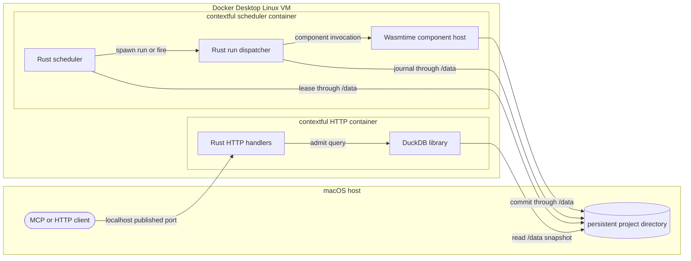
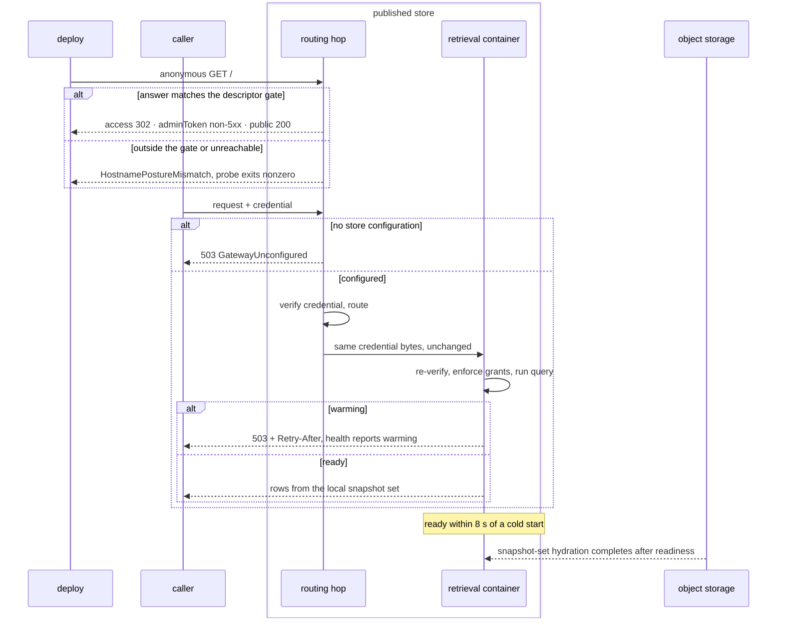
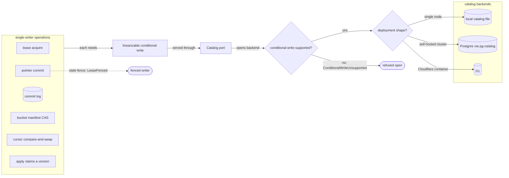

# System topology

Contextful runs connectors, stores Parquet files and serves queries under access controls.
Operators use this page to choose a binary and deployment. Implementers use the component,
dependency and coordination requirements below.

Deployment instructions name the executables, embedded libraries and storage services:

- [Linux](./targets.md#linux-reference): native processes or Linux containers.
- macOS: [native processes](#macos-without-docker) or [Docker containers](#macos-with-docker).
- [Cloudflare](./targets.md#cloudflare): Workers, Linux Containers, D1 and R2.
- [AWS](./targets.md#aws): Lambda, Fargate, Postgres and S3.

## compose

Execution, storage, queries, access controls and the contracts these components share.

- `workspace` — One Cargo workspace compiles execution, storage and query code. These components share one binary, package scope and release.
- `read-path` — Storage and query code manages the context store, catalog, queries, ranking, memory queries and bucket sync. A capability check admits each record before storage.
- `run-path` — Execution code manages the journal, scheduler, cursor commits, awakeables and journaled connector steps. Execution code owns no store or ranking.
- `three-crossings` — Execution, storage and query code share exactly three contracts: the connector interface world, columnar-part-plus-manifest layout and capability-token format. No general internal API connects these components.
  *A-topology#public-surfaces*
- `crossing-version` — Each shared contract has a version. Execution, storage and query code run its conformance suite. Adding a contract member requires a security review.
- `undeclared-crossing` — An execution crate depends on storage or query crates only through crates implementing the three shared contracts. {{assurance.gate.crate-graph}} checks each dependency.
  *A-topology#public-surfaces*
- `run-path-droppable` — A build without the execution engine, scheduler or component host reads data written by a full-profile build. Both builds use the same part-and-manifest layout and connector contract.
- `cli-binary` — The runtime ships one command binary, `contextful`, and one package scope, `@contextful/*`; release assurance follows {{assurance.consumer.suite}}. The smallest deployable build is a profile, not a crate.
- `mediation` — Each function returning or releasing stored rows requires an access-control admission value ({{assurance.gate.row-token}}). A call omitting that value fails to compile. Access controls have no disable option.
  *A-topology#enforcement-stack*
- `enforcement-span` — Execution enforces capability allowlists and records journal entries. Storage and queries enforce statement guards, visibility semi-joins, row and column restrictions, masking and the audit chain.
- `semantic-layer` — Access controls do not interpret content. Retrieval, memory synthesis, the operator console and inference placement interpret content and access enforcement through the three shared contracts alone.
- `one-tree` — Local and clustered deployments use one source tree. Single-node and edge deployments use no external queue, cache or coordination process. Multi-node deployments add one shared database.
- `queue-extension` — With a `queue` role, the target carries `receive` batches, object-arrival keys and post-commit wake-ups through the `Queue` port. Without that role, the target uses the local spool. Only the engine writes the store.
  *A-topology#queue-ingress*
- `queue-sqs` — With `CONTEXTFUL_QUEUE_URL` set, `receive` batches and object-arrival keys travel through that SQS standard queue, each request signed with Signature Version 4 under {{store.endpoint.role-credentials}}; post-commit wake-ups stay in the local spool.
  *because the `aws` target's queue role is an SQS standard queue, and its task holds a workload role rather than a key pair*
- `queue-sqs-absent` — A build linking no SQS adapter, given `CONTEXTFUL_QUEUE_URL`, refuses each queue use as {{topology.package.capability-absent}} and never falls back to the local spool.
  *because a batch queued where no consumer of the configured queue reads it is a batch lost*
- `queue-sqs-wait` — A receive long-polls the SQS queue for up to 20 s on its first call and waits on none after, stopping at the first empty answer.
  *because a long poll answers an idle queue with one request rather than many, and later calls drain what already waits*
- `queue-sqs-batch` — One SQS receive call asks for at most 10 messages.
  *because SQS answers no more per call*
- `queue-sqs-visibility` — A received SQS message stays hidden for 300 s; a consumer acknowledges it by deleting its receipt handle, and one left undeleted redelivers after that window.
  *because a batch's landing and push finish inside it, and a consumer that died must hand its messages to the next*
- `queue-sqs-cap` — An SQS message carries at most 1 MiB; a `receive` body past it spills under {{run.land.receive-queued-spill}} to the store's `[sync]` bucket beneath its prefix's `queue/spill/`.
  *because SQS refuses a larger message, and the store's bucket is the one object store every shape with a queue role already writes*
- `queue-object-notification` — An S3 event notification on the queue delivers one object-arrival key per `ObjectCreated` record, its key URL-decoded; a message holding none, the test event among them, is deleted and delivers nothing.
  *because S3 notifies object creation in its own envelope, and a message no read consumes must not redeliver forever*
- `connector-pillar` — A connector is an interface world run in a sandboxed component host that mediates every capability. A native connector, the first-party path for stateful sources, satisfies the same schema, record and cursor contract.
- `open-store` — Table data sits in columnar parts with a JSON manifest and a rebuildable catalog on plain object storage, readable by standard SQL tooling. No proprietary container or opaque blob holds table data.
- `inference-egress` — Model access leaves the process through one operator-configured endpoint speaking OpenAI-compatible HTTP. The one provider-shaped step serializes a tool's parameter schema into the provider's envelope.
  *A-topology#one-egress*
- `vendor-sdk` — A model-vendor SDK or second outbound model path raises `VendorSdkLinked` in the dependency audit. The error names the crate and dependency.
  *A-topology#one-egress*
- `local-first` — Pipelines need no network beyond their sources, and bucket sync is opt-in per deployment. The engine makes no control-plane callback, no license check, and sends no telemetry to its authors.
- `script-runtime` — A JavaScript runtime linked into any profile raises `ScriptRuntimeLinked`. The authoring surface is a build-time compiler emitting a serialized, content-hashed plan.
  *A-run#plan-compiled-content*
- `memory-substrate` — Synthesized memory uses ordinary store tables for episodes, facts, entities and preferences. The synthesis pipeline runs as an ordinary execution workflow using the same journal, cursor and retry machinery.
- `two-spines` — The run record describes writes. The request ledger describes reads. No third interface combines these records.

## package

Rust package dependencies and the capabilities each compiled binary includes.

- `crate-map` — Twenty crates compose the workspace. `contextful-cli` is the binary and wires every adapter per profile by dependency injection.
- `crate-map-drift` — An unmapped `crates/` package or {{topology.package.crate-map}} count differing from the `## Shapes` tree raises `CrateMapDrift`. The error names the package or both counts.
  *because a package added without a map entry otherwise passes every other gate*
- `domain-crate` — `contextful-core` holds the pure domain types and the port traits every adapter implements, performs no I/O, and links into every profile.
  *A-topology#domain-crate*
- `domain-impurity` — An async runtime, component host, HTTP client or columnar-format implementation in `contextful-core` raises `DomainCrateImpurity`. The error names the dependency and enabling feature.
  *A-topology#domain-crate*
- `dependency-direction` — A dependency edge from `contextful-core` toward an adapter crate raises `TopologyDependencyInversion`, naming both crates and the manifest line.
  *A-topology#domain-crate*
- `profile` — Three profiles compile from the workspace, each a Cargo feature bundle selected at build time: `contextful-edge`, `contextful-full`, `contextful-control`. Each links the dependencies its role names and nothing else.
  *A-topology#build-profiles*
- `fixed-at-build` — No run-time detection widens a running binary into another profile's feature set. Build, release and automation tooling links into no profile.
  *A-topology#build-profiles*
- `profile-leak` — A dependency outside a profile's role raises `ProfileRoleLeak`, naming the profile and dependency path. Disallowed dependencies include component hosts, execution or evaluation in edge/control; SQL in control; build tooling in any profile.
  *A-topology#build-profiles*
- `capability-absent` — A subcommand requiring an unlinked capability raises `ProfileCapabilityAbsent`, naming the subcommand and profile. The command performs no action. A subcommand absent from every profile is a usage error.
  *A-topology#build-profiles*
- `version-profile` — `contextful --version` prints the workspace version and selected build profile. A build selecting no profile prints `development` as its profile.
- `edge-profile` — `contextful-edge` syncs parts and manifests from a bucket and serves read-only SQL queries. This profile links no scheduler, execution engine, script runtime or component host.
- `edge-eligibility` — The edge profile is the one profile a function-class target hosts. Execution on such a deployment runs on a worker target.
- `full-profile` — `contextful-full` includes the execution engine, in-process scheduler, component host, SQL queries, transforms, full-text and vector sidecars, and tool server.
- `control-profile` — `contextful-control` provides self-hosted team configuration and operator identity. Apply produces canonical TOML. This profile alone links the CRDT library.
  *A-topology#control-crdt*
- `control-team-state` — The control profile stores ingest source, model and access-policy configuration in one `loro` document. Replicas merge concurrent edits. Apply uses this document as the editable configuration.
  *A-topology#control-crdt*
- `control-identity` — The control profile identifies an operator by {{surface.apply.operator-attestation}} alone, refusing an apply without one, and keeps no account store.
  *because the console already signs every Admin mutation, and a second account concept is a second identity to provision and revoke*
- `canonical-toml` — Apply sorts each table's keys by byte order and places nested tables after values. The format-preserving editor chooses quoting and spacing, preserving comments. Applying canonicalization to canonical text changes no byte.
  *because equal configurations then claim identical bytes, and a comment is the operator's record of why a value holds*
- `apply-home` — `contextful-snapshot` is the one home of the snapshot directory {{surface.apply.local-claim}} claims into; `contextful-engine` and `contextful-control` both call it, and it links no run-path package.
  *A-topology#control-crdt*
- `component-host` — Builds that link a component host run component connectors: the full profile and container or worker deployments built from that profile.
  *A-topology#build-profiles*
- `host-missing` — Dispatching a component connector without a component host raises `ComponentHostMissing`, naming the connector and profile. No similarly named native source substitutes.
  *A-topology#build-profiles*
- `crdt-leak` — The CRDT library in the resolved dependency graph of the edge or full profile raises `ProfileDependencyLeak`, naming the profile and the path that pulled it. A daemon or replica reads materialized text.
  *A-topology#build-profiles*
- `store-write-engine-free` — Without `read`, `contextful-context` excludes `duckdb`, `libduckdb-sys`, `libsqlite3-sys`, async runtimes, HTTP and TLS from normal dependencies on every target. A dependency reaching these raises `StoreWriteLinksEngine`, naming the package and path.
  *because a host that lands, folds or scans a store serves no read and opens no connection, so an engine, runtime or network stack is code it never calls*
- `transport-optional` — Without `transport-ureq`, `contextful-outbound` excludes `ureq`, `hyper`, `reqwest`, `rustls` and `curl` from normal dependencies. A dependency reaching these raises `TransportStackLinked`, naming the dependency path.
  *A-connector#egress-passes-transport*
- `decode-network-free` — `contextful-decode` reaching `contextful-outbound`, `ureq`, `hyper`, `reqwest`, `rustls`, `curl` or `tokio` through a normal dependency raises `DecodeLinksNetwork`, naming the path that pulled it.
  *A-connector#untrusted-input-decodes*
- `exchange-optional` — `contextful-policy` links the external-assertion stack, `jsonwebtoken` and `rsa`, only under its non-default `exchange` feature, which only the binary may enable, and only alongside wiring {{authority.exchange.surface}}. Another `crates/` package whose resolved graph reaches either raises `ExchangeDependencyLeak`, naming the path.
  *because an embedder admitting credentials with no identity provider then links no RSA code, and `rsa` carries a timing advisory with no patched release*
- `sqlite-adapter` — `contextful-sqlite` alone declares the SQLite binding as a normal dependency and enables no link feature itself; only `contextful-cli` turns on its `bundled` feature. Any other normal-dependency declaration or enablement raises `SqliteLinkForced`, naming the manifest line.
  *A-store#sqlite-link-rule*
- `s3-sync-optional` — Without `s3-sync`, `contextful-sync` excludes `ureq`, `hyper`, `reqwest`, `rustls` and `curl` from normal dependencies. A dependency reaching these raises `SyncStackLinked`, naming the dependency path.
  *because a host syncing through a filesystem bucket, or embedding the sync package without a bucket, links no network stack*
- `store-sqlite-free` — `contextful-context` reaching `libsqlite3-sys` through a normal dependency, with its default features, on any target, raises `StoreLinksSqlite`, naming the path that pulled it.
  *A-store#sqlite-link-rule*
- `interchange-whole` — The edge profile links the columnar interchange crates whole, as the full profile does; no slimmed interchange build exists.
  *because a slimmed build forks the format code an edge replica reads with from the code the full profile writes with*

Each profile selects the capabilities of one `contextful` executable at compilation.
Deployment diagrams show where that executable runs: directly on Linux or macOS, or inside a Linux container.

unsettled: Does the edge profile pull native connectors through an execution core that links no scheduler? owner: topology affects: topology.package

## deploy

Deployment configurations, provider services and comparison against the reference deployment.

- `unsupported-shape` — A target profile claiming a shape its provider does not provide raises `TargetShapeUnsupported`, naming the shape and the missing primitive.
  *A-topology#deploy-observation*
- `wall-clock-cap` — A target capping per-invocation wall clock at 15 min hosts neither a first-time backfill nor a component connector, and its target profile records both exclusions.
- `parity` — One declaration produces byte-identical table parts on every control-plane target. The parity check compares each target's object-store parts with the reference parts after a 24 h soak.
  *A-topology#deploy-observation*
- `parity-divergence` — A byte difference from the reference output raises `ParityDivergence`, naming the target, the table and the first differing part.
  *A-topology#deploy-observation*

Provider configurations live under `spec/targets/`; `corpus.targets` checks those files.
The generated [deployment tables and diagrams](./targets.md) identify processes, embedded
libraries and provider services. Diagram groups distinguish process, container and operating-system boundaries.

### Native Linux deployment

The Linux reference map below places the scheduler, its run children, HTTP server and
embedded libraries on one host. Each service uses the same project directory, including
`contextful.toml`, applied control snapshots, execution files and corpus files. The
directory persists across process restarts; the optional console has its own Node.js
process and configured Rust HTTP endpoint.

The examples assume an existing project with an applied snapshot, readable `issuer.key`,
independently configured issuer public-key pins, and the source credentials its declaration
names. The scheduler and HTTP server inherit that environment. `contextful-local` is the
example token audience; `4` is the example HTTP concurrency setting. From that project's
directory, two terminals or two service-manager units run:

```sh
contextful pipeline serve --issuer-key issuer.key
```

```sh
contextful serve --http 127.0.0.1:8080 --issuer-key issuer.key \
  --audience contextful-local --max-in-flight 4
```

Linux Docker Engine also runs the image and container commands below, sharing the host's
Linux kernel. Docker Desktop on macOS adds the Linux VM shown in the Docker map.

### macOS without Docker

<a id="macos-reference"></a>

Apple Silicon uses the `aarch64-apple-darwin` executable; Intel uses
`x86_64-apple-darwin`. From the repository root, a native source installation selects
the full profile:

```sh
cargo install --locked --path crates/contextful-cli \
  --no-default-features --features contextful-full
```

The project's two startup commands above run directly as macOS processes. Wasmtime,
Tokio, DuckDB and SQLite stay embedded in those processes. For managed startup, launchd supervises the scheduler and HTTP server.
Project state sits on the Mac's filesystem. This path uses the Darwin binary and a native
Rust/C++ build toolchain, with no Linux VM or Docker daemon. The optional Node.js console
uses `http://127.0.0.1:8080` as its configured store endpoint.

### macOS with Docker

Docker Desktop supplies a Linux VM; its Docker Engine runs the same Linux image a Linux
server uses. The Rust processes and embedded libraries run inside containers in that VM.
The browser and optional native Node.js console reach a published localhost port.

The image build runs from the repository root. Apple Silicon selects ARM64 explicitly:

```sh
docker build --platform linux/arm64 --build-arg PLATFORM=linux/arm64 \
  --build-arg RUST_TARGET=aarch64-unknown-linux-musl -t contextful:local .
```

Intel Macs select AMD64; this also selects an emulated AMD64 build on Apple Silicon:

```sh
docker build --platform linux/amd64 --build-arg PLATFORM=linux/amd64 \
  --build-arg RUST_TARGET=x86_64-unknown-linux-musl -t contextful:local .
```

The Dockerfile's `PLATFORM` and `RUST_TARGET` arguments select matching builder and
executable architectures. `--platform` alone leaves the Dockerfile's AMD64 defaults in
place. Emulation adds translation cost; an ARM64 image matches an Apple Silicon Linux VM.

From the existing project directory, these commands use a shared bind mount at `/data`.
`runtime.env` supplies the configured public-key pins and source credentials through
Docker's `--env-file`; the issuer seed stays in `issuer.key`. The invoking non-root user's
UID and GID keep writes owned by the project owner. Each terminal runs one container:

```sh
docker run --rm --init --name contextful-scheduler \
  --user "$(id -u):$(id -g)" --env-file runtime.env \
  --mount "type=bind,src=$PWD,dst=/data" \
  contextful:local pipeline serve --issuer-key /data/issuer.key
```

```sh
docker run --rm --init --name contextful-http \
  --user "$(id -u):$(id -g)" --env-file runtime.env \
  --mount "type=bind,src=$PWD,dst=/data" -p 127.0.0.1:8080:8080 \
  contextful:local serve --http 0.0.0.0:8080 --issuer-key /data/issuer.key \
  --audience contextful-local --max-in-flight 4
```

The container listens on `0.0.0.0:8080`; Docker publishes it at `127.0.0.1:8080` on
macOS. `/data` persists in the host project directory when `--rm` removes a container.
A Docker named volume stores project state when the operator copies configuration and
keys into that volume. Both containers mount the same volume. A project uses one
writer mode at a time: switching between native and Docker stops its scheduler and run
children before reusing the directory.

Declared file and component paths resolve inside the container; files outside `/data`
need an explicit mount. A source or model endpoint running on the Mac uses
`host.docker.internal` from Docker Desktop containers. Container `localhost` names the
container itself; the native console uses the published Mac loopback port.

The Linux VM contains the containers; the project directory remains on macOS through
Docker's file sharing.



unsettled: Which role hosts heavy compute on a provider exposing neither a container primitive nor a long-running function? owner: topology affects: topology.deploy

## publish-hostname

Hostname access policies, deployment checks and requests through the routing service to the query container.

- `posture-mismatch` — An unreachable hostname or response outside its declared access policy raises `HostnamePostureMismatch`, naming the hostname, policy and observed response. `contextful-ci deploy probe` exits nonzero.
  *A-topology#posture-probe*
- `probe-table` — Before probing hostnames, the deploy tool compares descriptor and probe-table entries. An entry missing from either set raises `ProbeTableDrift`, naming the hostname and missing side.
  *A-topology#posture-probe*
- `empty-probe` — An absent descriptor directory, absent probe table or empty hostname set raises `ProbeSetEmpty`, naming the path. A passing probe checks at least one hostname.
  *because a probe that checks nothing and exits zero reads as a proven posture to the pipeline that invoked it.*
- `unknown-field` — An unmodelled descriptor property raises `DescriptorUnknownField`, naming the key and contract version. The decoder rejects the descriptor.
  *P1*
- `unconfigured-gateway` — A routing hop with no store configuration answers `503` on every route and raises `GatewayUnconfigured`.
  *P3*
- `issuer-key` — The HTTP server requires a verification key that resolves and parses. An unusable key raises `IssuerKeyUnusable`, naming the input, and prevents startup. The server generates no replacement key.
  *P3*
- `container-readiness` — A retrieval container reaches readiness within 8 s of a cold start, before its snapshot-set hydration completes.

The deployment tool checks anonymous access. A caller then sends a request through the router to the query container.



## coordinate

Conditional metadata updates, writer leases and the databases that store coordination state.

- `primitive` — Coordination rests on one property: a linearizable conditional write. No component depends on a stronger one, and the tree ships no consensus implementation or external coordination service.
  *A-store#coordination-probed-compare*
- `inventory` — Single-writer operations comprise lease-row updates, cursor compare-and-swap, {{store.fold.pointer-commit}}, lease acquisition, leased pipeline commit-log entries, bucket manifest commits and configuration version claims. No other operation needs a single writer.
  *A-store#coordination-probed-compare*
- `lease-row` — A lease key names a pipeline, source partition, table compaction or deployment cadence. One conditional update assigns the row's holder, expiry instant and fence.
  *A-store#coordination-probed-compare*
- `catalog-clock` — The catalog evaluates a lease row's expiry against its own clock, never a caller-supplied instant.
  *A-store#coordination-probed-compare*
- `fence-advances` — Each acquisition of a lease row increments its fence, and release keeps the fence, so the fence never repeats for a key.
  *A-store#coordination-probed-compare*
- `fenced-commit` — A commit under a lease is a conditional write predicated on the holder's fence; a predicate matching nothing is {{store.lease.stale-fence}}.
  *A-store#coordination-probed-compare*
- `cursor-cas` — A cursor compare-and-swap is one conditional update predicated on the stored version, read back by its affected-row count.
  *A-store#store-s-catalogs*
- `cadence-lease-ttl` — The catalog grants a cadence lease for 90 s.
  *A-store#coordination-probed-compare*
- `cadence-lease-renewal` — The reconciler renews a cadence lease every 30 s while its applied document schedules a dispatchable unit.
  *A-store#coordination-probed-compare*
- `cadence-fallback` — A deployment's fallback cron fires only after taking the cadence lease itself, so one fire holds the current fence.
  *A-store#coordination-probed-compare*
- `catalog-port` — Engine code accesses catalog backends through the `Catalog` trait without naming a backend. `contextful-cli` selects the backend through dependency injection.
  *A-store#store-s-catalogs*
- `backends` — Single-node self-hosting uses a local catalog file. Clusters use Postgres through `pg-catalog`. Cloudflare execution uses D1 through `d1-catalog`.
  *A-store#store-s-catalogs, A-topology#cloudflare-d1*
- `catalog-url` — With `pg-catalog`, `CONTEXTFUL_CATALOG_URL` selects the named Postgres catalog instead of the local file. Without `pg-catalog`, setting this variable raises {{topology.package.capability-absent}}.
  *because a daemon falling back to its own file while its peers share the database holds leases no peer sees*
- `postgres-transport` — Beyond loopback or Unix sockets, PostgreSQL requires TLS with WebPKI roots and hostname verification. Disabling TLS there raises `DatabaseTransportUnprotected` before DNS resolution. Preferred TLS mode permits no plaintext fallback there.
  *because remote execution state and database credentials cross an untrusted network boundary*
- `postgres-ca-bundle` — `sslrootcert=<path>` in the connection string names a PEM bundle whose roots replace the WebPKI roots of {{topology.coordinate.postgres-transport}} for that connection; hostname verification still applies.
  *because a managed database such as RDS chains its server certificate to a provider CA that WebPKI omits*
- `postgres-ca-unreadable` — An `sslrootcert` path that is unreadable or holds no certificate raises `DatabaseCaBundleUnreadable`, naming the path, before connecting.
  *because a silent fallback to WebPKI roots fails later as an unknown issuer and hides the misconfigured path*
- `postgres-verify-modes` — `sslmode=verify-ca` and `sslmode=verify-full` parse and require TLS on every host, verifying the server's chain and hostname as {{topology.coordinate.postgres-transport}} does.
- `postgres-system-roots` — `sslrootcert=system` selects the WebPKI roots of {{topology.coordinate.postgres-transport}}, as libpq's `system` value does, and reads no file.
- `weak-backend` — A catalog backend whose conditional update is not linearizable refuses at open with {{surface.apply.weak-conditional-backend}}.
  *A-store#coordination-probed-compare*
- `cluster-availability` — Cluster availability is the shared database's availability. The engine adds no replication and no failover protocol between daemons.
- `air-gap` — Single-node and edge deployments reach no process outside themselves for coordination, and run air-gapped with only their sources reachable.
- `no-clustered-catalog` — Clustered availability behind the `Catalog` port comes from Postgres alone; the tree ships no self-contained clustered catalog.
  *because a separate clustered catalog duplicates Postgres replication*

Every single-writer operation reduces to one linearizable conditional write behind the
`Catalog` port.



unsettled: Does an encrypted store seal its rows in the Postgres catalog, or keep refusing that pairing at open? owner: topology affects: topology.coordinate


## bound-application

Responsibilities of the engine and applications that use the engine.

- `domain-neutral` — The engine processes declared data, schemas, policies, time bounds and capabilities. Consumer configuration, connectors, components or explicitly selected evaluation profiles supply domain meanings, business rules and sector-specific metrics.
  *A-topology#public-surfaces*
- `restated-case` — A case with neither a generated artifact nor a callable route stays with the application, which restates the engine rule at its site under {{assurance.structure-tree.mirror-exemption}}.
  *because a restatement naming its clause id surfaces when the rule changes, and an adapter for one case costs more than it guards*

## Shapes

The workspace:

```
crates/
  contextful-core/         pure domain types and ports, no I/O
  contextful-fs/           exclusive-create publish the store and the journal share
  contextful-engine/       runner, journal, catalog, awakeables, cancellation
  contextful-outbound/     mediated client, credential resolution, quota metering, inference
  contextful-wasm/         sandboxed component host
  contextful-connectors/   native sources
  contextful-decode/       record decoders: JSON, JSON Lines, delimited text, workbook
  contextful-context/      table parts, query face, snapshot commit, retrieval
  contextful-memory/       deterministic memory synthesis
  contextful-sqlite/       the SQLite adapter behind the catalog and run store ports
  contextful-pg/           the Postgres adapter behind the catalog port
  contextful-d1/           the D1 adapter behind the execution store ports
  contextful-policy/       predicates, masks, redaction, zones, audit chain, token trait
  contextful-sync/         bucket push and pull
  contextful-agent/        tool server and connector scaffolder
  contextful-eval/         read-path quality harness
  contextful-snapshot/     control snapshot directory: versions, pointer, drafts, receipts
  contextful-control/      control plane; the one CRDT consumer
  contextful-cli/          the `contextful` binary; dependency injection per profile
  acceptance/              black-box suite driving the built binary
contextful.toml            the deployment declaration, identical across providers
```

The three profiles as feature bundles:

```toml
[features]
contextful-edge    = ["read-plane", "transport-ureq", "s3-sync"]
contextful-full    = ["data-plane", "transport-ureq", "s3-sync", "drive", "component-host", "pg-catalog", "d1-catalog", "aws-secrets-manager"]
contextful-control = ["dep:contextful-control"]
```

A published-hostname descriptor:

```jsonc
{ "contract": 1, "worker": "contextful-docs", "hostname": "docs.example.org",
  "gate": { "_tag": "public", "acknowledged": true } }
```

A lease row and a fenced cursor commit, as the `Catalog` port issues them:

```sql
-- acquire: the catalog's clock decides expiry; the fence only grows
UPDATE leases SET holder = :me, expires_at = now() + :ttl, fence = fence + 1
 WHERE key = :key AND (holder IS NULL OR expires_at < now());

-- commit: one conditional update, predicated on version and on the holder's fence
UPDATE cursors SET position = :pos, version = version + 1
 WHERE stream = :stream AND version = :v
   AND EXISTS (SELECT 1 FROM leases WHERE key = :key AND fence = :fence);
```
