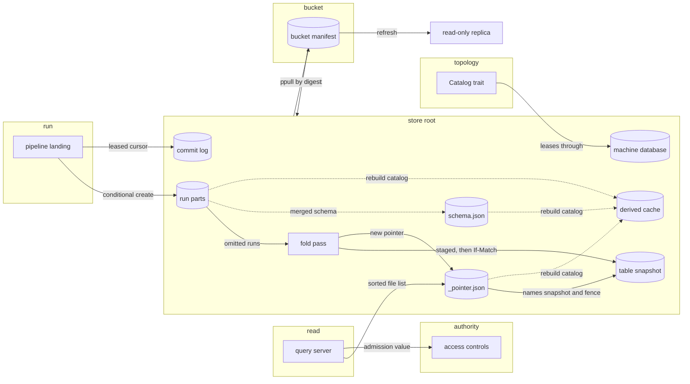
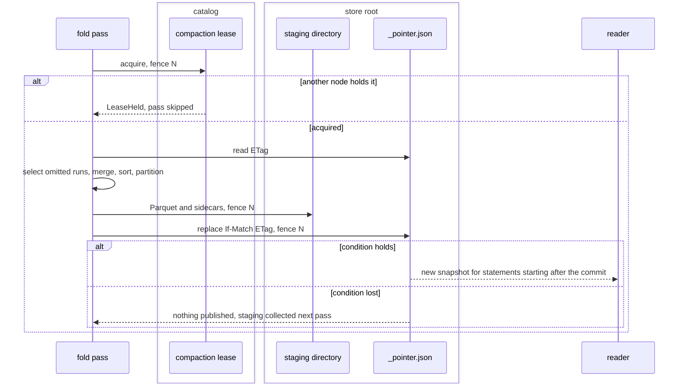
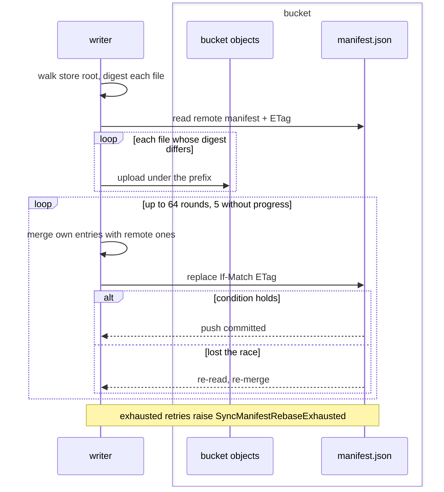

# The store and its sync

The store holds canonical Parquet data, JSON manifests and a pointer to each table's current snapshot, which readers open without the engine.
Two local SQLite catalogs cache metadata and hold machine state, and an S3-compatible bucket mirrors the tree key for key.



## lay-out

Store directories, run and snapshot manifests, table pointers, local catalogs and node identifiers.

- `components` — A store holds Parquet table data, JSON run and snapshot manifests, one pointer object per table, landed blobs, and SQLite catalogs `derived.sqlite` and `machine.sqlite`. Parquet, manifests and pointers are canonical.
  *because a catalog both rebuildable and a commit point resurrects half-published snapshots on rebuild*
- `store-root` — A project's store sits at `.contextful/context/<project>/`, holding both catalogs, `config.toml`, `cursors/` and one `tables/<t>/` directory per table.
- `table-directory` — A table directory holds `schema.json`, `_pointer.json`, `data/snapshots/<id>/`, `data/runs/<run-id>/<node-id>/` and `requests/`.
- `snapshot-id` — A snapshot id is `snapshot-` and a nanosecond value zero-padded to 20 chars: the greater of the commit instant and the previous id plus one.
  *because a wall clock that steps backwards breaks lexical order equalling commit order*
- `part-name` — A data file is `part-<ordinal>.parquet`, the ordinal zero-padded to five digits and unique within its directory.
- `staging` — A running fold writes under `data/snapshots/<id>.staging/`. File lists exclude that directory.
- `snapshot-manifest` — A snapshot's `_manifest.json` holds a `lay_out::SnapshotManifest`, and each entry of `parts` and `indexes` carries its `key_version`.
- `ancestors` — A snapshot manifest records `ancestors`, its parent then the parent's `ancestors`, at most 256 entries; a root, or a child of a parent lacking the field, records none.
  *because retention collects superseded snapshots, and a push decides descent from the snapshot's own manifest*
- `folded-index` — A snapshot manifest's `folded_runs` names Parquet segments whose rows list each run its chain folds, by run key and folding snapshot with commit instant, `_commit_seq`, `batch_digest` and row count, and `through`, the snapshot they describe.
  *A-store#folded-index*
- `folded-index-valid` — A reader trusts `folded_runs` only where it decodes, `through` names its snapshot and every segment reads at its recorded digest and row count, and otherwise walks, so the index never names fewer runs than the walk.
  *A-store#folded-index*
- `folded-index-walk` — An unbounded read reads the pointer's snapshot and its parents down to the first valid index; a bounded read reads on to the first snapshot created at or before its bound.
  *A-store#folded-index*
- `unrecognised-index-entry` — An `indexes` entry of unsupported kind or fields parses as unrecognised: the manifest stays readable, probes ignore the entry and rewrites keep it byte for byte.
  *because an older build neither refuses nor drops a newer builder's sidecar*
- `table-pointer` — `tables/<t>/_pointer.json` names the table's current snapshot and commit fence; readers reach only snapshots reachable from it directly or through `parent` links.
  *A-store#manifest-carries-format*
- `schema-file` — A table's schema is `schema.json` in Arrow JSON form, which each arriving batch's schema merges into and the merged result replaces.
- `immutable-files` — The store writes each run file once and edits none; snapshot directories are immutable save the `_collected.json` {{store.collect.manifest-kept}} lists, so a fold writes a new snapshot.
- `landed-blob` — A body landed by reference occupies `blobs/<sha256>` under the store root, named by its bytes' SHA-256 and written whole through a rename before the referencing run commits.
  *because a committed row naming no stored body answers for content nobody can retrieve*
- `derived-catalog` — `derived.sqlite` is a cache: `contextful context rebuild-catalog` reconstructs it from pointers, reachable manifests, committed run manifests and every `schema.json`, and sync excludes it.
  *A-store#store-s-catalogs*
- `machine-catalog` — `machine.sqlite` holds the machine's journal, cursor cache, leases and run-row cache; sync excludes it and pull preserves it. Rebuild refills run rows from {{run.record.reserved-table}} only when none exists, and rebuilds nothing else.
  *A-store#machine-catalog-seals*
- `catalog-ports` — The store accesses `machine.sqlite` through {{topology.coordinate.catalog-port}} and `derived.sqlite` through `DerivedCatalog`. Both traits reside in `contextful-core`; `contextful-sqlite` implements both. A host implements either trait over its own connection.
  *A-store#store-s-catalogs*
- `unknown-table` — A table name absent from every `schema.json` raises `StoreUnknownTable` rather than returning an empty result.
  *P1*

### run manifests

A run commits through its manifest, and a repeated landing replays or refuses.

- `run-manifest` — A run commits by conditionally creating its node directory's `_manifest.json`, a `lay_out::RunManifest` whose `node_id` equals the directory's node segment.
- `run-replay` — Re-landing an unlogged run committed on its node, at its manifest's position with rows reconstructing its parts column for column, writes nothing and returns the committed manifest as a replay.
  *because a retry after a lost acknowledgement cannot tell whether its first landing committed*
- `run-conflict` — Any other landing under a run id committed on its node or folded under its run key raises `StoreRunConflict`, naming the run, and changes nothing; a folded row without `batch_digest` predates digests and always conflicts.
  *because other rows under a committed id are another run*
- `run-digest` — A landing's run manifest records `batch_digest`, the SHA-256 of its batches' producer rows and fixed column types after writer rules, and of its position; injected columns and the commit instant stay outside it.
  *A-store#run-digest*
- `run-folded-replay` — Re-landing a run whose manifest is gone and whose key the table's folded runs name, with an equal `batch_digest`, writes nothing and returns a replay carrying the folded-runs row in place of a manifest.
  *A-store#run-digest*
- `folded-committed` — `Store::committed_rows` answers a run whose manifest a collection removed from its folded-runs rows, summing their row counts; a run only a walked snapshot names, or one without a count, reads as uncommitted.
  *A-store#run-digest*
- `run-id-shape` — A run id holds at most 128 chars of letters, digits, dot, underscore and hyphen; landing and request-ledger append reject any other before writing a file.
  *because a run id is interpolated into run directories and request-ledger filenames*
- `uncommitted-run` — A node directory without `_manifest.json` holds an uncommitted run, whose parts file lists exclude; a leased pipeline's run also waits for its commit-log entry.
  *P4*
- `cursor-in-commit` — A pipeline's committed position is its newest commit-log cursor when leased, else its highest run-manifest cursor; `machine.sqlite` caches it.
  *because a position committed apart from its rows re-lands the batch after a crash*

### format versions

Each manifest names its layout version.

- `manifest-default` — A field added to a manifest carries a default value.
- `format-version` — Run and snapshot manifests carry `format_version` as `<major>.<minor>`: major `2` for snapshots referencing parts or segments, else `1`; minor `1` for snapshots carrying `folded_runs`, else `0`. An absent version reads as `1.0`; readers parse a newer minor as their own.
  *A-store#manifest-carries-format*
- `format-newer` — A run or snapshot manifest of a newer `format_version` major raises `StoreManifestFormatNewer`, naming the file and both versions, and the table refuses reads until a newer build reads it.
  *A-store#manifest-carries-format*
- `format-migrate` — A major-`2` reader reads a `1.x` snapshot manifest as one part per directory, counting rows from footers; the next pass references those parts under major `2`, rewriting no manifest in place.
  *A-store#manifest-carries-format*
- `manifest-unreadable` — A run manifest or reachable snapshot manifest failing to parse raises `StoreManifestUnreadable`, naming the table and file; the table refuses reads until it parses.
  *P4*

### node identity

Each machine resolves one node id that keeps its files apart.

- `node-segment` — The `<node-id>` segment of run directories and ledger filenames keeps apart two machines writing one logical run id.
- `node-id-order` — A process resolves its node id once: `CONTEXTFUL_NODE_ID`, then `[node] id`, then {{store.lay-out.node-id-project}}.
- `node-id-project` — A project's default node id is `node-<8 hex>` of SHA-256 over the host id and absolute store root, so two checkouts on one host write as distinct nodes.
  *because a pull skips every key under its own node id, another checkout's runs included*
- `node-id-state-path` — The host id, a random `node-<8 hex>` generated once, persists outside the store root under `$CONTEXTFUL_STATE_DIR`, else `$XDG_STATE_HOME/contextful`, else the platform user-state directory.
  *because a copied store carrying its identity makes two machines one holder*
- `node-id-shape` — A node id over 64 chars or outside `^[A-Za-z0-9._-]+$` raises `StoreNodeIdInvalid` at process start, before any path, key or lease carries it.
  *P3*
- `node-id-shared` — A `[node]` block in a manifest, control-plane snapshots included, raises `StoreNodeIdShared` before {{run.model.top-level-block}}, naming the file and the store root's `config.toml` as the node id's home.
  *because a control-plane snapshot applies to every machine reconciling it, making one id many holders*
- `node-id-local` — A machine with no writable state directory takes the reserved node id `local`.

unsettled: Does a store re-bind the node id it last derived, so runs landed before its root moved push without `CONTEXTFUL_NODE_ID`? owner: store affects: store.lay-out

## init

Project initialization, and project discovery when a command omits `--project`.

- `declaration-file` — `contextful init <name>` writes `[project] name = "<name>"` into the working directory's `contextful.toml`, appending to a file declaring no `project` key and keeping its bytes, and creates the store root {{store.lay-out.store-root}} beside it.
- `store-identity` — An initialized store holds one synced, canonical version-4 UUID in `store-id`, which repeated init and clones keep and a recreated root replaces.
  *A-store#synced-uuid-binds*
- `identity-invalid` — A malformed `store-id`, or an owner mint naming no initialized store root, raises `StoreIdentityInvalid`.
  *A-store#synced-uuid-binds*
- `name-conflict` — A project name other than `/`-separated `[A-Za-z0-9._-]` segments, or with a `.` or `..` segment, raises `StoreProjectNameInvalid` before file access; a `contextful.toml` naming another project or no string `name` raises `StoreProjectConflict`, writing nothing.
  *because the name enters every project path, so a traversing segment escapes it*
- `repeat` — If `contextful.toml` declares the same `[project] name`, init succeeds, keeps store content and rewrites only the posture under {{store.init.posture}} and a missing {{store.init.store-identity}}.
  *because scripts and onboarding run init unconditionally*
- `posture` — `contextful init <name> --authoring-posture <posture>` prepends `authoring_posture = "<posture>"` under {{authority.issue.posture-key}} when `contextful.toml` declares none, preserving every other byte; init keeps a declared posture and, without the flag, writes none.
  *because the posture decides whether a credential-less write lands*
- `discovery` — Without `--project`, a command takes the `[project] name` of the nearest `contextful.toml` at or above the working directory, basing the store root, `.contextful/run/<project>/` and `.contextful/memory/<project>/` on its directory.
- `default-declaration` — Under `--project`, a command runs no discovery and bases every path {{store.init.discovery}} names on the working directory. Without `--declaration`, it reads the discovered `contextful.toml`, or the working directory's under `--project`.
- `declaration-base` — A located project resolves relative declaration paths, a derive binding's `media_root` and path-form `command[0]` included, against its base directory rather than the working directory.
  *because a pipeline otherwise reads different media or programs per subdirectory it fires from*
- `undiscovered` — Without `--project`, a command raises `StoreProjectUndiscovered`, naming the starting directory, when no `contextful.toml` sits at or above it or the nearest lacks `[project] name`.
  *because a store opened at a guessed root splits one project's rows across two trees*

#### Scenarios

- `store.init.repeat`: WHEN `contextful init research` runs twice in one directory, THEN the second run succeeds and `contextful.toml` holds the bytes the first wrote.
- `store.init.name-conflict`: WHEN `contextful init archive` runs beside a `contextful.toml` naming `research`, THEN the command raises `StoreProjectConflict` and preserves the file.
- `store.init.declaration-base`: WHEN `contextful pipeline run` fires in `notes/` below a `contextful.toml` binding `media_root = "media"`, THEN media resolves under `media/` beside that file, not `notes/media/`.
- `store.init.posture`: WHEN `contextful init research` runs without `--authoring-posture`, THEN a following `contextful context land` raises `AuthoringPostureUndeclared`, and after `contextful init research --authoring-posture per_request` the same land commits.
- `store.init.discovery`: WHEN `contextful context land` runs in `notes/` below a directory where `contextful init research --authoring-posture per_request` ran, THEN the run commits under that directory's `.contextful/context/research/`.

## declare

Table declarations, primary keys, row ordering, write modes and replacement behavior.

- `table-block` — A table block takes {{type:contextful_core::store::declare::TableDecl}}, canonical serialization omitting unset keys. A key applies from the next read, rewriting no committed part; `columns` types every landing under {{store.reconcile.typed-landing}}.
  *because a JSON value alone cannot say it carries bytes or a vector*
- `erasure-metadata` — An erasure declaration names, in keys of {{type:contextful_core::store::declare::TableDecl}}, the table's erasure key, the table and column references citing it, and whether citing rows survive erasure.
  *A-disclosure#erasure-forced-rewrite*
- `retain-rows` — `retain_rows = { column = "<name>", age = "<n>d" }` takes `_ingested_at` or a declared Timestamp column; another column or a null value raises `StoreRetentionColumnInvalid` before landing, and a malformed age refuses the declaration.
  *because a sender's clock cannot move the arrival time, and a null clock never expires*
- `two-genres` — A table holds connector items or synthesized artifacts, whose kind is an open string; both append, deduplicate on content and carry a timestamp.
- `unkeyed-union` — A table declaring no `primary_key` reads as the byte-identical union of its visible committed runs, under {{store.declare.replace-frontier}} when replacing.
- `dedup-view` — A keyed table reads through `ROW_NUMBER() OVER (PARTITION BY <pk> ORDER BY <order_by> DESC, _ingested_at DESC, _run_id DESC, _row_seq DESC) = 1` over the current snapshot, if any, unioned with the committed runs it omits.
  *because a keyed table read as a union before its first fold inflates every aggregate*
- `order-by-default` — `order_by` names the column picking each key's surviving row, default `_ingested_at`.
- `key-unknown` — A `primary_key` or `order_by` naming a column neither declared nor injected raises `StoreKeyUnknownColumn` or `StoreOrderByUnknownColumn`, and a struct, list or map column in a key, ordering, clustering, partition or valid-time role raises `StoreNestedKeyColumn`, at validation.
  *because an absent column reads as null and a nested one has no total order*
- `replace-frontier` — `write_mode` is `append`, the default, retiring no key, or `replace`, whose read covers the newest complete-state run and every later run; displaced runs stay until `retain_runs` expires, with no erasure receipt or lineage traversal.
- `empty-run` — A zero-row run commits a manifest with no parts, replacing nothing without {{store.declare.empty-replacement}}; a table with no rows registers as a zero-row relation over its declared and injected columns.
- `empty-replacement` — A complete zero-row `replace` run marks its manifest a replacement frontier, which push, pull and fold preserve; current reads exclude earlier files, and bounded reads before it keep earlier rows within retention.
  *A-store#sidecar-names-id*
- `fold-job` — A `[[job]]` of kind `fold` with a `schedule`, `enabled` absent or true and `target` absent or naming the table's destination covers the table; `pipeline validate` warns on stderr for each keyed table no job covers.
  *A-store#sidecar-names-id*
- `declaration-set` — The project's tables combine its declaration with adjacent `pipelines/*.toml` and `pipelines/*.json`, `[pipeline]` tables as named and specification tables under {{run.declare.table-name}}; queries and every `sync` verb use this set.
  *because a key declared only where `pipeline run` reads it leaves every other verb treating the table as unkeyed*

unsettled: What retires a key a source stops serving under `append`, given the source-side deletion is invisible in the tree? owner: store affects: store.declare

## reserve

Reserved column and table names, injected columns, `_commit_seq` assignment and request ledgers.

- `underscore-namespace` — Column names beginning `_` belong to the engine: the injected set and the reserved optional set.
- `injected` — The engine injects non-null `_ingested_at` as Parquet `TIMESTAMP(UTC, NANOS)`, `_run_id`, `_site_id`, int32 `_batch_seq` within a batch scope, and `_authored_by` for writes an authenticated subject authorized, replacing producer values.
  *because a string instant does not sort by time once fractions or offsets appear*
- `authored-agent` — Where an authenticated subject with an agent member authorized the write, the engine injects that agent as `_authored_agent` beside `_authored_by`, replacing any producer value.
  *because {{authority.place.per-principal}} matches an agent or the person it acts for*
- `row-seq` — The engine injects `_row_seq`, a non-null int64 numbering a run's rows from 0 in batch order, replacing any producer value.
  *because a run's rows share `_ingested_at` and `_run_id`, and last-write-per-key needs an order among them*
- `no-placeholder` — A path with no batch scope or no authenticated subject omits that column instead of writing nulls.
- `taint` — On each row from model output, the engine injects `_taint` under {{connector.infer.provenance-order}}, replacing any producer value; other rows omit `_taint`.
  *because a label a producer sets is one injected text can forge*
- `optional` — A producer sets any of `_modality`, `_lang`, a BCP-47 tag, `_provenance`, the evidence rows addressed by the source table's key, and `_prompt_hash`, `sha256:<hex>` over the prompt template rather than the rendered prompt; each surfaces in the provenance envelope.
- `modality` — `_modality` takes text, image, audio, structured or mixed; another value fails its batch's validation.
  *A-run#passage-s-modality*
- `column-name` — A producer column inside the `_` namespace and outside the optional set raises `StoreReservedColumnName` at reconciliation, before any Parquet.
  *P1*
- `table-namespaces` — The engine reserves three table namespaces: `_runs`, the durable run record; `_items`, item records under {{run.items.outcome-record}}; `_visibility`, each source's mirrored access tables under {{disclosure.mirror.grants-table}}.
- `table-name` — Manifest assembly raises `StoreReservedTableName` for a pipeline table inside a reserved namespace, naming the reservation.
  *P1*

### commit

A commit holds its table's commit lock, assigns `_commit_seq` above every held value and publishes in sequence order.

- `commit-seq` — The engine injects non-null int64 `_commit_seq` above every value the table holds, so a run committing after a read carries a value above every returned row, whatever its `_ingested_at`.
  *A-topology#commit-lock*
- `commit-order` — A commit publishes its manifest once every lower `_commit_seq` of the table publishes or ends landing, so readable runs form a prefix of the commit sequence.
  *A-topology#commit-lock*
- `commit-lock-span` — A commit holds its table's commit lock while assigning `_commit_seq` and writing its manifest. The commit writes parts outside the lock, except when the table keeps vintage history.
  *A-topology#commit-lock*
- `commit-wait` — A commit waits at most 30 s for its table's commit lock or for a lower value's publication, then raises `StoreCommitLockTimeout`, a transient failure.
  *A-topology#commit-lock*
- `commit-marker` — A commit rewrites `data/.commit_seq` as JSON with `format_version` and `commit_seq`. Builds reading a bare integer refuse the table before writing a part. A newer major refuses under {{store.lay-out.format-newer}}.
  *A-topology#commit-lock*
- `commit-seq-seed` — A commit assigns one above the greatest `commit_seq` in the node's counter, run manifests and current snapshot, so a pulled or counterless store reuses no value.
  *A-topology#commit-lock*

### request ledgers

Each run appends its outbound requests to its own ledger file, which fold passes merge and collection retires.

- `ledger-suffix` — Table names ending `__requests` name request-ledger relations; any other declaration with that suffix refuses under {{store.reserve.table-name}}.
- `ledger-path` — A run's request ledger is `requests/<run-id>.<node-id>.parquet`, disjoint per run and per writing node.
- `ledger-append` — An append locks its run's ledger file and returns after syncing its rows and the rename to disk.
- `ledger-fold` — Each fold pass merges a table's committed ledger files into `requests/folded-<snapshot-id>.parquet`, and a replica carries ledgers with their table.
  *because one ledger file per run, node and table grows listing cost without bound*
- `ledger-retention` — Collection removes a ledger row 365 d after its run committed.

unsettled: Does a replica merging another node's runs renumber `_commit_seq`, or does an export cursor hold one position per writing node? owner: store affects: store.reserve

unsettled: Does a fold backfill `_commit_seq` onto parts landed without the column, and in which order among their runs? owner: store affects: store.reserve

## reconcile

Schema reconciliation across table files, type promotion, added columns and scan behavior.

- `explicit-file-list` — Every read passes `read_parquet` an explicit sorted file list of the parts the pointer's manifests name, with no glob, so stray files and `indexes/` stay out.
- `union-by-name` — Every read passes `union_by_name=true`, resolving each column to the common supertype of the files carrying it; the generated relation casts only vectors, under {{store.reconcile.half-width}}.
- `lattice` — The type lattice holds one promotion, `Int64` with `Float64` to `Float64`; a JSON type absorbs `Utf8`.
  *A-store#schema-lattice-has*
- `incompatible` — Any other pair of types observed for one column raises `StoreSchemaIncompatible` at the write, naming the column, stored type and arriving type.
  *A-store#binary-fixed-size*
- `float-loss` — An `Int64` value above 9007199254740992 loses precision once a `Float64` batch lands on its column.
- `binary-and-vector` — The lattice includes `Binary`, `FixedSizeBinary(n)` and dimension-n `FixedSizeList` of `Float32` or `Float16`, none promoting; a width, item or dimension change meets {{store.reconcile.incompatible}}.
  *A-store#binary-fixed-size*
- `typed-landing` — A producer declares these types; JSON batches carry bytes as padded base64 and vectors as number arrays of the declared dimension, other values meeting {{store.reconcile.incompatible}}.
  *A-store#binary-fixed-size*
- `nested-lattice` — Structs gain fields, which files lacking them read as null; list items and map values reconcile under {{store.reconcile.lattice}}. A kind change, scalar against nested or list against map, meets {{store.reconcile.incompatible}}, naming the column path.
  *A-store#struct-list-map*
- `variant` — A `variant` column stores string, Int64, Float64, boolean or padded-base64 bytes values in one Struct of `kind` and a matching field, landing scalar or tagged inputs losslessly; conflicting non-null fields meet {{store.reconcile.incompatible}}.
  *A-store#variant-column-keeps*
- `nested-landing` — Producers or declarations type columns `struct<…>`, `list<…>` or `map<utf8, …>`, which JSON batches carry as objects and arrays; a struct key outside its fields meets {{store.reconcile.incompatible}}.
  *A-store#struct-list-map*
- `stored-type` — Once `schema.json` records a binary, vector or nested type, later undeclared JSON values land in that type without a declaration.
  *A-store#binary-fixed-size*
- `half-width` — A `Float16` vector stores elements at half width in Parquet; one relation cast reads its elements as `FLOAT`, either binary type as `BLOB`, and a vector as an `ARRAY` of its dimension.
  *A-store#binary-fixed-size*
- `key-widening` — Primary-key columns take no `Float64` promotion: a widening batch raises `StoreKeyWidened` before any Parquet, and so does a fold meeting a key already reconciled to `Float64`.
  *A-store#schema-lattice-has*
- `additive` — An unseen column joins the merged schema, and files written before it read it as null.
- `no-invented-column` — Scans invent no columns: an ordering column absent from every file enters through a zero-row branch, and a column added after the first rows projects as literal null.
- `first-sight` — A destination creates a table on the first schema it sees and merges each later schema into `schema.json`.
- `fold-never-narrows` — A fold backfills nulls and widens types, a struct's fields included; it narrows no type and drops no column or field.
- `no-history` — Reconciliation stores only the current schema; run files record past widenings.
- `reserved-set-versioned` — Adding an injected column advances the semantics version, whose fingerprint recipe names the column.

unsettled: What dimension caps a fixed-size vector column, given the engine bounds an `ARRAY` width? owner: store affects: store.reconcile

unsettled: Does the variant column's Struct encoding give way to Parquet `VARIANT` once the linked DuckDB and parquet releases read and write it? owner: store affects: store.reconcile

## fold

Compaction passes, their triggers and retention, and snapshot publication through a pointer update.

- `pass` — A pass selects committed runs omitted by the current snapshot, deduplicates by key or unions, reconciles schemas, sorts by `cluster_by`, then partitions. The pass stages Parquet and every declared sidecar, then commits through {{store.fold.pointer-commit}}.
- `carry-by-reference` — For append tables, a pass writes unfolded rows as one delta part per affected partition and rewrites only parts replacement or retention touches, referencing every other part in its origin snapshot.
  *A-store#pass-carries-untouched*
- `tiered-merge` — In each written partition a size tier spans row counts between consecutive powers of 4, and a pass merges 4 parts of one tier into one part until every tier holds fewer than 4 parts.
  *A-store#pass-carries-untouched*
- `bounded-memory` — A carrying pass without a full sidecar build holds its delta and one record batch per part read or merged, so peak memory scales with landed, not stored, rows.
  *because an inline pass decoding the whole table grows with history until memory runs out*
- `valid-time-line` — A keyed table declaring `valid_time` partitions on the key and valid-time line, keeping one row per line.
- `includes-runs` — A snapshot's `includes_runs` names each folded run as `<run-id>/<node-id>`, matching the run directory. Reads include runs committed after the snapshot.
- `retention` — `retain_runs` defaults to 7 d. Collection removes folded runs, superseded snapshots and their sidecars once older than the window.
- `reference-retention` — Collection keeps the parts, sidecar segments and folded-runs segments a retained snapshot references and removes the rest of the collected snapshot's directory, its manifest included save under {{store.fold.manifest-kept}}.
  *A-store#pass-carries-untouched*
- `cached-inputs` — Under {{store.pull.lazy-parts}}, a fold fetches input parts through {{store.pull.part-cache}}; inputs exceeding the cache raise `FoldInputsExceedCache`, naming both byte counts, and publish nothing.
  *A-store#cold-store-boots*
- `row-retention` — After keyed winner selection and derived supersession, a fold removes expired snapshot and sidecar rows, skipping row reads of unkeyed partitions whose footer maximum precedes the cutoff; idle passes publish on expiry under {{store.declare.retain-rows}}.
  *because a time partition follows the sender's clock while the retention clock follows arrival*
- `row-retention-report` — Per table, a pass reports the row-age cutoff, expired rows, dropped partitions and collected directories; `collect` returns the removed paths.
  *because an operator needs evidence of both logical expiry and physical collection*
- `result` — A pass reports one line per table, folded, `indexes-built` for sidecars built without folding runs, failed, or nothing-landed when no run is pending and every declared sidecar is current, and continues.
- `collection-failed` — A collection failure reports beside `folded` when the pass published, the snapshot staying published, and as `failed` otherwise; both exit non-zero.
- `compaction-lease` — A pass holds the table's compaction lease and stamps its fence into the snapshot manifest and the pointer.
  *A-store#coordination-probed-compare*
- `pointer-commit` — A pass publishes by replacing `_pointer.json` conditioned on the ETag read at pass start. Object stores use `If-Match`; filesystems use a version-checked rename.
  *A-store#coordination-probed-compare*
- `partial-snapshot` — A reader observes a snapshot and every declared sidecar together or neither; a commit exposing one without the other raises `StorePartialSnapshot`.
  *P4*
- `lost-pointer` — If a pointer replacement loses its condition, the pass publishes nothing. Collection removes the staged snapshot.
- `group-marker` — Collection keeps a folded run's `_group.json` while a member table other than the root still holds its copy of that run, which the member's own retention removes, and removes the marker once none does.
  *because a member run reads as committed only beside its group root's marker, an `as_of` read inside the window included*
- `staging-collected` — The next pass collects staging directories and snapshot directories unreachable through any pointer chain. Reads exclude these directories.
- `non-blocking` — A statement running during a pass reads the snapshot the pointer named when it started; statements starting after the commit read the new one.
- `supersedes` — A new snapshot supersedes the previous one without deleting it, and a bounded read reaches the older one until retention collects it.
- `manifest-kept` — On a store declaring `[sync]`, collection keeps a collected snapshot's `_manifest.json` and writes no `_collected.json`, so its `includes_runs` still folds.
  *because the bucket keeps every chain manifest, and a copy of a folded run beside a chain lacking its folding manifest reads twice*
- `collected-snapshot` — A snapshot counts as collected while the bucket's `_collected.json` stands beside it or, on a store reading through no part source, a part it names is absent; no `as_of` read, pin or hold resolves to it.
  *because local retention removes parts the bucket still holds, and a pull bringing them home makes the snapshot readable again*
- `folded-index` — A pass writes `folded_runs` over its parent's valid index, carried by reference with the runs walked above it, or over a walk reaching a root, merging 4 segments of one size tier into one; otherwise it writes none.
  *A-store#folded-index*

### pass scheduling

When a table's pass fires, and which writer runs it.

- `triggers` — A pass fires at 50 runs committed on a table, 6 h after the table's previous pass, or on `contextful context compact <table>`.
- `declared-trigger` — A positive `fold_max_unfolded_runs` replaces {{store.fold.triggers}}'s unfolded-run count for the table; parsing rejects zero.
- `declared-bytes` — A positive `fold_max_unfolded_bytes` also fires the table's pass once the `part_bytes` its unfolded run manifests record at commit reach it; a landing session keeps the sum per commit, and parsing rejects zero.
  *because a run count bounds no fold's input when batch sizes vary*
- `session-trigger` — A landing session counts the table's unfolded runs at open and each commit, recounting after another writer commits or folds, and runs a pass before landing returns once the trigger fires.
  *because a continuous writer otherwise accrues thousands of unfolded runs between scheduled passes*
- `session-synced` — On a store declaring `[sync]`, a landing session runs no pass, leaving it to {{store.fold.job-pass-synced}}.
  *because a session pass outside the compaction lease races every other node's pass on the bucket pointer*
- `land-trigger` — After a commit that is not a replay, `contextful context land` runs a pass before returning once the table's trigger fires; on a store declaring `[sync]` it runs none, leaving the pass to {{store.fold.job-pass-synced}}.
  *because a writer landing through repeated one-shot commands otherwise accrues unfolded runs without bound*
- `job-pass` — `contextful job fire` on a `fold` job runs a pass over its `target`, or over every table the store holds when it names none, reporting each table under {{store.fold.result}} and exiting non-zero once any table fails.
  *A-surface#maintenance-kinds*
- `job-pass-synced` — On a store declaring `[sync]`, a fold job's pass takes each table's compaction lease, pulls, folds, pushes and publishes as `contextful sync compact <table>` does; on any other store it folds locally as `contextful context compact <table>` does.
  *because a node publishing a snapshot outside the lease races every other node's pass on the bucket pointer*

A fold pass under the compaction lease, from run selection to the pointer commit.



## index

Sidecar indexes, bloom filters, row clustering and partitions.

- `kinds` — Five index kinds exist: footer zone maps, sorted-Parquet sparse-map primary-key lookups, HNSW vector graphs, positional full-text indexes and opt-in per-column bloom filters.
- `declaration` — Each table declares sidecars under `indexes` as {{type:contextful_core::store::index::IndexBlock}}. A vector sidecar requires `model` and `dim`, and a key outside its kind refuses the declaration.
- `id-column` — Without `valid_time`, `id_column` defaults to the table's single-column primary key; a table's sidecars share one `id_column`, whether it is keyed, composite-keyed or unkeyed.
  *A-store#sidecar-names-id*
- `id-column-unresolved` — Manifest validation raises `StoreIndexIdColumnUnresolved` when `id_column` is missing without a single-column primary key or with `valid_time`, names a valid-time table's single key, or differs across sidecars.
  *A-store#sidecar-names-id*
- `id-unique` — Two staged snapshot rows sharing an `id_column` value make fold raise `StoreIndexIdNotUnique`, naming the table, column and value, and publish nothing.
  *A-store#sidecar-names-id*
- `paths` — A vector sidecar sits at `indexes/vec-<col>-<model>/zone=<label>/` and a full-text sidecar at `indexes/fts-<col>-<tokenizer>/`, inside the snapshot directory it indexes.
- `path-collision` — Two sidecar declarations of one table resolving to one path under {{store.index.paths}} raise `StoreIndexPathCollision`, naming both, at manifest validation before either builds.
  *because a second build overwrites the first sidecar's files*
- `identity` — A sidecar's identity is its one path under {{store.index.paths}}; `derived.sqlite` records the builder and builder version of each sidecar a reachable snapshot holds.
  *A-store#sidecar-s-builder*
- `filter-copies` — A sidecar copies only `id_column`, the indexed column, and the tenant column, zone label and availability instant filtered traversal needs; every other filter applies at {{store.index.candidate-ids}}.
  *A-store#sidecar-copies-tenant, A-read#sidecar-serves-past*
- `dies-with-snapshot` — Collecting a snapshot collects its sidecars in the same step, save a segment {{store.fold.reference-retention}} keeps.
- `candidate-ids` — A sidecar returns only candidate `id_column` values, which retrieval joins on that column through the relation access controls protect before finalizing top-K.
  *P5*
- `column-absent` — A reconciled schema lacking an index's column or `id_column` makes fold raise `StoreIndexColumnAbsent` before staging that build.
  *because an index over a missing column builds empty and reads as no match*
- `column-type` — `StoreIndexColumnType` refuses an `id_column` other than text or integer, a vector-sidecar column other than vectors of `dim`, and a fulltext column other than text, at manifest validation when `columns` types them, otherwise before landing rows.
  *because a builder reading another type indexes rows no reader finds*

### bloom filters

Only a project without an encryption key writes bloom filters.

- `bloom-parts` — Without a project encryption key, each landed or folded part carries bloom filters, sized to its row count, on the columns `bloom_filter` names; erasure rewrites carry none.
  *A-store#sidecar-names-id*
- `bloom-vintage-key` — Without a project encryption key, each landed or folded vintage-table part carries a bloom filter on every primary-key column, whatever `bloom_filter` declares.
  *because interleaved writers write parts with overlapping key bounds*
- `bloom-encrypted` — A project binding an encryption key writes no bloom filter in any part, whatever `bloom_filter` names.
  *because Parquet modular encryption leaves a bloom filter in plaintext, answering key membership*

### sidecar builds

Fold passes build, extend and rebuild each declared sidecar.

- `rebuild` — A pass rebuilds in full, into a new snapshot, a current sidecar whose builder or builder version differs from this build's; readers keep the prior snapshot until pointer publication.
  *A-store#sidecar-s-builder*
- `declared-unbuilt` — A pass builds a declared sidecar the current snapshot lacks, or records with other `id_column` or builder parameters, over those rows, publishing a new snapshot even without a landed run.
  *because an index over landed rows otherwise waits for a landing that may never come*
- `graph-format` — The vector graph's byte layout carries no compatibility guarantee: a reader opens a sidecar only at its own builder and builder version, else {{read.retrieve.sidecar-falls-back}}.
  *A-store#sidecar-s-builder*
- `graph-extensions` — A vector or full-text entry counts in `extensions` the segment-adding passes since its last full build; a pass finding 16 extensions rebuilds in full and records 0.
  *A-store#sidecar-s-builder*
- `sidecar-segments` — A delta replacing and removing no stored row adds a segment to each current sidecar, referencing earlier ones; probes read every segment, scoring full text over their summed statistics.
  *A-store#sidecar-s-builder*
- `vector-by-fold` — Fold builds each declared vector sidecar from staged rows with non-null identifiers and non-zero vectors, of the declared model where `embedding_model` exists, and records it in the snapshot manifest.
  *A-store#sidecar-names-id*
- `graph` — A vector sidecar is an HNSW graph over unit-length vectors stored as `Float32`, or as `Float16` where its declaration's `storage` is `f16`, its layers seeded from the snapshot id and column, so one staged row set yields a byte-identical graph.
  *because a recall figure then replays from its snapshot*
- `fulltext-by-fold` — Fold builds each declared full-text sidecar from staged rows with non-null identifiers and text yielding a term, recording it in the snapshot manifest.
  *A-store#sidecar-names-id*
- `postings` — Each full-text segment is one file holding a sorted term dictionary and each term's row identifiers and positions, which readers binary-search mapped or decrypted.
  *because a probe then reads only its own terms' postings, mapped or decrypted*
- `tokenizer` — The default `unicode` tokenizer indexes each lowercased alphanumeric run as one term; `cjk` indexes each Han, Kana or Hangul stretch within a run as overlapping character bigrams.
  *because an unspaced script puts no boundary inside a sentence*

### partitions

Clustering orders rows within files, and partitioning splits a table's files.

- `clustering` — `cluster_by` sorts file rows lexicographically by its columns in order, so zone maps skip row groups with no manifest entry or sidecar.
- `partitioning` — A table uses partitioning only when the table declares `partition_by`.
- `partition-type` — A `partition_by` column typed binary or vector raises `StorePartitionColumnType` at validation, before any Parquet.
  *because bytes name no directory that keeps two distinct values apart*
- `partition-warnings` — Planning warns, naming the column, where a partition specification projects more than 1000 partitions or a median partition below 16 MiB.
- `tenant-outermost` — A multi-tenant table carries the tenant identifier as its outermost partition column.
  *because a dropped tenant predicate then reads nothing instead of every tenant*
- `tenant-verbatim` — Landing applies no canonical form to tenant values: writes and comparisons keep bytes without trimming, case folding or Unicode normalization, and percent-escaping changes only the directory name.
  *A-store#tenant-value-bytes*

## encrypt

At-rest encryption of Parquet, sidecars, ledgers, metadata, machine catalogs and node run-state files.

- `key-binding` — A project enables at-rest encryption by binding `[encryption] key_source` to `env:<NAME>` or a key-management service; without it, encryption is off.
- `key-unbound` — A `key_source` naming a binding the process lacks raises `StoreEncryptionKeyUnbound` at startup, with no cleartext fallback.
  *P3*
- `cipher` — Parquet modular encryption encrypts Parquet files, footers included; every sidecar and ledger file uses AES-256-GCM under a per-file data key the project key wraps.
  *because a cleartext vector graph admits nearest-neighbour search over the embedding space*
- `metadata-envelope` — With a bound key, schema, manifest, pointer, counter and commit-log files enclose canonical JSON or text in an authenticated versioned envelope; without one they keep their canonical bytes.
  *A-store#sidecar-memory-mapped, A-store#canonical-metadata-sits*
- `run-state-envelope` — With a bound key, a node's synced run-state JSON encloses canonical bytes in an authenticated envelope, and readers refuse a file sealed under another key.
  *A-store#sidecar-memory-mapped, A-store#canonical-metadata-sits*
- `machine-catalog-sealing` — A bound `machine.sqlite` holds an authenticated SQLite snapshot: each catalog transaction locks the file, reads the snapshot into memory and seals the committed bytes before unlocking.
  *A-store#sidecar-memory-mapped, A-store#machine-catalog-seals*
- `redacted-index` — An index declared over a column redacted at write time raises `StoreIndexOverRedactedColumn` at manifest validation.
  *A-authority#redaction-no-copy*
- `sidecar-reader` — Unencrypted projects' readers memory-map sidecars read-only; encrypted projects' readers decrypt each sealed sidecar into anonymous process memory, writing no cleartext to disk.
  *A-store#sidecar-memory-mapped*

unsettled: How long does a sidecar decrypted into process memory stay resident across reads, and what evicts it? owner: store affects: store.encrypt

unsettled: How does a project rotate its key, and what reseals a part carried by reference under the retiring key version? owner: store affects: store.encrypt

## emit

Push planning from local files without reading or writing the bucket.

- `plan` — `contextful sync manifest --emit` prints the JSON bucket manifest a push commits, each key with sha256, size and owner, reading and writing no bucket object.
  *because a pre-push check and a dry run need the commit's content without a credential*
- `plan-scope` — The plan lists every key {{store.push.wire-format}} uploads and each `schema.json` at its local digest; a key another node owns stays out.

## push

Uploading local files, constraining bucket prefixes and committing the bucket manifest.

- `prefix-escape` — A key resolving outside the prefix raises `SyncPrefixEscape`, naming the key and the prefix.
  *P3*
- `prefix-unbound` — An unset variable named by `prefix_from` raises `SyncPrefixUnbound` at startup, with no bucket-root fallback.
  *P3*
- `prefix-overspecified` — Declaring `prefix` and `prefix_from` together raises `SyncPrefixOverspecified`.
  *P3*
- `in-flight` — A push waits up to `[sync] push_wait_secs`, default 300 s, for another local push to release the store's push guard, then raises `SyncPushInFlight`, naming the holder.
  *because units of one serve share a store root, and a refused push fails a committed fire*
- `wire-format` — A push conditionally uploads files the bucket lacks by digest under `<prefix>/<project>/<path>`, of the pushing node or none; machine catalogs, `config.toml`, locks and staging directories stay local, and pointers follow {{store.push.pointer-carry}}.
- `schema-cas` — A table's `schema.json` commits by merging into the bucket's copy through the one-promotion lattice and replacing it on the ETag read, so no copy overwrites another.
  *because two nodes landing different columns into one table both keep them*
- `manifest-commit` — A push commits by replacing `<prefix>/manifest.json` under `If-Match` on the ETag it read; this bucket manifest lists each key's sha256, size and owner.
  *A-store#push-tombstones-owned*
- `manifest-format` — The bucket manifest and every generation manifest carry `format`: `1` while they hold no collected record, `2` while they hold one; a manifest without `format` reads as `1`.
  *A-store#bucket-collect*
- `format-unsupported` — A bucket or generation manifest with `format` above 2 raises `SyncManifestFormatUnsupported`, naming the key and format, before the push commit or any pull file write.
  *because a reader rewriting a manifest it parses in part drops a newer writer's fields*
- `collected` — A push uploads no key a standing collected record names in the manifest it reads, and {{store.merge.collected}} keeps that key out of its commit; each commit round first uploads each key of its plan its manifest neither lists nor records.
  *A-store#bucket-collect*
- `hold-renewal` — A hold record `holds/<build-id>.json` and a table's `holds.jsonl` commit as `schema.json` does, merged into the bucket's copy, a hold record keeping the later `expires_at`; a pull merges a hold record alike.
  *because a renewal rewrites a hold in place, and an immutable key refuses the rewrite*
- `build-ledger` — A model's `builds.jsonl` and `contract-history.jsonl` commit as `schema.json` does, merged into the bucket's copy as the union of lines by build id, the later line keeping a shared id; a pull merges alike.
  *because each build appends a line, an immutable key refuses the grown file, and two nodes building one model both keep their lines*
- `run-state` — `sync push` and `sync manifest --emit` first write `nodes/<node-id>/run-state.json`, recording each pipeline's newest run and each cursor row with its commit marker.
  *because run history and cursors live outside the store root*
- `run-state-upload` — A push uploads its node's run state whatever digest the bucket manifest lists.
  *because an interrupted push leaves the key holding bytes its listed digest misdescribes*
- `control-version` — `sync push` and `sync manifest --emit` record the default local applied control version in each node's run state, which replicas use only for verification.
  *because a cold node needs the version a writer applied*
- `run-state-format` — A run state records `format`, `1` for this layout; readers take no run or cursor from a run state above 1.
- `control-artifact` — A push uploads each immutable applied control snapshot and its {{surface.apply.synced-attestation}} receipt under `<project>/control/`, then commits their digests and project-scoped head in the bucket manifest.
  *A-surface#synced-control-head*
- `control-diverged` — A push whose signed control head does not descend from the bucket head raises `SyncControlDiverged`, naming both heads, and leaves the bucket head unchanged.
  *A-surface#synced-control-head*
- `upload-digest` — A manifest commit records the sha256 of the uploaded bytes, not the plan's; where they differ, push drops the file's digest record.
  *because a file rewritten after the plan otherwise lists a digest no bucket object carries*
- `transfer-width` — A push keeps up to {{store.pull.transfer-width}} uploads in flight and commits the bucket manifest only once every upload it started returns.
  *because the manifest lists an object only once the bucket holds it*
- `pointer-carry` — After the manifest commit, push conditionally publishes local pointers of complete snapshots, keeping the bucket's fence, when {{store.lay-out.ancestors}} names the bucket pointer's snapshot or the bucket pointer names none.
  *because a locally published snapshot reads nowhere else until its pointer reaches the bucket*
- `pointer-leased` — A push publishes no pointer for a table whose compaction lease a holder keeps unexpired; that holder publishes under its fence.
  *because a publish beside the holder races the commit its fence guards*
- `pointer-fenced` — A local pointer fenced below the bucket pointer stays local, and the push warns beside its commit.
  *A-store#coordination-probed-compare*
- `pointer-unrooted` — Snapshot ancestry ending at a collected manifest before the bucket pointer's snapshot or a root keeps the pointer local, and the push warns beside its commit.
  *because a publish over an unproven descent drops rows the bucket reaches*
- `pointer-recommit` — Once the bucket accepts a published pointer, the push commits the manifest again, so a generation names a carried pointer only after the bucket holds it.
  *because a generation otherwise names a pointer the bucket never held*
- `stranded` — Push reports local keys other nodes own that the committed bucket manifest neither lists nor tombstones, grouped by owner on stderr with the `CONTEXTFUL_NODE_ID` pushing each group.
  *because a moved store root re-derives the node id, stranding runs under the old one*

### fire-driven pushes

A run or a job fire pushes the store without an operator's push.

- `after-run` — With `[sync] push_after_run = true`, `run start`, `pipeline run` and `job fire` push the store once the fire's runs close, a failed push failing the command.
  *because a push spends bucket writes on every fire, which a scheduled sync avoids*
- `job-push` — `contextful job fire` on a `sync-push` job pushes the store once as `contextful sync push` does; on a store declaring no `[sync]` the fire fails, naming the store's `config.toml`.
  *A-surface#maintenance-kinds*

### generations

Each manifest commit numbers a generation and writes its immutable copy, which a restore reads.

- `generation` — Each manifest commit records `generation` under {{store.push.generation-floor}} and the project's table pointers read before it, then creates `<prefix>/manifests/gen-<N>.json` with the committed bytes under `If-None-Match`.
  *because a restore or pre-push gate names one committed state*
- `commit-stamp` — Each manifest commit records `committed_at`, the push instant, and `committed_by`, the pushing node id; a plan records neither.
- `generation-floor` — A commit's `generation` is one past the greater of the read manifest's `generation`, absent reading as 0, and the newest `gen-<N>.json` under the prefix.
  *because reusing a taken number collides with its immutable copy*
- `generation-probe` — Push lists `gen-<G>.json`, G the read manifest's generation, and each later generation's key one by one until the first absent key; only a manifest without `generation` lists all of `manifests/`.
  *because the prefix gains one copy per commit and is never pruned*
- `generation-heal` — Before each manifest commit, a push finding no `gen-<N>.json` for the read manifest's generation creates it from the bytes it read.
  *because a missing `gen-<N>.json` otherwise leaves a gap no later push sees*
- `generation-conflict` — A push whose create of `gen-<N>.json` meets another commit's bytes raises `SyncGenerationConflict`, naming N, after its manifest commit applied.
  *because the immutable copy keeps the first commit, so `pull --generation` restores another state*

A push: digest, upload, then the bucket-manifest commit by merge and compare-and-set.



unsettled: Which pointer does the bucket keep when a local fold's snapshot descends from none the bucket pointer names? owner: store affects: store.push

#### Scenarios

- `store.push.control-diverged`: WHEN two signed control heads name the same predecessor, THEN the second push refuses and keeps the first head.

## Shapes

Each example names the `contextful_core::store` type it serializes. Each example parses into that type and writes back unchanged.

The store tree and its bucket mirror, drawn by `lay_out::TableLayout`:

```
.contextful/context/<project>/          bucket: <prefix>/<project>/
  derived.sqlite                         not synced
  machine.sqlite                         not synced
  config.toml
  cursors/<pipeline-id>/<node-id>/       commit log of a leased pipeline, per node
    <seq>.json
  nodes/<node-id>/run-state.json         newest runs, cursor markers
  tables/<t>/
    schema.json
    _pointer.json
    data/runs/<run-id>/<node-id>/
      part-00000.parquet
      _manifest.json
    data/snapshots/snapshot-01742054400000000000/
      part-00000.parquet
      _manifest.json
      indexes/vec-<col>-<model>/zone=<label>/
      indexes/fts-<col>-<tokenizer>/
    data/snapshots/<id>.staging/
    requests/
      <run-id>.<node-id>.parquet
      folded-<snapshot-id>.parquet

<prefix>/manifest.json                   key -> { sha256, size, owner }
<prefix>/_contextful/cas-probe/<uuid>
<prefix>/leases/<pipeline-id>.json
<prefix>/leases/compact/<table>.json
```

A table declaration, `declare::TableDecl`:

```toml
[[pipeline.tables]]
name         = "documents"
primary_key  = ["document_id", "page"]
order_by     = "revised_at"
write_mode   = "replace"
cluster_by   = ["source_id", "revised_at"]
partition_by = ["tenant"]
retain_runs  = "7d"

[pipeline.tables.valid_time]
from = "effective_from"
to   = "effective_to"

[[pipeline.tables.indexes]]
kind            = "vector"
column          = "embedding"
id_column       = "passage_id"
model           = "e5-small"
dim             = 384
metric          = "cosine"
m               = 16
ef_construction = 200

[[pipeline.tables.indexes]]
kind      = "fulltext"
column    = "body"
id_column = "passage_id"
tokenizer = "cjk"
```

A run manifest, a snapshot manifest and a table pointer, `lay_out::RunManifest`, `lay_out::SnapshotManifest` and `lay_out::Pointer`:

```json
{ "run_id": "run-4815", "table": "documents", "node_id": "ingest-a",
  "format_version": "1.0", "parts": [{ "name": "part-00000.parquet", "key_version": 3 }],
  "committed_at": "2025-03-15T15:58:00Z", "pipeline_id": "documents-sync",
  "cursor": { "field": "revised_at", "at": "2025-03-15T15:57:41Z" }, "fence": null }

{ "snapshot_id": "snapshot-01742054400000000000", "parent": "snapshot-01741968000000000000",
  "format_version": "1.0", "table": "documents", "created_at": "2025-03-15T16:00:00Z",
  "includes_runs": ["run-4812/ingest-a", "run-4813/ingest-a", "run-4814/ingest-b"],
  "primary_key": ["document_id", "page"], "order_by": "revised_at", "row_count": 128400,
  "valid_time": { "from": "effective_from", "to": "effective_to" }, "fence": 12,
  "parts": [{ "name": "part-00000.parquet", "key_version": 3 }],
  "indexes": [{ "kind": "vector", "path": "indexes/vec-embedding-e5-small/zone=all",
                "table": "documents", "snapshot_id": "snapshot-01742054400000000000",
                "column": "embedding", "id_column": "passage_id", "model": "e5-small", "dim": 384,
                "metric": "cosine", "m": 16, "ef_construction": 200,
                "builder": "contextful-hnsw", "builder_version": 3, "row_count": 128400,
                "key_version": 3 },
              { "kind": "fulltext", "path": "indexes/fts-body-cjk",
                "table": "documents", "snapshot_id": "snapshot-01742054400000000000", "column": "body",
                "id_column": "passage_id", "tokenizer": "cjk",
                "builder": "contextful-postings", "builder_version": 2, "row_count": 128400,
                "term_count": 902113, "key_version": 3 }] }

{ "snapshot_id": "snapshot-01742054400000000000", "fence": 12 }
```

A lease object and a commit-log entry, `lease::BucketLease` and `commit_log::CommitEntry`:

```json
{ "holder": "ingest-a", "acquired_at": "2025-03-15T16:00:00Z", "expires_at": "2025-03-15T16:10:00Z", "fence": 418 }
{ "kind": "commit", "table": "documents", "run_id": "run-4816", "cursor": { "kind": "opaque-token", "value": "eyJwYWdlIjo0Mn0" }, "fence": 418 }
```

A bucket manifest, `sync::BucketManifest`:

```json
{ "format": 1, "generation": 7,
  "entries": { "documents/tables/documents/_pointer.json": { "sha256": "9f2c41d07be3a5c8e6f1d2b4a7c90e3f5d8b1a6c4e7f2d9b0a3c5e8f1d4b7a2c", "size": 74, "owner": "ingest-a" } },
  "tombstones": { "documents/tables/documents/data/runs/run-4811/ingest-a/part-00000.parquet": { "owner": "ingest-a", "deleted_at": "2025-03-15T16:00:00Z" } },
  "pointers": { "documents/tables/documents/_pointer.json": { "snapshot_id": "snapshot-01741968000000000000", "fence": 11 } } }
```

A store's `config.toml`, `config::StoreConfig`:

```toml
[sync]
bucket            = "context-prod"
endpoint          = "r2://<account-id>"
access_key_id     = "secret://sync-access-key-id"
secret_access_key = "secret://sync-secret-access-key"
prefix_from       = "env:CONTEXTFUL_SYNC_PREFIX"
coordination      = "cas"
push_retries      = 5
transfers         = 16
push_wait_secs    = 300
pull_before_run   = true
push_after_run    = true

[node]
id = "ingest-a"

[encryption]
key_source = "env:CONTEXTFUL_KEY"

[connector]
require_pin = true
```
