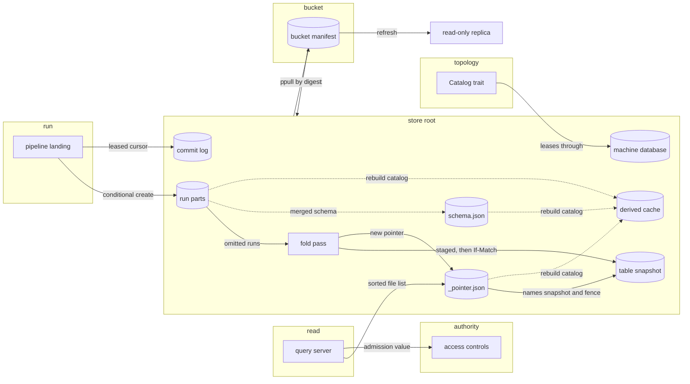
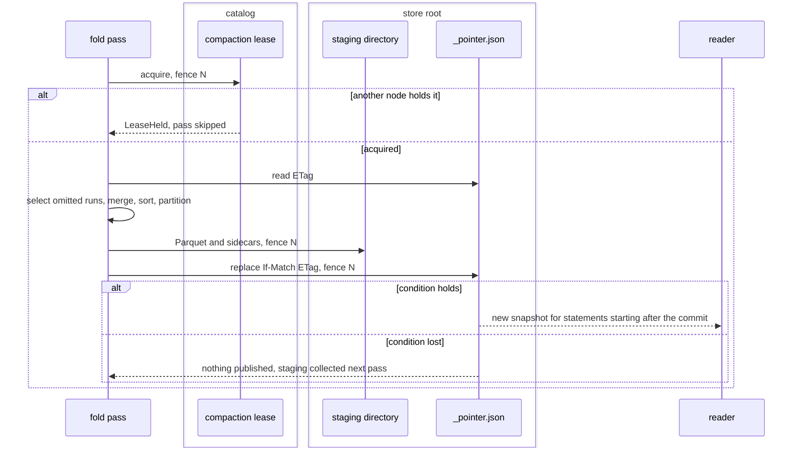
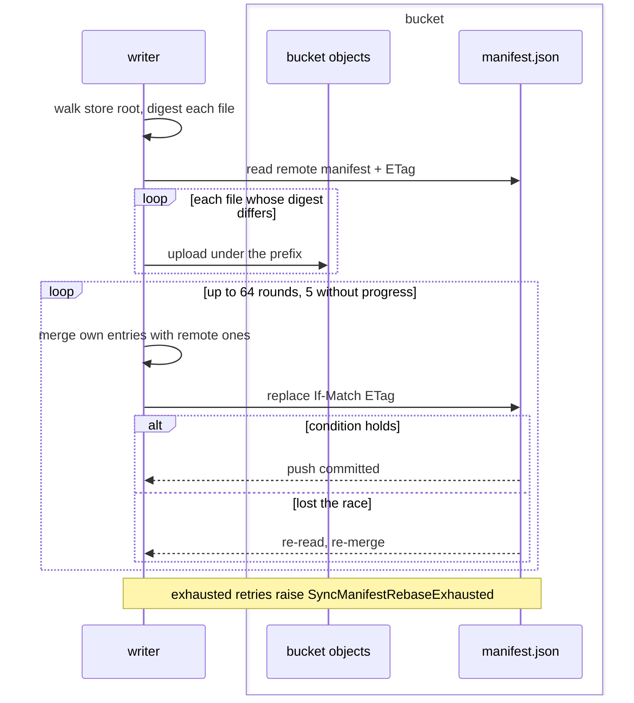
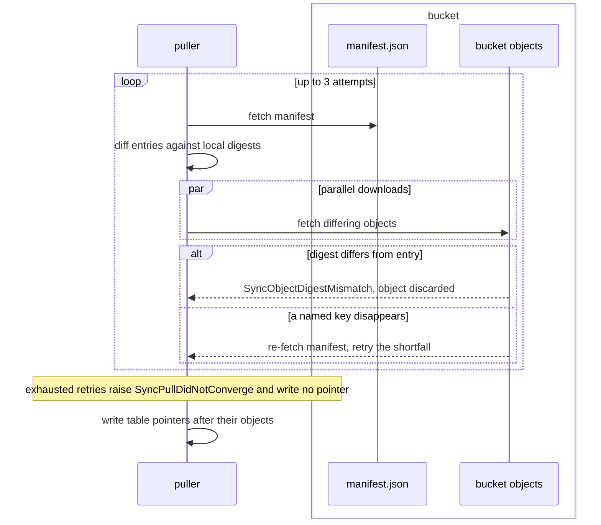
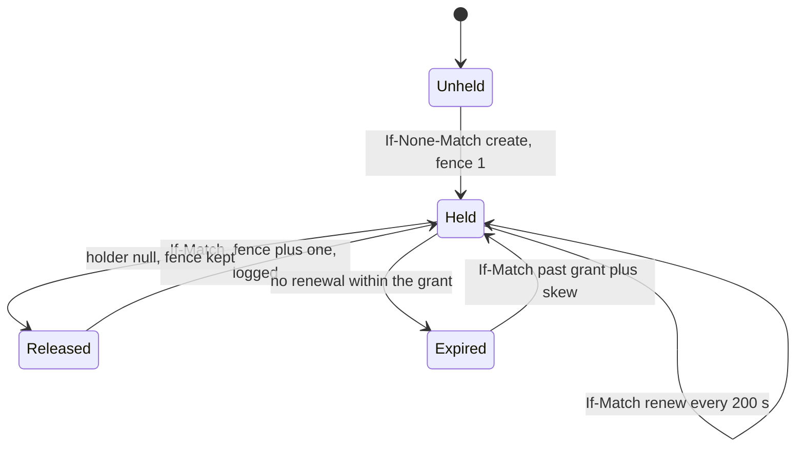

# The store and its sync

The store holds canonical Parquet data, JSON manifests and a pointer to each table's current snapshot.
Readers open the Parquet files without the engine. Two local SQLite catalogs cache metadata and hold machine state.
An S3-compatible bucket mirrors the directory tree key for key.
Implementers use this contract to store rows, publish snapshots and sync files between machines.

The diagram shows canonical files, local catalogs, bucket sync and the components that write or read rows.



## lay-out

Store directories, run and snapshot manifests, table pointers, local catalogs and node identifiers.

- `components` — A store holds Parquet table data, JSON run and snapshot manifests, one pointer object per table, landed blobs, and SQLite catalogs `derived.sqlite` and `machine.sqlite`. Parquet, manifests and pointers are canonical.
  *because a catalog that is both a rebuildable cache and a commit point resurrects half-published snapshots on rebuild*
- `store-root` — A project's store sits at `.contextful/context/<project>/`, holding both catalogs, `config.toml`, `cursors/` and one `tables/<t>/` directory per table.
- `table-directory` — A table directory holds `schema.json`, `_pointer.json`, `data/snapshots/<id>/`, `data/runs/<run-id>/<node-id>/` and `requests/`.
- `snapshot-id` — A snapshot id is `snapshot-` followed by a nanosecond value zero-padded to 20 chars. The value is the greater of the commit instant and the previous id plus one.
  *because a wall clock that steps backwards breaks lexical order equalling commit order*
- `part-name` — A data file is `part-<ordinal>.parquet`, the ordinal zero-padded to five digits and unique within its directory.
- `staging` — A running fold writes under `data/snapshots/<id>.staging/`. File lists exclude that directory.
- `run-manifest` — A run commits by conditionally creating `_manifest.json` in its node directory. The file holds a `lay_out::RunManifest` whose `node_id` equals the directory's node segment.
- `run-replay` — Repeating an unlogged run already committed on its node writes nothing when the position matches its manifest and rows reconstruct its parts column for column. The landing returns the committed manifest as a replay.
  *because a retry after a lost acknowledgement cannot tell whether its first landing committed*
- `run-conflict` — Any other landing using a run id already committed on its node raises `StoreRunConflict` and changes nothing.
  *because a logged run's readability rides a commit-log entry a replay cannot vouch for, and other rows under one id are another run*
- `run-id-shape` — A run id holds at most 128 chars: letters, digits, dot, underscore and hyphen. Landing and request-ledger append reject other run ids before writing any file.
  *because a run id is interpolated into run directories and request-ledger filenames*
- `uncommitted-run` — A node directory without `_manifest.json` holds an uncommitted run. File lists exclude its parts. A leased pipeline's run also waits for its commit-log entry.
  *P4*
- `cursor-in-commit` — A pipeline's committed position is its newest commit-log cursor when leased, or its highest run-manifest cursor otherwise. `machine.sqlite` caches that position.
  *because a position committed apart from its rows re-lands the batch after a crash between the two writes*
- `snapshot-manifest` — A snapshot's `_manifest.json` holds a `lay_out::SnapshotManifest`, and each entry of `parts` and `indexes` carries its `key_version`.
- `ancestors` — A snapshot's `_manifest.json` records `ancestors`: its parent followed by the parent's `ancestors`, at most 256 entries. A root records none. If the parent lacks `ancestors`, the child omits the field.
  *because retention collects superseded snapshot directories, and a push decides a pointer's descent from the snapshot's own manifest*
- `unrecognised-index-entry` — An `indexes` entry with an unsupported kind or fields parses as unrecognised. The manifest remains readable, probes ignore the entry, and rewrites preserve the entry byte for byte.
  *because a sidecar a newer builder records must neither refuse the table's reads nor vanish when an older build rewrites the manifest*
- `table-pointer` — `tables/<t>/_pointer.json` names the table's current snapshot and publishing fence. Readers access only snapshots reachable from the pointer directly or through `parent` links.
  *A-store*
- `manifest-default` — A field added to a manifest carries a default value.
- `format-version` — Run and snapshot manifests carry `format_version` as `<major>.<minor>`. Snapshots referencing parts or segments use `2.0`; other manifests use `1.0`. An absent version reads as `1.0`. Readers parse newer minor versions as their own.
  *A-store*
- `format-newer` — A run or snapshot manifest with a newer `format_version` major raises `StoreManifestFormatNewer`, naming the file and both versions. The table refuses reads until a newer build reads the manifest.
  *A-store*
- `format-migrate` — A major-`2` reader treats a `1.x` snapshot manifest as holding each part in its own directory, counting rows from footers. The next pass references those parts under `2.0`, without rewriting any manifest in place.
  *A-store*
- `manifest-unreadable` — If a run manifest or reachable snapshot manifest fails to parse, the store raises `StoreManifestUnreadable`, naming the table and file. The table refuses reads until the manifest parses.
  *P4*
- `schema-file` — A table's schema is `schema.json` in Arrow JSON form; each arriving batch's schema merges into it and the merged result replaces it.
- `immutable-files` — The store writes each run file once without editing the file. Snapshot directories are immutable. A fold writes a separate snapshot.
- `landed-blob` — A source body landed by reference occupies `blobs/<sha256>` under the store root, named by its bytes' SHA-256. The store writes the complete file through a rename before the referencing run commits.
  *because a row names the bytes it came from, and a committed row naming no stored body answers for content nobody can retrieve*
- `derived-catalog` — `derived.sqlite` is a cache. `contextful context rebuild-catalog` reconstructs the cache from pointers, reachable manifests, every committed run manifest and every `schema.json`. Sync excludes the cache, which commits nothing.
  *A-store*
- `machine-catalog` — `machine.sqlite` holds the machine's journal, cursor cache, leases and run-row cache. Sync excludes the database; pull preserves it. Rebuild refills run rows from {{run.record.reserved-table}} only when no run row exists, and rebuilds nothing else.
  *because run rows alone have a durable copy in the store, and a catalog already holding runs is a live machine's cache, which a refill rewrites*
- `catalog-ports` — The store accesses `machine.sqlite` through {{topology.coordinate.catalog-port}} and `derived.sqlite` through `DerivedCatalog`. Both traits reside in `contextful-core`; `contextful-sqlite` implements both. A host implements either trait over its own connection.
  *A-store*
- `unknown-table` — A table name absent from every `schema.json` in the tree raises `StoreUnknownTable` rather than returning an empty result.
  *P1*
- `node-segment` — The `<node-id>` segment in run directories and ledger filenames separates files from two machines writing the same logical run id.
- `node-id-order` — A process resolves its node id once: `CONTEXTFUL_NODE_ID`, then `[node] id`, then {{store.lay-out.node-id-project}}.
- `node-id-project` — A project's default node id is `node-<8 hex>` from SHA-256 over the host id and absolute store root. Two checkouts of one project on one host therefore write as distinct nodes.
  *because a pull treats every key under its own node id as already held, skipping another checkout's run parts of the same project*
- `node-id-state-path` — The host id, a random `node-<8 hex>` generated once, persists under `$CONTEXTFUL_STATE_DIR`, else `$XDG_STATE_HOME/contextful`, else the platform user-state directory, outside the store root.
  *because a copied store carrying its identity makes two machines one holder*
- `node-id-shape` — A node id longer than 64 chars or outside `^[A-Za-z0-9._-]+$` raises `StoreNodeIdInvalid` at process start, before any path, key or lease carries it.
  *P3*
- `node-id-shared` — A `[node]` block in a manifest, including control-plane snapshots, raises `StoreNodeIdShared` before {{run.model.top-level-block}}. The error names the file and identifies the store root's `config.toml` as the node id's home.
  *because a control-plane snapshot applies to every machine reconciling it, making one id many holders*
- `node-id-local` — A machine with no writable state directory takes the reserved node id `local`.

unsettled: Does a store re-bind the node id it last derived, so runs landed before its root moved, or under the bare host id an earlier build used, push without `CONTEXTFUL_NODE_ID`? owner: store affects: store.lay-out

## init

Project initialization, repeated initialization and project discovery when a command omits `--project`.

- `declaration-file` — `contextful init <name>` writes `contextful.toml` in the working directory declaring `[project]` with `name = "<name>"`, and creates the store root {{store.lay-out.store-root}} beside it.
- `store-identity` — An initialized store holds one synced, canonical version-4 UUID in `store-id`; repeated init and clones keep it, while a recreated root receives a new UUID.
  *A-store*
- `identity-invalid` — A malformed `store-id`, or an owner mint naming no initialized store root, raises `StoreIdentityInvalid`.
  *because an ambiguous or absent UUID cannot bind an owner credential*
- `name-shape` — Project names use `/`-separated segments of `[A-Za-z0-9._-]`, excluding `.` and `..` segments. Other names raise `StoreProjectNameInvalid` before any file read or write.
  *because the name is interpolated into every project path, and a traversing segment places a store outside its project*
- `repeat` — If `contextful.toml` declares the same `[project] name`, init succeeds and preserves store content. Init rewrites only the posture under {{store.init.posture}} and a missing {{store.init.store-identity}}.
  *because a repeated init converges on the state the first one wrote, so scripts and onboarding run it unconditionally*
- `adopt` — An init against a `contextful.toml` declaring no `project` key appends the `[project]` table and keeps every existing byte of the file.
- `posture` — `contextful init <name> --authoring-posture <posture>` prepends top-level `authoring_posture = "<posture>"` under {{authority.issue.posture-key}} when `contextful.toml` declares none, preserving every other byte. Init preserves a declared posture. Without the flag, init writes no posture.
  *because the posture decides whether a write without a credential lands, so no default chooses it for the operator*
- `name-conflict` — If `contextful.toml`'s `project` declares another name or lacks a string `name`, init raises `StoreProjectConflict` and writes nothing. The error names the requested name and the declared name when present.
  *because renaming a project orphans its store root, which an overwrite hides*
- `discovery` — Without `--project`, a command reads the nearest `contextful.toml` in the working directory or an ancestor. The command uses that file's `[project] name` and bases every project path on the file's directory.
- `explicit-project` — A command given `--project` bases every project path on the working directory and runs no discovery.
- `project-paths` — The project paths are the store root, the run state `.contextful/run/<project>/` and the memory pass state `.contextful/memory/<project>/`.
- `default-declaration` — A command given no `--declaration` reads the discovered `contextful.toml`, or `contextful.toml` in the working directory under `--project`.
- `declaration-base` — For a located project, relative declaration paths resolve against the project's base directory rather than the working directory. These paths include a derive binding's `media_root` and path-form `command[0]`.
  *because one pipeline otherwise reads different media or programs depending on the subdirectory it fires from*
- `undiscovered` — Without `--project`, a command raises `StoreProjectUndiscovered` when the working directory and ancestors lack `contextful.toml` or the nearest file lacks `[project] name`. The error names the starting directory.
  *because a store opened at a guessed root splits one project's rows across two trees*

#### Scenarios

- `store.init.repeat`: WHEN `contextful init research` runs twice in one directory, THEN the second run succeeds and `contextful.toml` holds the bytes the first wrote.
- `store.init.name-conflict`: WHEN `contextful init archive` runs beside a `contextful.toml` naming `research`, THEN the command raises `StoreProjectConflict` and preserves the file.
- `store.init.declaration-base`: WHEN `contextful pipeline run` fires in `notes/` below a `contextful.toml` binding `media_root = "media"`, THEN media resolves under `media/` beside that file, not `notes/media/`.
- `store.init.posture`: WHEN `contextful init research` runs without `--authoring-posture`, THEN a following `contextful context land` raises `AuthoringPostureUndeclared`, and after `contextful init research --authoring-posture per_request` the same land commits.
- `store.init.discovery`: WHEN `contextful context land` runs in `notes/` below a directory where `contextful init research --authoring-posture per_request` ran, THEN the run commits under that directory's `.contextful/context/research/`.

## declare

Table declarations, primary keys, row ordering, write modes and replacement behavior.

- `table-block` — Table keys: `primary_key`, `order_by`, `write_mode`, `replicate`, `subject_id`, `class`, `policy`, `visibility`, `valid_time`, `cluster_by`, `partition_by`, `bloom_filter`, `retain_runs`, `retain_rows`, `columns`, `indexes`, `agent_description`, `agent_hint`, `example_queries`, `content_hash_column`, `result_cache` and `private`. Canonical serialization omits unset keys.
- `erasure-metadata` — An erasure declaration names `erasure_key`, incoming `referenced_by` table/column edges, and `on_erase = "survive"` for retained citing rows; absent fields remain absent in canonical serialization.
  *A-disclosure*
- `retain-rows` — `retain_rows = { column = "<name>", age = "<n>d" }` accepts `_ingested_at` or a declared Timestamp column. Another column or null value raises `StoreRetentionColumnInvalid` before landing. A malformed age refuses the declaration.
  *because a sender's clock cannot control the injected arrival time, and a nullable retention clock leaves a row with no expiry*
- `column-types` — `columns` maps column names to type spellings under {{store.reconcile.typed-landing}}. Every landing into the table, including pipeline runs, uses the declared type for that column.
  *because a JSON value alone cannot say it carries bytes or a vector*
- `two-genres` — A table holds connector items or synthesized artifacts. Artifact kinds use an open string without an engine-defined enumeration. Both items and artifacts append, deduplicate on content and carry a timestamp.
- `unkeyed-union` — A table declaring no `primary_key` reads as the byte-identical union of its visible committed runs, selected under {{store.declare.replace-frontier}} when replacing.
- `dedup-view` — A keyed table reads through `ROW_NUMBER() OVER (PARTITION BY <pk> ORDER BY <order_by> DESC, _ingested_at DESC, _run_id DESC, _row_seq DESC) = 1`. The source unions the current snapshot, if present, with committed runs omitted by that snapshot.
  *because a keyed table read as a union before its first fold inflates every aggregate silently*
- `order-by-default` — `order_by` names the column picking the surviving row per key, and defaults to `_ingested_at`.
- `order-by-unknown` — An `order_by` naming a column neither declared nor injected raises `StoreOrderByUnknownColumn` at validation, before the first batch.
  *because an ordering column absent from every file reads as null and picks survivors arbitrarily*
- `key-unknown` — A `primary_key` naming a column neither declared nor injected raises `StoreKeyUnknownColumn` at validation, before the first batch.
  *because a key column absent from every file partitions every row into one group and collapses the table to a single row*
- `nested-key` — A struct, list or map column named by `primary_key`, `order_by`, `cluster_by`, `partition_by` or `valid_time` raises `StoreNestedKeyColumn` at validation, before any Parquet.
  *A-store*
- `write-mode` — `write_mode` is `append`, the default, keeping the last write per key and retiring no key, or `replace`.
- `replace-frontier` — Under `replace`, a read covers the newest run carrying the source's complete state plus every run committed after it.
- `replace-retains` — A replacing run keeps displaced runs on disk until `retain_runs` expires. The replacing run writes no erasure receipt and traverses no lineage.
- `empty-run` — A run landing zero rows commits a manifest with no parts; without {{store.declare.empty-replacement}} it replaces nothing. A table with no rows registers as a zero-row relation over its declared and injected columns.
- `empty-replacement` — A complete zero-row `replace` run marks its manifest as a replacement frontier. Current reads exclude earlier files; bounded reads before that commit retain earlier rows within retention.
  *A-store*
- `empty-frontier-preserved` — Sync push, sync pull and fold preserve an empty replacement frontier without writing a data row.
  *A-store*
- `fold-job` — A compaction job covers a table when its `[[job]]` block has kind `fold` and a `schedule`. The job's `enabled` is absent or true; its `target` is absent or names the table's destination name.
  *A-store*
- `fold-coverage` — If a table declares `primary_key` without coverage under {{store.declare.fold-job}}, `pipeline validate` warns on stderr and names the table. The warning alone causes no failure.
  *A-store*
- `declaration-set` — The project's tables combine its declaration with adjacent `pipelines/*.toml` and `pipelines/*.json`: `[pipeline]` tables as named, specification tables under {{run.declare.table-name}}. Queries and every `sync` verb use this declaration set.
  *because a key or `replicate` declared only where `pipeline run` reads it leaves reads, pulls and folds treating the table as unkeyed and replicated*
- `read-side-keys` — A declaration key changes what a read returns and rewrites no committed part; a key added after rows land applies from the next read.

unsettled: What retires a key a source stops serving under `append`, given the source-side deletion is invisible in the tree? owner: store affects: store.declare

## reserve

Reserved column and table names, injected provenance columns and request ledgers.

- `underscore-namespace` — Column names beginning `_` belong to the engine; the injected set and the reserved optional set are its whole content.
- `injected` — The engine injects `_ingested_at` as non-null Parquet `TIMESTAMP(UTC, NANOS)`, `_run_id` and `_site_id`. Injection adds int32 `_batch_seq` within a batch scope and `_authored_by` for writes authorized by an authenticated subject. Injected values replace producer values.
  *because a string instant does not sort by time once fractions or offsets appear*
- `authored-agent` — Where an authenticated subject carrying an agent member authorized the write, the engine injects `_authored_agent`, that agent, beside `_authored_by`, replacing any producer value.
  *because a `[[principal]]` names an agent as well as the person it acts for, and {{authority.place.per-principal}} matches either*
- `row-seq` — The engine injects `_row_seq`, a non-null int64 numbering a run's rows from 0 in batch order, replacing any producer value.
  *because a run's rows share `_ingested_at` and `_run_id`, and keeping the last write per key needs an order among them*
- `commit-seq` — The engine injects non-null int64 `_commit_seq`, assigned above every value held by the table. A run committing after a read carries a value above every returned row, regardless of `_ingested_at`.
  *A-topology*
- `commit-order` — A commit publishes its manifest after every lower `_commit_seq` in the table publishes or ends landing. Readable runs therefore form a prefix of the table's commit sequence.
  *A-topology*
- `commit-lock-span` — A commit holds its table's commit lock while assigning `_commit_seq` and writing its manifest. The commit writes parts outside the lock, except when the table keeps vintage history.
  *A-topology*
- `commit-wait` — A commit waits at most 30 s for its table's commit lock or for a lower value's publication, then raises `StoreCommitLockTimeout`, a transient failure.
  *A-topology*
- `commit-marker` — A commit rewrites `data/.commit_seq` as JSON with `format_version` and `commit_seq`. Builds reading a bare integer refuse the table before writing a part. A newer major refuses under {{store.lay-out.format-newer}}.
  *A-topology*
- `commit-seq-seed` — A commit assigns one above the greatest `commit_seq` in the node's counter, run manifests and current snapshot. A pulled store or store without a counter therefore reuses no value.
  *A-topology*
- `no-placeholder` — A path with no batch scope or no authenticated subject omits that column instead of writing nulls.
- `taint` — On each row from model output, the engine injects `_taint` under {{connector.infer.provenance-order}}, replacing any producer value. Rows without model output omit `_taint`.
  *because a label a producer sets is one injected text can forge*
- `pass` — For each synthesized claim, the engine injects `_pass`: `glean` under {{read.synthesize.gleaning}}, `first` otherwise. Injection replaces any producer value. Rows without synthesis omit `_pass`.
  *because a reader telling a gleaned claim from a first-pass one must not trust a label the model could emit*
- `optional` — A producer sets any of `_modality`, `_lang`, `_provenance` and `_prompt_hash`, and each surfaces in the provenance envelope where present.
- `modality` — `_modality` takes one of text, image, audio, structured or mixed; another value fails validation of its batch.
- `lang-and-provenance` — `_lang` carries a BCP-47 tag; `_provenance` carries the evidence rows the row derives from, addressed by the identity the source table keys on.
- `prompt-hash` — `_prompt_hash` is `sha256:<hex>` over the prompt template, not the rendered prompt.
- `edge-validity` — `memory_edges` rows carry `valid_from`, `valid_to` and `superseded_by`. A producer's `valid_from` stands; an absent value takes declared availability time, else commit time. Only {{read.revise.edge-supersede}} writes `valid_to` and `superseded_by`.
  *A-read*
- `column-name` — A producer column inside the `_` namespace and outside the optional set raises `StoreReservedColumnName` at reconciliation, before any Parquet.
  *P1*
- `table-namespaces` — The engine reserves three table namespaces. `_runs` holds the durable run record; `_items` holds item records under {{run.items.outcome-record}}. `_visibility` holds each source's mirrored access tables under {{disclosure.mirror.grants-table}}.
- `table-name` — When assembling a manifest, the engine raises `StoreReservedTableName` for a pipeline table inside a reserved namespace, naming the reservation.
  *P1*
- `ledger-suffix` — The engine reserves table names ending in `__requests` for request-ledger relations. Other declarations using that suffix refuse under {{store.reserve.table-name}}.
- `ledger-path` — A run's request ledger is `requests/<run-id>.<node-id>.parquet`, disjoint per run and per writing node.
- `ledger-append` — An append locks its run's ledger file to serialize writes. The append returns after syncing its rows and the rename to disk.
- `ledger-fold` — Each fold pass merges a table's committed ledger files into `requests/folded-<snapshot-id>.parquet`, and a replica carries ledgers with their table.
  *because one ledger file per run per node per table grows listing and diff cost without bound*
- `ledger-retention` — Collection removes a ledger row 365 d after its run committed.

unsettled: Does a replica merging another node's runs renumber `_commit_seq`, or does an export cursor hold one position per writing node? owner: store affects: store.reserve

unsettled: Does a fold backfill `_commit_seq` onto parts landed without the column, and in which order among their runs? owner: store affects: store.reserve

## reconcile

Schema reconciliation across table files, type promotion, added columns and scan behavior.

- `explicit-file-list` — Every read passes `read_parquet` an explicit sorted file list resolved from the pointer and manifests. Reads use no glob and exclude stray files.
- `union-by-name` — Every read passes `union_by_name=true`. Columns resolve to the common supertype across files carrying each column. The generated relation casts only vectors under {{store.reconcile.half-width}}.
- `lattice` — The type lattice holds one promotion, `Int64` with `Float64` to `Float64`; a JSON type absorbs `Utf8`.
  *A-store*
- `incompatible` — Any other pair of types observed for one column raises `StoreSchemaIncompatible` at the write, naming the column, the stored type and the arriving type.
  *A-store*
- `float-loss` — An `Int64` value above 9007199254740992 loses precision once a `Float64` batch lands on its column.
- `binary-and-vector` — The lattice includes `Binary`, `FixedSizeBinary(n)` and dimension-n `FixedSizeList` of `Float32` or `Float16`. These types have no promotion. Width, item or dimension changes meet {{store.reconcile.incompatible}}.
  *A-store*
- `typed-landing` — A producer declares these types. JSON batches carry bytes as padded base64 and vectors as number arrays matching the declared dimension. Other values meet {{store.reconcile.incompatible}}.
  *A-store*
- `nested-lattice` — Structs gain fields; files lacking a field read null. List items and map values reconcile under {{store.reconcile.lattice}}. Kind changes, including scalar against nested or list against map, meet {{store.reconcile.incompatible}}, naming the column path.
  *A-store*
- `variant` — A `variant` column stores string, Int64, Float64, boolean or padded-base64 bytes values in one Struct with `kind` and a matching field. Scalar or tagged inputs land losslessly. Conflicting non-null fields meet {{store.reconcile.incompatible}}.
  *A-store*
- `nested-landing` — Producers or declarations type columns `struct<…>`, `list<…>` or `map<utf8, …>`. JSON batches represent structs and maps as objects, lists as arrays. A struct key absent from its fields meets {{store.reconcile.incompatible}}.
  *A-store*
- `stored-type` — When `schema.json` records a binary, vector or nested type, later undeclared JSON values land in that type. Runs after the first require no declaration.
  *A-store*
- `half-width` — A `Float16` vector stores each element at half width in Parquet. The engine reads its elements as `FLOAT`, either binary type as `BLOB`, and a vector as an `ARRAY` of its dimension through one relation cast.
  *A-store*
- `key-widening` — Primary-key columns take no `Float64` promotion. A widening batch raises `StoreKeyWidened` before any Parquet. A fold encountering a key already reconciled to `Float64` raises the same error.
  *A-store*
- `additive` — An unseen column joins the merged schema, and files written before it read it as null.
- `no-invented-column` — Scans invent no columns. An ordering column absent from every file enters through a zero-row branch. A column added after the table's first rows projects as literal null.
- `first-sight` — A destination creates a table on the first schema it sees and merges each later schema into `schema.json`.
- `fold-never-narrows` — A fold backfills nulls and widens types, a struct's fields included; it narrows no type and drops no column or field.
- `no-history` — Reconciliation stores only the current schema. Run files identify past type widenings.
- `reserved-set-versioned` — Adding an injected column advances the semantics version, whose fingerprint recipe names the column.

unsettled: What dimension caps a fixed-size vector column, given the engine bounds an `ARRAY` width? owner: store affects: store.reconcile

unsettled: Do the linked DuckDB and parquet releases read and write Parquet `VARIANT`, so the variant column's Struct encoding gives way to it (issue 90)? owner: store affects: store.reconcile

## fold

Compaction steps, triggers, retention, leases and snapshot publication through a pointer update.

- `pass` — A pass selects committed runs omitted by the current snapshot, deduplicates by key or unions, reconciles schemas, sorts by `cluster_by`, then partitions. The pass stages Parquet and every declared sidecar, then commits through {{store.fold.pointer-commit}}.
- `carry-by-reference` — For append tables, a pass writes unfolded rows as one delta part per affected partition. The pass rewrites only parts affected by replacement or retention, referencing every other part in its origin snapshot.
  *A-store*
- `tiered-merge` — In each written partition, a size tier spans row counts between consecutive powers of 4. The pass merges 4 parts from one tier into one part, repeating until every tier holds fewer than 4 parts.
  *A-store*
- `bounded-memory` — A carrying pass without a full sidecar build holds its delta and one record batch per part read or merged. Peak memory therefore scales with landed rows rather than stored rows.
  *because a pass inline with a landing that decodes the whole table grows with history until it exhausts the landing process's memory*
- `valid-time-line` — A keyed table declaring `valid_time` partitions on both the key and valid-time line. The table keeps one row per line.
- `includes-runs` — A snapshot's `includes_runs` names each folded run as `<run-id>/<node-id>`, matching the run directory. Reads include runs committed after the snapshot.
- `triggers` — A pass fires at 50 runs committed on a table, 6 h after the table's previous pass, or on `contextful context compact <table>`.
- `declared-trigger` — A positive `fold_max_unfolded_runs` sets the table's unfolded-run trigger count instead of {{store.fold.triggers}}'s count. Parsing rejects a declaration with zero.
- `session-trigger` — A landing session counts unfolded table runs at open and each commit, recounting after another writer commits or folds. If the table's trigger fires, the session runs a pass before landing returns.
  *because a trigger read only by a scheduled job lets a continuous writer accrue thousands of unfolded runs between passes*
- `retention` — `retain_runs` defaults to 7 d. Collection removes folded runs, superseded snapshots and their sidecars once older than the window.
- `reference-retention` — Collection keeps parts and sidecar segments referenced by retained snapshots until no retained snapshot names those files. Collection removes the rest of the collected snapshot's directory, including its manifest.
  *A-store*
- `cached-inputs` — Under {{store.pull.lazy-parts}}, a fold fetches input parts through {{store.pull.part-cache}}. If inputs exceed the cache size, the fold raises `FoldInputsExceedCache`, names both byte counts and publishes nothing.
  *A-store*
- `row-retention` — After keyed winner selection and derived supersession, a fold removes expired snapshot and sidecar rows. Unkeyed partitions with footer maximum before the cutoff skip row reads. Idle passes publish on expiry under {{store.declare.retain-rows}}.
  *because a time partition follows the sender's clock while the retention clock follows arrival*
- `row-retention-report` — For each table, a pass reports the row-age cutoff, expired row count, dropped partition count and collected directories. `collect` returns the removed directory paths.
  *because an operator needs evidence of both logical expiry and physical collection*
- `result` — A pass reports folded, `indexes-built`, nothing-landed or failed on one line per table. `indexes-built` names sidecars built without folding runs. Nothing-landed means no pending runs and every declared sidecar current; the pass continues.
- `collection-failed` — A collection failure reports beside `folded` if the pass published; the snapshot stays published. Otherwise the pass reports `failed`. Both cases exit non-zero.
- `unknown-table` — A pass naming a table no `schema.json` declares halts the command with {{store.lay-out.unknown-table}}.
  *P1*
- `compaction-lease` — A pass holds the table's compaction lease and stamps its fence into the snapshot manifest and the pointer.
  *A-store*
- `pointer-commit` — A pass publishes by replacing `_pointer.json` conditioned on the ETag read at pass start. Object stores use `If-Match`; filesystems use a version-checked rename.
  *A-store*
- `partial-snapshot` — A reader observes a snapshot and every declared sidecar together or neither; a commit exposing one without the other raises `StorePartialSnapshot`.
  *P4*
- `lost-pointer` — If a pointer replacement loses its condition, the pass publishes nothing. Collection removes the staged snapshot.
- `staging-collected` — The next pass collects staging directories and snapshot directories unreachable through any pointer chain. Reads exclude these directories.
- `non-blocking` — A statement running during a pass reads the snapshot the pointer named when it started; statements starting after the commit read the new one.
- `supersedes` — A new snapshot supersedes the previous one without deleting it, and a bounded read reaches the older one until retention collects it.

A fold pass under the compaction lease, from run selection to the pointer commit.



## index

Sidecar index types, identifiers and builds; row clustering, partitions and tenant identifiers.

- `kinds` — Five index kinds exist: Parquet footer zone maps, sorted-Parquet sparse-map primary-key lookups, HNSW vector graphs, positional full-text indexes and opt-in per-column bloom filters.
- `bloom-parts` — Without a project encryption key, every landed or folded part carries bloom filters on columns named in `bloom_filter`. Each filter's size follows the part's row count. Erasure rewrites carry none.
  *A-store*
- `bloom-vintage-key` — Without a project encryption key, every landed or folded vintage-table part carries a bloom filter on each primary-key column. These filters apply regardless of `bloom_filter` declarations.
  *because writers landing interleaved keys write parts whose key bounds overlap, and only a key filter keeps {{store.available-time.vintage-scope}} from decoding another writer's rows*
- `bloom-encrypted` — A project binding an encryption key writes no bloom filter in any part, whatever its tables name in `bloom_filter`.
  *because Parquet modular encryption leaves a bloom filter in plaintext, where it answers key membership without the key*
- `declaration` — Each table declares sidecars under `indexes` with kind, `column`, `id_column` and builder parameters. The `vector` kind takes `model`, `dim`, metric `cosine`, `m` and `ef_construction`. The `fulltext` kind takes `tokenizer`.
- `id-column` — Without `valid_time`, a sidecar's `id_column` defaults to the table's single-column primary key. All sidecars of a table share `id_column`; keyed, composite-key and unkeyed tables each use one.
  *A-store*
- `id-column-unresolved` — Manifest validation raises `StoreIndexIdColumnUnresolved` for missing `id_column` without a single-column primary key or with `valid_time`. Naming a valid-time table's single key, or different `id_column` values across sidecars, raises the same error.
  *A-store*
- `id-unique` — If two staged snapshot rows share an `id_column` value, fold raises `StoreIndexIdNotUnique`, naming the table, column and value. The fold publishes nothing.
  *A-store*
- `paths` — A vector sidecar sits at `indexes/vec-<col>-<model>/zone=<label>/` and a full-text sidecar at `indexes/fts-<col>-<tokenizer>/`, inside the snapshot directory it indexes.
- `path-collision` — Two sidecar declarations of one table resolving to one path under {{store.index.paths}} raise `StoreIndexPathCollision`, naming both, at manifest validation and before the fold builds either.
  *because a second build overwrites the first sidecar's files, and the manifest then records an entry no reader opens*
- `identity` — A sidecar's identity is its one path under {{store.index.paths}}; `derived.sqlite` records the builder and builder version of each sidecar a reachable snapshot holds.
  *A-store*
- `rebuild` — If a current sidecar's builder or builder version differs from this build's, a pass rebuilds the sidecar in full. The pass preserves rows in a separate snapshot. Readers keep the prior snapshot until pointer publication.
  *A-store*
- `declared-unbuilt` — If the current snapshot lacks a declared sidecar or records different `id_column` or builder parameters, a pass builds the sidecar over those rows. The pass publishes a separate snapshot even without a landed run.
  *because an index declared over rows already landed otherwise waits for a landing the store may never receive*
- `graph-format` — The vector graph's byte layout has no format compatibility guarantee. A reader opens a sidecar only when builder and builder version match its own; mismatches follow {{read.retrieve.sidecar-falls-back}}.
  *A-store*
- `graph-extensions` — A vector or full-text entry records `extensions`, counting segment-adding passes since its last full build. A pass finding 16 extensions rebuilds the sidecar in full and records 0.
  *A-store*
- `sidecar-segments` — If the delta replaces and removes no stored row, a pass adds a delta segment to each current sidecar, referencing earlier segments. Probes read every segment and score full text using their summed statistics.
  *A-store*
- `filter-copies` — A sidecar copies only `id_column`, the indexed column, and the tenant column, zone label and availability instant needed for filtered traversal. Every other filter applies at {{store.index.candidate-ids}}.
  *A-store*
- `not-in-file-set` — Table file sets exclude `indexes/`. A snapshot reader lists only parts named by the snapshot manifest.
- `dies-with-snapshot` — Collecting a snapshot collects its sidecars in the same step, save a segment {{store.fold.reference-retention}} keeps.
- `candidate-ids` — A sidecar returns only candidate `id_column` values. Before finalizing top-K, retrieval joins those identifiers on that column through the relation protected by access controls.
  *P5*
- `vector-by-fold` — Fold builds each declared vector sidecar from staged rows with non-null identifiers and non-zero vectors. Where `embedding_model` exists, fold selects only rows from the declared model. Fold records the sidecar in the snapshot manifest.
  *A-store*
- `graph` — A vector sidecar is an HNSW graph over unit-length `Float32` vectors. Layers use a seed from the snapshot id and column. The same staged row set therefore produces a byte-identical graph.
  *because a rebuilt sidecar then differs from its predecessor only where the rows do, and a recall figure replays from its snapshot*
- `fulltext-by-fold` — Fold builds each declared full-text sidecar from staged rows with non-null identifiers and text yielding a term. Fold records the sidecar in the snapshot manifest.
  *A-store*
- `postings` — Each full-text segment is one file with a sorted term dictionary and each term's row identifiers and positions. Readers binary-search the mapped or decrypted bytes.
  *because one layout then serves a mapped plaintext file and a decrypted sealed one, and a probe reads only its own terms' postings*
- `tokenizer` — The default `unicode` tokenizer indexes each lowercased alphanumeric run as one term. The `cjk` tokenizer indexes each Han, Kana or Hangul stretch within a run as overlapping character bigrams.
  *because an unspaced script puts no boundary inside a sentence, so a word within one is never a whole term*
- `column-absent` — If the reconciled schema lacks an index's column or `id_column`, fold raises `StoreIndexColumnAbsent` before staging anything for that build.
  *because an index over a missing column builds empty and reads as no match*
- `column-type` — Invalid types raise `StoreIndexColumnType`: `id_column` other than text or integer; vector-sidecar columns other than vectors of `dim`; fulltext columns other than text. Checks occur at manifest validation when `columns` declares types, otherwise before landing rows.
  *because a builder reading another width, or an identifier the re-join casts differently, indexes rows no reader finds*
- `clustering` — `cluster_by` sorts file rows lexicographically by columns in declared order. Zone maps then skip row groups with no manifest entry and no sidecar.
- `partitioning` — A table uses partitioning only when the table declares `partition_by`.
- `partition-type` — A `partition_by` column typed binary or vector raises `StorePartitionColumnType` at validation, before any Parquet.
  *because bytes name no directory that keeps two distinct values apart*
- `partition-warnings` — Planning warns, naming the column, where a partition specification projects more than 1000 partitions or a median partition below 16 MiB.
- `tenant-outermost` — A multi-tenant table carries the tenant identifier as its outermost partition column.
  *because a dropped tenant predicate then reads nothing instead of every tenant*
- `tenant-verbatim` — Landing applies no canonical form to tenant values. Writes and comparisons preserve bytes without trimming, case folding or Unicode normalization. Percent-escaping changes only the directory-name representation.
  *A-store*

## encrypt

At-rest encryption of Parquet, sidecars, ledgers, metadata, machine catalogs and node run-state files; key derivation and rotation.

- `key-binding` — A project enables at-rest encryption by binding `[encryption] key_source` to `env:<NAME>` or a key-management service. Without that binding, encryption is off.
- `key-unbound` — A `key_source` naming a binding the process lacks raises `StoreEncryptionKeyUnbound` at startup, with no cleartext fallback.
  *P3*
- `cipher` — Parquet modular encryption encrypts Parquet files, including footers. Every sidecar and ledger file uses AES-256-GCM with a per-file data key wrapped by the project key.
  *because a cleartext vector graph admits nearest-neighbour search over the embedding space*
- `metadata-envelope` — With a bound key, schema, manifest, pointer, counter and commit-log files enclose canonical JSON or text in an authenticated versioned envelope. Without encryption, these files retain their canonical bytes.
  *A-store*
- `run-state-envelope` — With a bound key, a node's synced run-state JSON encloses canonical bytes in an authenticated envelope. Readers refuse files sealed under another key.
  *A-store*
- `machine-catalog-sealing` — A bound `machine.sqlite` holds an authenticated SQLite snapshot. Each catalog transaction locks the file, reads the snapshot into process memory and seals committed bytes before releasing the lock.
  *A-store*
- `password-kdf` — A password-derived project key uses Argon2id with 64 MiB memory, 3 iterations and 4 lanes.
- `transport-separate` — At-rest encryption covers files and TLS covers bucket transport; a cleartext endpoint carries no encrypted-at-rest claim.
- `redacted-index` — An index declared over a column redacted at write time raises `StoreIndexOverRedactedColumn` at manifest validation.
  *A-authority*
- `at-rest-scope` — A stolen bucket credential yields ciphertext Parquet and sidecars, no write-time-redacted content, and no key material.
- `sidecar-reader` — For unencrypted projects, readers memory-map sidecars read-only. For encrypted projects, readers decrypt each sealed sidecar file into anonymous process memory without writing cleartext to disk.
  *A-store*
- `rotation` — After rotation, writes use the rotated key version. Published files keep their key versions until collection. A key version retires when no retained file names that version.

unsettled: How long does a sidecar decrypted into process memory stay resident across reads, and what evicts it? owner: store affects: store.encrypt

unsettled: What reseals a part carried by reference under a retiring key version, given only a restatement, retention or merge rewrites it, so {{store.encrypt.rotation}} retires that version? owner: store affects: store.encrypt

## emit

Push planning from local files without reading or writing the bucket.

- `plan` — `contextful sync manifest --emit` prints a JSON bucket manifest listing each key a push commits, with sha256, size and owner. The command neither reads nor writes bucket objects.
  *because a pre-push check and a dry run need the commit's content without a credential or a network*
- `plan-scope` — The plan lists every key {{store.push.wire-format}} uploads and each `schema.json` at its local digest; a key another node owns stays out.

## push

Uploading local files, constraining bucket prefixes and committing the bucket manifest.

- `prefix-escape` — A key resolving outside the prefix raises `SyncPrefixEscape`, naming the key and the prefix.
  *P3*
- `prefix-unbound` — An unset variable named by `prefix_from` raises `SyncPrefixUnbound` at startup, with no bucket-root fallback.
  *P3*
- `prefix-overspecified` — Declaring `prefix` and `prefix_from` together raises `SyncPrefixOverspecified`.
  *P3*
- `in-flight` — A push waits for another local push to release the store's push guard, up to `[sync] push_wait_secs`, default 300 s. On timeout, the push raises `SyncPushInFlight`, naming the holder.
  *because units of one serve share a store root, and a refused push fails a fire whose runs already committed*
- `wire-format` — A push conditionally uploads files whose digests the bucket lacks, under `<prefix>/<project>/<path>`. Eligible files belong to the pushing node or no node. Machine catalogs, `config.toml`, locks and staging directories stay local. Table pointers follow {{store.push.pointer-carry}}.
- `schema-cas` — A table's `schema.json` commits by merging into the bucket's copy through the one-promotion lattice and replacing it on the ETag read; no copy overwrites another.
  *because two nodes landing different columns into one table both keep them*
- `manifest-commit` — A push commits by replacing `<prefix>/manifest.json` under `If-Match` on the ETag read for that copy. This bucket manifest lists each key's sha256, size and owner.
  *A-store*
- `manifest-format` — The bucket manifest and every generation manifest carry `format`, `1` for this layout; a manifest without `format` reads as `1`.
- `format-unsupported` — A bucket or generation manifest with `format` above 1 raises `SyncManifestFormatUnsupported`, naming the key and format. Refusal precedes the push commit or any pull file write.
  *because a reader rewriting a manifest it parses only in part drops the fields a newer writer added*
- `generation` — Each manifest commit records `generation` under {{store.push.generation-floor}} and the project's table pointers read before the commit. The push then creates `<prefix>/manifests/gen-<N>.json` with the committed bytes under `If-None-Match`.
  *because a restore or a pre-push gate names one committed state, and the live manifest and pointers move on*
- `commit-stamp` — Each manifest commit records `committed_at`, the push instant, and `committed_by`, the pushing node id. A plan records neither field.
- `generation-floor` — A commit's `generation` is one past the greater of the read manifest's `generation`, absent reading as 0, and the newest `gen-<N>.json` under the prefix.
  *because a format-1 writer predating the field drops `generation`, and reusing a taken number collides with its immutable copy*
- `generation-probe` — For manifest generation G, push lists `gen-<G>.json` and each later generation's key individually until the first absent key. Only a manifest without `generation` causes a complete `manifests/` listing.
  *because the prefix gains one copy per commit and is never pruned, so a whole listing grows every commit round*
- `generation-heal` — Before each manifest commit, a push finding no `gen-<N>.json` for the generation of the manifest it read creates it from the bytes it read.
  *because a commit of N+1 landing while `gen-<N>.json` is absent leaves a gap no later push sees*
- `generation-conflict` — A push whose create of `gen-<N>.json` meets another commit's bytes raises `SyncGenerationConflict`, naming N, after its manifest commit applied.
  *because the immutable copy keeps the first commit, and a push reporting success names a state `pull --generation` does not restore*
- `run-state` — `sync push` and `sync manifest --emit` first write `nodes/<node-id>/run-state.json`. This node run-state file records each pipeline's newest run and each cursor row with its commit marker.
  *because run history and cursors live outside the store root, and a node starting cold otherwise sees neither*
- `run-state-upload` — A push uploads its node's run state regardless of the digest listed in the bucket manifest.
  *because the run state rewrites one key in place, and an interrupted push leaves an object its listed digest no longer describes*
- `control-version` — `sync push` and `sync manifest --emit` record the default local applied control version in each node's run state. Replicas use this version only for verification.
  *because a cold node needs the version a writer applied, while an unverified snapshot must not arm work*
- `run-state-format` — A run state records `format`, `1` for this layout. Readers take no run or cursor from run states whose `format` exceeds 1.
- `control-artifact` — A push uploads each immutable applied control snapshot and its {{surface.apply.synced-attestation}} receipt under `<project>/control/`. The push then commits their digests and project-scoped head in the bucket manifest.
  *A-surface*
- `control-diverged` — A push whose signed control head does not descend from the bucket head raises `SyncControlDiverged`, names both heads and leaves the bucket head unchanged.
  *A-surface*
- `upload-digest` — A manifest commit records the sha256 of uploaded bytes, regardless of the plan's digest. If those digests differ, push removes the file's digest record.
  *because a file rewritten after the plan otherwise lists a digest no bucket object carries*
- `transfer-width` — A push keeps up to {{store.pull.transfer-width}} uploads in flight, and commits the bucket manifest only after every upload it started has returned.
  *because the manifest lists an object only once the bucket holds it*
- `pointer-carry` — After committing the manifest, push conditionally publishes local table pointers with complete snapshots, keeping the bucket's fence. Publication requires {{store.lay-out.ancestors}} to name the bucket pointer's snapshot, or the bucket pointer to name none.
  *because a snapshot a local fold or a build publishes reads on no other node until its pointer reaches the bucket*
- `pointer-leased` — A push publishes no pointer for a table whose compaction lease a holder keeps unexpired; that holder publishes under its fence.
  *because the holder publishes under the fence its acquisition raised, and a publish beside it races that commit*
- `pointer-fenced` — If a local pointer's fence is below the bucket pointer's fence, the push keeps the pointer local and reports a warning beside its commit.
  *A-store*
- `pointer-unrooted` — If snapshot ancestry ends at a collected manifest before reaching the bucket pointer's snapshot or a root, push keeps the pointer local. Push reports a warning beside its commit.
  *because a publish over a snapshot it may not descend from drops rows the bucket reaches, and a silent keep leaves every other node reading the older snapshot*
- `pointer-recommit` — After the bucket accepts a published pointer, the push commits the manifest again. A generation therefore names a carried pointer only after the bucket pointer holds that value.
  *because a generation naming a pointer the bucket never held restores a state no node read*
- `stranded` — Push reports local keys owned by other nodes that the committed bucket manifest neither lists nor tombstones. Stderr groups keys by owner and names the `CONTEXTFUL_NODE_ID` required to push each group.
  *because a moved store root re-derives the node id, and runs landed under the old one otherwise stay local without a message*
- `after-run` — With `[sync] push_after_run = true`, `run start` and `pipeline run` push the store once the fire's runs close, and a failed push fails the command.
  *because a push spends bucket writes and network on every fire, and an operator syncing on a schedule pays nothing for an undeclared key*

A push: digest, upload, then the bucket-manifest commit by merge and compare-and-set.



unsettled: Which pointer does the bucket keep when a local fold's snapshot descends from none the bucket pointer names? owner: store affects: store.push

#### Scenarios

- `store.push.control-diverged`: WHEN two signed control heads name the same predecessor, THEN the second push refuses and keeps the first head.

## pull

Downloading bucket files, verifying digests, advancing table pointers and restoring named generations.

- `digest-mismatch` — If a downloaded object's digest differs from its manifest entry, pull discards the object and raises `SyncObjectDigestMismatch`. Run states follow {{store.pull.run-state-torn}} instead.
  *P4*
- `run-state-torn` — If a downloaded `nodes/<node-id>/run-state.json` differs from its listed digest, pull discards the file and warns with the key. Pull continues without that file.
  *because a push writes its run state before its manifest commit, and an interrupted push otherwise refuses every later pull of the bucket*
- `identity-conflict` — A pull into a store holding a different {{store.init.store-identity}} raises `StoreIdentityConflict` before downloading files.
  *because importing another UUID lets that store's owner credential read local rows*
- `convergence` — When a named key disappears mid-download, the pull re-fetches the manifest and retries the shortfall, up to 3 attempts.
- `unconverged` — Exhausting those retries raises `SyncPullDidNotConverge`, naming the key that kept moving, and writes no pointer.
  *P4*
- `unconverged-resume` — A pull refused under {{store.pull.unconverged}} preserves verified objects. The next `sync pull` downloads only keys whose digests still differ. Pull does not exceed its retry attempts.
  *A-store*
- `transfer-width` — A pull downloads objects with up to `[sync] transfers` concurrent requests, default 16 requests with a minimum of 1. Before returning any refusal, the pull writes every object already verified.
  *because one request per round trip makes a cold store's boot grow with its object count rather than its bytes*
- `digest-record` — Pull and push reuse a local file's machine-local sha256 record when size, modification time, change time and inode match the record. Otherwise, pull and push hash the file.
  *because rehashing every held file on each pull and push grows with the store, and setting a modification time moves the change time*
- `pointer-last` — A pull writes a table's pointer only after every Parquet part in the named snapshot exists locally. Readers therefore encounter no pointer before its data.
  *A-store*
- `tombstone-applied` — Pull deletes local keys named by tombstones and absent from entries. For a key without a local copy, pull performs no verification and reports nothing.
  *because a deletion that never reaches a consumer resurrects once its tombstone ages out*
- `cold-own-keys` — If the store lacks its own `nodes/<node-id>/run-state.json`, pull downloads missing keys owned by that node. A replacement host reusing the node id therefore tombstones none of those keys.
  *because a replacement host otherwise reads none of its node's run history, and its push lists none of it as held*
- `pointer-advance` — Pull advances pointers only to a higher fence, or the same fence with a later snapshot. Pull verifies every advancing table before writing any pointer.
  *A-store*
- `schema-merge` — A pulled `schema.json` differing from the local copy merges into it column by column through {{store.reconcile.incompatible}}'s lattice rather than replacing it.
  *because rows landed locally carry columns the bucket's copy may lack*
- `before-run` — With `[sync] pull_before_run = true`, `run start`, `pipeline run`, `mcp` and `serve` pull every bucket table before their first read. A failed pull stops the command.
  *because a container starting on an empty disk otherwise serves and folds against a store missing every other node's runs*
- `serve-refresh` — Under {{store.pull.before-run}}, `serve` pulls again every 30 s and maps the new generation for reads starting after that pull; a failed refresh keeps serving the held generation and logs the failure.
  *because a query face running apart from the nodes that push otherwise serves the generation it started with until it restarts*
- `lazy-parts` — With `[sync] lazy_parts = true`, pull downloads all listed keys except table Parquet data parts. On first read or fold use, the store fetches each complete part and verifies the digest under {{store.pull.digest-mismatch}}.
  *A-store*
- `part-cache` — `[sync] part_cache_bytes`, default 8 GiB, bounds locally fetched parts. Above that bound, the cache deletes the least recently read part that no statement or fold holds.
  *A-store*
- `part-accounting` — Each verified lazy download counts once toward {{store.pull.part-cache}} upon reaching disk, despite other fetch failures. If the cache index is missing, reopening adopts receipt-listed parts without bucket reads or receipt-free tree scans.
  *because a partial acquisition and a lost index leave completed downloads subject to eviction*
- `part-collected` — If the bucket lacks a part required by {{store.pull.lazy-parts}}, the store raises `SyncPartCollected`, naming the part and snapshot. The next pull advances the pointer past that snapshot.
  *because retention collects a superseded snapshot's parts while a container still holding its pointer reads them*
- `generation` — `contextful sync pull --generation <N>` reads `gen-<N>.json` instead of the bucket manifest. The pull downloads listed keys in scope at their listed digests and writes exactly that generation's pointers regardless of fence.
- `generation-list` — `contextful sync generations` lists bucket `gen-<N>.json` files in ascending order. Each entry includes `committed_at`, `committed_by`, and the project's entry and tombstone counts. Missing stamps print as `-`.
  *because choosing a generation to restore needs the last commit before an unwanted tombstone, and generation numbers alone carry no time*
- `generation-absent` — A generation the bucket holds no `gen-<N>.json` for raises `SyncGenerationAbsent`, naming N and the newest generation, and writes nothing.
  *because a restore falling back to another generation reads a state nobody named*
- `generation-diverged` — If a local syncable file in scope is absent from the generation, generation pull raises `SyncGenerationDiverged` and names the file. The pull writes nothing.
  *because a kept unlisted run adds rows the generation never held, and deleting it loses unpushed work*
- `generation-schema` — A generation pull takes the bucket's current `schema.json` and merges under {{store.pull.schema-merge}}. A differing generation digest causes no refusal.
  *because the lattice keeps every column an earlier generation carried, and the merged copy replaces the old one in the bucket*
- `generation-run-state` — Generation pull exempts `nodes/<node-id>/run-state.json` from {{store.pull.generation-diverged}}, preserving run-state files absent from the generation. Other unlisted files under `nodes/` meet that refusal.
  *because a run state summarizes history outside the store root, and a restore predating it otherwise refuses every node that pushed since*
- `run-state-cursor` — At run open, a run resumes from a pulled run state's cursor when its pipeline and table commit marker is newer than every local marker.
  *because a collected run takes its manifest's cursor out of the bucket, and a cold node otherwise re-reads the source from its start*
- `control-head` — Pull downloads the bucket manifest's project-scoped control head, snapshot and receipt ancestry at their listed digests. The local applied pointer stays unchanged for {{surface.reconcile.pulled-control}}.
  *A-surface*

unsettled: Under {{store.pull.lazy-parts}} a pointer lands before its parts are home: does {{store.pull.pointer-last}} hold the snapshot manifest and its listed digests alone, and does {{store.pull.before-run}} end once every table's metadata is home? owner: store affects: store.pull

A pull converges on the bucket manifest and writes each table pointer last.



#### Scenarios

- `store.pull.control-head`: WHEN a cold node pulls a signed control head, THEN its local applied pointer stays absent until reconciliation verifies the head.

## probe

Testing conditional writes with a sentinel object and selecting the backend's coordination mode.

- `inconclusive` — An unsupported-method response, a forbidden response or a transport error raises `SyncProbeInconclusive` and counts as capability not demonstrated.
  *A-store*
- `unproven` — Declaring `cas` against a backend the probe did not demonstrate raises `SyncCoordinationUnproven` and stops the push.
  *A-store*
- `sentinel` — The probe creates a sentinel under `_contextful/cas-probe/`. The probe demonstrates `cas` when a second create and stale `If-Match` fail, while a current `If-Match` replaces the sentinel. The probe then deletes the sentinel.
- `network-volume` — For filesystem buckets, mount types outside apfs, hfs, ext4, xfs, btrfs, zfs, tmpfs and overlay resolve `single-writer` without a sentinel. The result names the mount type. A declared `cas` there meets {{store.probe.unproven}}.
  *because the bucket's advisory lock is not a guarantee across the clients of a network share, and a sentinel run from one client cannot observe another*

## merge

Merging bucket manifests across writers, verifying tombstones and retrying conditional manifest commits.

- `tombstone-owner` — A tombstone whose owner differs from the owner of the entry it names raises `SyncTombstoneForeign`, and the merge keeps the entry.
  *A-store*
- `tombstone-signed` — Push signs each tombstone with the node's issuer key, recording `signer` and `signature` over the key, owner and `deleted_at`. A node without an issuer key writes unsigned tombstones.
  *A-store*
- `tombstone-unverified` — Unsigned tombstones, invalid signatures, or keys absent from the key-set ledger's verifying set at `deleted_at` raise `SyncTombstoneUnverified`. Merge preserves the named entry; pull deletes nothing.
  *A-store*
- `tombstone-ttl` — A tombstone leaves the manifest 30 d after its `deleted_at`.
- `retries` — `[sync] push_retries` bounds consecutive re-commit rounds whose re-read manifest carries no newer generation than the round before, defaulting to 5 attempts.
  *A-store*
- `round-ceiling` — A push stops its manifest commit loop after 64 rounds, whatever generations those rounds meet.
  *A-store*
- `exhausted` — Exhausting {{store.merge.retries}} or {{store.merge.round-ceiling}} raises `SyncManifestRebaseExhausted`, reports every uploaded object as already in the bucket, and asks for a re-run.
  *A-store*
- `cursor-recency` — Resolving a cursor by last-write time raises `SyncCursorConflict`. A cursor resolves through its commit.
  *A-run*
- `scoped-union` — A merge takes local entries owned by this writer or unowned, and all other remote entries. It tombstones a writer-owned remote entry only when {{store.merge.held-record}} lists the key and the store lacks the file.
  *A-store*
- `held-record` — Push records locally held owned keys under its node id in `.sync-held.json`: adding before commit, replacing that node's keys after. Pull holding the push guard adds each such key listed in the bucket manifest.
  *A-store*
- `held-absent` — If `.sync-held.json` lists no keys for the node, a surviving `.push.lock` means the store holds every remote node-owned key. Without that lock, the store holds none.
  *A-store*
- `held-unreadable` — An unreadable `.sync-held.json` raises `SyncHeldRecordUnreadable` without granting deletion authority or replacing the record.
  *because corruption establishes no ownership and a replacement discards other nodes' entries*
- `ownership` — A key names its owner through the node in its run directory, request-ledger filename, commit-log directory or run-state directory. Every other key is unowned and propagates no deletion.
  *A-store*

## lease

Exclusive pipeline and compaction leases, fencing values and cursor commits in the commit log.

- `ttl` — A lease grants ownership for 10 min.
- `renewal` — A holder renews every 200 s by `If-Match` replace on the ETag it holds.
- `clock-skew` — Bucket leasing assumes the clocks of two machines differ by 30 s or less, and every expiry judgment reads the judging machine's monotonic clock.
  *because correctness rests on the fence, and the skew bound only sets how early a holder stops committing*
- `held` — If a run finds an unexpired lease, the engine raises `LeaseHeld`, names the holder and expiry, and skips the run. The engine retries the run at the next reconciliation tick.
  *A-store*
- `stale-fence` — If a commit-log create, pointer replacement or catalog `UPDATE` loses its condition to a higher fence, the operation raises `LeaseFenced`. The associated run or snapshot stays unreadable.
  *A-store*
- `not-held` — Releasing a lease another node holds raises `LeaseNotHeld` and leaves the object untouched.
  *A-store*
- `cursor-kind` — A cursor whose kind takes no lease reaching `cursors/` raises `LeaseCursorKindMismatch`.
  *A-run*
- `local-node` — A bucket lease attempted under the node id `local` raises `LeaseNodeIdLocal`, logging the variable that sets a node id; that machine keeps the machine lease.
  *P3*
- `acquire` — Acquisition creates the lease object under `If-None-Match` or replaces an expired or released object under `If-Match` on its ETag. The acquired fence is one above the object's fence.
  *A-store*
- `pointer-fence` — Taking a table's compaction lease raises the fence stored in its bucket pointer, so a publish carrying a lower fence loses its condition.
  *A-store*
- `network-volume` — A compaction lease on a bucket resolving `single-writer` under {{store.probe.network-volume}} meets {{store.probe.unproven}}, naming the mount type. Acquisition writes no lease object or pointer fence.
  *because a conditional put holding on one machine only lets two machines each take the lease*
- `commit-log` — Under a machine lease, a run commits by creating the next `cursors/<pipeline-id>/<node-id>/<seq>.json`. Acquisition creates an entry carrying its fence. A manifest marked `logged` becomes readable when that log records the manifest.
  *A-store*



## Shapes

Each example names the `contextful_core::store` type it serializes. Each example parses into that type and writes back unchanged.

The store tree and its bucket mirror, drawn by `lay_out::TableLayout`:

```
.contextful/context/<project>/          bucket: <prefix>/<project>/
  derived.sqlite                         not synced
  machine.sqlite                         not synced
  config.toml
  cursors/<pipeline-id>/<node-id>/       commit log of a leased pipeline, per node
    <seq>.json
  nodes/<node-id>/run-state.json         newest runs, cursor markers
  tables/<t>/
    schema.json
    _pointer.json
    data/runs/<run-id>/<node-id>/
      part-00000.parquet
      _manifest.json
    data/snapshots/snapshot-01742054400000000000/
      part-00000.parquet
      _manifest.json
      indexes/vec-<col>-<model>/zone=<label>/
      indexes/fts-<col>-<tokenizer>/
    data/snapshots/<id>.staging/
    requests/
      <run-id>.<node-id>.parquet
      folded-<snapshot-id>.parquet

<prefix>/manifest.json                   key -> { sha256, size, owner }
<prefix>/_contextful/cas-probe/<uuid>
<prefix>/leases/<pipeline-id>.json
<prefix>/leases/compact/<table>.json
```

A table declaration, `declare::TableDecl`:

```toml
[[pipeline.tables]]
name         = "documents"
primary_key  = ["document_id", "page"]
order_by     = "revised_at"
write_mode   = "replace"
cluster_by   = ["source_id", "revised_at"]
partition_by = ["tenant"]
retain_runs  = "7d"

[pipeline.tables.valid_time]
from = "effective_from"
to   = "effective_to"

[[pipeline.tables.indexes]]
kind            = "vector"
column          = "embedding"
id_column       = "passage_id"
model           = "e5-small"
dim             = 384
metric          = "cosine"
m               = 16
ef_construction = 200

[[pipeline.tables.indexes]]
kind      = "fulltext"
column    = "body"
id_column = "passage_id"
tokenizer = "cjk"
```

A run manifest, a snapshot manifest and a table pointer, `lay_out::RunManifest`, `lay_out::SnapshotManifest` and `lay_out::Pointer`:

```json
{ "run_id": "run-4815", "table": "documents", "node_id": "ingest-a",
  "format_version": "1.0", "parts": [{ "name": "part-00000.parquet", "key_version": 3 }],
  "committed_at": "2025-03-15T15:58:00Z", "pipeline_id": "documents-sync",
  "cursor": { "field": "revised_at", "at": "2025-03-15T15:57:41Z" }, "fence": null }

{ "snapshot_id": "snapshot-01742054400000000000", "parent": "snapshot-01741968000000000000",
  "format_version": "1.0", "table": "documents", "created_at": "2025-03-15T16:00:00Z",
  "includes_runs": ["run-4812/ingest-a", "run-4813/ingest-a", "run-4814/ingest-b"],
  "primary_key": ["document_id", "page"], "order_by": "revised_at", "row_count": 128400,
  "valid_time": { "from": "effective_from", "to": "effective_to" }, "fence": 12,
  "parts": [{ "name": "part-00000.parquet", "key_version": 3 }],
  "indexes": [{ "kind": "vector", "path": "indexes/vec-embedding-e5-small/zone=all",
                "table": "documents", "snapshot_id": "snapshot-01742054400000000000",
                "column": "embedding", "id_column": "passage_id", "model": "e5-small", "dim": 384,
                "metric": "cosine", "m": 16, "ef_construction": 200,
                "builder": "contextful-hnsw", "builder_version": 2, "row_count": 128400,
                "key_version": 3 },
              { "kind": "fulltext", "path": "indexes/fts-body-cjk",
                "table": "documents", "snapshot_id": "snapshot-01742054400000000000", "column": "body",
                "id_column": "passage_id", "tokenizer": "cjk",
                "builder": "contextful-postings", "builder_version": 2, "row_count": 128400,
                "term_count": 902113, "key_version": 3 }] }

{ "snapshot_id": "snapshot-01742054400000000000", "fence": 12 }
```

A lease object and a commit-log entry, `lease::BucketLease` and `commit_log::CommitEntry`:

```json
{ "holder": "ingest-a", "acquired_at": "2025-03-15T16:00:00Z", "expires_at": "2025-03-15T16:10:00Z", "fence": 418 }
{ "kind": "commit", "table": "documents", "run_id": "run-4816", "cursor": { "kind": "opaque-token", "value": "eyJwYWdlIjo0Mn0" }, "fence": 418 }
```

A bucket manifest, `sync::BucketManifest`:

```json
{ "format": 1, "generation": 7,
  "entries": { "documents/tables/documents/_pointer.json": { "sha256": "9f2c41d07be3a5c8e6f1d2b4a7c90e3f5d8b1a6c4e7f2d9b0a3c5e8f1d4b7a2c", "size": 74, "owner": "ingest-a" } },
  "tombstones": { "documents/tables/documents/data/runs/run-4811/ingest-a/part-00000.parquet": { "owner": "ingest-a", "deleted_at": "2025-03-15T16:00:00Z" } },
  "pointers": { "documents/tables/documents/_pointer.json": { "snapshot_id": "snapshot-01741968000000000000", "fence": 11 } } }
```

A store's `config.toml`, `config::StoreConfig`:

```toml
[sync]
bucket            = "context-prod"
endpoint          = "r2://<account-id>"
access_key_id     = "secret://sync-access-key-id"
secret_access_key = "secret://sync-secret-access-key"
prefix_from       = "env:CONTEXTFUL_SYNC_PREFIX"
coordination      = "cas"
push_retries      = 5
transfers         = 16
push_wait_secs    = 300
pull_before_run   = true
push_after_run    = true

[node]
id = "ingest-a"

[encryption]
key_source = "env:CONTEXTFUL_KEY"

[connector]
require_pin = true
```
