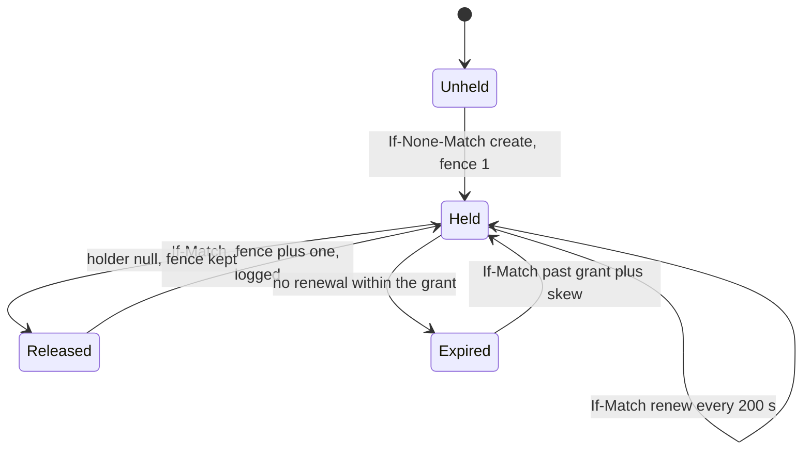

# Bucket endpoints and leases

The `[sync]` endpoint decides how each request reaches the bucket: its scheme, its region and the credentials that sign it.
The adapter speaks the S3 object API to AWS S3, R2 and compatible services, and reads a filesystem bucket directly.

## endpoint

Bucket endpoint schemes, transport, request addressing and signing, credentials and backend response handling.

- `schemes` — `[sync] endpoint` maps `file://<directory>` to a filesystem bucket and `s3://<region>` to regional AWS S3. `r2://<account-id>` selects that account's R2 endpoint at region `auto`. `https://<host>` uses `[sync] region`, default `us-east-1`.
- `unsupported-scheme` — Any other scheme, or an S3 or R2 endpoint in a build without the `s3-sync` feature, raises `SyncEndpointUnsupported`, naming the endpoint.
  *because an unreachable bucket refuses when it opens, before a push uploads anything*
- `plaintext` — An `http://` endpoint opens on a loopback host alone; any other host raises `SyncEndpointInsecure`, naming it.
  *because plaintext objects and signed requests are readable and replayable by anyone on the path*
- `addressing` — S3 and R2 address `<endpoint>/<bucket>/<key>` path-style, percent-encoding each key segment, and sign every request with AWS Signature Version 4 for service `s3` at the endpoint's region.
- `credentials` — `[sync] access_key_id`, `secret_access_key` and the optional `session_token` each bind `secret://<name>`, hydrated as {{connector.reference.whole-value-reference}}, or `env://NAME`, read whole from the process environment, as the bucket opens.
- `credential-unbound` — An S3 or R2 `[sync]` omitting `access_key_id` or `secret_access_key`, supplying a non-reference credential, or naming an unset variable raises `SyncCredentialUnbound`, naming the key.
  *because a literal key in `config.toml` sits in plaintext on every disk and backup*
- `role-credentials` — `[sync] credentials = "role"` on an `s3://` or `https://` endpoint signs with workload-role credentials in place of both keys, from the ECS container credential endpoint, then STS web identity, then IMDSv2.
  *because a workload role supplies short-lived keys in place of long-lived stored ones*
- `role-unavailable` — Under {{store.endpoint.role-credentials}}, a bucket open that no role source answers raises `SyncRoleUnavailable`, naming each source tried.
  *because an unsigned request otherwise fails as forbidden, hiding the missing role*
- `role-conflict` — `credentials = "role"` beside a key credential {{store.endpoint.credentials}} binds, or on an R2 endpoint, raises `SyncCredentialConflict`, naming the endpoint.
  *because two credential sources for one bucket leave unstated which identity signed a write*
- `role-refresh` — Role credentials refresh 300 s before their stated expiry and never sign once expired; a failed refresh keeps still-valid credentials and retries at the next request.
- `conditional-answers` — A `412` or `409` means a failed condition; a `404` naming `NoSuchKey` does so for an `If-Match` put. `501` means an unsupported method; `403` means forbidden credentials. Both follow {{store.probe.inconclusive}}.
- `missing-bucket` — A `404` naming a code other than `NoSuchKey`, `NoSuchBucket` included, is neither an absent object nor a failed condition: the request fails as transport, naming the code.
  *because a missing bucket otherwise reads as empty, a free lease or a lost compare-and-set*
- `transport` — An incomplete S3 get, head, list page, delete or unconditional put retries within 3 attempts. Connections allow 5 s; responses allow 2 s, 4 s, then 10 s. Conditional puts attempt once.
  *because a resent conditional put whose answer was lost reads its own write as a failed condition*
- `throttled` — S3 requests retry within 5 attempts after `429` or `503`, or `500` except on conditional puts. Each retry waits a uniform draw below a ceiling doubling from 100 ms to 5 s.
  *because a throttled request never applied, and jitter spreads throttled clients*
- `unavailable` — A request unanswered within {{store.endpoint.transport}}, or answered `429` or `5xx` past {{store.endpoint.throttled}}, fails as unavailable, naming the request and claiming nothing about the bucket's content.
- `list-pages` — A list follows continuation tokens until the backend reports completion, returning every key under the prefix in sorted order.

## probe

Testing conditional writes with a sentinel object and selecting the backend's coordination mode.

- `inconclusive` — An unsupported-method response, a forbidden response or a transport error raises `SyncProbeInconclusive` and counts as capability not demonstrated.
  *A-store#coordination-probed-compare*
- `unproven` — Declaring `cas` against a backend the probe did not demonstrate raises `SyncCoordinationUnproven` and stops the push.
  *A-store#coordination-probed-compare*
- `sentinel` — The probe creates a sentinel under `_contextful/cas-probe/`, demonstrates `cas` when a second create and a stale `If-Match` fail while a current `If-Match` replaces it, then deletes it.
- `network-volume` — A filesystem bucket on a mount type outside apfs, hfs, ext4, xfs, btrfs, zfs, tmpfs and overlay resolves `single-writer` without a sentinel, naming the mount type; a declared `cas` there meets {{store.probe.unproven}}.
  *because a sentinel run from one client of a network share cannot observe another client*

## lease

Exclusive pipeline and compaction writer leases, their commit fences, and cursor commits in the commit log.

- `ttl` — A writer lease grants ownership for 10 min.
- `renewal` — The process holding a compaction lease renews it every 200 s by `If-Match` replace on its ETag; `sync compact` renews while it pulls, folds and pushes.
- `operator-renew` — `sync lease renew <table>` renews the compaction lease this node holds, for `sync compact --held`.
- `clock-skew` — Bucket leasing assumes the clocks of two machines differ by 30 s or less, and every expiry judgment reads the judging machine's monotonic clock.
  *because correctness rests on the commit fence, and the skew bound only sets how early a holder stops committing*
- `held` — If a run finds an unexpired lease, the engine raises `LeaseHeld`, names the holder and expiry, and skips the run. The engine retries the run at the next reconciliation tick.
  *A-store#coordination-probed-compare*
- `stale-fence` — If a commit-log create, pointer replacement or catalog `UPDATE` loses its condition to a higher commit fence, the operation raises `LeaseFenced`. The associated run or snapshot stays unreadable.
  *A-store#coordination-probed-compare*
- `not-held` — Releasing a lease another node holds, or one a later acquisition of the same node fenced past, raises `LeaseNotHeld` and leaves the object untouched.
  *A-store#coordination-probed-compare*
- `cursor-kind` — A cursor whose kind takes no lease reaching `cursors/` raises `LeaseCursorKindMismatch`.
  *A-run#incremental-position-bound*
- `local-node` — A bucket lease attempted under the node id `local` raises `LeaseNodeIdLocal`, logging the variable that sets a node id; that machine keeps the machine lease.
  *P3*
- `acquire` — Acquisition creates the lease object under `If-None-Match` or replaces an expired or released object under `If-Match` on its ETag. The acquired commit fence is one above the object's commit fence.
  *A-store#coordination-probed-compare*
- `pointer-fence` — Taking a table's compaction lease raises the fence stored in its bucket pointer, so a publish carrying a lower fence loses its condition.
  *A-store#coordination-probed-compare*
- `network-volume` — A compaction lease on a bucket resolving `single-writer` under {{store.probe.network-volume}} meets {{store.probe.unproven}}, naming the mount type. Acquisition writes no lease object or pointer fence.
  *because a conditional put holding on one machine only lets two machines each take the lease*
- `commit-log` — Under a machine lease, a run commits by creating the next `cursors/<pipeline-id>/<node-id>/<seq>.json`. Acquisition creates an entry carrying its fence. A manifest marked `logged` becomes readable when that log records the manifest.
  *A-store#coordination-probed-compare*

unsettled: Which process carries out `renewal` for a pipeline lease? owner: store affects: store.lease
