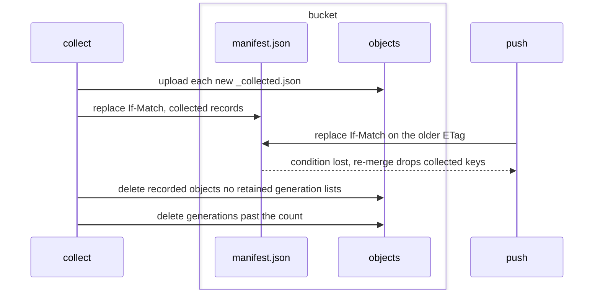

# Bucket collection

A bucket keeps every object a push writes until a collect deletes it.
`contextful sync collect` unlists, then deletes, the objects no reader needs: objects the bucket manifest no longer lists, a superseded snapshot's parts and sidecars, the run directories an aged snapshot folds, and the generation manifests past a retained count. Every snapshot's `_manifest.json` stays.

## collect

Unlisting and deleting the bucket objects no reader needs, and the generation manifests past the retained count.

- `command` — `contextful sync collect` prints JSON naming, per class `unlisted`, `superseded`, `folded_runs` and `generations`, the keys it records as collected, the objects it deletes, their bytes and `unknown_size`, then `undeclared`, `shared_prefix` and `referenced`; `--dry-run` prints the same and writes nothing.
  *because an operator sizes a reclamation before running it*
- `unlisted` — Collect records as collected an object of the project the bucket manifest does not list when a tombstone or a generation past {{store.collect.retain-generations}} names its key, save a `_group.json`.
  *because a key some manifest once listed is one a push wrote, while an unnamed object may be an upload awaiting its commit*
- `superseded` — Collect records as collected every object of a bucket chain snapshot's directory once a child created `retain_runs` ago supersedes it and no unexpired hold names it, save `_manifest.json` and each part or segment a retained snapshot names.
  *A-store#bucket-collect*
- `manifest-kept` — Collect deletes no snapshot `_manifest.json` and lists `_collected.json` beside each snapshot it reclaims, the only writer of that marker, so every chain reaches its root and each `includes_runs` still names its folded runs.
  *A-store#bucket-collect*
- `folded-runs` — Collect records as collected every object of a run directory, `_manifest.json` included, once the bucket chain snapshot naming the run in `includes_runs` supersedes a snapshot {{store.collect.superseded}} reclaims, save a `_group.json` {{store.collect.group-window}} keeps.
  *A-store#bucket-collect*
- `group-window` — Collect keeps a folded run's `_group.json` while a member table holding a copy of the run has not folded it out under {{store.collect.folded-runs}}, under that member's `retain_runs`.
  *because a member run reads as committed only beside its group root's marker, an `as_of` read inside the window included*
- `index-walk` — Under the pointer's valid bucket index, collect stops its walk at a child within the cutoff, by clock and id, whose parent is collected, and takes older folded runs from the index; a hold record walks whole.
  *A-store#index-walk*
- `chain-only` — Collect reclaims only snapshots the bucket pointer reaches through `parent` links; another snapshot's `includes_runs` collects no run.
  *because a snapshot that lost its pointer commit folded nothing a bucket reader sees*
- `declared-window` — Collect takes each table's `retain_runs` from the collecting store's declarations, a declared model defaulting as its builds' retention does, and reclaims no snapshot or run of a table it declares none for, naming it under `undeclared`.
  *because the window is a table declaration, not bucket state*
- `two-phase` — Collect records a key as collected whether or not a retained generation lists it, and deletes the object at the first collect after {{store.collect.generation-listed}} stops holding it.
  *because a restore of a retained generation reads the object, while the record already keeps it out of every merge*
- `record-stands` — While the bucket holds a recorded object, each collect stamps its record again once it passes half the age {{store.merge.tombstone-ttl}} sets; past its object, a record lapses and {{store.merge.collected-directory}} keeps the key out.
  *because a record lapsing before its object goes lets a merge list the key again*
- `retained-kept` — Collect deletes no recorded object a retained snapshot names, reporting its key under `referenced`, and the key stays recorded.
  *because a hold reaching the bucket outside {{run.model.hold-bucket-first}} then leaves a refusal rather than a loss*
- `serialized` — Collect holds the bucket's collect lease from before it reads a hold until its last deletion, and refuses as {{store.lease.held}} does while another collect holds it.
  *because a hold or a record a concurrent collect commits otherwise reaches the deletes of a collect that never read it*
- `lease-renewed` — Collect renews its lease at a fresh clock reading before its deletes and at {{store.lease.renewal}}'s interval through them, and deletes nothing more once {{store.lease.stale-fence}} answers a renewal.
  *because a collect outliving its lease otherwise deletes beside a successor that read newer holds*
- `metadata-kept` — Collect records no snapshot `_manifest.json` or `_collected.json`, pointer, `schema.json`, hold or run state, and no key a retained snapshot names, a tombstoned one included.
  *because those keys hold the chain and the coordination state every reader walks*
- `marker-first-writer` — A collect uploads `_collected.json` only where no object holds its key, and lists the bytes the bucket then holds.
  *because a losing concurrent collect overwriting a listed marker fails every pull's digest check*
- `generation-listed` — Collect deletes no object whose key a retained generation lists, and leaves it for a later collect.
  *because `sync pull --generation` restores a retained generation's keys at their listed digests*
- `retain-generations` — `[sync] retain_generations`, default 64 generations, sets how many newest generation manifests a collect keeps, the current one included; a value of 0 fails the configuration's parse.
  *A-store#bucket-collect*
- `generations` — Collect heals an absent copy of the read generation, then deletes every `manifests/gen-<N>.json` older than the newest {{store.collect.retain-generations}}, so a restore of one meets {{store.pull.generation-absent}}.
  *because each generation manifest lists the whole store, and a push after every run writes one per run*
- `shared-prefix` — While the bucket manifest names another project's key, record or control head, collect records no key as collected, deletes no generation manifest, treats every generation as retained, and reports `shared_prefix`.
  *because generation manifests belong to the prefix, and one project's `retain_generations` binds no other project's restores*
- `drop-first` — Collect commits a bucket manifest recording each key it unlists as collected, by the conditional replace of {{store.push.manifest-commit}}, before deleting any object, so no push lists a deleted object and a lazy read meets {{store.pull.part-collected}}.
  *A-store#bucket-collect*

unsettled: Does a collect reclaim another project's unlisted objects when the generations it prunes are the last to name them? owner: store affects: store.collect

#### Scenarios

- `store.collect.drop-first`: WHEN an owner restoring a tombstoned run reads the manifest, a collect then commits and deletes the run's objects, and the owner's push commits, THEN the push loses its condition, re-merges, and lists no deleted object.
- `store.collect.generation-listed`: WHEN a tombstoned run is unlisted while 64 retained generations list it, THEN the collect deletes none of its objects.
- `store.collect.manifest-kept`: WHEN a node holding a copy of run `r` but no snapshot pulls after a collect reclaimed the snapshot folding `r`, THEN its chain reaches that snapshot's manifest and `r` reads once.
- `store.collect.folded-runs`: WHEN the owner of a collected run lists its restored copy again after the record's age, THEN every reader folds the run through the kept manifest and reads it once.
- `store.collect.group-window`: WHEN a member table folds its copy of a grouped run one day before a collect, THEN the root run's directory leaves save its `_group.json`.

A collect, from the manifest commit to the generation manifests it deletes.

