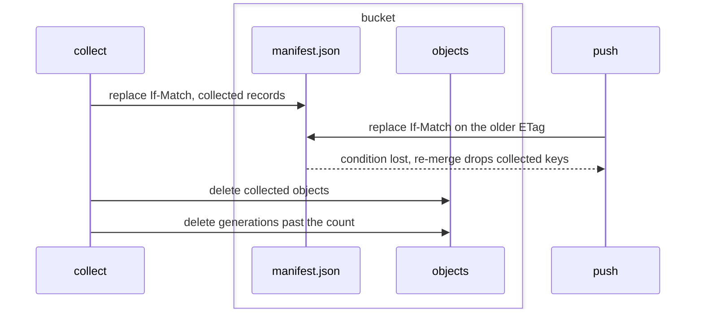

# Bucket collection

A bucket keeps every object a push writes until a collect deletes it.
`contextful sync collect` deletes the objects the bucket manifest no longer lists and no retained generation names, and the generation manifests past a retained count; snapshots and run directories stay.

## collect

Deleting the bucket objects the manifest no longer lists and no retained generation names, and the generation manifests past the retained count.

- `command` — `contextful sync collect` prints JSON naming, per class `unlisted` and `generations`, the keys it records as collected, the objects it deletes, their bytes and `unknown_size`, and `shared_prefix`; `--dry-run` prints the same and writes nothing.
  *because an operator sizes a reclamation before running it*
- `unlisted` — Collect deletes an object of the project the bucket manifest does not list when a tombstone or a generation past {{store.collect.retain-generations}} names its key, save a `_group.json`.
  *because a key some manifest once listed is one a push wrote, while an unnamed object may be an upload awaiting its commit*
- `generation-listed` — Collect deletes no object whose key a retained generation lists, and leaves it for a later collect.
  *because `sync pull --generation` restores a retained generation's keys at their listed digests*
- `retain-generations` — `[sync] retain_generations`, default 64 generations, sets how many newest generation manifests a collect keeps, the current one included; a value of 0 fails the configuration's parse.
  *A-store#bucket-collect*
- `generations` — Collect heals an absent copy of the read generation, then deletes every `manifests/gen-<N>.json` older than the newest {{store.collect.retain-generations}}, so a restore of one meets {{store.pull.generation-absent}}.
  *because each generation manifest lists the whole store, and a push after every run writes one per run*
- `shared-prefix` — While the bucket manifest names another project's key, record or control head, collect deletes no generation manifest, treats every generation as retained, and reports `shared_prefix`.
  *because generation manifests belong to the prefix, and one project's `retain_generations` binds no other project's restores*
- `drop-first` — Collect commits a bucket manifest recording each key it deletes as collected, by the conditional replace of {{store.push.manifest-commit}}, before deleting any object, so no push lists a deleted object and a lazy read meets {{store.pull.part-collected}}.
  *A-store#bucket-collect*

unsettled: Does a collect reclaim another project's unlisted objects when the generations it prunes are the last to name them? owner: store affects: store.collect

#### Scenarios

- `store.collect.drop-first`: WHEN an owner restoring a tombstoned run reads the manifest, a collect then commits and deletes the run's objects, and the owner's push commits, THEN the push loses its condition, re-merges, and lists no deleted object.
- `store.collect.generation-listed`: WHEN a tombstoned run is unlisted while 64 retained generations list it, THEN the collect deletes none of its objects.

A collect, from the manifest commit to the generation manifests it deletes.

