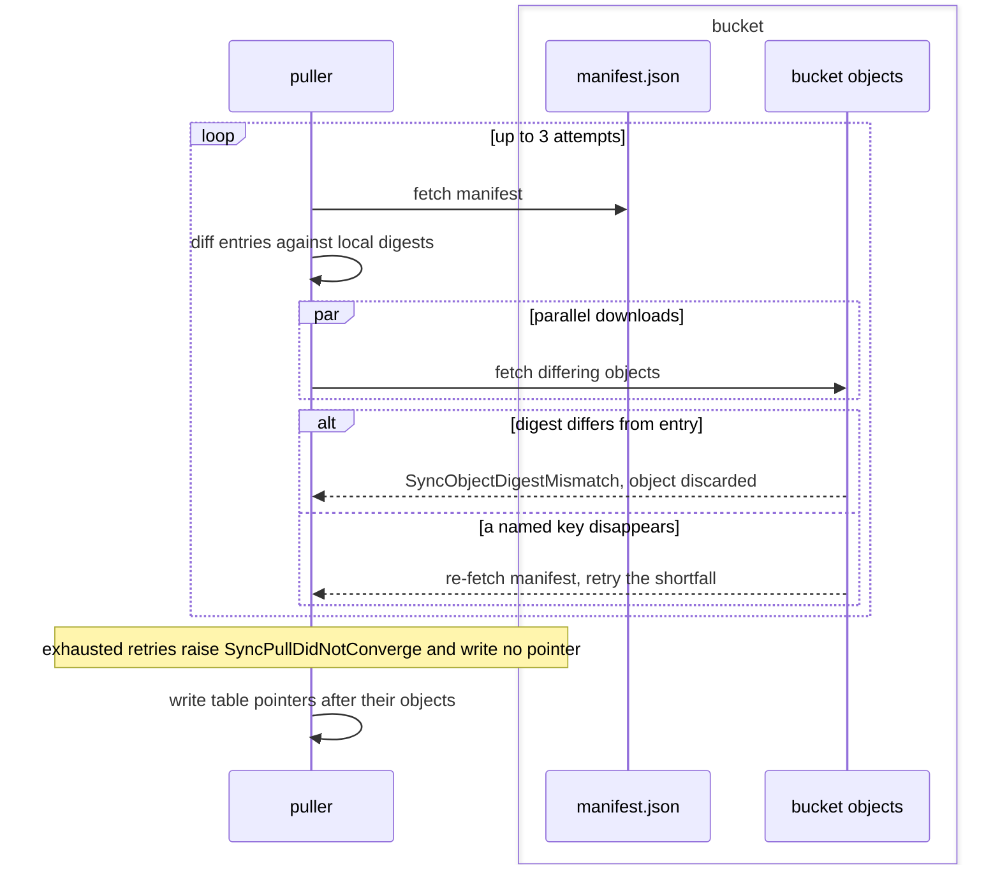

# Bucket pulls

A pull downloads the bucket into the store, verifying each object, and writes each table pointer last.

## pull

Downloading bucket files, verifying digests, advancing table pointers and restoring named generations.

- `digest-mismatch` — A downloaded object whose digest differs from its manifest entry is discarded and raises `SyncObjectDigestMismatch`; run states follow {{store.pull.run-state-torn}} instead.
  *P4*
- `run-state-torn` — A downloaded `nodes/<node-id>/run-state.json` differing from its listed digest is discarded with a warning naming the key, and the pull continues without it.
  *because an interrupted push leaves a run state its manifest never committed*
- `identity-conflict` — A pull into a store holding a different {{store.init.store-identity}} raises `StoreIdentityConflict` before downloading files.
  *because importing another UUID lets that store's owner credential read local rows*
- `convergence` — A named key disappearing mid-download makes the pull re-fetch the manifest and retry the shortfall, up to 3 attempts.
- `unconverged` — Exhausting those retries raises `SyncPullDidNotConverge`, naming the key that kept moving, and writes no pointer.
  *P4*
- `unconverged-resume` — A pull refused under {{store.pull.unconverged}} keeps verified objects, so the next `sync pull` downloads only keys whose digests still differ.
  *A-store#exhausted-pull-refuses*
- `transfer-width` — A pull downloads with up to `[sync] transfers` concurrent requests, default 16 requests, minimum 1, and writes every verified object before returning any refusal.
  *because one request per round trip makes a cold boot grow with object count*
- `digest-record` — Pull and push reuse a file's machine-local sha256 record while size, modification time, change time and inode match it, and hash the file otherwise.
  *because rehashing every held file on each sync grows with the store*
- `pointer-last` — A pull writes a table's pointer only once every Parquet part of the named snapshot exists locally, so no reader meets a pointer before its data.
  *A-store#replica-read-whole*
- `run-manifest-last` — A pull writes a run's `_manifest.json` only after every other listed object it downloads exists locally, so a concurrent read resolves no run missing parts.
  *because a read resolves every run whose `_manifest.json` exists*
- `tombstone-applied` — Pull deletes local keys tombstoned and absent from entries; a tombstoned key with no local copy goes unverified and unreported.
  *because a deletion that never reaches a consumer resurrects once its tombstone ages out*
- `cold-own-keys` — A pull downloads each key its node owns that the store lacks and {{store.merge.held-record}} does not list, so a replacement host or a widened table scope reusing the node id reads every such key.
  *because only a key the store held and lost is its own deletion; one it never held carries rows nothing local replaces*
- `pointer-read` — Pull and push read the pointer of each table the bucket manifest lists by its key, `tables/<t>/_pointer.json`, and list no table objects, so the read grows with the tables and not with their objects.
  *because a bucket gathers parts with every landing, and a pointer read listing them grows with the store's history*
- `pointer-advance` — Pull advances a local pointer whose snapshot the bucket pointer's chain names, keeping one on the same snapshot at a higher fence, and replaces any other only under {{store.pull.pointer-adopt}}, verifying every advancing table before writing any pointer.
  *A-store#replica-read-whole*
- `pointer-adopt` — Pull replaces a local pointer the bucket pointer's chain does not name, whatever its fence, save one ahead whose ancestry names the bucket pointer's snapshot, and warns once {{store.pull.local-fold-unrecoverable}} admits its branch.
  *because a fold outside a lease writes no fence, and a local snapshot off the bucket's chain misses every run the bucket's head folded*
- `local-fold-unrecoverable` — A branch back to the bucket's chain or a root that folds a run neither on disk, listed in the bucket nor folded on that chain, or meets an absent manifest, raises `SyncLocalFoldUnrecoverable` naming the runs, and the pointer stays.
  *because those rows otherwise live only in the replaced snapshot's parts, which collection deletes once no pointer names them*
- `schema-merge` — A pulled `schema.json` differing from the local copy merges into it column by column through {{store.reconcile.incompatible}}'s lattice rather than replacing it.
  *because rows landed locally carry columns the bucket's copy may lack*
- `table-scope` — `contextful sync pull --table <pattern>`, repeatable, pulls only the tables its patterns cover through {{authority.grant.one-matcher}}. Without the flag, a pull takes `[sync] pull_tables`, and without either, every table.
  *because a disposable disk serving one table otherwise downloads every table the bucket holds*
- `tables-empty` — A `[sync] pull_tables` holding no pattern raises `SyncPullTablesEmpty` when the config is read; `["*"]` names every table.
  *because an empty list reads as no table to one operator and every table to another*
- `scope-shared` — A table-scoped pull also takes `store-id`, `control/`, every `nodes/<node-id>/run-state.json` and every `cursors/` entry, and no other key outside `tables/`.
  *because run states and commit-log entries name no table, and a scoped store lacking them restarts each source*
- `before-run` — With `[sync] pull_before_run = true`, `run start`, `pipeline run`, `mcp` and `serve` pull the tables {{store.pull.table-scope}} selects before their first read, a failed pull stopping the command.
  *because a container on an empty disk otherwise serves without other nodes' runs*
- `serve-refresh` — Under {{store.pull.before-run}}, `serve` pulls again every 30 s and maps the new generation for reads starting after that pull; a failed refresh keeps serving the held generation and logs the failure.
  *because a separate query face otherwise serves its starting generation until restart*
- `generation` — `contextful sync pull --generation <N>` reads `gen-<N>.json` in place of the bucket manifest, downloads its in-scope keys at their listed digests and writes exactly its pointers regardless of fence.
- `generation-list` — `contextful sync generations` lists the bucket's `gen-<N>.json` files in ascending order with `committed_at`, `committed_by` and the project's entry and tombstone counts, a missing stamp printing as `-`.
  *because generation numbers carry no time*
- `generation-absent` — A generation the bucket holds no `gen-<N>.json` for raises `SyncGenerationAbsent`, naming N and the newest generation, and writes nothing.
  *because a restore falling back to another generation reads a state nobody named*
- `generation-diverged` — A local syncable file in scope that the generation omits makes generation pull raise `SyncGenerationDiverged`, naming the file, and write nothing.
  *because a kept unlisted run adds rows the generation never held*
- `generation-schema` — A generation pull merges the bucket's current `schema.json` under {{store.pull.schema-merge}}, refusing nothing over a differing generation digest.
  *because the lattice keeps every column an earlier generation carried*
- `generation-run-state` — Generation pull exempts `nodes/<node-id>/run-state.json` from {{store.pull.generation-diverged}}, keeping run states the generation omits; other unlisted files under `nodes/` meet that refusal.
  *because a run state summarizes history outside the store root*
- `run-state-cursor` — At run open, a run resumes from a pulled run state's cursor when that pipeline and table's commit marker is newer than every local one.
  *because a collected run takes its cursor out of the bucket, so a cold node re-reads the source*
- `control-head` — Pull downloads the bucket manifest's project-scoped control head, snapshot and receipt ancestry at their listed digests. The local applied pointer stays unchanged for {{surface.reconcile.pulled-control}}.
  *A-surface#synced-control-head*

### lazy parts

A lazy store pulls metadata and fetches each data part and folded run manifest when a reader first needs it.

- `lazy-parts` — With `[sync] lazy_parts = true`, pull skips table Parquet data parts, which the store fetches whole on first read or fold use and verifies under {{store.pull.digest-mismatch}}.
  *A-store#cold-store-boots*
- `lazy-pointer` — Under {{store.pull.lazy-parts}}, {{store.pull.pointer-last}} waits for the named snapshot's `_manifest.json` alone; a part's digest comes from the bucket manifest when a read first fetches it.
  *A-store#cold-store-boots*
- `lazy-ready` — Under {{store.pull.lazy-parts}}, {{store.pull.before-run}} waits for every in-scope object except data parts and the manifests {{store.pull.lazy-folded-runs}} skips.
  *A-store#folded-runs-on-demand*
- `lazy-folded-runs` — Under {{store.pull.lazy-parts}}, pull skips each other node's run `_manifest.json` that the pointer's snapshot chain folds, keeping its `_group.json`, and lists the skipped keys in the store's `.skipped-runs.json`.
  *A-store#folded-runs-on-demand*
- `husks-skipped` — Under {{store.pull.lazy-parts}}, pull skips each `_manifest.json` beside a listed `_collected.json` where the pointer's snapshot, once home, holds a valid folded-runs index and an ancestry reaching the local pointer, listing it in `.skipped-runs.json`.
  *A-store#index-walk*
- `husks-fetched` — A full chain walk, or one meeting no valid index, fetches the table's skipped collected snapshot manifests through the part source at the first it reaches; local retention and a walk past a valid index end there.
  *A-store#index-walk*
- `husks-staleness` — A model's staleness check reads its head snapshot, each input's snapshots from the pointer down to the watermark snapshot, and the runs folded beneath through {{store.lay-out.folded-index-walk}}, fetching a skipped manifest only on that path.
  *A-store#index-walk*
- `skipped-record` — Each pull clearing its refusals rewrites `.skipped-runs.json` to the manifests the bucket lists and the store lacks, inside its scope or outside it, a generation restore also keeping each entry outside its scope; an empty record leaves no file.
  *because a manifest the bucket stopped listing was collected, and an eager pull applies its tombstone*
- `folded-runs-fetched` — Listing a table's committed runs, or an `as_of` read resolving before the pointer's snapshot, fetches each skipped manifest through the part source within {{read.cache.miss-wait}}'s deadline; an unbounded read fetches none.
  *A-store#folded-runs-on-demand*
- `folded-run-collected` — A skipped manifest the part source cannot bring home refuses the read as {{store.pull.part-collected}} does, save where the source answers it collected: an unbounded listing leaves it out, and a bounded read does when a kept snapshot folds its run.
  *A-store#folded-runs-on-demand*
- `folded-runs-unreachable` — A store listing skipped manifests and opened without a part source raises `SyncFoldedRunsUnfetched` wherever {{store.pull.folded-runs-fetched}} or {{store.pull.husks-fetched}} fetches, naming the table and a manifest.
  *A-store#folded-runs-on-demand*
- `folded-runs-source` — Every command opening a store whose `[sync]` declares `lazy_parts` registers the bucket's part source once per process, whether or not the command pulls.
  *because a command reading runs without pulling otherwise meets {{store.pull.folded-runs-unreachable}}*
- `part-cache` — `[sync] part_cache_bytes`, default 8 GiB, bounds locally fetched parts; above it, the cache deletes the least recently read part no statement or fold holds.
  *A-store#cold-store-boots*
- `part-accounting` — Each verified lazy download counts once toward {{store.pull.part-cache}} upon reaching disk, despite other fetch failures. If the cache index is missing, reopening adopts receipt-listed parts without bucket reads or receipt-free tree scans.
  *because a partial acquisition and a lost index leave completed downloads subject to eviction*
- `part-collected` — A part {{store.pull.lazy-parts}} needs and the bucket lacks raises `SyncPartCollected`, naming the part and snapshot; the next pull advances the pointer past that snapshot.
  *because `sync collect` deletes a tombstoned run's parts while a container whose pointer predates the tombstone reads them*

### reland

A reland lands again the runs a refused pull names and moves the local pointer onto the bucket pointer's snapshot.

- `reland` — `contextful sync reland <table>` lands each run {{store.pull.local-fold-unrecoverable}} names again as a new run of this node, then writes the bucket pointer's snapshot and fence as the local pointer, so the next pull proceeds.
  *because those rows otherwise wait on a landing by hand and a deleted pointer per table*
- `reland-named` — A refusal under {{store.pull.local-fold-unrecoverable}} naming runs names `contextful sync reland <table>` as its remedy; one meeting an absent manifest names landing the rows by hand.
  *because an operator reads the remedy where the pull stops*
- `reland-rows` — A relanded run holds the local snapshot's rows whose `_run_id`, and `_commit_seq` and `_ingested_at` where the folded-runs index records them, match the run's, committed at its instant with its site, author and taint.
  *because one run id repeats across nodes, and the original instant keeps a keyed read's ranking*
- `reland-keyed` — A relanded run of a keyed table holds only the rows its snapshot kept, and the reland reports beside them the rows the folded-runs index records the run held.
  *because a later run in the branch superseded the rest, and that run folds again or is relanded too*
- `reland-lineage` — A relanded run's id is `reland-` and 16 hex digits of SHA-256 over the local snapshot id and the run key, and its manifest's `relanded_from` names that key.
  *because a repeat then replays the committed run instead of landing its rows twice*
- `reland-order` — A reland commits every relanded run and syncs its files to disk before writing the pointer; a failure before that write leaves the local pointer and the snapshot's parts as they stood.
  *because the pointer write is the step after which no pointer names the snapshot's parts*
- `reland-unneeded` — A reland of a table holding no local pointer, against a bucket naming no snapshot, of a pointer {{store.pull.pointer-advance}} keeps or advances, or of a branch folding no unrecoverable run raises `SyncRelandUnneeded`, writing nothing.
  *because with nothing stranded the pull already brings every row home*
- `reland-head-absent` — A reland while the bucket pointer's snapshot lacks its manifest on disk, or a Parquet part outside {{store.pull.lazy-parts}}, raises `SyncRelandHeadAbsent`, naming the snapshot; the refused pull brings it home.
  *because without the head's chain on disk every run the head folds reads as unrecoverable*
- `reland-unknown` — A branch meeting an absent manifest, or a run whose rows no folded-runs row tells apart from another node's run of its id, refuses the reland as {{store.pull.local-fold-unrecoverable}} does, writing nothing.
  *because neither names the rows a relanded run holds*

A pull converges on the bucket manifest and writes each table pointer last.

#### Scenarios

- `store.pull.control-head`: WHEN a cold node pulls a signed control head, THEN its local applied pointer stays absent until reconciliation verifies the head.
