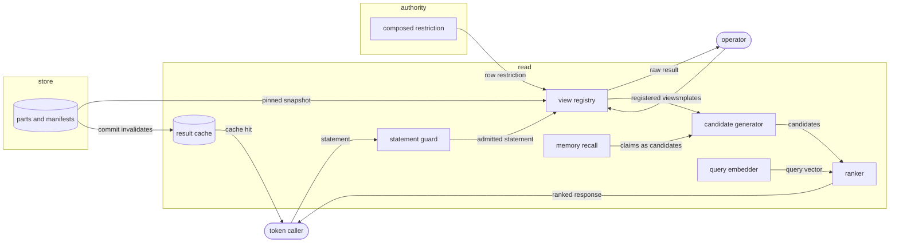

# The read face

Implementers use this page for SQL queries, ranked retrieval and read responses.
Each connection registers relations with the caller's access restrictions. Reads write
no rows and hold no leases. Queries use existing index sidecars and build no indexes.

Query components and their connections to storage, access controls and memory:



## register

Registered relations, query tools, templates, the embedded SQL engine and HTTP transport.

- `connection-views` — Each session connection creates or replaces one view per manifest table, scanning {{store.reconcile.explicit-file-list}}. Statements reuse these views under {{read.cache.session-pool}}. No view directory exists on disk.
- `declaration-set` — The face registers the tables of {{store.declare.declaration-set}}, so a `primary_key` a pipeline file declares reaches {{store.declare.dedup-view}} on the operator verb and the tool server alike.
- `engine` — Every profile serving reads links an embedded columnar SQL engine that reads Parquet with standard SQL. External processes read the same files without that embedded engine.
  *A-topology#build-profiles*
- `quiet-table` — A quiet table registers as {{store.declare.empty-run}}. Reading that table returns an empty result rather than a missing-relation fault.
  *P4*
- `bare-name` — In caller statements, templates, ranking queries and file previews, a bare table name resolves to the caller's registered relation. That relation carries the caller's restriction.
  *P5*
- `tool-set` — The face exposes `context.describe`, `context.query`, `context.reference`, `context.execute_query` for templates, `context.files`, `context.file`, `context.subscribe`, `corpus.retrieve`, `memory.recall` and `memory.explain` as its closed tool set.
  *A-read#pooled-engine-reuses*
- `bound-arguments` — Except `memory.recall`, `memory.explain` and `context.subscribe`, read tools, including templates, accept `as_of` and `valid_as_of` and echo {{store.bound-time.echo}}. {{store.bound-time.valid-as-of}} applies only to tables the read touches.
  *because a session registers every granted table, and wrapping one declaring no pair refuses reads that never name it*
- `bound-listing` — `context.files` and a `context.describe` naming no table select under `as_of` alone; each ignores `valid_as_of` and echoes only its `as_of` part.
  *because valid time narrows rows, and a listing returns files and table names, never rows*
- `available-bound-argument` — Tools under {{read.register.bound-arguments}} also accept `available_as_of` and echo {{store.available-time.bound-echo}}. {{store.available-time.available-as-of}} applies only to tables the read touches.
  *because a session registers every granted table, and wrapping one declaring no availability time refuses reads that never name it*
- `available-bound-listing` — A listing {{read.register.bound-listing}} names ignores `available_as_of` and echoes no `available_as_of` part.
  *because availability time narrows rows, and a listing returns files and table names, never rows*
- `describe-payload` — `context.describe` returns row count, {{read.register.size-estimate}}, schema fingerprint, description, {{read.register.column-hints}}, declared indexes, partition scheme, `limits.max_rows`, zone label, lexicon and example queries.
- `size-estimate` — `context.describe` reports `bytes`, the serialized JSON length of the caller's restricted rows, and `estimated_tokens`, one per 4 B of that length, rounded up.
  *because a client choosing between a full-context read and a ranked one compares the corpus against its context window before reading it*
- `join-route` — Cross-table joins use one `context.query` statement over registered relations or a published model listed by describe. No tool constructs joins for callers.
  *because a statement already composes each relation's restriction, and a join tool restates that composition outside the guard*
- `column-hints` — A table's `column_hints` map supplies optional per-column hints; `context.describe` includes each hint only with a column the session registers.
  *because a hint for an absent column describes a relation the registered schema cannot query*
- `describe-zone` — `context.describe` reports the session zone as `session_zone`, and per table, listed or described, `zone_admitted`: whether the table's effective allow-set admits that zone.
  *A-read#read-surface-admits*
- `advertised-is-enforced` — A table's published `limits` block lists a bound exactly when the engine applies it.
  *because a published number and a delivered guarantee cannot disagree when one derives from the other*
- `budget-arguments` — Every read tool but `context.subscribe`, which {{read.subscribe.overrun}} bounds, accepts optional `max_duration_ms` and `max_response_bytes` request fields, each with no default.
- `duration-no-statement` — A read tool running no SQL statement accepts `max_duration_ms` without triggering {{read.respond.duration-ceiling}}.
  *because no connection executes a statement for its deadline to interrupt*
- `budget-advertisement` — `context.describe` lists a table's `limits.max_duration_ms` and `limits.max_response_bytes` under {{read.register.advertised-is-enforced}} and omits each undeclared limit.
- `template-projection` — Each manifest template registers a tool named by the template's identifier. The tool's typed schema requires every declared positional parameter.
- `file-listing` — `context.files` returns store-root-relative paths for the tables the caller reads, and a table outside that set contributes no path.
  *P5*
- `file-preview-target` — `context.file` resolves a path to its `(table, run_id)` and reads it through that table's registered relation. A snapshot part, a traversal, an absolute path or a ledger file raises `FilePreviewNotATable`.
  *A-read#read-surface-admits*
- `ledger-relation` — Each table's per-run request ledger registers as the child relation `<table>__requests`, holding identifiers, connector, method, host, status and timing of mediated outbound calls.
- `scoped-ledger` — The child relation registers on the owner read alone: a credential carrying no tenant scope, over a table carrying no row policy. Naming a closed ledger raises `LedgerNotTenantScoped`, stating what closed the relation.
  *A-read#read-surface-admits*
- `no-tenant-ledger` — No tenant-scoped projection of a request ledger registers; {{read.register.scoped-ledger}} is the ledger's one read path.
  *because ledger rows carry no tenant column, and a projection filtering on a dimension its rows lack discloses every tenant's calls*
- `lexicon-surface` — The describe payload carries the store's numeric-identifier and badge vocabulary. Aliases, time-window phrases and distillation examples stay on the serving side.
- `reserved-relation` — The engine's reserved table namespaces register like any other relation, with no privileged path underneath.
  *P5*

### HTTP transport

`contextful serve --http` admits each request, bounds its connections and drains on stop.

- `network-transport` — `contextful serve --http <addr> --audience <aud> --max-in-flight <n>` serves MCP Streamable HTTP at `POST /mcp`. The stdio tool server answers each request's single JSON-RPC message as `application/json`.
  *A-read#networked-read-transport*
- `concurrent-statements` — Requests on any number of connections run concurrently. Each statement uses its own engine connection under {{read.cache.pool-connections}} and delays no other request.
  *A-read#pooled-engine-reuses*
- `serve-declaration` — A serve with no `--audience`, or no positive `--max-in-flight`, raises `ServeDeclarationMissing` naming the flag and binds no listener; neither ships a default.
  *P3*
- `past-ceiling` — A request arriving while the ceiling's count of requests is in flight answers `503` with a `Retry-After` of 1 s and admits nothing.
  *A-read#networked-read-transport*
- `connection-ceiling` — An accepted connection holds a slot until the server writes its response. With all slots held, the server answers {{read.register.past-ceiling}} before parsing the request and starts no thread.
  *because a request head arrives before admission, and a slot taken only after reading it lets an unadmitted caller hold one thread per connection*
- `per-request-admission` — Each request carries `Authorization: Bearer <credential>`, or `DPoP <credential>` with a `DPoP` proof header. The listener admits each credential under {{authority.verify.possession-binding}} and {{authority.verify.network-bearer}} and restricts reads to that credential's grants.
  *A-read#networked-read-transport*
- `credential-missing` — A request carrying no `Authorization` credential raises `HttpCredentialMissing` with `401` and reads no row.
  *A-read#networked-read-transport*
- `admission-refused` — A request its admission refuses answers `401` carrying the refusal's identifier, except a full nonce cache, which answers `503` under {{authority.verify.nonce-cache}}.
  *A-read#networked-read-transport*
- `per-request-revocation` — The server re-reads `--denylist` for each request and rejects a revoked credential on the next request without restarting. An unreadable denylist returns `503` and admits nothing.
  *A-read#networked-read-transport*
- `stateless-session` — A notification answers `202` with no body. The face holds no protocol session and opens no server stream: a `GET` or `DELETE` on `/mcp` answers `405`, any other path `404`.
  *A-read#networked-read-transport*
- `request-body` — For a request body over 1 MiB, the server returns `413` and stops reading the body.
  *because the listener reads the body before admission, and an unbounded body lets an unadmitted caller hold memory*
- `health` — `GET /health` answers `200` with the build identity of {{read.embed.build-identity}}, admitting no credential and reading no row.
  *because a container runtime probes readiness before any caller holds a credential*
- `health-hydrated` — `GET /health?ready=hydrated` answers as {{read.register.past-ceiling}} until snapshot-set hydration completes, then as {{read.register.health}}.
  *because a load balancer probing plain `/health` routes reads to a container still hydrating, which answers each one `503`*
- `stop-drain` — On `SIGTERM` or `SIGINT`, `contextful serve --http` admits no new request, answers every connection it accepted before the signal, and exits 0 once none remains, at most 20 s after the signal.
  *because a container platform kills a stopping process after its grace period, and a process exiting at the signal resets every request it holds*
- `drain-unfinished` — A connection still unanswered at the bound of {{read.register.stop-drain}} closes unanswered; the server names their count on stderr and exits non-zero.
  *because an operator reading a clean exit as a complete drain misses the requests the bound cut off*
- `draining-health` — From the stop signal on, every new connection, `GET /health` included, answers as {{read.register.past-ceiling}} before its request is parsed.
  *because a load balancer reading `503` from `/health` stops routing to a target whose admitted requests are still finishing*

## guard

SQL validation, allowed relations, operator statements and template arguments.

- `single-read-only-statement` — Admitted text parses to exactly one read-only SELECT. Attach, copy, install, load, pragma, set, any schema change, any data modification and a piggybacked second statement raise `StatementNotReadOnly`.
  *A-read#read-surface-admits*
- `engine-own-parse` — The guard checks the syntax tree serialized by the SQL engine. The tree determines whether the statement is read-only; no keyword blocklist determines admission.
  *because guard and executor cannot disagree about what a text means when they share one parse*
- `relation-allowlist` — Every base relation names a view registered for this caller or a common table expression the statement declares. A bare file path is a base relation and falls under this rule.
  *A-read#read-surface-admits*
- `whole-tree-walk` — The guard checks the entire tree, including select-list subqueries, union arms and pivot sources. Common-table-expression names resolve only within their declaring scope and nested scopes.
- `unregistered-relation` — The guard rejects an unregistered base relation under {{authority.refuse.ungranted-table}}. The error echoes the requested name and no relation belonging to another caller.
  *A-read#read-surface-admits*
- `table-function` — A table function anywhere in the tree, and a schema-qualified reach into a system catalog, raise `TableFunctionRefused`.
  *A-read#read-surface-admits*
- `statement-provenance` — Local operator statements, template bodies and engine-composed reads execute without caller-SQL validation. The guard validates capability-token callers' SQL. No network interface exposes raw operator execution.
  *A-read#read-surface-admits*
- `quoted-identifiers` — Every schema- or manifest-derived identifier is double-quoted where rendered, admitting any UTF-8 vendor field name as an identifier and never as an expression.
- `template-declaration` — A template declares an identifier, one SQL statement, positional parameters written `name:type` over integer, float, string, timestamp and boolean, and an optional row ceiling.
- `template-reserved-parameter` — Manifest validation rejects template parameters named `as_of`, `valid_as_of`, `zone` or `pin`. Every template tool reserves those names for read bounds, zone and build pins.
  *because a parameter sharing a read argument's name hides that bound from the template tool*
- `available-reserved-parameter` — Manifest validation rejects `available_as_of` template parameters under {{read.guard.template-reserved-parameter}}. Every template tool reserves that name for the availability bound.
  *because a parameter sharing a read argument's name hides that bound from the template tool*
- `template-relation-shape` — Manifest validation and server startup raise `TemplateNamesForeignRelation` for template SQL naming anything except store tables as plain identifiers. Template identifiers starting with `context.`, `corpus.` or `memory.` also raise that error.
  *A-read#read-surface-admits*
- `template-binding` — A missing, unknown or type-mismatched argument raises `TemplateArgumentRejected` ahead of execution, with no coercion. Placeholders are `$1`…`$n` or `?` in declaration order, or exactly the declared names.
  *A-read#read-surface-admits*
- `query-binding` — `context.query` binds `$name` or contiguous `$1`…`$n` from `parameters` typed under {{read.guard.template-declaration}}, without coercion. Positional `?`, missing, unused, untyped or mismatched parameters raise `QueryParameterRejected` before execution. Bound values pass {{authority.refuse.scope-guard}}.
  *because a value bound to a placeholder reaches no parser, and the tenant guard decides a bound value as it decides a literal*
- `startup-time-check` — Template checks are caller-independent and run once at startup; a request pays nothing for them.

## respond

Response fields, cell encoding, row and byte limits, truncation and diagnostic metadata.

- `one-projection` — CLI JSON output, HTTP and the tool protocol serialize the same response: `columns`, `rows`, `truncated`, and optional restriction, resolved-build, provenance, retrieval and time-bound blocks.
  *because a guarantee landing on one transport and missing on another is worse than a guarantee on none*
- `row-ceiling` — The executor applies each table's `limits.max_rows` to delivered rows. Truncation detection uses an extra-row probe (1 rows). This ceiling limits no work performed.
- `face-ceiling` — Every read interface, including `corpus.retrieve`, delivers at most 10000 rows. This ceiling contributes to {{authority.grant.row-ceiling}} without requiring a declaration and bounds the candidate window.
  *because an undeclared ceiling otherwise streams a whole table into one response, and a caller learns of the cut from `truncated` rather than from memory exhaustion*
- `engine-composed-ceiling` — Engine-composed table reads, derive sources and memory reads apply the least declared grant or table row ceiling, excluding the interface ceiling. Without declared ceilings, these reads deliver every row.
  *because a derive or memory pass over a silently cut table records partial input as complete*
- `truncation-is-exact` — For a row ceiling, the serializer sets `truncated` exactly when the extra probe row exists. Comparing returned counts with requested limits does not determine truncation.
  *P4*
- `cell-encoding` — SQL NULL is JSON `null` and nothing else is. Non-finite floats are `"NaN"`, `"inf"`, `"-inf"`; temporal values are ISO-8601 strings, intervals ISO-8601 durations; an enum is its label; a union is its text form.
- `bytes-and-vectors` — The serializer encodes binary as padded base64. Fixed-size float arrays, including vector columns, become JSON arrays whose elements use float-cell encoding.
  *A-store#binary-fixed-size*
- `nested-values` — Lists encode as JSON arrays. Structs and maps encode as JSON objects keyed by field name or key text. Each item, field or value uses cell encoding.
  *A-store#struct-list-map*
- `wide-number-shape` — SQL type alone determines JSON encoding. Integers up to 32 bits, finite floats and decimals up to 15 digits encode as numbers. Wider integers and decimals encode as exact decimal strings.
  *because a wire type that varies with the values on one page breaks a typed client on the next*
- `type-is-the-cell` — The response carries no separate type list. Each cell's JSON type declares its type.
- `one-response-shape` — Every read answers with one complete result set in one response; no read tool streams partial rows.
  *P4*
- `zero-rows-is-success` — Fewer rows than the requested limit, zero included, is a success.
  *P2*
- `match-count` — Match counts report the number of matching rows scored by the ranker in that call. These counts require no diagnostic metadata.
- `coverage-is-a-count` — A claim of missing corpus coverage requires a table count after the full-scan fallback, without recency truncation. The highest ranked score supplies no coverage conclusion.
  *because the calibrated lexical leg scores the best row 1.0 and IDF lifts one incidental rare-term mention*
- `internals-opt-in` — With `internals: true`, every read tool and HTTP response includes a separate object containing executed SQL, engine name, applied limit, row count and elapsed milliseconds. Otherwise, the response omits that object.
- `query-internals-parameters` — Under `internals: true`, {{read.guard.query-binding}} includes the validated typed parameter map beside executed SQL in the internals object.
- `duration-ceiling` — Under {{authority.grant.duration-ceiling}}, the engine interrupts the statement's connection at its deadline. `ReadDurationExceeded` names the ceiling, source and elapsed milliseconds. The response contains no rows; other statements continue running.
  *A-read#statement-owns-deadline*
- `byte-ceiling` — Under {{authority.grant.byte-ceiling}}, the serialized response includes only whole rows within the selected ceiling. An envelope or first row exceeding that ceiling raises `ReadResponseTooLarge` and returns no rows.
  *A-read#statement-owns-deadline*
- `truncation-cause` — A truncated response carries `contextful.truncation` with `by`, `ceiling` and `source`: `rows` admits grant, table, request, template or face; `bytes` admits grant, table or request.
- `truncation-tie` — If both ceilings cut the same next row, bytes takes precedence. Equal ceilings within one dimension choose the first eligible source: grant, table, request, template, face.
  *because one cut needs one deterministic cause for a client to branch on*
- `operator-metadata` — Operator table metadata includes column count and backing files. A row count comes from a count query rather than a stored field.
  *P3*
- `restriction-block` — The restriction block includes session zone, incognito flag and an entry per touched relation excluded or column-masked by zone: `table`, `excluded`, `rows_dropped`, `columns_masked`. Reads withholding no touched relation omit the block.
  *A-read#zone-withheld-relation*
- `in-band-error` — On the tool protocol a refusal arrives in-band, as a protocol error object or a result flagged as an error under transport success.
  *P2*
- `paths-stay-inside` — An ordinary read's result carries no store path. Provenance arrives as columns naming table, run, connector version, ingestion instant and authoring subject.
  *A-read#read-surface-admits*

## query

The operator's raw statement verb on the command line: its arguments, the relations it registers, its row bound and its output.

- `operator-verb` — `contextful query --json [--project <name>] [--declaration <path>] [--limit <n>] [--incognito] <sql>` runs one raw operator statement under {{read.guard.statement-provenance}}. The command prints {{read.respond.one-projection}} as one JSON line on standard output.
- `one-statement` — Text the engine's parser splits into other than exactly one statement raises `QueryNotOneStatement` before any statement runs.
  *because preparing multi-statement text executes every statement but the last and answers only the last, dropping the earlier results and side effects unseen*
- `project-relations` — Within a project, outside {{read.query.incognito}}, all stored or manifest-declared tables register under bare names as unrestricted base relations at latest committed state. Quiet tables follow {{read.register.quiet-table}}.
  *because operator text is the store owner's own, and a restriction bounds a capability-token caller*
- `incognito` — With `--incognito` or `[project.zone]` setting `incognito_default = true`, each relation passes the zone step at `local:device`. Excluded tables return no rows; excluded columns return null. {{read.respond.restriction-block}} reports both.
  *because incognito pins the uncredentialed local owner's reads to the fail-closed pair, and this verb is that owner's read*
- `discovered-project` — Without `--project`, the project {{store.init.discovery}} finds is the verb's project. When discovery finds none, or the found project's store is absent, no relation registers and the statement runs over no store.
  *because every other verb reads the nearest `contextful.toml`, and a statement over files or literals needs no store*
- `project-store` — A `--project` whose `.contextful/context/<project>/` store is absent raises `QueryProjectAbsent`.
  *because every declared table of an absent store registers as quiet, and an operator reads its zero rows as an answer*
- `declaration-default` — `--declaration <path>` names the manifest whose declared tables register; without it, the {{store.init.default-declaration}} file does when present, and no manifest otherwise. With no project, `--declaration` refuses by {{store.init.undiscovered}}.
- `limit-truncates` — `--limit <n>` bounds delivered rows using the over-fetch of {{read.respond.row-ceiling}} and sets `truncated` under {{read.respond.truncation-is-exact}}. Without this flag, the query returns every row {{read.query.raw-row-ceiling}} admits.
- `raw-row-ceiling` — An operator's raw read delivers at most the least `limits.max_rows` among the relations its parsed statement names, and at most `--limit` beside it.
  *because a published bound the owner's own verb ignores advertises a guarantee one face breaks*
- `json-only` — The verb prints the JSON projection alone; it carries no text rendering, and a call omitting `--json` is a usage error.
  *because a second rendering is a second projection a script must reconcile with the first*
- `engine-fault` — A statement the engine rejects exits non-zero with the engine's message on standard error and nothing on standard output.
  *because a caller parsing standard output never mistakes a partial or empty envelope for an answer*


## reference

Resolution of one stored citation through the caller's registered relation, including the authenticated distinction between an erased source and an absent version.

- `call` — `context.reference` accepts one table, run identifier and row sequence. `contextful context reference` uses the same resolver under Read admission, returning {{read.respond.one-projection}} without selecting a filesystem path.
  *A-read#result-reused-under*
- `admission` — Resolution applies {{read.guard.unregistered-relation}}, the caller's registered row and column restrictions, and {{read.respond.duration-ceiling}}, {{read.respond.byte-ceiling}} and {{disclosure.record.read-entry}} before publishing its verdict.
  *A-read#read-surface-admits*
- `erased-verdict` — An admitted reference in the independently verified cumulative erasure index returns `available: false` and `reason: erased`. An absent reference outside that index returns `reason: missing` without source payload.
  *A-read#result-reused-under*
- `index-visibility` — A tenant-scoped, row-policy-restricted, zone-excluded or column-masked caller receives an unreadable verdict before erasure-index access; only the owner metadata eligibility of {{read.register.scoped-ledger}} admits an erased verdict.
  *A-read#read-surface-admits*
- `frontier` — Before resolution and response publication, the resolver validates the same signed store frontier. The frontier's erasure index binds store identity and cumulative reference versions through {{disclosure.erase.store-binding}}.
  *A-read#result-reused-under*

## retrieve

Candidate rows for ranked retrieval: query tokens, relevance thresholds, per-table queries, deduplication and snippets.

- `ranked-call` — `corpus.retrieve({prefix, tables?, query, query_embedding?, filter?, kinds?, limit?, since?, min_score?, as_of?, valid_as_of?})` returns ranked rows across item and artifact genres under `prefix` and `tables`, each with a snippet and provenance, composing the query surface and memory recall, storing nothing.
- `table-list` — Retrieval queries session relations matching both `tables` and `prefix`. Names outside the session raise `RetrieveTableUnavailable`, listing every unavailable name in input order. Absent and ungranted tables receive identical errors under {{authority.filter-rows.default-deny}}.
  *because one identical refusal for an absent and an ungranted table confirms neither exists, and a silently skipped typo answers a different question*
- `relevance-floor` — A row reaches a caller when its lexical score is null, at least the floor, or its vector score is positive. The floor is 2 tokens for queries of 3 tokens or more, else 1 tokens; a caller minimum overrides.
- `content-tokens` — The tokenizer lowercases query text and splits at non-alphanumeric characters. The tokenizer removes stop tokens, keeps non-ASCII runs of two or more characters, and deduplicates tokens in order.
- `token-length-floor` — An ASCII run shorter than 2 chars leaves the content-token set.
- `token-cap` — The content-token set holds at most 12 tokens. An empty set omits the relevance predicate.
- `script-split-matching` — An all-lowercase-alphanumeric token matches on an ASCII word boundary with an optional plural suffix; a token with any non-ASCII character matches by containment.
  *because no ASCII word boundary occurs beside an ideograph*
- `plural-suffix-floor` — A token under 4 chars takes no optional plural suffix.
- `scored-text` — Under {{store.declare.table-block}}, `retrieve.text` optionally lists columns for lexical scoring and {{read.retrieve.relevance-floor}}, excluding session-classed or masked columns. Without `retrieve.text`, scoring uses the table's snippet columns.
  *because a snippet is chosen for display, so a match in a long body misses the floor and a categorical label in the snippet matches every row*
- `empty-scored-text` — If declared `retrieve.text` leaves no column, retrieval skips that table's full-text probe. For queries containing a content token, only positive vector scores admit its rows.
  *because a null lexical score passes the floor, so a text-only query otherwise returns such a table's newest rows whatever it asks*
- `text-free-table-scores-null` — A table without scored text columns has a null lexical score rather than zero. Only vector scores admit that table's rows.
  *P4*
- `candidate-window` — The candidate window is 8 times the requested limit or 200 rows, whichever is larger. A filled window reports a recency-ordered slice. Where a vector sidecar answers, the window bounds no semantic recall: {{read.retrieve.sidecar-generates-candidates}} adds candidates beyond it.
  *P4*
- `reserved-columns-project-null` — Reserved projected columns — modality, language, prompt hash, kind — render null for a table lacking them, and its rows stay in the union.
- `unsatisfiable-arm-drops` — In `filter`, a scalar tests column equality; a value list tests membership. Rows match every condition. A table lacking a named column contributes no rows, including unfiltered rows.
  *P4*
- `filter-values` — Filter values are strings, numbers or booleans; membership lists contain at least one value. Nulls, nested objects, nested lists and empty lists are malformed conditions.
- `kinds` — `kinds` lists artifact kind strings as one membership condition on `kind`. A table without that column contributes no rows under {{read.retrieve.unsatisfiable-arm-drops}}.
- `engine-resolved-date` — The engine resolves each table's publication column itself, outside the caller's filter.
- `since` — `since` is the inclusive lower bound of the question's timeframe over the publication instant {{read.retrieve.engine-resolved-date}} resolves; the anchor is `as_of`, else the read's clock. A date-only value means midnight UTC, and omitting `since` leaves every row in window.
- `filter-budget` — A filter holds at most 32 conditions, each membership list at most 256 entries, and its serialized JSON, `kinds` included, at most 16 KiB.
- `filter-budget-refusal` — Before building per-table queries, retrieval checks the entire filter's budget. An oversized or malformed condition raises `FilterBudgetExceeded` for the whole read.
  *A-read#restricted-sidecar-probe*
- `row-key-dedup` — Ranked reads keep only the newest ingestion per `(table, row key)`. If that version misses the relevance floor, no older copy substitutes. The key uses the declared content-hash column, otherwise null; projected values supply no digest.
- `row-key-under-mask` — For content-hash columns masked by `drop`, `truncate`, `bucket`, `range` or any combine, every row key is null. Masking by `hash` or `tokenize` alone uses the digest as key.
  *because a mask merging distinct hashes lets a reader's grants decide which rows a table holds*
- `row-key-stays-internal` — The row key is absent from the outer projection.
- `dedup-is-gated` — The deduplicating window function runs under the same condition as the relevance floor, and a browse-shaped read skips it.
- `excluded-arm` — An arm whose table the session's zone excludes contributes no candidate, and the ranked response names that table in {{read.respond.restriction-block}}.
  *A-read#restricted-sidecar-probe*
- `snippet` — A snippet concatenates up to three text columns, using `retrieve.text` when declared. Label-priority columns, such as title, summary, description and thesis, come first; prose-worthy columns follow in schema order.
- `identifiers-never-snippet` — Snippets exclude content hashes, URLs, identifiers and instant-valued columns.

### index sidecars

Vector and full-text sidecars add candidates that rejoin through the caller's relation.

- `sidecar-generates-candidates` — Vector probes use query embeddings; full-text probes use content tokens. Each probe adds its top results to the recency window and rejoins through {{authority.compose.vector-arm}}. Per-row scores equal exact-scan scores.
  *P5*
- `fulltext-probe` — Full-text probes rank the entire snapshot by BM25 with one should-clause per content token. Tokens split by the sidecar tokenizer match resulting terms at consecutive positions. ASCII word tokens match plurals under {{read.retrieve.script-split-matching}}.
  *because a term outside the recency window is found only by a probe that reads every row's postings*
- `sidecar-oversampling` — One probe requests 4 times the limit or 64 rows, whichever is larger, and a full-text probe 4 times that where the request carries restriction context.
- `filtered-traversal` — Under a caller filter or restriction context, a vector probe admits only identifiers the reader's relation yields under the filter; traversal expands refused nodes' neighbours and returns the probe size in admitted rows where that many exist.
  *A-read#filtered-vector-traversal*
- `filtered-exact-threshold` — A pre-scan of the arm's relation under the filter counts the matching identifiers; under 4096 rows, the filtered probe ranks them by exact distance instead of traversal.
  *A-read#filtered-vector-traversal*
- `filter-matches-nothing` — A filtered probe whose pre-scan matches no identifier adds no candidate and raises no error.
- `adaptive-over-fetch` — A full-text probe, and a vector probe carrying neither filter nor restriction context, runs at most 4 rounds in total, doubling its size while readable rows fall below the requested limit. The retrieval block reports any remaining shortfall.
  *A-read#restricted-sidecar-probe*
- `sidecar-size-cap` — A vector sidecar exceeding 64 MiB resident memory stays unloaded; retrieval uses an exact scan. Resident memory includes each graph node's 4 B probe mark and, for sealed sidecars, the graph file.
  *A-store#sidecar-memory-mapped*
- `fulltext-sealed-cap` — A sealed full-text sidecar file larger than 256 MiB stays unopened, and its arm adds no candidates.
  *A-store#sidecar-memory-mapped*
- `sidecar-falls-back` — Retrieval uses an exact scan for missing snapshots, missing matching sidecars, masked or zone-withheld identifiers or indexed columns, classed text columns, dimension or manifest mismatches, or unreadable dumps.
  *P4*
- `gain-never-loss` — For each reader, accelerated retrieval returns a superset of the exact scan's rows. Different readers querying one snapshot may receive different rows.

#### Scenarios

- `read.retrieve.since`: WHEN `corpus.retrieve` carries `since: "2030-01-01"` and a matching row's publication column holds `2029-12-31`, THEN the row still returns, its in-window flag false, ordered below every in-window row.

unsettled: Does the row id {{run.normalize.identity-columns}} injects serve as the row key of a table declaring no content-hash column? owner: read-path affects: read.retrieve

unsettled: Does restriction get the statistics treatment {{read.horizon.rank-statistics}} gives the horizon, so BM25 document frequency on {{read.retrieve.fulltext-probe}} excludes restricted rows? owner: authority affects: read.retrieve

## rank

Candidate ordering by vector and lexical scores, timeframe and reported confidence.

- `three-legs` — Ranking runs exact cosine similarity over the candidate set, BM25 over a full-text index, and a weighted fusion of the two.
- `fusion` — Fusion computes `w_vec · clamp(cosine, 0, 1) + w_lex · rrf(bm25)`. Weights are 60 percent and 40 percent. `rrf` maps BM25 rank `r` to `61 / (60 + r)`. Absent documents score zero per leg; identifiers break ties.
- `lexical-leg-matches-only` — BM25 ranks documents matching at least one should-clause. Documents matching no term are absent. An empty query, candidate set or result produces an empty ranking and uses recency order.
- `flat-window-full-credit` — A lexical window with no score spread awards every present document full credit.
- `question-window-is-a-tier` — A question's timeframe projects a per-row in-window flag against the resolved publication column, and the flag leads the ordering. An out-of-window row sorts down and stays.
  *P4*
- `window-anchor-tolerance` — A publication instant more than 24 h past the question's anchor sets the in-window flag false. A null or uncastable value sets it false too, and a basis field names which case applied.
- `ordering-casts-first` — Ordering compares publication values as `TIMESTAMPTZ` instants, casting a text value before any comparison.
  *because a text comparison of two date spellings orders strings, not instants*
- `retrieval-block` — The `contextful.retrieval` block reports window, candidates_prefloor, candidates, matched, returned, in_window, deduped, padded, floor and since. Each row carries `_score`, the count of content tokens its {{read.retrieve.scored-text}} matches, the in-window flag and the basis label.
- `delivered-counts` — The retrieval block's returned count equals delivered rows; its in_window count equals delivered rows with a true in-window flag, after byte truncation.
  *because aggregate counts describe the rows the caller receives*
- `internal-score-stays-internal` — Responses omit the lexical engine's internal floating-point score.
  *because a corpus-relative number drifts under a consumer's threshold as the corpus changes*
- `absent-block` — Non-ranked statements and builds without a ranker omit the retrieval block. An absent block differs from a block reporting zero matches.
  *P2*
- `degradation-not-error` — Without the lexical backend linked, ranking substitutes a token fallback scoring each query token over the {{read.retrieve.scored-text}}, recency breaking ties. The result differs in order and still answers.
  *A-topology#build-profiles*
- `fallback-counts-tokens` — Under the fallback every matching token contributes, ranking hyphenated, spaced and possessive phrasings equivalently.
- `caller-embedding` — A supplied `query_embedding` adds per-row cosine fused with the lexical leg; omitting one leaves every projected column as the lexical-only path. Without the vector backend it scores only rows the recency window recalled.
  *A-topology#build-profiles*
- `lexical-index-cache` — The opened full-text sidecar cache holds at most 64 entries in FIFO order, keyed by table, snapshot, path and key-version fingerprint. Repeated reads reuse sidecars; a different snapshot requires opening another.
- `widened-window-statistics` — Lexical term statistics use the widened candidate window. Accelerated retrieval may therefore order rows differently from the exact scan.
- `calibration-gate` — A lexical-leg calibration replaces the one {{read.rank.fusion}} names only when the native evaluation scores it at or above that one on every tracked measure.
  *A-read#reciprocal-rank-calibrates*

unsettled: Does a convex combination over min-max-normalized scores, its weight fitted per domain on settled judgments, replace {{read.rank.fusion}}? owner: read-path affects: read.rank

unsettled: Does the read face admit a pointwise reranker, and does one whose every checkpoint postdates the horizon refuse to score under it? owner: read-path affects: read.rank

## cache

Locality of the bytes a read touches, reuse of a resolved session and its connections, and reuse of a result across requests.

- `hot-local-parquet` — The retrieval container syncs the current snapshot set to local disk and memory-maps it; object storage stays out of the per-query path except as {{read.cache.lazy-hydration}} admits.
- `cold-start` — A cold retrieval container meets {{topology.publish-hostname.container-readiness}}; a container holding no snapshot adds a whole-store pull before its first answer.
- `warming-read` — A request other than `GET /health` reaching a retrieval container whose snapshot-set hydration is incomplete answers as {{read.register.past-ceiling}}; `/health` names the hydration state.
  *because a container ready before hydration completes otherwise answers a read from a partial snapshot set*
- `miss-wait` — Under {{store.pull.lazy-parts}}, each absent part has a 30 s acquisition deadline covering manifest lookup, GET attempts and backoff sleeps. Expiry raises `ReadPartUnavailable`, naming the part.
  *A-store#cold-store-boots*
- `lazy-hydration` — Under {{store.pull.lazy-parts}}, hydration completes once the pull returns and the parts on disk are mapped, and a query's first read of an absent part takes the one fetch {{read.cache.miss-wait}} bounds.
  *A-store#cold-store-boots*
- `result-key` — Result keys include token id, revocation epoch, grants, subject, session zone and incognito state. Keys also include touched relations and files, bounds, statement, parameter values and applied row ceiling.
  *A-read#result-reused-under*
- `cache-is-opt-in` — Results enter the cache only if every touched table declares `result_cache` with a time to live and none declares `private = true`. Entries expire at the shortest declared time to live.
  *A-read#result-reused-under*
- `volatile-bypasses` — Statements execute uncached if they call functions the engine marks inconsistent across queries, including `now()`, `current_timestamp` and `random()`. Macros calling these functions also bypass caching.
  *because such a call answers differently under an unchanged key, and a hit returns its first answer frozen until the entry expires*
- `frontier-invalidates` — Commits, folds and request-ledger appends change a touched table's read frontier: its snapshot and runs. Earlier cache entries stop matching. Statements executing during a fold read under {{store.fold.non-blocking}}.
  *P4*
- `budget` — The result cache stays within its process's declared byte budget and evicts the least recently used entry first. Without a declared budget, the server caches nothing.
  *A-read#result-reused-under*
- `hit-identical` — Cache hits return responses byte-identical to the original miss, including the restriction block. With `internals: true`, diagnostic metadata reports `cache` as `hit` or `miss`.
  *because a reused answer differing from a computed one is a second projection a caller must reconcile*
- `session-pool` — `Face` reuses sessions and connections while the key matches: admitted authority, token id, revocation epoch, request zone, bounds, pin map and table set. Each granted table contributes schema digest, pointer, run set and ledger files.
  *A-read#result-reused-under*
- `change-misses` — Committed runs, snapshots, schema edits, new tables, request-ledger files and tokens with different ids or epochs cause pool misses. The next statement reads the changed state through a new connection.
  *A-read#result-reused-under*
- `pool-entries` — The pool holds at most 16 entries, oldest evicted first; a miss evicts the same principal's entries under an older store state.
  *because connections hold memory per authority, and an entry under a superseded store state is never hit again*
- `pool-connections` — One pool entry keeps at most 4 connections idle; a concurrent statement past them opens its own and closes it afterwards.
  *because concurrency on one session is bursty, and an idle connection holds its footer cache in memory*

## resolve-pin

Resolution of a named published-model build at read time, and the state each response echoes.

- `pin-parameter` — Every read tool admits `pin`, mapping a table name to a build identifier, and resolves that table to the files its build's committed manifest names. An unnamed table resolves to the latest published state.
- `pinned-schema` — A pinned table registers the columns stored in that build's parts. Later builds neither add, remove nor retype columns in the pinned read or description.
- `null-pin` — A `pin` entry with value `null` resolves as an unnamed table. Pin maps differing only in null entries are equivalent.
- `unknown-build` — An unknown or collected build identifier, one {{store.fold.collected-snapshot}} counts included, raises `PinnedBuildUnavailable`, naming the oldest identifier still pinnable. A pin never widens to the latest state.
  *because a substituted build applied to every remaining query passes the consumer's cross-query comparison and stitches two states*
- `unregistered-pin` — Pins on absent or ungranted tables raise {{read.resolve-pin.unknown-build}} as for a table publishing no build. Both cases return identical text.
  *because an answer differing between an absent and an ungranted table discloses the ungranted table's existence*
- `earlier-bound-wins` — A pin and the store's transaction-time bound are upper bounds on one clock; a table named by both resolves to the earlier.
- `resolved-echo` — Responses touching published models include `contextful.resolved`, mapping each model table to `{build_id, watermark}`. This includes unpinned and empty results. Watermarks follow {{run.model.watermark}}.
- `absent-watermark` — The watermark is null for a materialization carrying none, distinct from a watermark of zero.
  *P4*
- `consumer-comparison` — A consumer compares resolved build identifiers across every query of one derivation and fails the derivation where two differ.
  *P4*

## embed

Embedding implementations, stored model identifiers, query-model checks, build identity and missing-backend errors.

- `default-embedder` — The default embedding implementation deterministically hashes token term frequencies into an L2-normalized vector. This implementation performs no I/O and requires no download, key or network call.
- `default-embedder-reach` — The default is a lexical-vector baseline: a paraphrase is orthogonal under it and cross-lingual recall is undefined. Semantic reach comes from the learned in-process model or a caller-supplied query embedding.
- `model-identifier` — Every stored vector uses a {{store.reconcile.binary-and-vector}} column beside `embedding_model`, which names the producing model. Rows alone determine index identity and provenance.
- `build-identity` — The handshake reports linked retrieval backends (`duckdb`, `fts`, `hnsw`), connector families (`m365`, `s3`, `wasm`) and interfaces (`http`, `eval`, `otlp`). These names derive from the same feature declarations as version output; `otlp` names {{disclosure.record.span-encoding}}'s protobuf exporter.
  *P3*
- `required-face` — Before the first read, the server rejects a client's `require: [...]` with `RequiredFaceAbsent` for any unreported name. An engine reporting no set satisfies no requirement.
  *A-topology#build-profiles*
- `absent-read-backend` — Without the embedded SQL engine linked, every read tool raises `ReadBackendAbsent` rather than answering from a narrower path.
  *A-topology#build-profiles*

## as-of-join

Point-in-time `ASOF JOIN` statements and templates that match rows by their availability timestamps.

- `per-row-bound` — Per equality key, `ASOF JOIN` selects the right row with latest declared availability at or before the driving instant named by the inequality. If given, `max_age` bounds that row's valid-time `from`.
  *A-read#join-matches-availability*
- `horizon-caps-row` — Under `available_as_of`, each driving row's instant is the earlier of the instant its inequality names and `available_as_of`, so no right row past the bound joins.
- `join-undeclared` — An `ASOF JOIN` whose right relation declares no `available_time` refuses as {{store.available-time.undeclared}} does, naming the table, whether or not the read carries `available_as_of`.
  *because joining on valid time picks a restatement published after the event*

#### Scenarios

- `read.as-of-join.per-row-bound`: WHEN a resource directory maps stable id `resource-1` to label `alpha` available `2012-05-18` and to `beta` available `2022-06-09`, THEN an event for `resource-1` on `2021-03-01` joins `alpha` and one on `2022-07-01` joins `beta`.

unsettled: Does an as-of join's `max_age` measure valid time or availability time? owner: read-path affects: read.as-of-join

## horizon

Reads under {{authority.grant.horizon}}: default time bounds, rejected arguments, hidden metadata, network restrictions and selection of indexes, embedding models and builds.

- `inherited-bound` — Under a horizon, read tools default absent `available_as_of` to that horizon, cap {{read.as-of-join.horizon-caps-row}} and echo {{store.available-time.bound-echo}}. `context.subscribe` instead raises {{read.subscribe.horizon-refusal}}.
  *because a per-call bound is a bound the agent can omit*
- `exceeds-horizon` — A call supplying `available_as_of` or `since` later than its credential's horizon raises `ReadBoundExceedsHorizon`, naming the argument; `as_of`, `valid_as_of` and `observed_at` pass unbounded by it.
  *because a cutoff the agent can widen is advisory, while a valid-time question about a known future effective date stays legitimate*
- `recall-horizon` — Under a horizon, {{read.recall.keyed}} defaults absent `observed_at` to that horizon and reads claims at the same `available_as_of`. A table without declared availability time raises {{store.available-time.undeclared}}.
  *because a claim lands at its commit instant, and one concluded after the horizon otherwise answers inside it*
- `engine-stamps` — Under a horizon, responses omit `_ingested_at` and `_commit_seq` but retain citation fields `_run_id` and `_row_seq`. `context.describe` computes row count, size, lexicon and example values from the horizon-bounded relation.
  *because load stamps date a row's arrival and reveal the present under a past horizon, while `_run_id` and `_row_seq` cite a row without ordering rows in time*
- `late-columns` — A column's first merge sets `schema.json`'s `first_landed_at` once to the batch's earliest availability instant, otherwise commit instant. Columns with `first_landed_at` after the horizon are absent from registered schemas and describe payloads.
  *A-store#column-records-commit*
- `egress-hook` — Under a horizon, a pre-send hook rejects requests to every host except the configured model endpoint. Rejection follows {{connector.meter.hook-refusal}} with reason `horizon`.
  *because one attachment point already sees every egress, so a per-tool list restates it*
- `local-rank` — Under a horizon, `corpus.retrieve` ranks stored rows through local indexes; search sources read their pinned {{store.snapshot.capture}} corpus. Live search reaches no host through {{read.horizon.egress-hook}}.
  *because a live result order postdates the snapshot, and filtering it afterwards keeps the order*
- `rank-statistics` — Under a horizon, sidecar probes return only entries available at or before that horizon. Full-text scoring derives document count, average length and document frequency solely from those entries.
  *A-read#sidecar-serves-past*
- `embedder-route` — Under a horizon, an embedder declaring a checkpoint family selects its newest checkpoint whose {{connector.infer.cutoffs}} post-training cutoff precedes that horizon. The response names the selected checkpoint.
  *because an embedder trained after the horizon places documents by later events*
- `build-resolution` — Under a horizon, model tables select the newest build whose {{run.model.build-horizon}} is at or before the credential's horizon. If none qualifies, resolution raises `ReadNoBuildWithinHorizon`, naming the table.
  *because a build over current inputs carries later rows into every horizon*

#### Scenarios

- `read.horizon.exceeds-horizon`: WHEN a credential carries horizon `2014-05-01` and `corpus.retrieve` supplies `since: "2015-01-01"`, THEN the call raises `ReadBoundExceedsHorizon` naming `since`, and a call supplying `valid_as_of: "2015-01-01"` answers.
- `read.horizon.rank-statistics`: WHEN a full-text sidecar indexes stories published `2014-11-01` and `2015-06-01` and `corpus.retrieve` runs under horizon `2015-01-01`, THEN the 2014 story ranks with the score a sidecar over it alone gives, and the 2015 story is absent.

unsettled: Where does the engine record the instant a column first landed in a table, for a schema that predates the record? owner: read-path affects: read.horizon

unsettled: Does a vintage table's sidecar count only each key's newest vintage available by the horizon, so its statistics and candidates match the bounded relation's one vintage per key? owner: read-path affects: read.horizon

## subscribe

Committed-run notifications, durable replay, resume positions, queue limits and the subscription CLI.

- `durable-source` — Subscriptions read on-disk run manifests and commit logs rather than the {{run.project.emission-never-blocks}} channel. Subscribers receive runs committed by other processes.
  *because an in-process hub ties every reader to the landing process and loses its state on restart*
- `after-commit` — Subscriptions notify only runs committed under {{store.lay-out.uncommitted-run}}. Runs without manifests and logged runs absent from their node's commit log produce no notification.
  *P4*
- `notification` — A notification is {{type:contextful_core::read::subscribe::Notification}}; its `frontier` is the pair `{as_of, commit_seq}`: the run's commit instant and the `_commit_seq` value its rows carry.
- `frontier-covers-run` — A read of the table bounded `as_of` a notification's frontier covers the notified run's files.
  *P4*
- `commit-order` — Notifications of one table arrive in ascending `commit_seq`, the order {{store.reserve.commit-order}} makes runs readable, and each committed run notifies exactly once per subscription.
  *because a subscriber applying notifications in order rebuilds the table's commit sequence*
- `no-content` — A notification carries no row content and no row count.
  *because a count over a table under row policy or tenant scope discloses rows the reader cannot see*
- `resume` — `after` maps tables to `<run-id>/<node-id>` positions. Subscriptions replay each table's later committed runs once, then continue live. An intervening fold leaves the replay unchanged.
  *because a fold leaves run manifests in place until retention collects them*
- `position-unavailable` — An `after` position naming no committed run of its table raises `SubscriptionPositionUnavailable`, naming the table's oldest resolvable position.
  *because a replay from a collected position cannot tell which later runs retention also removed*
- `overrun` — A subscription holding more than 1000 notifications undelivered sends 1000, then a terminal `overrun` message naming each table's last delivered position, and ends.
  *because a bounded queue never drops a notification silently, and the terminal position resumes the stream*
- `operator-verb` — `contextful context subscribe <table>... [--after <table>=<run-id>/<node-id>] [--follow]` prints one JSON notification per line. Without `--follow`, the command ends after sending the replay.
- `tool-poll` — `context.subscribe` accepts `tables` and optional `after`. One response page includes `messages` under {{read.subscribe.resume}} and {{read.subscribe.overrun}}, plus `after` with each table's last delivered position for the next call.
  *because the tool protocol's request and response hold no stream, and a returned position resumes a poll exactly as it resumes a stream*
- `ungranted-table` — Before resolving `after`, the tool rejects subscriptions naming tables outside the session's relations under {{authority.refuse.ungranted-table}}, whether the table exists or not.
  *because a position refusal or a notification on an ungranted table discloses that the table exists and commits*
- `horizon-refusal` — On the tool protocol, a subscription under a credential carrying a horizon raises `SubscriptionUnderHorizon` before any table or `after` position resolves.
  *because a notification carries the run's commit instant and sequence, which {{read.horizon.engine-stamps}} withholds, and runs committed after the horizon*

#### Scenarios

- `read.subscribe.resume`: WHEN runs `r1`, `r2` and `r3` commit to `events` and a subscription names `after` `events=r1/ingest-a`, THEN it sends `r2` then `r3`, and a fold before the call changes neither.
- `read.subscribe.after-commit`: WHEN a leased pipeline's run writes its manifest and its commit-log entry is absent, THEN no subscription notifies it.
- `read.subscribe.commit-order`: WHEN a relational run commits `events` at `commit_seq` 5 before its group marker lands and a plain run commits at 6, THEN a subscription sends neither until the marker lands, then 5 before 6.

unsettled: Does a subscription under a credential horizon withhold runs committed after it and their stamps rather than refuse? owner: read-path affects: read.subscribe

unsettled: Does the networked transport carry `context.subscribe` as server notifications over a held stream? owner: read-path affects: read.subscribe

## Shapes

The registered relation for one table:

```sql
CREATE OR REPLACE VIEW orders AS
SELECT * FROM (
  SELECT *, ROW_NUMBER() OVER (
    PARTITION BY order_id
    ORDER BY updated_at DESC, _ingested_at DESC, _run_id DESC, _row_seq DESC
  ) AS _rn
  FROM read_parquet(
    [ 'tables/orders/data/snapshots/snapshot-01773100800000000000/part-00000.parquet',
      'tables/orders/data/runs/run-0192/node-9f2c/part-00000.parquet' ],
    union_by_name = true
  )
) WHERE _rn = 1;
```

The response projection, with `total_cents` a `BIGINT` column:

```json
{
  "columns": ["order_id", "total_cents", "placed_at"],
  "rows": [["A-8812", "1299", "2026-02-14T09:31:00Z"], ["A-8813", "9007199254740993", "2026-02-14T09:44:12Z"]],
  "truncated": true,
  "contextful.bounds": { "as_of": "2026-03-01T00:00:00Z", "inclusive": false },
  "contextful.resolved": {
    "daily_orders": {
      "build_id": "snapshot-01773100800000000000",
      "watermark": { "at": "2026-02-14T10:00:00Z", "inputs": { "orders": { "snapshot_id": null, "through": 7, "omitted": { "count": 1, "digest": "9f2c…" } } } }
    }
  },
  "contextful.policy.applied": { "rows_dropped": 12, "columns_masked": ["email"], "overfetch_rounds": 1 },
  "contextful.retrieval": {
    "window": 200, "candidates_prefloor": 200, "candidates": 61,
    "matched": 61, "returned": 20, "in_window": 14, "deduped": 3,
    "padded": 0, "floor": 2, "since": "2026-02-07"
  }
}
```

Per-row ranking fields: `{ "_score": 2, "_vscore": 0.71, "_in_window": true, "_date_basis": "published_at" }`.

A template, and the tool it projects as:

```toml
[[query_templates]]
id         = "orders_by_region"
sql        = "SELECT region, sum(total_cents) FROM orders WHERE placed_at >= ? AND region = ? GROUP BY region"
parameters = ["since:timestamp", "region:string"]
max_rows   = 500
```

```json
{ "name": "orders_by_region",
  "inputSchema": { "type": "object",
    "properties": { "since": { "type": "string", "format": "date-time" }, "region": { "type": "string" } },
    "required": ["since", "region"] },
  "limits": { "max_rows": 500 } }
```
