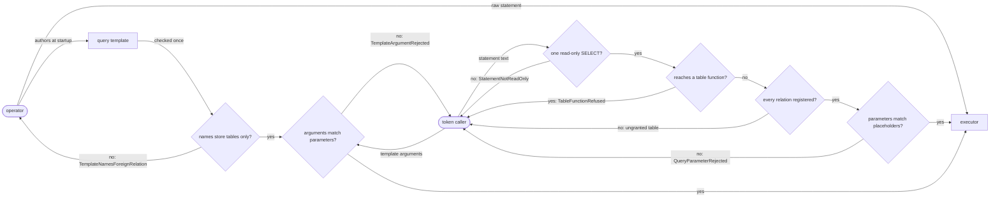
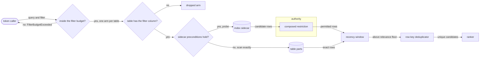
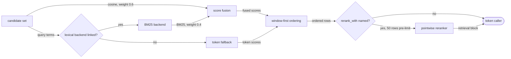
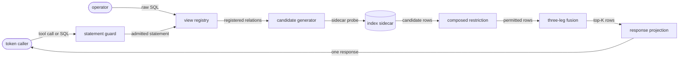

# The read face

Every question a caller asks of a store arrives here: the relations a connection sees, the
statement it sends, the candidates a question generates, their order, and the one envelope
that carries them. A read lands no row and holds no lease. Restriction arrives already
composed into each registered relation; this face consumes index sidecars and builds none.

The read face's operations, and where it meets the store, authority and memory:


## register

The relations, tools and templates one connection sees, the engine executing against them, and the network transport carrying the tools.

- `connection-views` — A session's connection issues one create-or-replace view per table the manifests name, each scanning {{store.reconcile.explicit-file-list}}, once per connection; statements reuse it under {{read.cache.session-pool}}. No view directory exists on disk.
- `declaration-set` — The face registers the tables of {{store.declare.declaration-set}}, so a `primary_key` a pipeline file declares reaches {{store.declare.dedup-view}} on the operator verb and the tool server alike.
- `engine` — The executor is an embedded columnar SQL engine, linked into every profile that serves reads, reading Parquet natively in standard SQL. An external process reads the same files with the engine uninstalled.
  *A-topology*
- `quiet-table` — A quiet table registers as {{store.declare.empty-run}}. A read of it returns an empty result, never a missing-relation fault.
  *P4*
- `bare-name` — A bare table name in any read — a caller statement, a template body, a ranking arm, a file preview — resolves to the caller's registered relation, which carries the caller's restriction.
  *P5*
- `tool-set` — The face exposes `context.describe`, `context.query`, `context.reference`, `context.execute_query` for templates, `context.files`, `context.file`, `context.subscribe`, `corpus.retrieve` and `memory.recall` as its closed tool set.
  *A-read*
- `bound-arguments` — Every read tool but `memory.recall` and `context.subscribe`, each template tool included, admits `as_of` and `valid_as_of` and echoes {{store.bound-time.echo}}; {{store.bound-time.valid-as-of}} wraps only the tables the read touches.
  *because a session registers every granted table, and wrapping one declaring no pair refuses reads that never name it*
- `bound-listing` — `context.files` and a `context.describe` naming no table select under `as_of` alone; each ignores `valid_as_of` and echoes only its `as_of` part.
  *because valid time narrows rows, and a listing returns files and table names, never rows*
- `available-bound-argument` — Every read tool {{read.register.bound-arguments}} names also admits `available_as_of` and echoes it under {{store.available-time.bound-echo}}; {{store.available-time.available-as-of}} wraps only the tables the read touches.
  *because a session registers every granted table, and wrapping one declaring no availability time refuses reads that never name it*
- `available-bound-listing` — A listing {{read.register.bound-listing}} names ignores `available_as_of` and echoes no `available_as_of` part.
  *because availability time narrows rows, and a listing returns files and table names, never rows*
- `describe-payload` — `context.describe` returns row count, {{read.register.size-estimate}}, schema fingerprint, description, {{read.register.column-hints}}, declared indexes, partition scheme, `limits.max_rows`, zone label, lexicon and example queries.
- `size-estimate` — `context.describe` reports `bytes`, the serialized JSON length of the caller's restricted rows, and `estimated_tokens`, one per 4 B of that length, rounded up.
  *because a client choosing between a full-context read and a ranked one compares the corpus against its context window before reading it*
- `join-route` — A cross-table join runs as one `context.query` statement over registered relations, or through a published model the describe payload lists; no tool joins on a caller's behalf.
  *because a statement already composes each relation's restriction, and a join tool restates that composition outside the guard*
- `column-hints` — A table's `column_hints` map supplies optional per-column hints; `context.describe` includes each hint only with a column the session registers.
  *because a hint for an absent column describes a relation the registered schema cannot query*
- `describe-zone` — `context.describe` reports the session zone as `session_zone`, and per table, listed or described, `zone_admitted`: whether the table's effective allow-set admits that zone.
  *A-read*
- `advertised-is-enforced` — A table's published `limits` block lists a bound exactly when the engine applies it.
  *because a published number and a delivered guarantee cannot disagree when one derives from the other*
- `budget-arguments` — Every read tool but `context.subscribe`, which {{read.subscribe.overrun}} bounds, accepts optional `max_duration_ms` and `max_response_bytes` request fields, each with no default.
- `duration-no-statement` — A read tool running no SQL statement accepts `max_duration_ms` without triggering {{read.respond.duration-ceiling}}.
  *because no connection executes a statement for its deadline to interrupt*
- `budget-advertisement` — `context.describe` lists a table's `limits.max_duration_ms` and `limits.max_response_bytes` under {{read.register.advertised-is-enforced}} and omits each undeclared limit.
- `template-projection` — Every manifest template projects into a tool named by its identifier, whose declared positional parameters form a typed schema with every field required.
- `file-listing` — `context.files` returns store-root-relative paths for the tables the caller reads, and a table outside that set contributes no path.
  *P5*
- `file-preview-target` — `context.file` resolves a path to its `(table, run_id)` and reads it through that table's registered relation. A snapshot part, a traversal, an absolute path or a ledger file raises `FilePreviewNotATable`.
  *A-read*
- `ledger-relation` — Each table's per-run request ledger registers as the child relation `<table>__requests`, holding identifiers, connector, method, host, status and timing of mediated outbound calls.
- `scoped-ledger` — The child relation registers on the owner read alone: a credential carrying no tenant scope, over a table carrying no row policy. Naming a closed ledger raises `LedgerNotTenantScoped`, stating what closed the relation.
  *A-read*
- `no-tenant-ledger` — No tenant-scoped projection of a request ledger registers; {{read.register.scoped-ledger}} is the ledger's one read path.
  *because ledger rows carry no tenant column, and a projection filtering on a dimension its rows lack discloses every tenant's calls*
- `lexicon-surface` — The describe payload carries the store's numeric-identifier and badge vocabulary. Aliases, time-window phrases and distillation examples stay on the serving side.
- `reserved-relation` — The engine's reserved table namespaces register like any other relation, with no privileged path underneath.
  *P5*
- `network-transport` — `contextful serve --http <addr> --audience <aud> --max-in-flight <n>` answers MCP Streamable HTTP at `POST /mcp`: one JSON-RPC message per request, answered as `application/json` by the tool server the stdio transport runs.
  *A-read*
- `concurrent-statements` — Requests on any number of connections run concurrently, each statement on its own engine connection under {{read.cache.pool-connections}}; a slow statement delays no other request.
  *A-read*
- `serve-declaration` — A serve with no `--audience`, or no positive `--max-in-flight`, raises `ServeDeclarationMissing` naming the flag and binds no listener; neither ships a default.
  *P3*
- `past-ceiling` — A request arriving while the ceiling's count of requests is in flight answers `503` with a `Retry-After` of 1 s and admits nothing.
  *A-read*
- `connection-ceiling` — An accepted connection holds one of the ceiling's slots from accept until its answer is written; a connection accepted with every slot held answers as {{read.register.past-ceiling}} before its request is parsed, and starts no thread.
  *because a request head arrives before admission, and a slot taken only after reading it lets an unadmitted caller hold one thread per connection*
- `per-request-admission` — Each request carries `Authorization: Bearer <credential>`, or `DPoP <credential>` with a `DPoP` proof header, admitted per request under {{authority.verify.possession-binding}} and {{authority.verify.network-bearer}}, so one listener serves many credentials, each reading its own grants.
  *A-read*
- `credential-missing` — A request carrying no `Authorization` credential raises `HttpCredentialMissing` with `401` and reads no row.
  *A-read*
- `admission-refused` — A request its admission refuses answers `401` carrying the refusal's identifier, except a full nonce cache, which answers `503` under {{authority.verify.nonce-cache}}.
  *A-read*
- `per-request-revocation` — Each request re-reads the `--denylist` file, so a credential revoked between two requests is refused on the next with no restart; an unreadable denylist answers `503` and admits nothing.
  *A-read*
- `stateless-session` — A notification answers `202` with no body. The face holds no protocol session and opens no server stream: a `GET` or `DELETE` on `/mcp` answers `405`, any other path `404`.
  *A-read*
- `request-body` — A request body over 1 MiB answers `413` and is read no further.
  *because the listener reads the body before admission, and an unbounded body lets an unadmitted caller hold memory*
- `health` — `GET /health` answers `200` with the build identity of {{read.embed.build-identity}}, admitting no credential and reading no row.
  *because a container runtime probes readiness before any caller holds a credential*

## guard

Admission of caller-written SQL: what parses, what a base relation names, whose text runs raw.

- `single-read-only-statement` — Admitted text parses to exactly one read-only SELECT. Attach, copy, install, load, pragma, set, any schema change, any data modification and a piggybacked second statement raise `StatementNotReadOnly`.
  *A-read*
- `engine-own-parse` — The guard walks the syntax tree the engine itself serializes for the statement; read-only-ness is a property of that tree, not a keyword blocklist.
  *because guard and executor cannot disagree about what a text means when they share one parse*
- `relation-allowlist` — Every base relation names a view registered for this caller or a common table expression the statement declares. A bare file path is a base relation and falls under this rule.
  *A-read*
- `whole-tree-walk` — The walk covers the entire tree — select-list subqueries, union arms, pivot sources — and a common-table-expression name resolves only within the scope that declares it and the scopes beneath.
- `unregistered-relation` — A base relation naming nothing this connection registered is refused by {{authority.refuse.ungranted-table}}, echoing what the statement asked for and no relation of another caller.
  *A-read*
- `table-function` — A table function anywhere in the tree, and a schema-qualified reach into a system catalog, raise `TableFunctionRefused`.
  *A-read*
- `statement-provenance` — Admission binds on who authored the text. Operator text — the local command line, template bodies, engine-composed reads — runs raw; capability-token caller text is gated. The raw surface is reachable from no network face.
  *A-read*
- `quoted-identifiers` — Every schema- or manifest-derived identifier is double-quoted where rendered, admitting any UTF-8 vendor field name as an identifier and never as an expression.
- `template-declaration` — A template declares an identifier, one SQL statement, positional parameters written `name:type` over integer, float, string, timestamp and boolean, and an optional row ceiling.
- `template-reserved-parameter` — A template parameter named `as_of`, `valid_as_of`, `zone` or `pin` refuses the manifest; those names carry the read's bounds, zone and pin map on every template tool.
  *because a parameter sharing a read argument's name hides that bound from the template tool*
- `available-reserved-parameter` — A template parameter named `available_as_of` refuses the manifest as {{read.guard.template-reserved-parameter}} refuses the other reserved names; that name carries the read's availability bound on every template tool.
  *because a parameter sharing a read argument's name hides that bound from the template tool*
- `template-relation-shape` — Manifest validation and face startup refuse a template whose SQL names anything but the store's own tables as plain identifiers, or whose identifier opens with a built-in tool prefix — `context.`, `corpus.` or `memory.` — raising `TemplateNamesForeignRelation`.
  *A-read*
- `template-binding` — A missing, unknown or type-mismatched argument raises `TemplateArgumentRejected` ahead of execution, with no coercion. Placeholders are `$1`…`$n` or `?` in declaration order, or exactly the declared names.
  *A-read*
- `query-binding` — `context.query` binds `$name` or contiguous `$1`…`$n` placeholders from `parameters` typed by {{read.guard.template-declaration}} without coercion; positional `?`, missing, unused, untyped or mismatched parameters raise `QueryParameterRejected` before execution; bound values reach {{authority.refuse.scope-guard}}.
  *because a value bound to a placeholder reaches no parser, and the tenant guard decides a bound value as it decides a literal*
- `startup-time-check` — Template checks are caller-independent and run once at startup; a request pays nothing for them.

Admission of one statement, by provenance, and of one template:



## respond

The one response projection: cell encoding, the row ceiling, truncation, counts and operator metadata.

- `one-projection` — The command line's JSON output, the HTTP face and the tool protocol serialize one projection: `columns`, `rows`, `truncated`, and the optional restriction, resolved-build, provenance, retrieval and time-bound blocks.
  *because a guarantee landing on one transport and missing on another is worse than a guarantee on none*
- `row-ceiling` — A per-table row ceiling published as `limits.max_rows` bounds rows delivered, applied at execution with an over-fetch of 1 rows. It bounds no work performed.
- `face-ceiling` — Every read on every face, `corpus.retrieve` included, delivers at most 10000 rows: the face ceiling is always a component of {{authority.grant.row-ceiling}}, declared or not, and bounds the candidate window.
  *because an undeclared ceiling otherwise streams a whole table into one response, and a caller learns of the cut from `truncated` rather than from memory exhaustion*
- `engine-composed-ceiling` — An engine-composed table read, a derive source or a memory read, takes the least of its grant's and tables' declared row ceilings and no face ceiling; with none declared it delivers every row.
  *because a derive or memory pass over a silently cut table records partial input as complete*
- `truncation-is-exact` — For a row ceiling, `truncated` is set exactly when the over-fetched probe row is present, never by comparing a returned count against a requested limit.
  *P4*
- `cell-encoding` — SQL NULL is JSON `null` and nothing else is. Non-finite floats are `"NaN"`, `"inf"`, `"-inf"`; temporal values are ISO-8601 strings, intervals ISO-8601 durations; an enum is its label; a union is its text form.
- `bytes-and-vectors` — Binary is padded base64, and a fixed-size float array, a vector column included, is a JSON array holding each element as a float cell.
  *A-store*
- `nested-values` — A list is a JSON array, and a struct or a map a JSON object keyed by field name or key text, each item, field or value encoded as its own cell.
  *A-store*
- `wide-number-shape` — A column's JSON encoding follows its SQL type alone: integers of 32 bits or fewer, finite floats and decimals of 15 digits or fewer are numbers; wider integers and decimals are exact decimal strings.
  *because a wire type that varies with the values on one page breaks a typed client on the next*
- `type-is-the-cell` — No separate type list rides the envelope; a cell's JSON type is the declaration.
- `one-response-shape` — Every read answers with one complete result set in one response; no read tool streams partial rows.
  *P4*
- `zero-rows-is-success` — Fewer rows than the requested limit, zero included, is a success.
  *P2*
- `match-count` — Match counts ride outside the internals opt-in, reporting how many rows the ranker scored as matching in the same call.
- `coverage-is-a-count` — A claim that the corpus lacks coverage of a subject comes from a count over the table with no recency truncation, taken after the full-scan fallback, never from a ranked top score.
  *because the calibrated lexical leg scores the best row 1.0 and IDF lifts one incidental rare-term mention*
- `internals-opt-in` — Executed SQL, engine name, applied limit, row count and elapsed milliseconds ride a separate object returned only under `internals: true`, on every read tool and the HTTP face.
- `query-internals-parameters` — Under `internals: true`, {{read.guard.query-binding}} includes the validated typed parameter map beside executed SQL in the internals object.
- `duration-ceiling` — Under {{authority.grant.duration-ceiling}}, the engine interrupts the statement's connection at its deadline; `ReadDurationExceeded` names the ceiling, source and elapsed milliseconds, delivers no rows, and leaves other statements running.
  *A-read*
- `byte-ceiling` — Under {{authority.grant.byte-ceiling}}, the serialized response holds whole rows within the selected byte ceiling; an envelope or first row exceeding it raises `ReadResponseTooLarge` and delivers no rows.
  *A-read*
- `truncation-cause` — A truncated response carries `contextful.truncation` with `by`, `ceiling` and `source`: `rows` admits grant, table, request, template or face; `bytes` admits grant, table or request.
- `truncation-tie` — When both ceilings cut the same next row, bytes takes precedence; equal ceilings within one dimension choose the first eligible source in grant, table, request, template, face order.
  *because one cut needs one deterministic cause for a client to branch on*
- `operator-metadata` — Operator-surface table metadata carries column count and backing file list; a row count is an ordinary count query, never a stored field.
  *P3*
- `restriction-block` — The restriction block carries the session zone, the incognito flag and one entry per touched relation the zone excludes or column-masks: `table`, `excluded`, `rows_dropped` and `columns_masked`. A read withholding no touched relation omits the block.
  *A-read*
- `in-band-error` — On the tool protocol a refusal arrives in-band, as a protocol error object or a result flagged as an error under transport success.
  *P2*
- `paths-stay-inside` — An ordinary read's result carries no store path. Provenance arrives as columns naming table, run, connector version, ingestion instant and authoring subject.
  *A-read*

## query

The operator's raw statement verb on the command line: its arguments, the relations it registers, its row bound and its output.

- `operator-verb` — `contextful query --json [--project <name>] [--declaration <path>] [--limit <n>] <sql>` runs one operator statement raw under {{read.guard.statement-provenance}} and prints the {{read.respond.one-projection}} envelope as one JSON line on standard output.
- `one-statement` — Text the engine's parser splits into other than exactly one statement raises `QueryNotOneStatement` before any statement runs.
  *because preparing multi-statement text executes every statement but the last and answers only the last, dropping the earlier results and side effects unseen*
- `project-relations` — Under a project, every table the store holds or the manifest declares registers under its bare name as its unrestricted base relation at the latest committed state; a quiet table reads as {{read.register.quiet-table}}.
  *because operator text is the store owner's own, and a restriction bounds a capability-token caller*
- `discovered-project` — Without `--project`, the project {{store.init.discovery}} finds is the verb's project. When discovery finds none, or the found project's store is absent, no relation registers and the statement runs over no store.
  *because every other verb reads the nearest `contextful.toml`, and a statement over files or literals needs no store*
- `project-store` — A `--project` whose `.contextful/context/<project>/` store is absent raises `QueryProjectAbsent`.
  *because every declared table of an absent store registers as quiet, and an operator reads its zero rows as an answer*
- `declaration-default` — `--declaration <path>` names the manifest whose declared tables register; without it, the {{store.init.default-declaration}} file does when present, and no manifest otherwise. With no project, `--declaration` refuses by {{store.init.undiscovered}}.
- `limit-truncates` — `--limit <n>` bounds rows delivered with the over-fetch of {{read.respond.row-ceiling}}, and sets `truncated` per {{read.respond.truncation-is-exact}}. Without it every row {{read.query.raw-row-ceiling}} admits is delivered.
- `raw-row-ceiling` — An operator's raw read delivers at most the least `limits.max_rows` among the relations its parsed statement names, and at most `--limit` beside it.
  *because a published bound the owner's own verb ignores advertises a guarantee one face breaks*
- `json-only` — The verb prints the JSON projection alone; it carries no text rendering, and a call omitting `--json` is a usage error.
  *because a second rendering is a second projection a script must reconcile with the first*
- `engine-fault` — A statement the engine rejects exits non-zero with the engine's message on standard error and nothing on standard output.
  *because a caller parsing standard output never mistakes a partial or empty envelope for an answer*


## reference

Resolution of one stored citation through the caller's registered relation, including the authenticated distinction between an erased source and an absent version.

- `call` — `context.reference` accepts one table, run identifier and row sequence; `contextful context reference` invokes the same resolver under Read admission and returns {{read.respond.one-projection}} without selecting a filesystem path.
  *A-read*
- `admission` — Resolution applies {{read.guard.unregistered-relation}}, the caller's registered row and column restrictions, and {{read.respond.duration-ceiling}}, {{read.respond.byte-ceiling}} and {{disclosure.record.read-entry}} before publishing its verdict.
  *A-read*
- `erased-verdict` — An admitted reference recorded in the independently verified cumulative erasure index returns `available: false` with `reason: erased`; an absent reference outside that index returns `reason: missing` and exposes no source payload.
  *A-read*
- `index-visibility` — A tenant-scoped, row-policy-restricted, zone-excluded or column-masked caller receives an unreadable verdict before erasure-index access; only the owner metadata eligibility of {{read.register.scoped-ledger}} admits an erased verdict.
  *A-read*
- `frontier` — The resolver validates the same signed store frontier before resolution and before response publication; its erasure index binds store identity and cumulative reference versions through {{disclosure.erase.store-binding}}.
  *A-read*

## retrieve

Candidate generation for a ranked read: content tokens, the relevance floor, per-table arms, dedup, snippet.

- `ranked-call` — `corpus.retrieve({prefix, query, query_embedding?, filter?, kinds?, limit?, since?, min_score?, as_of?, valid_as_of?})` returns the top rows across the item and artifact genres under one prefix, each with a snippet and full provenance. It composes the query surface and memory recall, storing nothing.
- `rerank-argument` — The ranked call also takes `query_embedding_model?`, naming the model behind `query_embedding`, and `rerank_with?`, naming the reranker {{read.rank.rerank}} applies.
  *because a caller-supplied vector and a reranked order are each meaningful only with the model that produced them*
- `relevance-floor` — A row reaches a caller when its lexical score is null, at least the floor, or its vector score is positive. The floor is 2 tokens for queries of 3 tokens or more, else 1 tokens; a caller minimum overrides.
- `content-tokens` — The query text is lowercased and split on non-alphanumeric characters. Stop tokens drop, non-ASCII runs of two or more characters stay, and survivors deduplicate in order.
- `token-length-floor` — An ASCII run shorter than 2 chars leaves the content-token set.
- `token-cap` — The content-token set holds at most 12 tokens. An empty set omits the relevance predicate.
- `script-split-matching` — An all-lowercase-alphanumeric token matches on an ASCII word boundary with an optional plural suffix; a token with any non-ASCII character matches by containment.
  *because no ASCII word boundary occurs beside an ideograph*
- `plural-suffix-floor` — A token under 4 chars takes no optional plural suffix.
- `text-free-table-scores-null` — A table with no snippet-worthy text column scores lexically null, never zero, and its rows enter by vector score alone.
  *P4*
- `candidate-window` — The candidate window is 8 times the requested limit or 200 rows, whichever is larger. Candidates equal to the window report that the ranking saw a recency-ordered slice.
  *P4*
- `reserved-columns-project-null` — Reserved projected columns — modality, language, prompt hash, kind — render null for a table lacking them, and its rows stay in the union.
- `unsatisfiable-arm-drops` — `filter` maps each caller-named column to a value, an equality, or a value list, a membership, and a row matches every condition. A table lacking a named column drops its arm, never emitting it unfiltered.
  *P4*
- `filter-values` — A filter value is a string, a number or a boolean, and a membership list is non-empty; a null, a nested object or list, or an empty list is a malformed condition.
- `kinds` — `kinds` lists artifact kind strings and joins the filter as one membership condition on the `kind` column, so a table without that column drops its arm by {{read.retrieve.unsatisfiable-arm-drops}}.
- `engine-resolved-date` — The engine resolves each table's publication column itself, outside the caller's filter.
- `since` — `since` is the inclusive lower bound of the question's timeframe over the publication instant {{read.retrieve.engine-resolved-date}} resolves; the anchor is `as_of`, else the read's clock. A date-only value means midnight UTC, and omitting `since` leaves every row in window.
- `filter-budget` — A filter holds at most 32 conditions, each membership list at most 256 entries, and its serialized JSON, `kinds` included, at most 16 KiB.
- `filter-budget-refusal` — The budget is checked over the whole filter ahead of building any arm; an oversized or malformed condition raises `FilterBudgetExceeded` for the whole read.
  *A-read*
- `row-key-dedup` — A ranked read keeps per `(table, row key)` only the newest ingestion, and no older copy when the newest misses the relevance floor. The row key is the declared content-hash column, else null, never a digest over projected values.
- `row-key-under-mask` — A content-hash column the session masks by `drop`, `truncate`, `bucket`, `range` or any combine keys every row null; one masked by `hash` or `tokenize` alone keys by its digest.
  *because a mask merging distinct hashes lets a reader's grants decide which rows a table holds*
- `row-key-stays-internal` — The row key is absent from the outer projection.
- `dedup-is-gated` — The deduplicating window function runs under the same condition as the relevance floor, and a browse-shaped read skips it.
- `excluded-arm` — An arm whose table the session's zone excludes contributes no candidate, and the ranked response names that table in {{read.respond.restriction-block}}.
  *A-read*
- `snippet` — A snippet concatenates up to three text columns: label-priority columns — title, summary, description, thesis and kin — first, then prose-worthy columns in schema order.
- `identifiers-never-snippet` — Content hashes, URLs, identifiers and instant-valued columns never qualify for a snippet.
- `sidecar-generates-candidates` — Each sidecar arm, vector over a query embedding and full-text over the content tokens, adds its top results to the recency window, each re-joined by {{authority.compose.vector-arm}}. Per-row scores equal the exact path's.
  *P5*
- `fulltext-probe` — A full-text probe ranks the whole snapshot by BM25 over one should-clause per content token; a token the sidecar's tokenizer splits into several terms matches them at consecutive positions, and an ASCII word token matches its plural as {{read.retrieve.script-split-matching}} does.
  *because a term outside the recency window is found only by a probe that reads every row's postings*
- `sidecar-oversampling` — One probe requests 4 times the limit or 64 rows, whichever is larger, and 4 times that where the request carries restriction context.
- `adaptive-over-fetch` — Where the rows a reader can see under-fill the requested limit, the probe doubles its size and probes again, for at most 4 rounds, then answers and reports the under-fill in the retrieval block.
  *A-read*
- `sidecar-size-cap` — A vector sidecar past 64 MiB of resident bytes stays unloaded and the arm takes the exact scan: its 4 B probe mark per graph node, plus a sealed one's graph file.
  *A-store*
- `fulltext-sealed-cap` — A sealed full-text sidecar file larger than 256 MiB stays unopened, and its arm adds no candidates.
  *A-store*
- `sidecar-falls-back` — Any sidecar precondition failure — no snapshot, no matching sidecar, a masked or zone-withheld identifier or indexed column, a classed text column, a dimension or manifest mismatch, an unreadable dump — falls back to the exact scan.
  *P4*
- `gain-never-loss` — For one reader the accelerated arm returns a superset of the exact path's rows. Two readers with one query on one snapshot can recall different rows.

Candidate generation for one ranked read:



#### Scenarios

- `read.retrieve.since`: WHEN `corpus.retrieve` carries `since: "2030-01-01"` and a matching row's publication column holds `2029-12-31`, THEN the row still returns, its in-window flag false, ordered below every in-window row.

unsettled: Does the row id {{run.normalize.identity-columns}} injects serve as the row key of a table declaring no content-hash column? owner: read-path affects: read.retrieve

unsettled: Does restriction get the statistics treatment {{read.horizon.rank-statistics}} gives the horizon, so BM25 document frequency on {{read.retrieve.fulltext-probe}} excludes restricted rows? owner: authority affects: read.retrieve

unsettled: Does predicate-aware graph traversal replace {{read.retrieve.adaptive-over-fetch}} under selective restrictions? owner: read-path affects: read.retrieve

## rank

Ordering of a candidate set: the three legs, their fusion, the question's timeframe, an optional reranker over the leading window, reported confidence.

- `three-legs` — Ranking runs exact cosine similarity over the candidate set, BM25 over a full-text index, and a weighted fusion of the two.
- `fusion` — Fusion computes `w_vec · clamp(cosine, 0, 1) + w_lex · rrf(bm25)`, weights 60 percent and 40 percent, `rrf` scoring BM25 rank `r` as `61 / (60 + r)`. A document absent from a leg scores zero; ties break by identifier.
- `lexical-leg-matches-only` — The BM25 leg ranks a disjunction of should-clauses; a document matching no term is absent. An empty query, candidate set or result yields an empty ranking that falls back to recency order.
- `flat-window-full-credit` — A lexical window with no score spread awards every present document full credit.
- `question-window-is-a-tier` — A question's timeframe projects a per-row in-window flag against the resolved publication column, and the flag leads the ordering. An out-of-window row sorts down and stays.
  *P4*
- `window-anchor-tolerance` — A publication instant more than 24 h past the question's anchor sets the in-window flag false. A null or uncastable value sets it false too, and a basis field names which case applied.
- `ordering-casts-first` — Ordering compares publication values as `TIMESTAMPTZ` instants, casting a text value before any comparison.
  *because a text comparison of two date spellings orders strings, not instants*
- `retrieval-block` — The `contextful.retrieval` block reports window, candidates_prefloor, candidates, matched, returned, in_window, deduped, padded, floor and since. Each row carries an integer score bounded by the content-token count, the in-window flag and the basis label.
- `delivered-counts` — The retrieval block's returned count equals delivered rows; its in_window count equals delivered rows with a true in-window flag, after byte truncation.
  *because aggregate counts describe the rows the caller receives*
- `internal-score-stays-internal` — The lexical engine's own float score never crosses to a caller.
  *because a corpus-relative number drifts under a consumer's threshold as the corpus changes*
- `absent-block` — The retrieval block is omitted from every non-ranked statement and from a build with no ranker, and an absent block differs from one reporting zero matches.
  *P2*
- `degradation-not-error` — Without the lexical backend linked, ranking substitutes a token fallback scoring each query token over the snippet, recency breaking ties. The result differs in order and still answers.
  *A-topology*
- `fallback-counts-tokens` — Under the fallback every matching token contributes, ranking hyphenated, spaced and possessive phrasings equivalently.
- `caller-embedding` — A supplied `query_embedding` adds per-row cosine fused with the lexical leg; omitting one leaves every projected column as the lexical-only path. Without the vector backend it scores only rows the recency window recalled.
  *A-topology*
- `lexical-index-cache` — An opened full-text sidecar is cached on a fingerprint of its table, snapshot, path and key version in a FIFO of 64 entries, so a repeated read opens nothing and a new snapshot opens afresh.
- `widened-window-statistics` — Lexical term statistics come from the widened candidate window, so an accelerated arm can order rows differently from the exact path.
- `calibration-gate` — A lexical-leg calibration replaces the one {{read.rank.fusion}} names only when the native evaluation scores it at or above that one on every tracked measure.
  *A-read*
- `reranker-admission` — A reranker joins the declared set only when it meets {{read.rank.calibration-gate}} against fused order.
  *A-read*
- `rerank` — A call naming `rerank_with` reorders the first 50 rows past authority, before `limit` truncates, of the ordering {{read.rank.question-window-is-a-tier}} leads, by reranker score within each tier; later rows keep their order, and the retrieval block names the reranker and its build.
  *A-read*
- `rerank-input` — A reranker scores each candidate apart from the others, reading only its {{read.retrieve.snippet}} after masking and never a raw cell.
  *because a listwise prompt lets one poisoned candidate promote itself*
- `rerank-absent` — A `rerank_with` naming no reranker in the set {{read.rank.reranker-admission}} admits raises `ReadRerankerAbsent`.
  *because a silent fallback to fused order hides a ranking change*
- `rerank-horizon` — Under a horizon, a reranker declaring a checkpoint family scores with the checkpoint {{read.horizon.embedder-route}} selects, and a remote reranker's call passes {{read.horizon.egress-hook}}.
  *A-read*
- `rerank-cutoff` — Under a horizon, a named reranker holding no checkpoint whose post-training cutoff precedes the horizon raises `ReadRerankerBeyondHorizon` rather than scoring; a reranker declaring no checkpoint family holds no such checkpoint.
  *because a trained reranker can order rows by events it learned after the horizon*

The ranking legs, their fallback, and the ordering they feed:



unsettled: Does a convex combination over min-max-normalized scores, its weight fitted per domain on settled judgments, replace {{read.rank.fusion}}? owner: read-path affects: read.rank

## cache

Locality of the bytes a read touches, reuse of a resolved session and its connections, and reuse of a result across requests.

- `hot-local-parquet` — The retrieval container syncs the current snapshot set to local disk and memory-maps it; object storage stays out of the per-query path.
- `cold-start` — A cold retrieval container meets {{topology.publish-hostname.container-readiness}}; a container holding no snapshot adds a whole-store pull before its first answer.
- `warming-read` — A request other than `GET /health` reaching a retrieval container whose snapshot-set hydration is incomplete answers as {{read.register.past-ceiling}}; `/health` names the hydration state.
  *because a container ready before hydration completes otherwise answers a read from a partial snapshot set*
- `result-key` — A cached result keys on the token's id, revocation epoch, grants and subject, the session zone and incognito state, each touched relation and the files it reads, the bounds, the statement, its parameter values and the applied row ceiling.
  *A-read*
- `reranker-key` — A reranked result's key adds the reranker's identity and build to {{read.cache.result-key}}.
  *because a new reranker build orders the same rows differently under an otherwise unchanged key*
- `cache-is-opt-in` — A statement's result caches only when every table it touches declares `result_cache`, a time to live, and none declares `private = true`; an entry expires at the least time to live among them.
  *A-read*
- `volatile-bypasses` — A statement calling a function the engine marks other than consistent across queries, such as `now()`, `current_timestamp` or `random()`, or a macro reaching one, executes uncached.
  *because such a call answers differently under an unchanged key, and a hit returns its first answer frozen until the entry expires*
- `frontier-invalidates` — A commit, fold or request-ledger append on a touched table moves its read frontier, the snapshot and runs its relation reads, so an entry filled before it stops matching. A statement in flight during a fold reads {{store.fold.non-blocking}}.
  *P4*
- `budget` — The result cache holds at most the byte budget its process declares, the least recently used entry evicted first; a face declaring no budget caches nothing.
  *A-read*
- `hit-identical` — A hit returns the response byte-identical to the miss that filled it, restriction block included; under `internals: true` the internals object carries `cache` as `hit` or `miss`.
  *because a reused answer differing from a computed one is a second projection a caller must reconcile*
- `keep-warm-is-per-deployment` — A deployment with active traffic keeps its retrieval container warm; one declining keep-warm takes a cold first read.
- `session-pool` — `Face` reuses a resolved session and its connections while the whole key holds: admitted authority, token id, revocation epoch, request zone, bounds, pin map, table set, and per granted table its schema digest, pointer, run set and ledger files.
  *A-read*
- `change-misses` — A committed run, snapshot, schema edit, new table, request-ledger file or token under another id or epoch misses the pool, and the next statement reads the new state on a new connection.
  *A-read*
- `pool-entries` — The pool holds at most 16 entries, oldest evicted first; a miss evicts the same principal's entries under an older store state.
  *because connections hold memory per authority, and an entry under a superseded store state is never hit again*
- `pool-connections` — One pool entry keeps at most 4 connections idle; a concurrent statement past them opens its own and closes it afterwards.
  *because concurrency on one session is bursty, and an idle connection holds its footer cache in memory*

## resolve-pin

Resolution of a named published-model build at read time, and the state each response echoes.

- `pin-parameter` — Every read tool admits `pin`, mapping a table name to a build identifier, and resolves that table to the files its build's committed manifest names. An unnamed table resolves to the latest published state.
- `pinned-schema` — A pinned table registers under the columns its build's parts carry, so a later build's contract neither adds, drops nor retypes a column of the pinned read or its description.
- `null-pin` — A table `pin` maps to `null` resolves as an unnamed table, and a pin map differing from another only by such entries is the same map.
- `unknown-build` — An unknown or collected build identifier raises `PinnedBuildUnavailable`, naming the oldest identifier still pinnable. A pin never widens to the latest state.
  *because a substituted build applied to every remaining query passes the consumer's cross-query comparison and stitches two states*
- `unregistered-pin` — A pin on a table the session registers no relation for, absent or outside the grants, refuses as {{read.resolve-pin.unknown-build}} on a table publishing no build, in one text for both.
  *because an answer differing between an absent and an ungranted table discloses the ungranted table's existence*
- `earlier-bound-wins` — A pin and the store's transaction-time bound are upper bounds on one clock; a table named by both resolves to the earlier.
- `resolved-echo` — A response touching a published model carries `contextful.resolved`, mapping each such table to `{build_id, watermark}`, pinned or not and zero rows included; the watermark names, per input table, the snapshot id and the committed runs it omits.
- `absent-watermark` — The watermark is null for a materialization carrying none, distinct from a watermark of zero.
  *P4*
- `consumer-comparison` — A consumer compares resolved build identifiers across every query of one derivation and fails the derivation where two differ.
  *P4*

## embed

The embedding port and its default, the model identifier beside each vector, the model check on a caller's query embedding, the linked-backend identity a handshake reports, and refusals on an absent backend.

- `default-embedder` — The embedding capability is a port whose default is deterministic and I/O-free: it hashes token term frequencies into an L2-normalized vector, needing no download, key or network call.
- `default-embedder-reach` — The default is a lexical-vector baseline: a paraphrase is orthogonal under it and cross-lingual recall is undefined. Semantic reach comes from the learned in-process model or a caller-supplied query embedding.
- `model-identifier` — Every stored vector lands in a {{store.reconcile.binary-and-vector}} column beside an `embedding_model` column naming the model that produced it; index identity and provenance resolve from the rows alone.
- `query-model` — A ranked call whose `query_embedding_model` differs from the `embedding_model` beside the vectors it scores raises `ReadEmbeddingModelMismatch`, naming both models.
  *because cosine across two models compares unrelated spaces*
- `build-identity` — The handshake reports the linked retrieval backends (`duckdb`, `fts`, `hnsw`), connector families (`m365`, `s3`, `wasm`) and faces (`http`, `eval`, `otlp`), composed from the same feature declarations the version output reads.
  *P3*
- `required-face` — A client passing `require: [...]` is refused ahead of its first read with `RequiredFaceAbsent` for any name outside the reported set. An engine reporting no set satisfies no requirement.
  *A-topology*
- `absent-read-backend` — Without the embedded SQL engine linked, every read tool raises `ReadBackendAbsent` rather than answering from a narrower path.
  *A-topology*

## as-of-join

The point-in-time join: an `ASOF JOIN` written in one read statement or template body, matching each driving row to the right relation's row that was available at that row's own instant.

- `per-row-bound` — An `ASOF JOIN` matches each driving row, per equality key, to the right relation's row whose declared availability instant is the latest at or before the driving instant its inequality names, its valid-time `from` within `max_age` when given.
  *A-read*
- `horizon-caps-row` — Under `available_as_of`, each driving row's instant is the earlier of the instant its inequality names and `available_as_of`, so no right row past the bound joins.
- `join-undeclared` — An `ASOF JOIN` whose right relation declares no `available_time` refuses as {{store.available-time.undeclared}} does, naming the table, whether or not the read carries `available_as_of`.
  *because joining on valid time picks a restatement published after the event*

#### Scenarios

- `read.as-of-join.per-row-bound`: WHEN a point-in-time security master maps stable id `sec-1` to ticker `FB` available `2012-05-18` and to `META` available `2022-06-09`, THEN a trade of `sec-1` on `2021-03-01` joins `FB` and one on `2022-07-01` joins `META`.

unsettled: Does an as-of join's `max_age` measure valid time or availability time? owner: read-path affects: read.as-of-join

## horizon

Reading under a credential's {{authority.grant.horizon}}: the bound every read inherits, the arguments it refuses, the stamps, statistics and columns it withholds, the egress it closes, and the indexes, embedders and builds it resolves.

- `inherited-bound` — Under a credential carrying a horizon, every read tool but `context.subscribe`, which {{read.subscribe.horizon-refusal}} refuses, reads at `available_as_of` equal to the horizon when the call supplies none, capping {{read.as-of-join.horizon-caps-row}}, and echoes it as {{store.available-time.bound-echo}}.
  *because a per-call bound is a bound the agent can omit*
- `exceeds-horizon` — A call supplying `available_as_of` or `since` later than its credential's horizon raises `ReadBoundExceedsHorizon`, naming the argument; `as_of`, `valid_as_of` and `observed_at` pass unbounded by it.
  *because a cutoff the agent can widen is advisory, while a valid-time question about a known future effective date stays legitimate*
- `recall-horizon` — Under a horizon, {{read.recall.keyed}} defaults an absent `observed_at` to the horizon and reads a claims table at `available_as_of` equal to it, so a table declaring no availability time refuses as {{store.available-time.undeclared}}.
  *because a claim lands at its commit instant, and one concluded after the horizon otherwise answers inside it*
- `traverse-horizon` — Under a horizon, {{read.traverse.call}} defaults an absent `observed_at` to the horizon.
  *because an edge live at the call's instant otherwise answers a walk the horizon dates earlier*
- `engine-stamps` — Under a horizon, the projection carries neither `_ingested_at` nor `_commit_seq` and keeps `_run_id` and `_row_seq`, which cite a row; `context.describe` computes row count, size, lexicon and example values over the horizon-bounded relation.
  *A-read*
- `late-columns` — Under a horizon, a column whose `first_landed_at` in `schema.json` — set once by its first merge, to that batch's earliest availability instant, else the commit instant — falls after the horizon is absent from the registered schema and describe payload.
  *A-store*
- `egress-hook` — A hop made under a credential carrying a horizon passes a pre-send hook refusing every host but the configured model endpoint, as {{connector.meter.hook-refusal}} with reason `horizon`.
  *because one attachment point already sees every egress, so a per-tool list restates it*
- `local-rank` — Under a horizon, `corpus.retrieve` ranks only stored rows through local indexes, and a search source reads its pinned {{store.snapshot.capture}} corpus; a live search reaches no host past {{read.horizon.egress-hook}}.
  *because a live result order postdates the snapshot, and filtering it afterwards keeps the order*
- `rank-statistics` — Under a horizon, lexical term statistics and vector neighbours come from the horizon-bounded relation; a ranking reaching a sidecar that indexes a row available after the horizon raises `ReadIndexBeyondHorizon`, naming the table.
  *because corpus-wide term frequency and neighbourhoods encode later events*
- `embedder-route` — Under a horizon, an embedder declaring a checkpoint family embeds with its newest checkpoint whose post-training cutoff, as {{connector.infer.cutoffs}} records it, precedes the horizon, and the response names that checkpoint.
  *because an embedder trained after the horizon places documents by later events*
- `build-resolution` — Under a horizon, a model table resolves to the newest build whose horizon, recorded under {{run.model.build-horizon}}, is at or before the credential's; a table holding none raises `ReadNoBuildWithinHorizon`, naming the table.
  *because a build over current inputs carries later rows into every horizon*

#### Scenarios

- `read.horizon.exceeds-horizon`: WHEN a credential carries horizon `2014-05-01` and `corpus.retrieve` supplies `since: "2015-01-01"`, THEN the call raises `ReadBoundExceedsHorizon` naming `since`, and a call supplying `valid_as_of: "2015-01-01"` answers.

unsettled: Does a sidecar indexing rows past the horizon fall back to the exact scan rather than refuse the ranking? owner: read-path affects: read.horizon

unsettled: Where does the engine record the instant a column first landed in a table, for a schema that predates the record? owner: read-path affects: read.horizon

## subscribe

The stream of one notification per committed run of each named table, read from the store's durable commit record, resumable from a run position, and the operator verb carrying it.

- `durable-source` — A subscription reads run manifests and commit logs on disk, never the {{run.project.emission-never-blocks}} channel, so a run one process commits reaches a subscriber in another.
  *because an in-process hub ties every reader to the landing process and loses its state on restart*
- `after-commit` — A run notifies only once {{store.lay-out.uncommitted-run}} no longer holds it: a run with no manifest, or a logged run absent from its node's commit log, never notifies.
  *P4*
- `notification` — A notification carries `table`, `run_id`, `node_id`, `committed_at` and `frontier`, the pair `{as_of, commit_seq}`: the run's commit instant and the `_commit_seq` value its rows carry.
- `frontier-covers-run` — A read of the table bounded `as_of` a notification's frontier covers the notified run's files.
  *P4*
- `commit-order` — Notifications of one table arrive in ascending `commit_seq`, the order {{store.reserve.commit-order}} makes runs readable, and each committed run notifies exactly once per subscription.
  *because a subscriber applying notifications in order rebuilds the table's commit sequence*
- `no-content` — A notification carries no row content and no row count.
  *because a count over a table under row policy or tenant scope discloses rows the reader cannot see*
- `resume` — `after` maps a table to a `<run-id>/<node-id>` position; the subscription replays every later committed run of that table once, then continues live, a fold between leaving the replay unchanged.
  *because a fold leaves run manifests in place until retention collects them*
- `position-unavailable` — An `after` position naming no committed run of its table raises `SubscriptionPositionUnavailable`, naming the table's oldest resolvable position.
  *because a replay from a collected position cannot tell which later runs retention also removed*
- `overrun` — A subscription holding more than 1000 notifications undelivered sends 1000, then a terminal `overrun` message naming each table's last delivered position, and ends.
  *because a bounded queue never drops a notification silently, and the terminal position resumes the stream*
- `operator-verb` — `contextful context subscribe <table>... [--after <table>=<run-id>/<node-id>] [--follow]` prints one JSON notification per line; without `--follow` it ends once the replay is sent.
- `tool-poll` — `context.subscribe` takes `tables` and an optional `after` map and answers one page: `messages`, what {{read.subscribe.resume}} sends under {{read.subscribe.overrun}}, and `after`, each table's last delivered position for the next call.
  *because the tool protocol's request and response hold no stream, and a returned position resumes a poll exactly as it resumes a stream*
- `ungranted-table` — On the tool protocol, a subscription naming a table outside the session's relations, existing or not, is refused by {{authority.refuse.ungranted-table}} before any `after` position resolves.
  *because a position refusal or a notification on an ungranted table discloses that the table exists and commits*
- `horizon-refusal` — On the tool protocol, a subscription under a credential carrying a horizon raises `SubscriptionUnderHorizon` before any table or `after` position resolves.
  *because a notification carries the run's commit instant and sequence, which {{read.horizon.engine-stamps}} withholds, and runs committed after the horizon*

#### Scenarios

- `read.subscribe.resume`: WHEN runs `r1`, `r2` and `r3` commit to `events` and a subscription names `after` `events=r1/ingest-a`, THEN it sends `r2` then `r3`, and a fold before the call changes neither.
- `read.subscribe.after-commit`: WHEN a leased pipeline's run writes its manifest and its commit-log entry is absent, THEN no subscription notifies it.
- `read.subscribe.commit-order`: WHEN a relational run commits `events` at `commit_seq` 5 before its group marker lands and a plain run commits at 6, THEN a subscription sends neither until the marker lands, then 5 before 6.

unsettled: Does a subscription under a credential horizon withhold runs committed after it and their stamps rather than refuse? owner: read-path affects: read.subscribe

unsettled: Does the networked transport carry `context.subscribe` as server notifications over a held stream? owner: read-path affects: read.subscribe

## Shapes

The registered relation for one table:

```sql
CREATE OR REPLACE VIEW orders AS
SELECT * FROM (
  SELECT *, ROW_NUMBER() OVER (
    PARTITION BY order_id
    ORDER BY updated_at DESC, _ingested_at DESC, _run_id DESC, _row_seq DESC
  ) AS _rn
  FROM read_parquet(
    [ 'tables/orders/data/snapshots/snapshot-01773100800000000000/part-00000.parquet',
      'tables/orders/data/runs/run-0192/node-9f2c/part-00000.parquet' ],
    union_by_name = true
  )
) WHERE _rn = 1;
```

The response projection, with `total_cents` a `BIGINT` column:

```json
{
  "columns": ["order_id", "total_cents", "placed_at"],
  "rows": [["A-8812", "1299", "2026-02-14T09:31:00Z"], ["A-8813", "9007199254740993", "2026-02-14T09:44:12Z"]],
  "truncated": true,
  "contextful.bounds": { "as_of": "2026-03-01T00:00:00Z", "inclusive": false },
  "contextful.resolved": {
    "daily_orders": {
      "build_id": "snapshot-01773100800000000000",
      "watermark": { "at": "2026-02-14T10:00:00Z", "inputs": { "orders": { "snapshot_id": null, "runs": ["run-0192/node-9f2c"] } } }
    }
  },
  "contextful.policy.applied": { "rows_dropped": 12, "columns_masked": ["email"], "overfetch_rounds": 1 },
  "contextful.retrieval": {
    "window": 200, "candidates_prefloor": 200, "candidates": 61,
    "matched": 61, "returned": 20, "in_window": 14, "deduped": 3,
    "padded": 0, "floor": 2, "since": "2026-02-07"
  }
}
```

Per-row ranking fields: `{ "_score": 2, "_vscore": 0.71, "_in_window": true, "_date_basis": "published_at" }`.

A template, and the tool it projects as:

```toml
[[query_templates]]
id         = "orders_by_region"
sql        = "SELECT region, sum(total_cents) FROM orders WHERE placed_at >= ? AND region = ? GROUP BY region"
parameters = ["since:timestamp", "region:string"]
max_rows   = 500
```

```json
{ "name": "orders_by_region",
  "inputSchema": { "type": "object",
    "properties": { "since": { "type": "string", "format": "date-time" }, "region": { "type": "string" } },
    "required": ["since", "region"] },
  "limits": { "max_rows": 500 } }
```

The path one ranked read takes:


