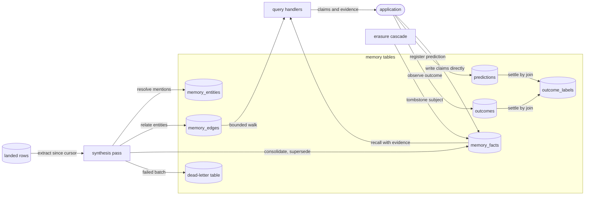
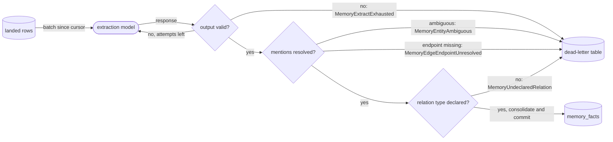
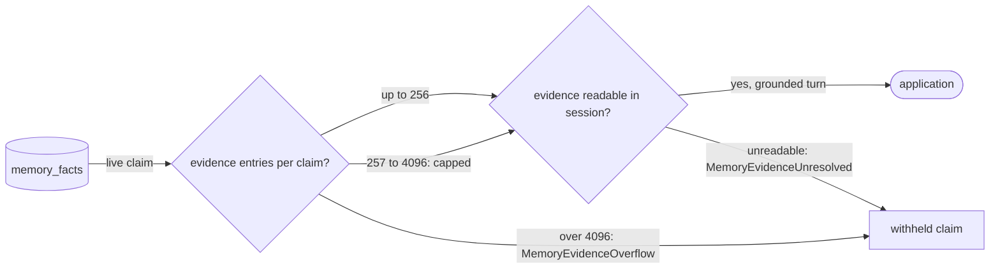

# Synthesized memory

Implementers use this page for stored claims, entity identities, relationships and prediction outcomes.
Memory uses the same tables, commit operations and access controls as ingested data.
The memory commands and tools write, revise and retrieve these records. Subject erasure uses
the disclosure contract's `erase` operation.

Memory tables and the operations that write and read their rows:



## declare

Memory table schemas, required columns, trust tiers, scopes and relation types.

- `canonical-column` — A table naming a shape and omitting one of its canonical columns raises `MemoryShapeColumnMissing` when the declaration loads.
  *P1*
- `undeclared-relation` — For a `rel_type` outside the allowed union, synthesis writes the candidate edge to the dead-letter table and raises `MemoryUndeclaredRelation`. No row uses the unknown type.
  *A-read#memory-vocabulary-schedules*
- `reserved-relations` — Reserved relation types are `supports`, `contradicts`, `supersedes`, `about` and `derived_from`. Deployments add types through `[relation].declared`. `contextful memory relations rename` rewrites stored edges before removing an old name.
  *A-read#memory-vocabulary-schedules*
- `settlement-shapes` — The `predictions` shape carries one column per registration field, `deadline_at` resolved for a horizon; the `outcomes` shape carries one column per observation field. Both key on `prediction_id`.
  *because the label join reads these columns by name, and one row per prediction keeps one label per prediction*
- `availability` — A shaped memory table accepts `[table.available_time]` under {{store.available-time.declaration}} and `content_hash_column` under {{store.declare.table-block}}, carrying both into every read and landing.
  *because a conclusion's publication time differs from its economic validity and shared availability bounds exclude later conclusions from historical recall*


## synthesize

Claim extraction, entity resolution, consolidation, evidence, deduplication, audit records and coverage gaps.

- `extract-attempts` — For a schema-invalid response, the synthesis pass retries extraction with validation feedback. Each batch receives at most 3 attempts in total.
- `dead-letter` — A batch exhausting {{read.synthesize.extract-attempts}} writes the response, template hash and drop reason to the dead-letter table, raises `MemoryExtractExhausted`, and leaves the cursor unadvanced.
  *A-read#memory-writes-validate*
- `pass-cursor` — Through the writing credential's session, synthesis reads committed source rows absent from its cursor, in batches under {{read.synthesize.prompt-bound}}. The cursor records each batch after its claims commit.
- `prompt-bound` — A batch packs marked rows up to 32 KiB; a marked row over that bound travels in a batch of its own.
  *because one oversized row neither stalls the pass nor drags its neighbours past the bound*
- `row-cap` — Synthesis marks each row, capped at 16384 chars under {{connector.infer.value-cap}}. Truncated rows reach the model; their batch commits and advances the cursor. The pass report counts these rows in `truncated`.
  *because a silent cut hides that a conclusion rests on a partial row*
- `attribution` — Every landed claim carries `grant_id`, the chain-final revocation identifier of the credential that wrote it, `agent`, that credential's agent member, and `_authored_by`, its on-behalf-of principal.
  *because a reader weighs a conclusion by which grant could have produced it*
- `claim-taint` — A source row carries its own `_taint`, else `ingested:third-party`. Every row a batch commits lands under {{store.reserve.taint}} with the least-trusted label among the batch's rows.
  *because a row no label vouches for is trusted least, and a claim re-synthesized from claims stays as low as its origin*
- `cadence` — By default, `contextful memory synthesize` starts synthesis. A scheduled `[[job]]` of kind `synthesize` targeting the claims table replaces that default. Each execution advances only through {{read.synthesize.pass-cursor}}.
  *A-read#gleaning-declared-single*
- `confidence-calibration` — Model-emitted confidence carries `uncalibrated` until a shape-and-predicate isotonic map trained on settled outcomes lowers held-out Brier score. A validated map supplies the reported calibrated confidence.
  *A-read#memory-confidence-retention*
- `extract-cache` — Synthesis caches schema-valid responses in an access-controlled, tenant-scoped table. Keys comprise marked-batch byte digest, template hash, model identifier and {{connector.infer.cutoffs}}. Identical keys reuse responses without calling the model.
  *A-read#extraction-cache-keys*

One synthesis batch, from landed rows to a committed claim or the dead-letter table:



unsettled: Which consolidation merges two claims of one dedup key, and what record does a coverage gap leave? owner: read-path affects: read.synthesize


## revise

Claim replacement within a validity interval, confidence decay, direct writes, timestamps, expiry, retention and promotion.

- `tier` — The writer assigns `tier` from write method and grounding, excluding payload values: synthesis uses `derived`, direct writes use `curated`, fetched results use `researched`. Mixed grounding takes the lowest tier.
  *A-read#claim-standing-derived*
- `supersede` — An equal-or-higher-tier claim replaces a live prior matching subject, predicate and scope when both are open-ended or share valid-from, except {{read.revise.unscoped-collision}}. The prior ends at the successor's start and names the successor.
  *A-read#claim-standing-derived*
- `direct-write` — The direct write accepts claims alone. Naming `memory_episodes`, `memory_entities`, `memory_edges` or `memory_preferences` raises `MemoryDirectWriteShapeRefused`; an entity row enters through {{read.resolve-entity.entity-upsert}}.
  *A-read#agent-third-party*
- `observed-at` — `contextful memory write --observed-at <instant>` lands the claim with `valid_from` at that instant; without it, `valid_from` is the write's own instant.
- `dedup-key` — `--dedup-key <key>` derives `claim_id` from the key beside the subject, predicate, object and scope, and a write whose `claim_id` the table already holds lands nothing.
  *because a retried write restates one observation, while one fact observed twice under two keys keeps two validity intervals*
- `observed-order` — For matching subject, predicate and scope with a different object, a write whose `valid_from` precedes an unsuperseded claim's `valid_from` raises `MemoryObservationOutOfOrder`. The write stores nothing.
  *because retiring the later claim at the earlier instant ends it before it starts, and it then answers at no instant*
- `citation-live` — If a cited keyed-table row reads through the writer's session as a replaced key version, a direct write raises `MemoryCitationNotLive`. The write stores nothing.
  *because such a claim rests on a replaced version from its first read, while a citation no readable row carries lands undigested and recall withholds it*
- `unscoped-collision` — Unscoped direct writes sharing subject, predicate and valid-from but different objects record both claim ids in the dead-letter table. Neither claim replaces the other until an explicit revision resolves the conflict.
  *A-read#claim-standing-derived*
- `retention-default` — Claims retain recorded validity until explicit expiry or erasure. With `decay_half_life`, ranked scores decrease by half per half-life since `valid_from`. Score decay neither deletes claims nor changes validity.
  *A-read#memory-confidence-retention*
- `served-write` — A writable HTTP server accepts `POST /memory/claims` under per-request network credentials and stores declared claims through the direct-write operation. The read MCP tool set remains closed.
  *A-read#served-claim-write*
- `served-scope` — A claim write raises `MemoryClaimScopeRefused` if `actor` differs from admitted `on_behalf_of`, `session` differs from admitted `task`, or `session` contains a colon. Accepted claims take scope from credential members rather than payload values.
  *A-read#served-claim-write*
- `browser-request` — An `Origin` header on the served claim-write route raises `MemoryClaimBrowserRefused` before credential admission and commits nothing.
  *A-read#served-claim-write*
- `malformed-request` — Malformed JSON, unknown fields, a client-selected claim scope, or an empty dedup key on the served claim-write route raises `MemoryClaimMalformed` and commits nothing.
  *A-read#served-claim-write*
- `served-dedup` — A served claim write passes its `dedup_key` to {{read.revise.dedup-key}}, returns `landed: false` on restatement, and returns the bound scope on both outcomes.
  *A-read#served-claim-write*
- `served-fault` — A served claim write whose store effect refuses raises `MemoryClaimWriteRefused` and lands nothing.
  *A-read#served-claim-write*

unsettled: What binds the asserted agent member to the writer? owner: authority affects: read.revise

unsettled: What declared bound expires a researched claim, and which served write promotes a claim to curated? owner: read-path affects: read.revise

## recall

Ranked and keyed claim retrieval, read timestamps, tier ordering, scope and tombstone filters, and evidence checks.

- `evidence-unresolved` — An unreadable or masked source row, an unknown table, a reference into another memory row, or malformed lineage suppresses the claim and raises `MemoryEvidenceUnresolved`.
  *A-read#memory-access-follows*
- `evidence-references` — For claims citing more than 256 entries of evidence, recall returns the first 256 in cited table, run and sequence order. `evidence_omitted` reports the remaining count.
  *A-read#memory-access-follows*
- `evidence-omitted-column` — `evidence_omitted` is a reserved projected column of {{read.recall.ranked-arm}}, null for a row outside a `memory_facts` table under {{read.retrieve.reserved-columns-project-null}}.
- `evidence-gate-bound` — Recall suppresses a claim with more than 4096 entries of evidence as unresolved and raises `MemoryEvidenceOverflow`.
  *A-read#memory-access-follows*
- `evidence-key` — Claim writes stamp each citation to a keyed table with a pepper-keyed digest of the cited row's key. If that row is unreadable, recall resolves the digest's live version.
  *A-read#citation-keyed-table*
- `evidence-key-masked` — If the writer's session masks or zone-nulls a cited key column, the citation carries no digest. Masked or nulled non-key columns leave the digest intact.
  *because a masked key cell digests a value no other session reads, while a cell outside the key plays no part in matching it*
- `evidence-no-value` — A citation stored in a memory row carries the cited table, run, sequence and key digest, and no cell value of the cited row.
  *A-read#citation-keyed-table*
- `evidence-stale` — Recall counts a served claim under `stale` in `contextful.recall` if the key digest resolves while the cited run and sequence are unreadable. The block names no claim.
  *A-read#citation-keyed-table*
- `ranked-arm` — For `memory_facts`, `corpus.retrieve` returns only claims without `superseded_by` and with `valid_to` null or after the read's anchor. Each claim's evidence passes the evidence check.
- `recall-block-presence` — A `corpus.retrieve` response carries the `contextful.recall` block exactly when one of its arms reads a `memory_facts` table, whichever of `prefix` and `tables` chose the arms.
  *because the block counts what claim arms withheld, and a read with no claim arm withheld no claim*
- `suppression-count` — A suppressed claim is absent from the rows; the `contextful.recall` block counts suppressions per error identifier and names no claim.
  *because a count discloses that a conclusion was withheld, never what it concluded*
- `keyed` — `memory.recall` accepts `table`, `subject`, `observed_at`, `as_of_ingest` and `limit`. Returned claims match `subject` exactly, with `valid_from` and `valid_to` covering `observed_at` under {{store.bound-time.valid-as-of}}.
- `cli-verb` — `contextful memory recall` forwards arguments to `memory.recall` and prints the tool's JSON response. The command appends the call's read entry under {{disclosure.record.read-entry}}.
- `keyed-clocks` — `as_of_ingest` bounds reads under {{store.bound-time.as-of}}; without that argument, reads use the latest committed state. Missing `observed_at` defaults to the call's instant. `contextful.bounds` echoes supplied bounds by argument name with a per-name `inclusive` map.
- `keyed-history` — Keyed recall returns a replaced claim for `observed_at` within that claim's validity interval. The query filters by validity alone, excluding `superseded_by` from filtering.
  *because the question is what held at that instant, and the retired claim is the answer its interval records*
- `keyed-gate` — Every keyed claim passes {{read.recall.evidence-gate-bound}}, and every evidence entry, served or omitted, passes {{read.recall.evidence-unresolved}}; the response carries {{read.recall.suppression-count}}.
- `keyed-window` — Keyed recall checks claims in order and stops after retaining one claim beyond the row ceiling. The suppression count covers claims checked before that stop.
  *because a one-row recall over a subject with thousands of claims otherwise resolves every claim's evidence*
- `keyed-evidence-batch` — The keyed read resolves a claim's citations into one table and run with one statement, listed among the executed SQL under `internals: true`.
  *because one statement per citation costs a claim at the gate bound one engine round trip per entry*
- `keyed-order` — Keyed claims order by tier, `curated` first, then `valid_from`, newest first, then `claim_id`; `limit` and the table's ceilings bound them under {{read.respond.row-ceiling}}.
- `keyed-not-claims` — A granted `table` declaring a shape other than `memory_facts`, or no memory shape, raises `MemoryRecallNotClaims`.
  *because a keyed read answers with a claim's subject, validity and evidence, which no other table carries*
- `confidence-label` — Each keyed claim's `confidence_label` is `calibrated` or `uncalibrated` under {{read.synthesize.confidence-calibration}}. Fitting uses the declared `labels` table, joining `prediction_id` to `claim_id` through the caller's session.
  *A-read#claim-standing-derived*
- `stale-revision` — A stale citation remains subject to {{read.recall.keyed-gate}}; only a newly committed source row advancing {{read.synthesize.pass-cursor}} starts synthesis against its live key version.
  *A-read#claim-standing-derived*
- `usage-ledger` — `memory.recall`, `memory.explain` responses carrying claims, and `corpus.retrieve` responses containing `memory_facts` record returned claim ids as `contextful.memory.claims`. The read entry includes caller credential, subject and read instant.
  *A-read#memory-reads-expose*

Evidence checks before returning a claim to the application:



#### Scenarios

- `read.recall.evidence-references`: WHEN a claim cites 300 readable rows, THEN recall serves 256 entries with `evidence_omitted = 44`.
- `read.recall.evidence-unresolved`: WHEN entry 290 of 300 reads masked, THEN the claim is suppressed with `MemoryEvidenceUnresolved`.


## resolve-entity

Entity matching, aliases, identity cards, location relationships, edges and ownership queries.

- `ambiguous-mention` — If a mention matches two canonical identities with no deterministic distinguishing key, resolution records an ambiguous skip, raises `MemoryEntityAmbiguous` and dead-letters the candidate claim.
  *A-read#memory-writes-validate*
- `edge-endpoint` — If a candidate edge's source or target resolves to no identity, resolution dead-letters the edge and raises `MemoryEdgeEndpointUnresolved`.
  *A-read#memory-writes-validate*
- `graph-index` — External graph engines index admitted memory edges as derived data. Entity and ownership answers resolve through access-controlled store rows at the read frontier.
  *A-read#memory-reads-expose*
- `ownership-answer` — Ownership queries return targets of every caller-visible `owned_by` edge from the artifact. Results sort by newest `_ingested_at`, then principal id for equal timestamps.
  *A-read#memory-reads-expose*
- `knowledge-card` — `memory.explain` accepts `table`, `reference` and an optional `claims` table. The tool resolves `reference` against `table`'s names and aliases and returns the identity's `entity_id`, `kind`, `name` and `aliases`.
  *because a caller holding a name or an alias in any script needs the canonical record without knowing its opaque id*
- `card-claims` — A card naming `claims` carries the claims {{read.recall.keyed}} returns at the call instant, under {{read.recall.keyed-gate}}, whose `subject` equals the identity's `entity_id` or its canonical `name`.
  *because synthesis keys a resolved claim by canonical name and `claim_id` hashes the subject, so re-keying stored claims by id re-identifies every one*
- `card-candidates` — If `reference` matches multiple identities without an exact canonical-name match distinguishing one, the card returns candidate `entity_id`s and no identity. With no matches, the card is empty.
  *because naming one of several matches guesses on the caller's behalf, and an absent identity is an answer, not a fault*
- `card-authorization` — Cards read `table` and `claims` through the caller's session. Without a registered `claims` relation, cards return only identity. Cards without claims omit the claims table's name from the response and read entry.
  *because a grant on identities is narrower than a grant on what the workspace concludes about them*
- `card-cli-verb` — `contextful memory explain` forwards its arguments, including `--internals`, to `memory.explain`. The command prints the tool's JSON response and appends the same read entry.
  *because a read outside the audit chain is a read no owner can account for*
- `card-not-entities` — A granted `table` declaring a shape other than `memory_entities`, or no memory shape, raises `MemoryExplainNotEntities`.
  *because only a `memory_entities` table carries the identity, kind and aliases a card returns*
- `entity-upsert` — `contextful memory entity upsert --table <entities> --id <id> --kind <kind> --name <name> [--alias <alias>]...` writes one row to the first declared `memory_entities` table. Synthesis resolves against that table; upsert requires its read and write grants.
  *because the claim write refuses entity rows, and an operator still names the identities mentions resolve to*
- `upsert-fields` — Before comparison or storage, upsert trims id, kind, name and each alias. An empty trimmed value raises `MemoryEntityFieldEmpty` and writes nothing.
  *because a blank identity or alias matches no mention, and surrounding whitespace lands a second spelling of a held name*
- `upsert-merge` — For an existing `entity_id`, upsert replaces `kind` and `name`, retaining stored aliases first. Supplied aliases follow, excluding those matching a stored alias after case-folding.
  *because an alias an earlier upsert recorded keeps naming the entity for mentions already written with it*
- `alias-conflict` — An upsert whose name or alias matches, case-folded, the name or an alias of another entity the session reads raises `MemoryEntityAliasConflict`, and nothing lands.
  *because a mention two identities share resolves to neither: synthesis skips it under {{read.resolve-entity.ambiguous-mention}} and a card lists candidates under {{read.resolve-entity.card-candidates}}*
- `upsert-whole-table` — An upsert whose session read of the entities table returns truncated raises `MemoryEntityTableTruncated`, and nothing lands.
  *because a merge over a cut read drops the held row's aliases, and a conflict check over it misses the entity that carries the mention*
- `upsert-serial` — Upsert holds the table's upsert lock during reading, conflict checking and storage. The new timestamp follows the stored row's `_ingested_at`. Concurrent upserts on one table execute serially.
  *because two upserts merging one snapshot lose an alias, and two checking one snapshot both claim one mention*
- `upsert-availability` — An upsert into an entities table declaring `available_time` raises `MemoryEntityAvailabilityDeclared`, and nothing lands.
  *because an operator's identity carries no source availability instant, and a vintage table keeps the prior row beside the one an upsert replaces*

unsettled: Which edges carry aliases and nearness's parent closure? owner: read-path affects: read.resolve-entity

#### Scenarios

- `read.resolve-entity.knowledge-card`: WHEN `reference` is an alias written in another script, THEN `memory.explain` returns the one identity carrying it.
- `read.resolve-entity.card-candidates`: WHEN `reference` is an alias two identities share, THEN the card lists both `entity_id`s and no identity.
- `read.resolve-entity.card-authorization`: WHEN the caller holds a read grant on `table` and none on `claims`, THEN the card carries the identity and no claims.


## settle

Prediction registration, observations, required verdict citations and outcome label views.

- `registration` — A registration requires one form (relative horizon, absolute deadline, open watch) and one source (`metric`, `adjudicator`, `manual`). Only `metric` requires and permits a comparator. Invalid registrations raise `OutcomeRegistrationInvalid`.
  *A-read#memory-writes-validate*
- `source-mismatch` — An observation raises `OutcomeSourceMismatch` if its `metric` series differs from registration, or its verdict's resolution source or registered series is missing or differs. The error names each source by wire name.
  *A-read#memory-writes-validate*
- `settling-citation` — An `adjudicator` or `manual` verdict without an `http` or `https` settling citation raises `OutcomeCitationMissing`. The label view includes the citation.
  *A-read#memory-writes-validate*
- `grace-window` — The label join keeps an observation from the prediction instant through the deadline plus an inclusive grace of 86400 s.
- `calibration-report` — Calibration reports group settled predictions by shape and predicate. Each group reports sample count, Brier score, expected calibration error over 10 equal-width bins, and {{read.synthesize.confidence-calibration}}'s held-out score over every fifth prediction.
  *A-read#memory-writes-validate*
- `statement-bound` — A registration's optional `statement` holds the falsifiable claim and participates in {{read.settle.registration-conflict}}. Text exceeding 4096 B raises `OutcomeStatementTooLong`.
  *because a registration reads on its own only with its claim text, and an unbounded text field lets one row outweigh the table*
- `metric-reference` — Optional `metric` uses `<table>:<series_id>` with non-empty parts and names the series without a store lookup. Malformed references or references under a source other than `metric` raise `OutcomeMetricReferenceInvalid`.
  *because a registration precedes its series' first landing, so a store lookup refuses every prediction made before its data exists*
- `deadline-date` — A bare `YYYY-MM-DD` in `deadline_at` resolves under {{store.bound-time.instant-comparison}} to the next UTC midnight. The entire named day precedes the deadline.
  *because one date spelling then means one instant on every clock the engine compares*
- `predict-verb` — `contextful memory predict --into <table> --registration <json>` validates {{read.settle.registration}}. Under the admitted credential's write grant, the command stores the registration in that `predictions` table and prints `prediction_id: <id>`.
  *because a registration nothing lands leaves its outcome no prediction to settle against*
- `observe-verb` — `contextful memory observe --into <table> --observation <json>` reads the stored prediction registration through the writer's session. After checking {{read.settle.source-mismatch}} and {{read.settle.settling-citation}}, the command stores the observation in that `outcomes` table and prints its label row.
  *because a verdict is checked against the source registered before it, never one the observation asserts*
- `verb-attribution` — Both verbs admit a capability token as `contextful memory write` does, and each landed row carries `_authored_by` from its subject under {{store.reserve.injected}}.
  *because a settled outcome is weighed by who registered and who observed it*
- `prediction-unregistered` — An observation naming a `prediction_id` no row of the declared `predictions` table carries in the writer's session raises `OutcomePredictionUnregistered`, and nothing lands.
  *because a verdict with no registration has no source to check it against*
- `restated-landing` — A registration or observation identical to the stored row of its `prediction_id` lands nothing, and the verb succeeds with its usual output.
  *because a retried verb restates one registration, and landing it again commits a run that records nothing new*
- `registration-conflict` — A registration whose `prediction_id` a stored registration with any other field already holds raises `OutcomeRegistrationConflict`, and nothing lands.
  *because rewriting a registration after the fact changes the deadline or source a verdict is scored against*
- `outcome-settled` — If an observation differs from a stored verdict-bearing outcome for its `prediction_id`, the write raises `OutcomeAlreadySettled`. Observations replace stored outcomes without verdicts.
  *because a verdict rewritten after scoring silently changes the calibration it fed*
- `label-join` — The label view of Shapes runs over a declared `predictions` and `outcomes` table pair as read through the reader's session.
  *because the view's grace window and self-rated filter then hold for every reader, not each reader's own join*
- `calibration-verb` — `contextful memory calibration --table <claims>` joins verdict-bearing labels to claims by `prediction_id = claim_id` through the caller's session. The command prints {{read.settle.calibration-report}} with joined-prediction count, using JSON under `--json`.
  *because a prediction's shape, predicate and emitted confidence are those of the claim it scores*

Registration, observation and the label view:


## traverse

Graph traversal from a seed entity, bounded by time, hop count and readable edges in the caller's session.

- `call` — `memory.traverse` accepts `table`, `seed`, `rel_types`, `hops`, `as_of_ingest`, `observed_at` and `available_as_of`. Under one frozen anchor, the tool returns reached edges whose `valid_from` and `valid_to` cover `observed_at`, using {{read.respond.one-projection}}.
- `clocks` — Missing `as_of_ingest` uses the latest committed state; missing `observed_at` uses the call's instant; missing `hops` defaults to 1. `contextful.bounds` echoes each supplied bound under {{read.recall.keyed-clocks}}.
- `cli-verb` — The `contextful memory traverse` verb passes its arguments through {{read.traverse.call}} and prints the same JSON response.
- `enforced-edges` — Every edge reads through the caller's enforced session, and each edge's citations pass {{read.recall.evidence-unresolved}}; an edge failing either is neither returned nor walked through.
  *because walking through a hidden edge reveals the node beyond it*
- `engine` — An engine-backed walk answers through {{read.resolve-entity.graph-index}}.
- `walkable` — A `rel_types` entry whose declared relation is not walkable raises `MemoryTraverseRelationUnwalkable`.
  *A-read#traversal-walks-enforced*
- `hop-bound` — A walk follows at most 3 hops; a larger `hops` raises `MemoryTraverseHopsExceeded`.
  *A-read#traversal-walks-enforced*
- `fan-out` — A node expands at most 64 memory-edges, ordered by `valid_from` newest first then edge id; the rest count in `edges_omitted`.
  *A-read#traversal-walks-enforced*
- `frontier-cap` — A walk stops at 512 memory-edges and counts unexpanded edges in `edges_omitted`; a non-zero `edges_omitted` marks the walk incomplete, and `truncated` stays with {{read.respond.truncation-cause}}.
  *A-read#traversal-walks-enforced*
- `omitted-readable` — `edges_omitted` counts only edges the caller's session reads.
  *because a count of hidden edges discloses their existence, as {{read.recall.suppression-count}} avoids naming claims*
- `cycle` — Traversal proceeds breadth-first by hop and expands each node at most once.
  *because a revisited node adds no edge and a cycle otherwise exhausts {{read.traverse.frontier-cap}}*

One walk, from the caller's seed to the reached edges:


unsettled: Does a graph arm seeded by the query's resolved entities fuse into {{read.rank.fusion}} as a third leg, and at what weight? owner: read-path affects: read.traverse

## Shapes

A declaration naming a shape and its declared relation types:

```toml
[[table]]
name  = "team_memory"
shape = "memory_facts"

[[relation.declared]]
name        = "reports_to"
direction   = "directed"
cardinality = "one"
walkable    = true

[[relation.declared]]
name        = "owns_service"
direction   = "directed"
cardinality = "many"
walkable    = true
```

The reserved-traits table:

| Relation | `direction` | `cardinality` | `walkable` |
| --- | --- | --- | --- |
| `supports` | `directed` | `many` | true |
| `contradicts` | `undirected` | `many` | true |
| `supersedes` | `directed` | `many` | true |
| `about` | `directed` | `many` | false |
| `derived_from` | `directed` | `many` | true |

The label view:

```sql
CREATE VIEW outcome_labels AS
SELECT p.prediction_id, p.subject, p.resolution_source,
       o.verdict, o.signal, o.settling_citation,
       epoch(CAST(o.observed_at AS TIMESTAMP)) - epoch(CAST(p.predicted_at AS TIMESTAMP)) AS lead_time_s
FROM predictions p
JOIN outcomes o ON o.prediction_id = p.prediction_id
WHERE o.observed_at IS NOT NULL
  AND o.signal IS DISTINCT FROM 'self-rated'
  AND epoch(CAST(o.observed_at AS TIMESTAMP)) >= epoch(CAST(p.predicted_at AS TIMESTAMP))
  AND epoch(CAST(o.observed_at AS TIMESTAMP)) <= epoch(CAST(p.deadline_at AS TIMESTAMP)) + 86400;
```
