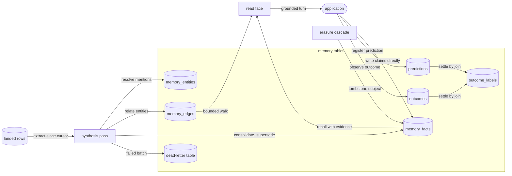
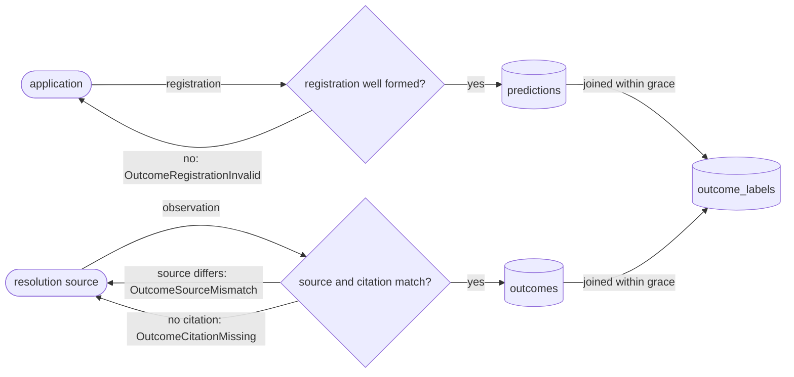
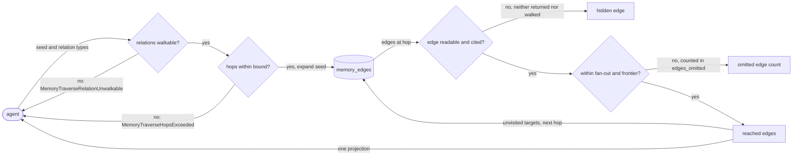

# Synthesized memory

Memory is what the workspace concludes from what it ingested: durable claims, the things they
are about, the relationships between them, and whether a claim it emitted turned out to hold.
It lives on the same tables, commit and enforcement as ingested data, and is reached through
its own doors. Erasure of a memory subject is the disclosure contract's `erase` operation.

Memory's tables and what moves rows between them; each edge names the operation, each cylinder a table:



## declare

The seven memory table shapes, their canonical columns, tier and scope, and the relation vocabulary with its cardinality.

- `canonical-column` — A table naming a shape and omitting one of its canonical columns raises `MemoryShapeColumnMissing` when the declaration loads.
  *P1*
- `undeclared-relation` — A candidate edge whose `rel_type` falls outside the union lands in the dead-letter table and raises `MemoryUndeclaredRelation`; no row is written under the unknown type.
  *A-read*
- `reserved-relations` — The reserved relation core contains `supports`, `contradicts`, `supersedes`, `about` and `derived_from`; a deployment extends it through `[relation].declared`, and `contextful memory relations rename` rewrites stored edges before removing an old name.
  *A-read*
- `gleanings` — A claims table's `gleanings` declares at most 1 passes over each batch, 0 by default; any other value raises `MemoryGleaningsInvalid` when the declaration loads.
  *A-read*
- `serving-taint` — A claims table's `serving_taint` names a minimum label under {{connector.infer.provenance-order}}; a claim without `_taint` ranks as `operator`, and a claim ranking below the minimum is suppressed, raising `MemoryClaimTaintBelowFloor`.
  *A-read*
- `relation-traits` — Each relation in `[relation].declared` carries `direction` (`directed` or `undirected`), `cardinality` (`one` or `many` edges per source) and `walkable`; the reserved core carries the traits the reserved-traits table under Shapes states.
  *A-read*
- `relation-string` — A bare string entry in `[relation].declared` declares a `directed`, `many`, non-walkable relation.
  *because declarations naming relations as strings keep loading, and a walk crosses only a relation its author opted in*
- `settlement-shapes` — The `predictions` shape carries `prediction_id`, `subject`, `predicted_at`, `horizon_secs`, `deadline_at`, `resolution_source` and `comparator`; the `outcomes` shape carries `prediction_id`, `observed_at`, `verdict`, `resolution_source`, `signal` and `settling_citation`. Both key on `prediction_id`.
  *because the label join reads these columns by name, and one row per prediction keeps one label per prediction*


## synthesize

Extract, Resolve and Consolidate; the dedup key, evidence support, the audit record and coverage gaps.

- `extract-attempts` — A schema-invalid response is re-prompted with its validation feedback, at most 3 attempts per batch in total.
- `dead-letter` — A batch exhausting {{read.synthesize.extract-attempts}} writes the response, template hash and drop reason to the dead-letter table, raises `MemoryExtractExhausted`, and leaves the cursor unadvanced.
  *A-read*
- `pass-cursor` — A pass reads the source's committed rows its cursor has not recorded, through the writing credential's own session, in batches under {{read.synthesize.prompt-bound}}, recording each batch once its claims commit.
- `prompt-bound` — A batch packs fenced rows up to 32 KiB; a fenced row over that bound travels in a batch of its own.
  *because one oversized row neither stalls the pass nor drags its neighbours past the bound*
- `row-cap` — A row is fenced at 16384 chars under {{connector.infer.value-cap}}; a truncated row still reaches the model, its batch commits and advances the cursor, and the pass report counts it in `truncated`.
  *because a silent cut hides that a conclusion rests on a partial row*
- `attribution` — Every landed claim carries `grant_id`, the chain-final revocation identifier of the credential that wrote it, `agent`, that credential's agent member, and `_authored_by`, its on-behalf-of principal.
  *because a reader weighs a conclusion by which grant could have produced it*
- `claim-taint` — A source row carries its own `_taint`, else `ingested:third-party`. Every row a batch commits lands under {{store.reserve.taint}} with the least-trusted label among the batch's rows.
  *because a row no label vouches for is trusted least, and a claim re-synthesized from claims stays as low as its origin*
- `cadence` — A claims table synthesizes when `contextful memory synthesize` runs; a `[[job]]` of kind `synthesize` targeting it with a `schedule` replaces that default, and each fire still advances only through {{read.synthesize.pass-cursor}}.
  *A-read*
- `confidence-calibration` — A model-emitted confidence is labelled `uncalibrated` until a shape-and-predicate isotonic map trained on settled outcomes lowers held-out Brier score; a validated map supplies the reported calibrated confidence.
  *A-read*
- `gleaning` — A table declaring gleaning under {{read.declare.gleanings}} re-prompts each schema-valid batch for omitted claims, up to its declared passes; gleaned and first-pass claims commit together in the batch's one commit, and gleaned claims carry `_pass = 'glean'`.
  *A-read*
- `gleaning-attempt` — A gleaning response gets one attempt and no re-prompt; {{read.synthesize.extract-attempts}} does not apply to it.
  *A-read*
- `gleaning-invalid` — A schema-invalid gleaning response discards the gleaned claims, commits the first-pass claims alone, advances the cursor, and the pass report counts the batch in `glean_failed`.
  *A-read*
- `extract-cache` — A schema-valid response is kept in an enforced, tenant-scoped cache table keyed on the fenced batch bytes' digest, template hash, model identifier and {{connector.infer.cutoffs}}; an identical key reuses it without a model call.
  *A-read*
- `cache-provenance` — A cache entry carries `_provenance` naming its batch's fenced rows, so {{disclosure.erase.cascade}} invalidates the entry when an erasure reaches any of them.
  *A-read*
- `cache-attribution` — A cache hit copies claims only; {{read.synthesize.attribution}} stamps `grant_id`, `agent` and `_authored_by` fresh, and the pass report counts the batch in `cached`.
  *A-read*

One synthesis batch, from landed rows to a committed claim or the dead-letter table:


unsettled: Does the gleaning prompt, the batch plus its first response, count against {{read.synthesize.prompt-bound}}? owner: read-path affects: read.synthesize

unsettled: Which consolidation merges two claims of one dedup key, and what record does a coverage gap leave? owner: read-path affects: read.synthesize


## revise

Supersession within one validity line, confidence decay, the direct write and its anchor, expiry, retention, promotion.

- `tier` — `tier` is stamped from the write path and grounding, never the payload: a synthesis pass stamps `derived`, a direct write `curated`, a fetched result `researched`, and mixed grounding takes the lowest.
  *A-read*
- `direct-tier` — A direct write stamps `derived` in place of the `curated` of {{read.revise.tier}} when its credential carries an agent member or a cited row's label, read as {{read.synthesize.claim-taint}} reads it, is `ingested:third-party`.
  *A-read*
- `supersede` — A claim of equal or higher tier retires a live prior on its subject, predicate and scope when both are open-ended or share a valid-from instant, except {{read.revise.unscoped-collision}}; the prior ends at the successor's start and names it.
  *A-read*
- `direct-write` — The direct write accepts claims alone. Naming `memory_episodes`, `memory_entities`, `memory_edges` or `memory_preferences` raises `MemoryDirectWriteShapeRefused`; an entity row enters through the entity upsert.
  *A-read*
- `observed-at` — `contextful memory write --observed-at <instant>` lands the claim with `valid_from` at that instant; without it, `valid_from` is the write's own instant.
- `dedup-key` — `--dedup-key <key>` derives `claim_id` from the key beside the subject, predicate, object and scope, and a write whose `claim_id` the table already holds lands nothing.
  *because a retried write restates one observation, while one fact observed twice under two keys keeps two validity intervals*
- `observed-order` — A direct write whose `valid_from` precedes the `valid_from` of an unsuperseded claim of its subject, predicate and scope with another object raises `MemoryObservationOutOfOrder`, and nothing lands.
  *because retiring the later claim at the earlier instant ends it before it starts, and it then answers at no instant*
- `citation-live` — A direct write citing a keyed table's row that reads through the writer's session as a version its key has since replaced raises `MemoryCitationNotLive`, and nothing lands.
  *because such a claim rests on a replaced version from its first read, while a citation no readable row carries lands undigested and recall withholds it*
- `edge-supersede` — A new edge from a source under a relation declaring `cardinality = one` ends that source's live edge of the relation at the new edge's `valid_from`, and the ended edge names the new one in `superseded_by`.
  *A-read*
- `unscoped-collision` — Direct writes with no scope, equal subject, predicate and valid-from, and different objects record both claim ids in the dead-letter table; neither claim retires the other until an explicit revision resolves the conflict.
  *A-read*
- `retention-default` — Claims retain their recorded validity until explicit expiry or erasure; a claims table declaring `decay_half_life` halves a claim's ranked score per half-life since its `valid_from`, never deleting a claim or changing its validity.
  *A-read*
- `served-write` — A writable served face answers `POST /memory/claims` under a per-request network credential, lands a declared claim through the direct write, and keeps the read MCP tool set closed.
  *A-read*
- `served-scope` — A claim write whose `actor` or `session` differs from the admitted credential's `on_behalf_of` or `task`, or whose `session` holds a colon, raises `MemoryClaimScopeRefused`; accepted claims take scope from those members, never from the payload.
  *A-read*
- `browser-request` — An `Origin` header on the served claim-write route raises `MemoryClaimBrowserRefused` before credential admission and commits nothing.
  *A-read*
- `malformed-request` — Malformed JSON, unknown fields, a client-selected claim scope, or an empty dedup key on the served claim-write route raises `MemoryClaimMalformed` and commits nothing.
  *A-read*
- `served-dedup` — A served claim write passes its `dedup_key` to {{read.revise.dedup-key}}, returns `landed: false` on restatement, and returns the bound scope on both outcomes.
  *A-read*
- `served-fault` — A served claim write whose store effect refuses raises `MemoryClaimWriteRefused` and lands nothing.
  *A-read*

unsettled: What binds the asserted agent member to the writer? owner: authority affects: read.revise

unsettled: What declared bound expires a researched claim, and which served write promotes a claim to curated? owner: read-path affects: read.revise

## recall

Serving memory: the ranked arm at the read's anchor, the keyed read at an observed instant, the two clocks, tier-first ordering, the scope filter, the tombstone filter, the evidence gate.

- `evidence-unresolved` — An unreadable or masked source row, an unknown table, a reference into another memory row, or malformed lineage suppresses the claim and raises `MemoryEvidenceUnresolved`.
  *A-read*
- `evidence-references` — A claim naming more than 256 entries of evidence serves its first 256 in cited table, run and sequence order, and reports the count of the rest in its `evidence_omitted` field.
  *A-read*
- `evidence-omitted-column` — `evidence_omitted` is a reserved projected column of {{read.recall.ranked-arm}}, null for a row outside a `memory_facts` table under {{read.retrieve.reserved-columns-project-null}}.
- `evidence-gate-bound` — A claim naming more than 4096 entries of evidence is suppressed unresolved, raising `MemoryEvidenceOverflow`.
  *A-read*
- `evidence-key` — The write landing a claim stamps each citation into a keyed table with a pepper-keyed digest of the cited row's key; recall resolves a citation whose row no longer reads through the digest's live version.
  *A-read*
- `evidence-key-masked` — A citation whose key column reads masked or nulled by zone in the writer's session carries no digest; a masked or nulled column outside the key leaves the digest stamped.
  *because a masked key cell digests a value no other session reads, while a cell outside the key plays no part in matching it*
- `evidence-no-value` — A citation stored in a memory row carries the cited table, run, sequence and key digest, and no cell value of the cited row.
  *A-read*
- `evidence-stale` — A claim served through its key digest while its cited run and sequence no longer read counts under `stale` in the `contextful.recall` block, which names no claim.
  *A-read*
- `ranked-arm` — A `corpus.retrieve` arm over a `memory_facts` table serves only live claims — no `superseded_by`, and a `valid_to` null or past the read's anchor — whose evidence passes the gate.
- `recall-block-presence` — A `corpus.retrieve` response carries the `contextful.recall` block exactly when one of its arms reads a `memory_facts` table, whichever of `prefix` and `tables` chose the arms.
  *because the block counts what claim arms withheld, and a read with no claim arm withheld no claim*
- `suppression-count` — A suppressed claim is absent from the rows; the `contextful.recall` block counts suppressions per error identifier and names no claim.
  *because a count discloses that a conclusion was withheld, never what it concluded*
- `keyed` — `memory.recall` takes `table`, `subject`, `observed_at`, `as_of_ingest` and `limit`, and returns the claims whose `subject` equals `subject` exactly and whose `valid_from` and `valid_to` cover `observed_at` as {{store.bound-time.valid-as-of}} does.
- `cli-verb` — The `contextful memory recall` verb passes its arguments through {{read.recall.keyed}} and prints the same JSON response as the `memory.recall` tool.
- `keyed-clocks` — `as_of_ingest` bounds the read as {{store.bound-time.as-of}} does; absent, the read takes the latest committed state, and an absent `observed_at` the call's instant. `contextful.bounds` echoes each supplied bound under its argument name, with a per-name `inclusive` map.
- `keyed-history` — A claim a successor retired still answers an `observed_at` inside its validity; the keyed read filters on validity alone, never on `superseded_by`.
  *because the question is what held at that instant, and the retired claim is the answer its interval records*
- `keyed-gate` — Every keyed claim passes {{read.recall.evidence-gate-bound}}, and every evidence entry, served or omitted, passes {{read.recall.evidence-unresolved}}; the response carries {{read.recall.suppression-count}}.
- `keyed-window` — The keyed read gates claims in order and stops once it keeps one claim past the row ceiling, so the suppression count covers the claims gated before that stop.
  *because a one-row recall over a subject with thousands of claims otherwise resolves every claim's evidence*
- `keyed-evidence-batch` — The keyed read resolves a claim's citations into one table and run with one statement, listed among the executed SQL under `internals: true`.
  *because one statement per citation costs a claim at the gate bound one engine round trip per entry*
- `keyed-order` — Keyed claims order by tier, `curated` first, then `valid_from`, newest first, then `claim_id`; `limit` and the table's ceilings bound them under {{read.respond.row-ceiling}}.
- `keyed-not-claims` — A granted `table` declaring a shape other than `memory_facts`, or no memory shape, raises `MemoryRecallNotClaims`.
  *because a keyed read answers with a claim's subject, validity and evidence, which no other table carries*
- `confidence-label` — Each keyed claim carries `confidence_label`, `calibrated` or `uncalibrated` under {{read.synthesize.confidence-calibration}}, fitted on its table's declared `labels` table joined `prediction_id` to `claim_id`, read through the caller's session.
  *A-read*
- `stale-revision` — A stale citation remains subject to {{read.recall.keyed-gate}}; only a newly committed source row advancing {{read.synthesize.pass-cursor}} starts synthesis against its live key version.
  *A-read*
- `usage-ledger` — A `memory.recall` read, and a `corpus.retrieve` read returning `memory_facts` rows, records the returned claim ids as `contextful.memory.claims` in its read entry, beside the caller's credential, subject and read instant.
  *A-read*
- `ranked-order` — Within one in-window flag value of {{read.rank.question-window-is-a-tier}}, claims order by tier, `curated`, then `derived`, then `researched`; claims of one tier keep {{read.rank.fusion}} order.
  *A-read*

The evidence check a claim passes on its way to a grounded turn:


#### Scenarios

- `read.recall.evidence-references`: WHEN a claim cites 300 readable rows, THEN recall serves 256 entries with `evidence_omitted = 44`.
- `read.recall.evidence-unresolved`: WHEN entry 290 of 300 reads masked, THEN the claim is suppressed with `MemoryEvidenceUnresolved`.


## resolve-entity

Mention-to-entity matching, aliases, the knowledge card, place identity and nearness, edges, and ownership answers.

- `ambiguous-mention` — A mention matching two canonical identities with no deterministic key separating them is recorded as an ambiguous skip, raises `MemoryEntityAmbiguous`, and dead-letters its candidate claim.
  *A-read*
- `edge-endpoint` — A candidate edge whose source or target resolves to no identity is dead-lettered, raising `MemoryEdgeEndpointUnresolved`.
  *A-read*
- `graph-index` — An external graph engine is a derived index of admitted memory edges; an entity or ownership answer resolves through the store's enforced rows at the read frontier.
  *A-read*
- `ownership-answer` — An artifact's ownership answer returns the target of every `owned_by` edge from it visible to the caller, newest `_ingested_at` first, with principal id breaking equal-instant ties.
  *A-read*
- `ownership-live` — The ownership answer omits an `owned_by` edge whose `valid_to` falls at or before the anchor.
  *because an ended edge records a past owner, and returning it names that owner as current*

unsettled: Which edges carry aliases and nearness's parent closure, and what fields form the knowledge card? owner: read-path affects: read.resolve-entity


## settle

Predictions, observations, the registration, the citation a verdict owes, and the label views.

- `registration` — A registration names exactly one form (relative horizon, absolute deadline, open watch) and one source (`metric`, `adjudicator`, `manual`), with a comparator exactly when the source is `metric`; otherwise it raises `OutcomeRegistrationInvalid`.
  *A-read*
- `source-mismatch` — An observation carrying a verdict whose resolution source is absent or differs from the registration's raises `OutcomeSourceMismatch`.
  *A-read*
- `settling-citation` — An `adjudicator` or `manual` verdict without an `http` or `https` settling citation raises `OutcomeCitationMissing`; the citation rides the label view.
  *A-read*
- `grace-window` — The label join keeps an observation from the prediction instant through the deadline plus an inclusive grace of 86400 s.
- `calibration-report` — Calibration reports group settled predictions by shape and predicate, and name sample count, Brier score, expected calibration error over 10 equal-width bins, and the held-out score {{read.synthesize.confidence-calibration}} uses, over every fifth prediction.
  *A-read*
- `predict-verb` — `contextful memory predict --into <table> --registration <json>` checks {{read.settle.registration}} and lands the registration in that `predictions` table under the admitted credential's write grant, then prints `prediction_id: <id>`.
  *because a registration nothing lands leaves its outcome no prediction to settle against*
- `observe-verb` — `contextful memory observe --into <table> --observation <json>` reads the prediction's stored registration through the writer's session, checks {{read.settle.source-mismatch}} and {{read.settle.settling-citation}}, lands it in that `outcomes` table, and prints its label row.
  *because a verdict is checked against the source registered before it, never one the observation asserts*
- `verb-attribution` — Both verbs admit a capability token as `contextful memory write` does, and each landed row carries `_authored_by` from its subject under {{store.reserve.injected}}.
  *because a settled outcome is weighed by who registered and who observed it*
- `prediction-unregistered` — An observation naming a `prediction_id` no row of the declared `predictions` table carries in the writer's session raises `OutcomePredictionUnregistered`, and nothing lands.
  *because a verdict with no registration has no source to check it against*
- `restated-landing` — A registration or observation identical to the stored row of its `prediction_id` lands nothing, and the verb succeeds with its usual output.
  *because a retried verb restates one registration, and landing it again commits a run that records nothing new*
- `registration-conflict` — A registration whose `prediction_id` a stored registration with any other field already holds raises `OutcomeRegistrationConflict`, and nothing lands.
  *because rewriting a registration after the fact changes the deadline or source a verdict is scored against*
- `outcome-settled` — An observation differing from a stored outcome of its `prediction_id` that carries a verdict raises `OutcomeAlreadySettled`; a stored outcome without a verdict is replaced.
  *because a verdict rewritten after scoring silently changes the calibration it fed*
- `label-join` — The label view of Shapes runs over a declared `predictions` and `outcomes` table pair as read through the reader's session.
  *because the view's grace window and self-rated filter then hold for every reader, not each reader's own join*
- `calibration-verb` — `contextful memory calibration --table <claims>` joins label rows carrying a verdict to that claims table on `prediction_id` equal to `claim_id`, through the caller's session, and prints {{read.settle.calibration-report}}, as JSON under `--json`.
  *because a prediction's shape, predicate and emitted confidence are those of the claim it scores*

Registration, observation and the label view:



## traverse

A bounded walk over admitted memory edges from a seed entity, under one frozen anchor and the caller's enforced session.

- `call` — `memory.traverse` takes `table`, `seed`, `rel_types`, `hops`, `as_of_ingest`, `observed_at` and `available_as_of`, and returns the reached edges whose `valid_from` and `valid_to` cover `observed_at`, under one frozen anchor, as {{read.respond.one-projection}}.
- `clocks` — An absent `as_of_ingest` reads the latest committed state, an absent `observed_at` the call's instant, and an absent `hops` 1; `contextful.bounds` echoes each supplied bound as {{read.recall.keyed-clocks}} does.
- `cli-verb` — The `contextful memory traverse` verb passes its arguments through {{read.traverse.call}} and prints the same JSON response.
- `enforced-edges` — Every edge reads through the caller's enforced session, and each edge's citations pass {{read.recall.evidence-unresolved}}; an edge failing either is neither returned nor walked through.
  *because walking through a hidden edge reveals the node beyond it*
- `engine` — An engine-backed walk answers through {{read.resolve-entity.graph-index}}.
- `walkable` — A `rel_types` entry whose declared relation is not walkable raises `MemoryTraverseRelationUnwalkable`.
  *A-read*
- `hop-bound` — A walk follows at most 3 hops; a larger `hops` raises `MemoryTraverseHopsExceeded`.
  *A-read*
- `fan-out` — A node expands at most 64 memory-edges, ordered by `valid_from` newest first then edge id; the rest count in `edges_omitted`.
  *A-read*
- `frontier-cap` — A walk stops at 512 memory-edges and counts unexpanded edges in `edges_omitted`; a non-zero `edges_omitted` marks the walk incomplete, and `truncated` stays with {{read.respond.truncation-cause}}.
  *A-read*
- `omitted-readable` — `edges_omitted` counts only edges the caller's session reads.
  *because a count of hidden edges discloses their existence, as {{read.recall.suppression-count}} avoids naming claims*
- `cycle` — A visited node is never expanded again; the walk proceeds breadth-first by hop.
  *because a revisited node adds no edge and a cycle otherwise exhausts {{read.traverse.frontier-cap}}*

One walk, from the caller's seed to the reached edges:



unsettled: Does a graph arm seeded by the query's resolved entities fuse into {{read.rank.fusion}} as a third leg, and at what weight? owner: read-path affects: read.traverse

## Shapes

A declaration naming a shape and its declared relation types:

```toml
[[table]]
name  = "team_memory"
shape = "memory_facts"

[[relation.declared]]
name        = "reports_to"
direction   = "directed"
cardinality = "one"
walkable    = true

[[relation.declared]]
name        = "owns_service"
direction   = "directed"
cardinality = "many"
walkable    = true
```

The reserved-traits table:

| Relation | `direction` | `cardinality` | `walkable` |
| --- | --- | --- | --- |
| `supports` | `directed` | `many` | true |
| `contradicts` | `undirected` | `many` | true |
| `supersedes` | `directed` | `many` | true |
| `about` | `directed` | `many` | false |
| `derived_from` | `directed` | `many` | true |

The label view:

```sql
CREATE VIEW outcome_labels AS
SELECT p.prediction_id, p.subject, p.resolution_source,
       o.verdict, o.signal, o.settling_citation,
       epoch(CAST(o.observed_at AS TIMESTAMP)) - epoch(CAST(p.predicted_at AS TIMESTAMP)) AS lead_time_s
FROM predictions p
JOIN outcomes o ON o.prediction_id = p.prediction_id
WHERE o.observed_at IS NOT NULL
  AND o.signal IS DISTINCT FROM 'self-rated'
  AND epoch(CAST(o.observed_at AS TIMESTAMP)) >= epoch(CAST(p.predicted_at AS TIMESTAMP))
  AND epoch(CAST(o.observed_at AS TIMESTAMP)) <= epoch(CAST(p.deadline_at AS TIMESTAMP)) + 86400;
```
