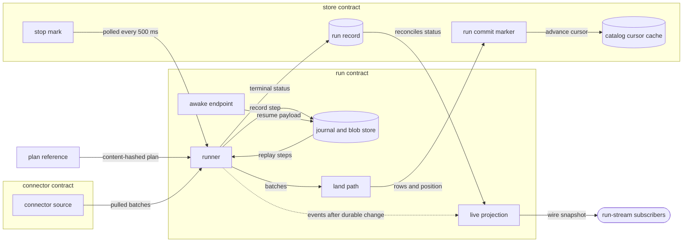
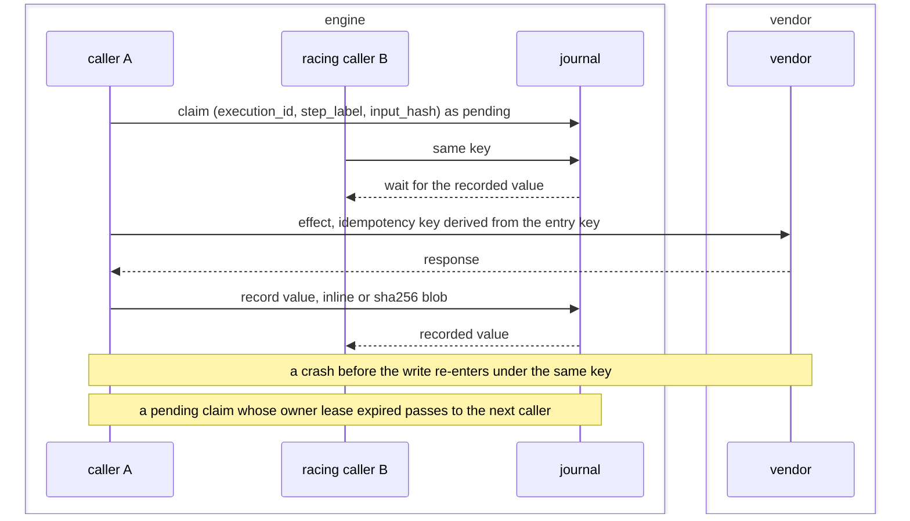
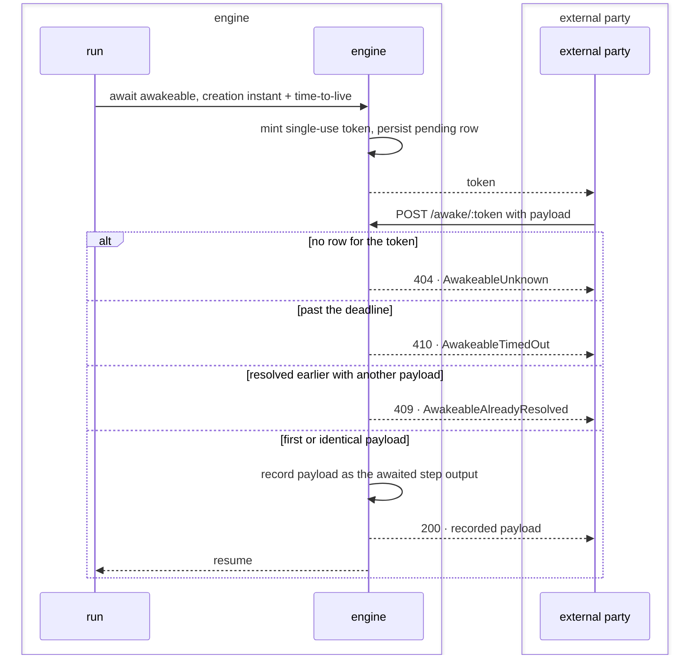
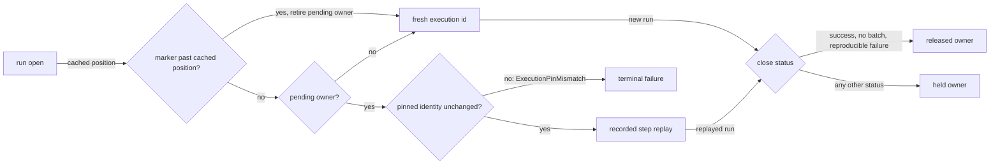
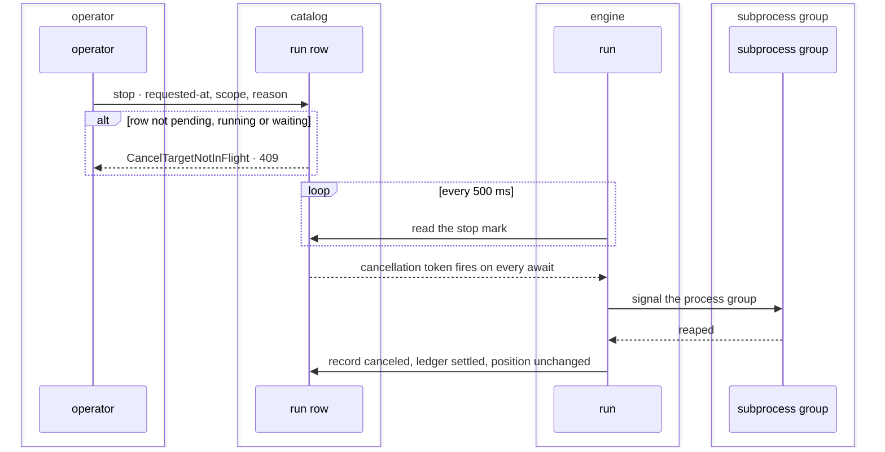
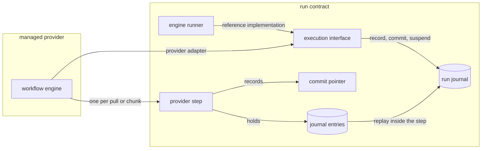
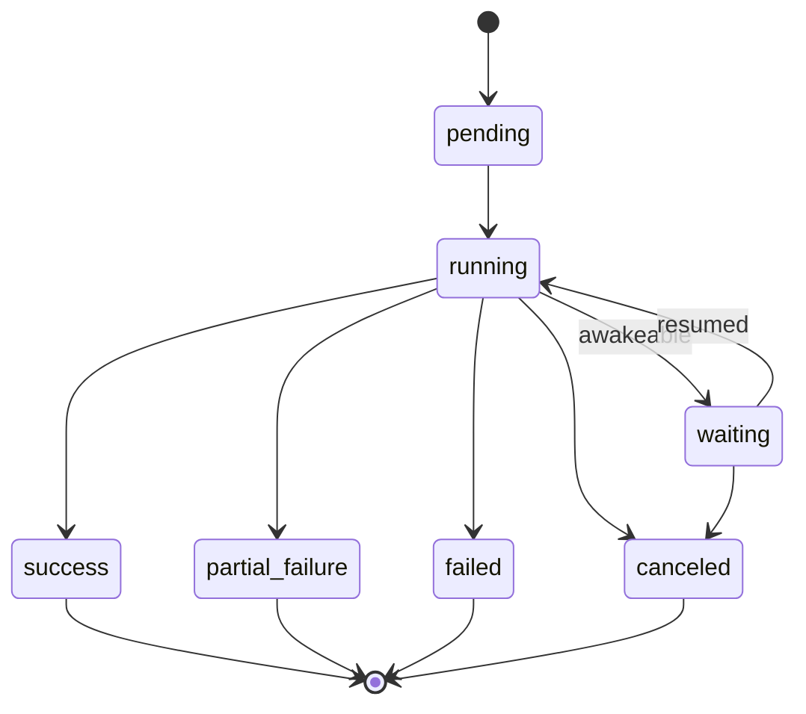

# Durable runs

A run executes a compiled plan: read a source, record steps, commit rows and advance the
source position. Implementers use this contract for the journal, retries and cancellation
shared by pipelines and derive tasks. Row processing follows `31-pipeline.md`.

The runner records steps, commits rows and publishes run status:



## journal

The journal records step values, returns those values on replay and deletes records after execution retirement.

- `step-output` — The journal records a step's value exactly once. Its effect runs at least once: a crash between effect and write repeats the effect. Every later call under the key returns the recorded value.
  *because exactly-once effects need the vendor's cooperation, and the recorded value is the one fact a replay can rely on*
- `entry-key` — The journal keys entries by `(execution_id, step_label, input_hash)`. The first caller claims the key with a pending row before running the effect. A concurrent caller waits for the recorded value without computing.
  *because two racers computing one key issue two billed calls and spend two meter permits*
- `claim-takeover` — If a pending claim's run owner lease expires, {{run.record.owner-lease}}, the next caller under that key takes over the claim.
- `idempotency-key` — Every outbound request a step makes carries an idempotency key derived from its entry key, identical on every re-entry of that effect.
  *because a vendor honoring the key turns an at-least-once effect into one billed call*
- `inline-cutoff` — The journal stores values of 1 MiB or smaller inline as row bytes. For larger values, the journal stores a content-addressed blob named by its sha256 and a reference in the row.
- `blob-write` — Concurrent writers of one blob hash converge on one stored value and none errors on another's write; no partial write survives beside it.
  *A-run*
- `missing-blob` — If a row references a missing blob, the journal raises `BlobMissing` carrying the reference. The journal returns no empty replacement value.
  *P6*
- `collection` — Retiring an execution owner deletes its journal rows in the retiring transaction.
  *because recorded work is needed only while a replay can reach it, and an uncollected journal grows with total ingest*
- `retire-order` — A journal store apart from the catalog deletes a retired owner's rows after the catalog commits the retirement, and the next open under that scope repeats the delete.
  *because a delete ahead of the commit strands a pending owner without its recorded steps, while a late delete leaves only rows no replay reaches*
- `one-cutoff` — Every step kind follows {{run.journal.inline-cutoff}}: pulls, recorded effects, input steps and awakeable payloads. No step kind overrides the cutoff.
  *because one placement rule lets every adapter and the blob sweep read a row without knowing which step kind wrote it*
- `fan-out-join` — Parallel branches rejoin only at an explicit join node. A failed branch reaching the join fails the run. With `allow_partial`, the join instead records each failed branch's label and failure tag on the run record.
  *because an implicit join hides which branch failed, and a partial result recorded as complete reads as one*
- `blob-sweep` — A mark-and-sweep pass every 24 h deletes each blob that no journal row or pending awakeable references and that is older than 1 h.
  *because the grace window covers a blob written ahead of the row that names it*
- `effect-boundary` — A body replays faithfully when every observable side effect passes through a recorded step, a cursor commit or an awakeable; the work between them is pure.
- `recorded-batch` — A journaled pull records its guarded source batch, or its canonically prepared replacement under {{authority.redact.before-the-record}}, ahead of landing.
- `replay-lands` — A journal hit hands the recorded batch to the land path, so a resumed run lands bytes identical to an uninterrupted one, batch ordinal included.
- `ledger-settles-first` — The outbound request ledger settles durably before the entry recording its batch commits.
- `redacting-source` — A journaled source declaring removal without canonical prepared-recording admission raises `JournalRedactionConflict` before its first pull; a boolean removal assertion supplies no admission.
  *A-authority*
- `prepared-owner` — Protected recording binds the plan, shape, canonical declarations, normalization and pepper identities into owner pins before source execution; a changed identity follows {{run.own.pinned-plan-changed}}.
  *A-authority*
- `prepared-replay` — A protected journal hit admits the recorded rewritten payload against its canonical writer without repeating shaping, normalization or removal and without fetching the source again.
  *A-authority*
- `opt-out` — Pull journaling defaults on. A source whose pre-pull cursor cannot name the content it reads opts out through one constant, pinned against each source's declaration by a test. An empty pull is never journaled.
- `escape-hatch` — Journaling permits only two exceptions: `journal.unsafe(label, effect)` for an idempotent read, and a source declaring no pull journaling. Each exception states its idempotency argument at a searchable call site.
- `substrate-port` — One execution interface provides: open or resume under a scope and content-hashed plan reference; record step output; commit a cursor; suspend on an awakeable with timeout; attach a retry schedule; describe capabilities.
  *A-run*
- `storage-ports` — Journal rows, blobs and awakeables persist through a journal store, a blob store and an awakeable store; every `run.journal` and `run.suspend` clause holds for each adapter, the file tree included.
  *A-run*
- `sqlite-stores` — `contextful-sqlite` serves the journal, blob and awakeable stores from one SQLite file in write-ahead-log mode over one connection, a blob as a row keyed by its sha256; an awakeable update commits with the journal writes inside it.
  *because a resolution recording its payload through a second connection waits on the write lock its own update holds*
- `sqlite-write-lock` — Every `contextful-sqlite` store write opens an immediate transaction, so concurrent writers of one key across connections to one file serialize: one record lands, and every other returns the standing value instead of a locked-database failure.
  *because under write-ahead logging a deferred read upgrading to a write fails on the lock at once instead of waiting through the busy timeout*
- `postgres-stores` — `contextful-pg` serves journal rows, blobs and awakeables through {{run.journal.storage-ports}} in the catalog's PostgreSQL database; conditional journal writes serialize across connections, and recorded values survive replacement of every local disk.
  *A-run*
- `container-profile` — `CONTEXTFUL_STORAGE_PROFILE=postgres` selects {{run.journal.postgres-stores}} with shared owners, cadence and {{run.export.remote-state}}; corpus objects use a remote S3-compatible bucket with pull-before-run and push-after-run enabled.
  *A-run*
- `d1-profile` — `CONTEXTFUL_STORAGE_PROFILE=cloudflare-d1` selects D1 for catalog, journal, awakeables and export state through a private Worker outbound binding; R2 holds blob content and corpus objects.
  *A-run*
- `d1-blob` — D1 stores each blob digest, whose R2 object key is `blobs/<sha256>`; the R2 write precedes its D1 reference, and a read verifies the content digest.
  *A-run*
- `d1-transport` — A D1 read, health probe or content-addressed blob request left without an HTTP answer resends, within 3 attempts of at most 15 s each; a writing statement outside {{run.journal.d1-initialize}} goes once over a fresh connection and raises `StorageBindingUnavailable`.
  *because a write whose answer is lost may have committed, and resending it could apply it twice*
- `d1-initialize` — Storage initialization's D1 batch, every statement `IF NOT EXISTS` DDL or an insert or update guarded to apply once, resends after a lost answer as a read does under {{run.journal.d1-transport}}.
  *because a second application of that batch leaves the state its first application left*
- `d1-atomicity` — D1 commits metadata atomically. An interrupted R2 upload may leave an unreferenced object. R2 deletion follows removal of every D1 reference.
  *A-run*
- `d1-guard` — A committed D1 guard prevents owner or lease transfer throughout an admitted external callback; a crash guard requires recorded receipt or idempotency evidence before takeover.
  *A-run*
- `d1-recovery` — The D1 recovery identity binds one project and schema to an R2 object frontier; a missing object or mismatched generation follows {{run.journal.execution-recovery}}.
  *A-run*
- `d1-backup` — A D1 recovery captures the execution database with its guard and export rows, the R2 blob and corpus frontier, project recovery identity and executable schema before writers resume.
  *A-run*
- `storage-incomplete` — Missing profile bindings, corpus state, strict execution guards or a supported outbox raises `StorageCapabilityMissing` before execution admission; absent compiled adapters follow {{topology.package.capability-absent}}.
  *A-run*
- `corpus-unavailable` — If a storage preflight's corpus request fails as {{store.endpoint.unavailable}}, preflight raises `StorageCorpusUnavailable`, naming the bucket or object. The failure does not raise {{run.journal.storage-incomplete}}'s refusal.
  *because an unanswered bucket says nothing of whether a capability is absent, and a transient outage must not read as an unsupported profile*
- `storage-unsupported` — An unknown storage profile or an encrypted corpus paired with an unsealed execution adapter raises `StorageProfileUnsupported` before execution admission.
  *because an unrecognized durability claim cannot select a local fallback safely*
- `execution-schema` — An execution database whose schema differs from the executable's supported schema raises `ExecutionSchemaIncompatible` before execution admission; preflight creates no missing execution table.
  *because creating an empty replacement for a missing table erases the evidence of a partial restore*
- `execution-recovery` — Missing execution tables or a mismatched project recovery identity raise `ExecutionRecoveryMismatch`. Normal startup provisions no recovery identity. A corpus-only restore admits no paid or effectful work.
  *A-run*
- `execution-backup` — An execution backup contains owners, leases, cadence run history, journal rows, blobs, awakeables and export state from one quiesced PostgreSQL snapshot, together with the corpus object frontier, project recovery identity and executable schema.
  *A-run*
- `current-owner` — An execution checks its durable owner, admitted pins and active attempt immediately before effect dispatch and publication; a superseded attempt enters neither boundary, and a late stop still follows {{run.cancel.land-path-uncut}}.
  *A-run*
- `durable-dispatch` — PostgreSQL admission holds shared owner and unexpired lease locks through each bounded provider or destination callback, including item ancestors and entity fences; owner replacement, retirement and takeover serialize after admitted callbacks.
  *A-run*
- `guard-callback` — A guarded callback may update run metadata; mutating its admitted owner or lease refuses. Nested callbacks retain only scopes and leases their caller already admits. Local adapters expose cooperative checks without strict execution-guard capability.
  *because nested lock expansion and owner mutation can deadlock the admission that invokes them*
- `plan-pin` — A run resolves the plan reference it started against for its whole life.
- `store-input` — A store-driven run reads its statement once, through the read face under the job's grant at its `as_of`, and records the resolved snapshot id per table and the ordered input rows as its first step.
  *A-surface*
- `input-replay` — A resumed run iterates recorded input without re-reading the statement. Rows landed after the pinned `as_of`, or folded since, do not enter the input set.
- `open-as-of` — A store-driven job declaring no `as_of` resolves it to the instant its execution opens, recorded in the input step, so every resume reads that instant.
- `input-pin` — A store-driven run's plan reference hashes its body name, statement and declared `as_of`, so a resume under a changed one meets {{run.own.pinned-plan-changed}} before any step replays.
  *A-surface*
- `host-structure-pin` — A host-supplied structural identity joins the input plan and owner pins through {{run.own.pinned-plan-changed}}; without one, the plan reference hashes body, statement and `as_of` alone, as {{run.journal.input-pin}} states.
  *A-surface*
- `input-truncated` — An input statement whose response the face truncates at its row ceiling raises `RunInputTruncated` before any row runs.
  *because a silently shortened input set closes `success` as though every row ran*
- `row-step` — Each input row runs the registered body under a row key, its ordinal in the recorded input; every step the body records carries a label scoped to that key, and a paid call carries {{run.journal.idempotency-key}}.
  *because two rows sharing one label under one execution resolve to one recorded value*
- `row-concurrency` — A batch store-driven run holds at most `max_in_flight` rows inside the body at once; a failing row admits no further row, and the run closes after the rows in flight return.
- `row-output` — A batch's emitted rows land after the last input row completes and before the owner retires, one run per declared output table through {{run.land.stage-order}}.
  *because a landing that fails then holds the owner, and its resume replays every paid call instead of paying again*
- `body-projection` — A registered body's closed effect labels, declared roots, types, transforms and normalization bind its owner before input or effect execution; a caller-supplied projection differing from that registration refuses.
  *A-authority*
- `unwired-capability` — Requesting a capability absent from the running profile raises `CapabilityUnwired` at the first request, before any partial work.
  *A-topology*
- `machine-state` — The host's own stores hold journal rows, execution owners and awakeables. The derived catalog holds none. A catalog rebuild changes none and reconstructs none from the file tree.



## items

The engine executes isolated input items with independent completion receipts, bounded retries and leased entity keys.

- `opt-in` — A store-driven job defaults to batch execution; `isolated_items` explicitly declares logical and entity key columns, an entity namespace and a positive failed-attempt budget.
  *because independent completion changes aggregate failure and retry semantics*
- `identity` — An isolated item's logical identity derives from its declared key and namespace; its execution identity binds that identity, job, input row, policy and pinned plan, independently of input order.
- `completion` — Each successful item lands independently and stores a durable completion receipt; a later fire under the same execution identity skips its body and landing.
- `terminal-input` — An aggregate whose items all hold terminal receipts releases its pinned input owner, so later fires read fresh input while retaining each item's completion or terminal failure.
- `outcomes` — Individual outcomes distinguish success, failure, parked, deferred and waiting; the aggregate succeeds only when every required item succeeds.
- `retry-budget` — Failed attempts consume the declared item budget across fires; permanent failures terminate immediately, parked entries consume no failed attempt, and terminal failure receipts prevent further body entry.
  *P6*
- `replay` — A nonterminal failed or parked item retains its execution owner and recorded paid calls; its next admitted attempt reuses that journal.
- `entity-admission` — Admission holds one leased entity namespace and key across triggers, job names and execution versions; unrelated entities occupy at most the job's `max_in_flight` body slots.
- `overlap` — An active entity lease returns a deferred item outcome through the scheduler's failed fire report; its next scheduled fire rechecks admission.
- `fence` — Recorded effects and output publication check their execution owner and entity fence immediately before dispatch; a superseded owner sends no provider request and publishes no output.
  *because an owner that resumes after transfer cannot authorize another effect*
- `delegated-item` — Under a delegated body, each call ordinal is one request under {{surface.delegate.envelope}}, its `ok`, `defer` or `permanent` answer recorded under the item's entry key, so a resume replays every recorded answer and sends only the unrecorded call.
  *A-surface*
- `outcome-record` — Each terminal item appends one row to the reserved `_items` table once its receipt commits: job, logical key, entity namespace and key, attempt count, terminal outcome, reason, attempt run id, execution id and end instant.
  *A-run*
- `terminal-outcome` — An item row's outcome is `succeeded`, `failed` for a failure no retry changes, or `exhausted` for a retryable failure on the attempt spending {{run.items.retry-budget}}; its reason carries the failure tag and {{run.record.error-cap}} message.
  *A-run*
- `waiting-item` — Under `isolated_items`, every retry wait closes its item {{run.retry.waiting-state}} and frees its slot; once the pass ends, an item whose instant falls within {{run.retry.retry-after}}'s ceiling re-enters in the same fire.
  *because one throttled item sleeping in a slot delays every sibling queued behind it*
- `served-key` — An item row carries its logical and entity keys as the job's input relation served them, so a key its source masks or classes lands under that rule, never in the clear.
  *A-run*

#### Scenarios

- `run.items.completion`: WHEN one input fails permanently among three isolated items, THEN both healthy items land and reordering a later fire repeats neither completed body.
- `run.items.fence`: WHEN a newer owner takes an entity's lease while an earlier job's item resumes, THEN that resume sends no delegate request and publishes nothing.
- `run.items.entity-admission`: WHEN three store-driven jobs declare one entity namespace and key column and two fire in one window, THEN at most one item per key enters a body and the later job's item reports deferred.
- `run.items.entity-admission`: WHEN two jobs target one entity under different plans, THEN one enters its body and the other reports deferred while unrelated entities proceed.
- `run.items.fence`: WHEN an entity lease transfers before a paid call, THEN the earlier attempt invokes no provider.
- `run.items.outcome-record`: WHEN one of three items fails transiently under a one-attempt budget, THEN `_items` holds two `succeeded` rows and one `exhausted` row naming the job and entity key, and a later fire adds none.
- `run.items.served-key`: WHEN the input table hashes the entity key column, THEN every `_items` row carries the 32-char digest and no clear key.

unsettled: Does a job credential holding a mask exception record its entity key in the clear on `_items`, or does the item record apply the source column's mask itself? owner: run-path affects: run.items

## advance

The engine commits source positions according to cursor kind and re-reads rows at each poll's boundary.

- `cursor-kind` — A cursor declares `monotonic` for a timestamp, autoincrement or watermark, `opaque-token` for a vendor continuation token, or `snapshot-id` for a log sequence number or version id. An undeclared kind resolves to `opaque-token`.
- `concurrency-by-kind` — A `monotonic` position is concurrent-safe and commits the highest value observed. An `opaque-token` or `snapshot-id` position moves only under a single-writer lease. Last-write-wins governs no cursor.
  *because two writers resolving one continuation token by recency skip or duplicate records with no count showing it*
- `engine-owned` — A connector moves its position only by committing through the engine; that commit is a recorded step and replays as a resolved read.
- `commit-with-rows` — A table's run commit marker, {{store.lay-out.run-manifest}}, publishes its rows and new position together. The catalog cursor caches the newest committed marker.
  *because rows and position committed in two stores leave a crash window that re-lands a batch*
- `cursor-bytes` — A position is opaque bytes the connector owns, and its kind is a manifest fact the engine reads. Each table carries its own position.
- `inclusive-boundary` — A polled load admits a row whose clock value is at or after the stored position, re-landing the boundary instant's rows on every poll.
  *because a clock coarser than the row grain otherwise drops a sibling sharing the boundary value, permanently and invisibly*
- `declared-key-required` — The boundary re-land is idempotent on a table declaring a key; on a keyless table the repeats accumulate in its union view.
- `watermark-shape` — A watermark position serializes as `{"field": "<name>", "at": <value>}`. `field` names the column whose values determine the watermark.
- `field-rename` — Opening a position whose stored field differs from the declared `incremental` field raises `CursorFieldMismatch` before any request leaves the host.
  *A-run*
- `frontier` — The frontier counts every fetched row, landed or not. A committed position advances or stays unchanged. An empty or older window does not rewind the position.
- `walk-position` — Under a `monotonic` cursor, a pull reporting more and carrying a position other than the one it asked continues its walk: the next pull asks that position and admits rows from the walk's floor, and the run commits the frontier.
  *A-run*
- `unorderable-position` — A row with no orderable value in the clock field, or a stream switching between text and numeric positions mid-pass, raises `CursorPositionUnorderable`, terminal for the pull.
  *A-run*
- `allowed-lateness` — A table declares `allowed_lateness`, default 0 s; a `monotonic` poll re-reads from its stored position minus that window, so a row arriving that late still lands.
  *because lateness belongs to the source feeding a table, and a position records only where the frontier stands*
- `turning-incremental-on` — Enabling `incremental` on a pipeline that holds a position starts from none, re-landing the source's current window once.
- `skip-unchanged` — A snapshot-shaped source with `skip_unchanged = true` records its input's raw-byte digest as `{ sha256, rows }`; a matching digest returns zero batches, holds the position and closes a zero-row success. Undeclared, it is false.
- `snapshot-completion` — A snapshot source reports complete inventory or unchanged skip independently of row count; a replacing run carries only complete inventory into its manifest.
  *A-store*
- `zero-row-commit` — A complete empty snapshot of a replacing table commits {{store.declare.empty-replacement}}; a skipped unchanged input holds the frontier and position, and a failed pull publishes neither.
  *A-store*

#### Scenarios

- `run.advance.zero-row-commit`: WHEN a complete snapshot holds zero rows after a non-empty replacing run, THEN the current read is empty and a bounded read before the commit retains the older rows.
- `run.advance.zero-row-commit`: WHEN the source skips unchanged input, THEN the current read and cursor retain their prior values.
- `run.advance.zero-row-commit`: WHEN a pull fails before completion, THEN no replacement marker becomes readable.
- `run.advance.walk-position`: WHEN a `monotonic` walk's pull returns no rows, the position it asked and more, THEN the run ends and commits its frontier.

## suspend

The engine suspends runs durably until an external callback resolves an awakeable or its deadline expires.

- `awakeable` — An awakeable suspends a run durably: the engine mints an opaque single-use token and persists a `pending` row through the awakeable store; an external party resumes by posting the token back.
  *A-run*
- `resume-is-a-step-output` — The journal records a resume payload as the awaited step's output under key `sha256("awakeable:" + token)`. A run that resumes and then crashes reads the payload back without suspending again.
- `deadline` — A deadline is the creation instant plus a time-to-live, both caller-supplied RFC3339 Zulu strings; the core reads no wall clock.
- `timeout-is-sticky` — The engine evaluates expiry against an injected instant. A suspension past its deadline becomes `timed_out` and keeps that state under any later instant.
- `idempotent-resolution` — Resolving a token again with the identical payload returns the recorded value.
- `conflicting-resolution` — A second resolution with a different payload raises `AwakeableAlreadyResolved` and leaves the recorded value untouched.
  *A-run*
- `expired-token` — Resolving a token past its deadline raises `AwakeableTimedOut`.
  *A-run*
- `unknown-token` — A token with no row raises `AwakeableUnknown` and allocates no state.
  *P2*
- `resume-route` — `POST /awake/:token` on the served face answers `200` with the recorded payload, `404` for {{run.suspend.unknown-token}}, `409` for {{run.suspend.conflicting-resolution}} and `410` for {{run.suspend.expired-token}}. `GET /awake/:token` reports state without resuming.
  *A-run*
- `resume-authenticates` — The resume route admits the request's credential before reading the registry, answering `401` without one, and passes the credential's verified `on_behalf_of` as the caller subject.
  *A-run*
- `caller-binding` — An awakeable may bind a verified caller subject at mint; resolving it then takes the token and a credential for that subject, and any other caller answers as {{run.suspend.unknown-token}}. An unbound token is its whole authority.
  *because a token leaked through a log otherwise resumes a run, and answering unknown discloses nothing to the wrong holder*
- `payload-offload` — A payload above {{run.journal.inline-cutoff}} lands in the journal's blob store, and the pending row references it.
- `postgres-reconciliation` — A PostgreSQL callback row interrupted after its resume value commits recovers its resolved payload from that journal value; a conflicting resolution follows {{run.suspend.conflicting-resolution}}.
  *because a separately committed callback row cannot overwrite the journal value that already determines replay*
- `survives-restart` — A durable awakeable store persists every registry row, so a process reopening it over the same location drops no pending callback; an in-process store ends with its process.
- `row-parks` — A store-driven row awaiting an unresolved awakeable parks and frees its slot; the other rows run on, and the parked row re-enters its body once the awakeable resolves or its deadline passes.
- `recorded-timeout` — A row's wait past its deadline records a timeout value as that wait's step output, so every re-entry of the body reads the identical value.
  *because a body branching on the clock rather than on a recorded value replays differently after a crash*



## retry

The runner classifies failures and schedules step retries through one retry layer.

- `failure-taxonomy` — One tagged failure type crosses every port: `Transient`, `Permanent`, `SchemaIncompatible`, `AuthExpired`, `RateLimited`, `Config`, `Storage`, `UnknownConnector`, `SecretNotFound` and `Canceled`. A caller branches on the tag, never on a message.
  *P2*
- `schedule` — A schedule attaches to a step and carries a fixed or exponential backoff with base and factor, a total attempt count including the first, a per-delay clamp, a jitter ceiling and `retry_on`.
- `default-policy` — The default schedule is exponential from a 100 ms base with factor 2, to 5 attempts in total, each delay clamped at 30 s, plus seeded jitter below 250 ms.
  *because zero jitter synchronizes every run that hit one shared throttle*
- `single-attempt` — A schedule of 1 attempts is the no-retry schedule.
- `retryable-classes` — `Transient` and `RateLimited` retry; every other tag stands as the step's answer whatever budget remains. `retry_on` narrows that pair.
  *P6*
- `unretryable-tag` — A `retry_on` naming any tag outside `Transient` and `RateLimited` raises `RunRetryTagUnretryable` at plan compile.
  *P6*
- `step-failed` — A non-retryable failure, or a step exhausting its schedule, raises `StepFailed` carrying the step label and the underlying tag.
  *P6*
- `deterministic-verdict` — A refusal whose check is pure over static input is terminal and consumes no attempt budget.
  *P6*
- `retry-after` — A server-supplied `Retry-After` supersedes the computed delay; a remaining wait up to 300 s sleeps in process, and a longer one closes the attempt `RateLimited` under {{run.retry.waiting-state}} instead of sleeping.
  *because an unclamped upstream delay holds a run slot for as long as the vendor asks*
- `not-before` — Before any wait, a retrying step records its next-attempt instant beside its attempt count in the execution's journal, so a restart, a container replacement included, reads both back.
  *because a wait held only in memory restarts on every replacement and calls the vendor early*
- `waiting-state` — An attempt closed on its next-attempt instant reports `waiting` with that instant on its run row, counts as neither refused nor failed, and keeps its owner; only exhausting the schedule's attempts fails the step.
  *because a vendor's requested pause is not evidence the work is wrong*
- `resume-at` — An attempt reaching a step whose stored instant has not passed waits again without invoking the effect; the first attempt at or after it re-enters under the same work key, pins and attempt count.
  *because resuming under another key or a fresh budget repeats paid work or retries without bound*
- `crash-resumes-wait` — An attempt resuming a step whose process died mid-sleep sleeps out only the remaining wait to the stored instant.
  *because restarting the wait over-delays and skipping it calls the vendor early*
- `wake` — A waiting attempt records its instant on its owner; the scheduler fires that owner's unit at the first beat at or after it, ahead of the unit's regular `schedule` fire, and the next attempt's claim clears it.
  *because a resume gated on the regular cadence adds up to a full interval to every rate-limited wait*
- `shared-path` — An HTTP `Retry-After`, a throttled lease mint and a limiter denial each reach the step as a `RateLimited` failure carrying its wait, and each takes {{run.retry.not-before}}.
  *because two retry owners for one throttle disagree on when to call again*
- `no-double-spend` — A resumed attempt replays every recorded step, so it reserves no meter permit and issues no call an earlier attempt already recorded.
  *because each resume reserving afresh spends a budget once per wait*
- `one-layer` — The step's schedule is the only retry layer: an adapter, a credential mint and a meter acquire inside a step return their failure to it.
  *because nested retry layers multiply attempts and amplify a vendor outage*
- `decision-is-pure` — The retry decision is a pure function of the completed one-based attempt and classified failure. Jitter derives from an injected seed. The runner owns the sleep and attempt counter.
- `partial-failure` — A run failing after it staged batches commits none of them under {{run.own.one-commit-per-run}} and closes `failed`, holding its owner so the journal keeps the resume point; only {{run.record.orphan-reap}} closes a run `partial_failure`.
- `no-compensation` — The engine offers no compensation combinator; undoing a partial effect is an author-written recorded step, replayed like any other.
  *because compensation depends on each vendor's undo semantics, which the engine cannot know*
- `attempt-counter` — An in-flight schedule's attempt counter persists on its step's journal row, so a crash mid-backoff resumes the remaining budget instead of restarting it.
  *because a budget restarting at each crash retries a failing vendor without bound*
- `pressure-is-local` — Rate-limit pressure against one source paces only that source's runs.
- `bound-hit-is-transient` — A connector striking {{connector.package.linear-memory}} or {{connector.package.call-deadline}} fails the attempt `Transient`, the failure naming the bound it struck.
  *A-run*
- `bound-hit-recorded` — The run record lists every bound hit with its step label, attempt and bound, a hit a later attempt recovered from included.
  *A-run*

## own

An execution owner binds pending work to a scope, connector build and plan identity.

- `execution-owner` — One durable execution owner exists per scope; a table or chunk owner holds the connector identity with its component world, the pipeline `content_hash` and the input hash.
- `host-scope` — The catalog keys every owner on its scope — live table, backfill chunk or host-declared id — a table owner keeping its stored key byte for byte, and a host owner pinning the plan reference and identities the host supplies.
  *A-run*
- `body-implementation` — Store-driven owner pins include the host-verified digest of its executing binary and concrete registered body type; configuration selects a body name and supplies no implementation identity.
  *A-run*
- `body-dependencies` — Registration declares prompt/template, public provider/model configuration and policy identities affecting execution; owner pins carry their digests independently of structural input and output declarations.
  *A-run*
- `body-admission` — Body implementation and dependency pins bind before input reads, recorded-call replay or body entry; unavailable or changed pins follow {{run.own.pinned-plan-changed}}.
- `body-compatibility` — Registrations without dependency declarations declare none and receive the verified host implementation pin; pending owners without implementation pins refuse before input reads or body entry under {{run.own.pinned-plan-changed}}.
  *because an unversioned record cannot establish which executable produced its paid calls*
- `body-fresh` — A fresh execution under changed implementation or dependencies receives a distinct plan identity and preserves earlier run records; pending work requires its recorded host build and registered dependencies.
- `body-public-configuration` — Semantic provider configuration contains public endpoint, model and generation parameters; credential-bearing endpoints refuse registration, credentials enter neither exported diagnostics nor recorded pins, and credential rotation alone changes no semantic identity.
  *because credential custody and executable semantics are independent identities*
- `execution-id-keys-the-journal` — Recorded work keys on the execution id; a catalog run id is the provenance of one attempt, so attempts under one owner resolve the same recorded values.
- `retirement` — Retiring an owner and caching its committed position share one catalog transaction; a later fire receives a fresh execution id even at a byte-identical position. A completed backfill chunk retires the same way.
- `marker-reconciles` — At run open, a commit marker newer than the catalog's cached position retires the pending owner that produced it before any replay.
  *because a crash between marker and catalog otherwise replays a recorded pull into rows already committed*
- `pinned-plan-changed` — While an owner is pending, a changed pin — connector identity, component world, pipeline `content_hash`, or a host's plan reference or identities — raises `ExecutionPinMismatch` before replay, terminal and non-retryable, naming the scope and both pin sets.
  *A-connector*
- `pin-recovery` — Restoring the recorded build and resuming to completion clears a pending owner; {{run.own.rewind}} retires a host or table owner, and an explicit chunk rewind retires the owners its window covers.
- `pin-mismatch-recovery` — The {{run.own.pinned-plan-changed}} refusal names restoring the recorded build or plan and, under a host or table scope, {{run.own.rewind}} with the pending execution id; it names no recovery the command line lacks.
  *because an operator acts on the refusal's text, and a recovery no verb provides leaves the scope refusing every fire*
- `rewind` — `contextful run rewind <execution-id> --reason <text>` retires the pending host or table owner holding that execution and leaves the scope's committed position alone, so the scope's next fire claims a fresh execution.
  *A-run*
- `rewind-record` — A retirement under {{run.own.rewind}} or {{run.own.apply-retires-superseded}} writes one `canceled` run row under the scope carrying the retired execution id, its pinned plan reference and the reason, started at the owner's open.
  *because a row started at the retirement reads as the job's latest start and postpones its next due fire*
- `rewind-not-pending` — A rewind naming an execution no pending host or table owner holds raises `ExecutionRewindNotPending`.
  *because a completed or retired execution holds nothing to release, and a chunk owner retires through its window's rewind*
- `rewind-plan-current` — If no attempt or refused open requested another plan reference, rewinding the owner raises `ExecutionRewindPlanCurrent`. The operator may override this refusal with `--force`.
  *because such an owner resumes on its next fire, and retiring it discards its recorded work*
- `rewind-unsafe` — Retiring an owner with an attempt on an unexpired {{run.record.owner-lease}}, a `waiting` attempt, or an awakeable pending before its deadline raises `ExecutionRewindUnsafe` naming it; `--force` overrides none.
  *A-run*
- `apply-retires-superseded` — A claimed `pipeline apply` retires a build or sweepless store-driven job's pending owner when the applied snapshot produces no matching declared plan reference: a verified body's `input` identity, otherwise its plan reference.
  *A-run*
- `apply-retire-refused` — An applied retirement meeting {{run.own.rewind-unsafe}} leaves the owner pending and the snapshot claimed, and the apply names the execution and {{run.own.rewind}} on standard error.
  *A-run*
- `scope-independence` — A finishing table releases nothing another table's unfinished execution holds, and a seeding scope carries its own source identity.
- `unclosed-execution` — An execution handle dropped without close records no status; its owner stays pending, and the next open under its scope resumes it once {{run.record.owner-lease}} lapses.
  *A-run*
- `live-owner` — An open under a host scope whose pending owner has an attempt on an unexpired {{run.record.owner-lease}} fails `Transient` naming that attempt, and its run row closes `failed` without joining the owner.
  *because two live handles on one owner share its journal, and either one retiring it strands the other*
- `pin-release` — `success`, a failure that wrote no batch, and replay-stable failures under {{run.own.staged-bytes}}, {{run.land.late-type}}, or {{run.own.source-stage-schema}} release the owner; every other status holds it.
- `admission-pin` — A run pins its connector identity at admission and a replay resolves the artifact from that pin; a connector rebuilt later reaches no in-flight or replayed run.
  *A-connector*
- `backpressure` — The runner stages each shaped batch through the destination as one part before its next pull, so a run holds one pulled batch in memory; the commit names the staged parts.
  *because holding every batch until the commit sizes a run's memory by the sum of its pulls*
- `one-commit-per-run` — One run produces one atomic commit per table, plus one per {{run.own.checkpoint-commit}}; a crash mid-run leaves parts under that run's own directory, and a resumption continues from the last recorded step or commit.
- `staged-bytes` — A stage carrying the parts a run staged since its last commit past 1 GiB raises `RunStagedBytesExceeded`, deterministic; the run commits nothing more and retires its owner, so the next fire pulls afresh from the stored cursor.
  *because a replay of the run's recorded pulls stages the same bytes past the bound and fails identically, holding the table's owner indefinitely*
- `checkpoint-commit` — When the parts a run of a position-addressed source staged since its last commit reach 512 MiB, the run commits them with the position after its last staged pull before staging more rows, then keeps pulling under the same execution.
  *A-run*
- `checkpoint-frontier` — Under a `monotonic` cursor, a checkpoint commits only before a pull whose every clock passes the run's frontier, so no commit's position splits the rows of one instant.
  *A-run*
- `checkpoint-resume` — A checkpoint caches its position and marker in the catalog cursor while the owner stays pending, and collects the journal's recorded pulls, so a resumption pulls afresh from that position.
  *A-run*
- `checkpoint-run-id` — A run's first commit lands under its run id and each later one under `<run id>.<n>`, `n` its zero-padded six-digit ordinal, so every commit names its own parts.
  *because the store holds one manifest per run id, and a later commit naming an earlier one's directory finds it committed*
- `checkpoint-id-length` — A checkpoint whose next `<run id>.<n>` passes {{store.lay-out.run-id-shape}} raises `RunCheckpointIdTooLong` before it commits; the run commits nothing and retires its owner.
  *because a run committing its first checkpoint and then failing on the next one's run id leaves a partial window published*
- `checkpoint-landed` — A run failing after a checkpoint's commit lands records on its row the rows and bytes every landed checkpoint commit carried, including one whose cursor update then fails.
  *because the checkpoints stay committed, and a failed row counting no rows hides rows every read returns*
- `checkpoint-scope` — A source is position-addressed when each pull's position names a watermark, page token or stable offset. A {{connector.source.http-url-walk}}, a replacing table, a body's prepared landing, and a seeding or receiving scope commit once.
  *A-run*
- `stage-schema` — A stage refuses against `schema.json` and the run's earlier stages, then merges its columns into the run's own staged schema; only the commit merges them into `schema.json`.
  *because otherwise rows no commit publishes fix a column's type in the table's schema*
- `source-stage-schema` — A deterministic `SchemaIncompatible` from staging an ordinary source batch, raw or prepared, retires its owner unless another live attempt holds it; the failed run changes neither committed cursor nor published rows. This exception excludes prepared body-emission staging.
  *because a recorded source batch that fails the same schema check on replay prevents a repaired source from being fetched*
- `stage-commit-seq` — A staged part carries no `_commit_seq`; the commit assigns it under {{store.reserve.commit-order}} and writes it into each part it names, so a run committing between a stage and that commit takes the lower value.
  *because a value fixed at the stage orders a run by its first pull, and the readable runs then hold no prefix of the sequence*
- `stage-instant` — A staged part carries no `_ingested_at`; the commit writes its commit instant into each part it names, so every row of a run carries the instant its marker carries.
  *because a stage-time instant ranks a run by its first pull, so under {{store.declare.dedup-view}} an earlier committer outranks a later one on a shared key*
- `stage-discard` — A run that fails removes every part it staged, and a commit failing before its manifest exists removes the parts it copied; a run's crash leaves its staged parts.
  *because a run id names one attempt, so no later commit names a failed run's staged parts*
- `body-parent` — Prepared body outputs require the unchanged parent execution and current in-flight, unstopped attempt at admission, staging and commit; a stopped parent reaches {{run.cancel.abandoned-work}} independently of the output table's stop policy.
  *A-authority*



#### Scenarios

- `run.own.unclosed-execution`: WHEN a host execution records two steps and its process dies mid-third, THEN the next open under its scope after the lease lapses replays both steps without running their effects.
- `run.own.live-owner`: WHEN attempt `job-a` holds host scope `index-42` open and `job-b` opens under it, THEN `job-b` fails `Transient` naming `job-a`, and `job-a` alone holds the owner.
- `run.own.pinned-plan-changed`: WHEN a host scope's pending owner pins plan reference `plan-a` and an open asks for `plan-b`, THEN the open refuses with `ExecutionPinMismatch` and its run row closes `failed`.
- `run.own.rewind`: WHEN job `score`'s pending owner pins `plan-a`, a fire asking `plan-b` refuses, and an operator rewinds that execution, THEN the next fire claims a fresh execution under `plan-b` and completes.
- `run.own.apply-retires-superseded`: WHEN applied v2 changes the model a build job targets while its pending owner pins v1's plan reference, THEN the apply retires that owner and the job's next fire completes.
- `run.own.backpressure`: WHEN a source serves three pages, THEN the destination stages part 0 after the first pull, part 1 after the second and part 2 after the third, and one commit names all three.
- `run.own.staged-bytes`: WHEN each of three pulls of a replacing table stages a 400 MiB part, THEN the third stage fails the run `Permanent` with `RunStagedBytesExceeded`, the cursor stays where it stood, and the next fire pulls all three pages under a fresh execution.
- `run.own.checkpoint-commit`: WHEN each of sixteen pulls stages a 128 MiB part, THEN one fire commits four times, four parts each, carrying the positions `p4`, `p8`, `p12` and `p16`.
- `run.own.checkpoint-frontier`: WHEN five pages of clocks `1 1`, `1`, `2`, `2` and `3` each stage a 512 MiB part, THEN the run commits at positions 1, 2 and 3, and no instant's rows span two commits.
- `run.own.checkpoint-id-length`: WHEN a run id of 122 chars stages sixteen 128 MiB parts, THEN the run fails with `RunCheckpointIdTooLong` and commits nothing.
- `run.own.checkpoint-landed`: WHEN a run commits checkpoints at `p4` and `p8` and its tenth pull fails, THEN its `failed` row counts eight rows.
- `run.own.checkpoint-landed`: WHEN a run's `p12` checkpoint commits and the cursor row moves before its update, THEN its `failed` row counts twelve rows.
- `run.own.checkpoint-resume`: WHEN a run commits checkpoints at `p4` and `p8` and dies pulling `p9`, THEN the next fire pulls from `p8` and lands every later row once.
- `run.own.checkpoint-scope`: WHEN an appending table's next-URL walk dies on its third page and the listing gains a first row, THEN the next fire lands each listed row once.
- `run.own.checkpoint-scope`: WHEN a replacing table's next-URL walk dies mid-walk on three fires, THEN the fourth fire succeeds with every listed row and no fire succeeds with zero.
- `run.own.stage-schema`: WHEN run `run-s` stages `ts` as text and fails, THEN a later run lands `ts` as a timestamp, and `run-s`'s commit refuses with `StoreSchemaIncompatible`.
- `run.own.stage-commit-seq`: WHEN run `run-s` stages a part, run `run-c` then commits as `_commit_seq` 1, and `run-s` commits after it, THEN every row of `run-s` reads `_commit_seq` 2.
- `run.own.stage-instant`: WHEN run `run-a` stages key `k` at 00:01, run `run-b` commits `k` at 00:03 and `run-a` commits at 00:05, THEN the keyed read returns `run-a`'s row, `_ingested_at` 00:05.
- `run.own.stage-discard`: WHEN a run stages its first page and its second pull fails, THEN its run directory holds no staged part.

unsettled: Which pass collects the staged parts of a run that crashed before its commit, and after what age? owner: run-path affects: run.own


## cancel

The engine stops work at run or pipeline scope through a shared cancellation token and records the remaining durable state.

- `catalog-channel` — The catalog stores each stop request on the run row: requested-at instant, scope and optional reason. The catalog is the only stop-request channel.
- `two-grains` — A `run`-scoped stop halts one run and the fire continues; a `pipeline`-scoped stop halts every in-flight run of the pipeline and every table or chunk the fire had left. An unrecognized stored scope reads as `run`.
- `host-grain` — A `pipeline`-scoped stop on a host execution's run halts every in-flight run under the same host-declared scope and no run of another scope.
- `one-token` — Each run holds one cancellation token that every await selects on: the pull, a retry sleep, an awakeable wait and a subprocess wait. A meter reservation holds no wait of its own, under {{connector.meter.acquire-call}}.
  *because a stop observed only at the pull leaves sleeps and child processes running after the record reads canceled*
- `poll-interval` — The engine updates the token from one catalog read before the run's first await, then every 500 ms. Each await evaluates cancellation before work.
- `engine-keeper` — One keeper per engine renews every registered execution's owner lease and feeds its token, sleeping until the earliest deadline; opening an execution registers it, and close or drop deregisters it.
  *A-run*
- `keeper-panic` — A keeper job that panics warns and leaves the keeper running: every other registration keeps its cadence, the panicking one retries at its next deadline, and dropping it returns.
  *because the keeper is shared, so one adapter's panic that ended its thread lapses every open execution's lease under a live run*
- `land-path-uncut` — A table run's own stop does not interrupt landing. The engine finishes landing bytes already received and records the unfulfilled stop. Prepared body outputs additionally require {{run.own.body-parent}}.
- `abandoned-work` — Abandoned work surfaces as the `Canceled` tag through the ordinary failure path, which settles the request ledger, closes the record and leaves the position alone.
  *A-run*
- `child-reaped` — A stop signals a running subprocess chain's process group. The engine records `canceled` only after reaping the group.
  *because a record reading canceled while a child still runs misstates what the machine is doing*
- `storage-blip` — A failed poll read warns and keeps polling.
- `not-in-flight` — Only a `pending`, `running` or `waiting` row accepts a mark; a stop matching none raises `CancelTargetNotInFlight`, answering `409` over HTTP and exiting non-zero at the terminal.
  *A-run*
- `re-mark` — Marking an already-marked row overwrites it with the newer request.
- `distinct-terminal-status` — `canceled` is a terminal status apart from `failed`, and upstream health observations skip it.
  *A-run*
- `resumable-remains` — A stopped run's recorded pull keeps its owner and replays next attempt; a stopped pull that recorded nothing releases it. A stopped chunk returns to pending, its attempt count unchanged. A stop advances no position.
- `authority-from-the-record` — A stop authorizes against the pipeline read off the run record, never off the request.
- `stop-unauthorized` — A credentialed stop needs an `execute` grant covering the pipeline read off the run record; an uncovered or unrecorded run raises `CancelUnauthorized` without naming the pipeline, answering `403` over HTTP.
  *because a stop halts work `execute` fires, and a refusal naming the pipeline discloses it to a credential that cannot read it*
- `stop-route` — `POST /runs/:run_id/stop` writes a stop under a per-request network credential, its optional JSON body carrying `scope` and `reason`, and answers `200` with the marked run ids.



#### Scenarios

- `run.cancel.engine-keeper`: WHEN 20 executions are open on one engine, THEN one keeper thread renews all 20 owner leases, and it exits once the last one closes or drops.

## record

The store records run status, owner leases and execution history. History requests select a time window and row ceiling.

- `reserved-table` — The durable run record is a reserved store table holding two append-only rows per run, one at plan and one at commit; the latest row per run and phase wins. The local catalog is a cache in front of it.
- `columns` — A run row carries run id, pipeline id, site id, status, owner, start and end instants, row and byte counts, error kind and message, connector id, version and hash, trace id and phase.
- `trace-context` — A run a command opens takes as trace id the trace of the caller's `traceparent`, read from `TRACEPARENT` and `TRACESTATE`, or a fresh trace; both run rows carry it.
- `run-span` — With an exporter configured, a run exports one span, child of the caller's span, carrying run id, pipeline, table, status, row and byte counts, and the failure tag.
- `status-set` — A run status is `pending`, `running`, `waiting`, `success`, `partial_failure`, `failed` or `canceled`, spelled identically on the record and the wire snapshot; every surface classifying a run covers all seven.
  *because two vocabularies for one lifecycle leave a suspended or partly failed run without a reading*
- `row-at-open` — The engine writes a run row at open, before the first pull. Readers distinguish zero-row `success`, `failed` with an error kind, and no run row.
- `record-folds` — An append to {{run.record.reserved-table}} runs a pass on it once {{store.fold.triggers}} fires; a pass that fails leaves the row appended and the append succeeding, and the next append retries it.
  *A-run*
- `rebuild-restores-history` — A catalog rebuild restores run history from {{run.record.reserved-table}}, so a rebuilt catalog lists every run the store recorded instead of starting empty.
  *because the catalog is a cache, and a rebuild dropping history loses the only record of failed runs*
- `time-travel` — Run history inherits the store's transaction-time bound, so one as-of selector rewinds it with every other table.
- `owner-lease` — A `running` or `waiting` row carries an owner of process id, boot id and a lease expiry, renewed every 10 s with a 30 s time-to-live.
  *because a second process sharing the catalog needs a liveness signal to tell a live run from an orphan*
- `orphan-reap` — Startup marks only non-terminal rows with expired owner leases as `partial_failure`. Startup leaves rows held by live processes unchanged.
- `writing-site` — Every landed row carries its run's site id in the `_site_id` column {{store.reserve.injected}} writes, so a row names the site that wrote it.
- `site-id-length` — A site id matches letters, digits, dot, underscore and hyphen, from 1 chars to 64 chars.
  *because it is interpolated into run directories and request-ledger filenames*
- `site-id-unresolved` — A site id comes from the manifest's `site_id`, or the variable its `site_id_env` names, and a run's `--site-id` or `--site-id-env` replaces that declaration; no declaration, both keys in one place, or an unset variable raises `SiteIdUnresolved` at startup.
  *P3*
- `history-window` — History requests specify an inclusive start-instant lower bound and row ceiling, returning newest first. A SQL catalog applies the bound in `WHERE` over an indexed start column and the ceiling as `LIMIT`.
  *because filtering after the read scans every run a pipeline ever recorded, so a describe call grows with history rather than with its window*
- `describe-window` — The describe surface answers with 5 rows by default and clamps a caller's ceiling at 500 rows.
- `bound-spelling` — A window lower bound is `YYYY-MM-DD` or a UTC RFC3339 instant ending `Z`; any other spelling raises `HistoryBoundSpelling` at every caller-facing surface.
  *because a bound read under a guessed zone silently moves the window*
- `truncation-flag` — A history response echoes its window and flags truncation when the pipeline recorded more runs inside it than the ceiling returned.
- `empty-window` — An empty window answers `[]` and raises nothing.
- `history-export` — History leaves the machine as a process listing and an NDJSON export over one run projection; the export's first line carries store, window, count and truncation flag, then one run per line. It resolves no bucket.
- `export-ceiling` — The export returns 500 rows by default and clamps at 5000 rows. Each pipeline's window takes the full ceiling; the export clips the merged result once.
- `error-cap` — The shared run projection masks credential-shaped spans in recorded errors and caps each error at 2 KiB with an ellipsis marker. Every surface serves that projection.
- `failure-publishes` — The bucket push runs on the failure arm as on the success arm, for every failure past run open.
- `per-table-accounting` — A table failing inside a multi-table fire leaves one row with its error kind, a step-failure and a run-failure event, and a position where the next run resumes, under either `on_table_error` setting.
- `counts-at-destination` — The engine measures row and byte counts at the destination rather than at the source.
- `skipped-count` — A pull's optional `skipped` field counts inputs the source declined to land whole; the run row sums it over the run's pulls, replayed pulls included, beside the destination counts.
  *because a skipped input raises no error, and a count on the record surfaces it without reading the landed rows*
- `input-bounds` — A store-driven run's row carries its input: the resolved `as_of`, the snapshot id per table and the input row count.
- `sweep-bounds` — A sweep origin's run row carries, beside {{run.record.input-bounds}}, its `available_as_of`, any `valid_as_of` it read under, the sweep id and the origin.
  *because a score reported per origin is auditable only when each run names the bounds it read under*
- `plan-identity` — A run row retains its admitted plan reference after owner retirement; a record lacking that field decodes with no plan identity.
- `schema-diff-home` — A table's run manifest holds its committed downgrade events with its parts and cursor; run history reads them under that run id.
  *A-run*
- `schema-diff-shape` — Each downgrade event names the table, column path, source type, landed type and reason; a stage that does not commit contributes none.
  *A-run*

unsettled: Does a run the engine drives for a job continue the trace of the job's submitter, or start a fresh one? owner: run-path affects: run.record

#### Scenarios

- `run.record.schema-diff-home`: WHEN a nested column downgrades and its table commits, THEN run history and that table's run manifest carry the same event; a failed stage carries none.

## project

The runner publishes a best-effort live view of run progress to subscribers.

- `best-effort` — Live run state is a best-effort projection of events the runner emits after durable state changes; execution never reads it.
- `wire-snapshot` — The wire snapshot carries run id, workflow id, a status from {{run.record.status-set}}, an ordered step list, an application metadata map, optional start and end instants, an optional tagged error and a version. Every deploy target emits it identically.
- `step-view` — A step view carries its label, a status of `pending`, `running`, `completed`, `failed` or `retrying`, its attempt count, optional instants, an optional output reference with byte count, and an optional tagged failure.
- `stopped-step` — A stopped run reports its executing step `failed` with the `Canceled` tag and leaves the run-level error unset.
- `emission-never-blocks` — Progress emission is no journal step: events reach an in-process observer over a bounded channel that drops when full and never blocks the runner.
- `terminal-slot` — A terminal transition bypasses the lossy channel through a per-run slot that is never dropped; a projection reading non-terminal behind a terminal run record reconciles from the record.
  *because a dropped terminal event otherwise leaves a finished run reading running forever*
- `coalescing` — The hub coalesces snapshot broadcasts to at most one per 100 ms, keeping only the latest. A terminal transition flushes immediately. The hub uses an injected clock.
- `metadata-too-large` — A metadata write whose serialized size exceeds 16384 B raises `RunMetadataTooLarge` naming size and bound, and the snapshot stands unchanged.
  *because a silently clipped map reads as the complete metadata*
- `version` — The snapshot version is `(epoch, counter)`, the epoch being the hub's start instant, compared lexicographically; a client discards any delta at or below the highest version it holds.
  *because a bare counter restarts at zero with the process and freezes every client's view*
- `reducer-is-total` — The reducer is total: nothing overwrites a terminal step or run status, a new step label appends, an existing one merges field-wise, and a stale delta is a no-op.
- `outputs-by-reference` — A step output appears as a post-redaction reference and a byte count, never inline; fetching the payload is a separately authorized request.
- `connect` — A subscriber receives the folded snapshot and its update receiver under one lock, missing and duplicating no update.
- `broadcast-ring` — The per-run broadcast holds 256 entries; a subscriber that overruns it resynchronizes to the latest snapshot.
- `catch-up` — A late joiner may subscribe from the oldest snapshot {{run.project.broadcast-ring}} holds, reading each held snapshot in order before live updates.
  *because the folded snapshot shows where a run stands, and a late joiner animating the catch-up needs how it got there*
- `channel-eviction` — The hub evicts a run's channel 60 s after it folds the run's terminal event; a later subscriber recovers from the durable record as after {{run.project.restart-discards}}.
  *because a channel allocated per run otherwise grows a long-lived process by every run it has seen*
- `unauthenticated-upgrade` — The run-stream socket, `GET /runs/:run_id/stream`, authenticates on the HTTP request before the upgrade; a missing or invalid credential raises `RunStreamUnauthorized` with `401`, and an unseen run answers `404`.
  *A-read*
- `read-only-socket` — A subscription permits reads only. Stop requests use an authenticated route.
- `restart-discards` — A restart discards in-memory snapshots; a subscriber recovers history from the durable record.

## sweep

The scheduler runs one store-driven job per origin across a declared span. Each origin reads data available at that origin under one frozen transaction-time bound.

- `origins` — A store-driven `[[job]]` declaring `sweep = { start, end, step, state }` opens one run per origin from `start` through `end` at each `step`, a `<n><unit>` interval in {{surface.arm.grammar}} units, each reading with `available_as_of` equal to its origin.
  *because an origin reading rows published after it scores a forecast against its own answer*
- `sweep-id` — A sweep's id is the execution id of the fire that opens it; every origin's run records it, so run history groups one sweep's origins.
- `frozen-as-of` — Every origin of one sweep reads at one `as_of`: the job's declared `as_of`, else the instant the sweep opens, recorded once as {{run.journal.open-as-of}} records it for resumes.
  *A-run*
- `origin-after-open` — A sweep whose `end` is later than its `as_of` raises `RunSweepOriginAfterOpen`, at validation for a declared `as_of` and at sweep open otherwise, and opens no origin.
  *because an origin past the frozen corpus reads nothing newer than it, and that empty answer looks like a forecast*
- `carried-state` — Under `state = "carried"`, origins run in ascending order one at a time, each reading the job's output `tables` at the commit of the preceding origin and every other table at the sweep's `as_of`.
  *A-run*
- `fresh-state` — Under `state = "fresh"`, the default, every table an origin reads, its output tables included, resolves at the sweep's `as_of`, so no origin reads a row another origin wrote.
  *A-run*
- `simulated-write` — A row an origin lands into a table declaring `available_time` carries the origin as its availability instant, so a later origin reads it and an earlier origin never does.
  *because notes an agent wrote at a 2014 origin were available in 2014, not at the instant they committed*
- `origin-pin` — An origin's plan reference hashes the sweep declaration and its origin beside the fields {{run.journal.input-pin}} hashes, so a resume under a changed sweep meets {{run.own.pinned-plan-changed}}.
- `no-collapse` — A sweep runs every declared origin, regardless of elapsed time. {{surface.arm.catch-up}} collapses no origin. A failed origin in a `carried` sweep prevents every later origin from opening.
  *because each origin is a distinct question, and a collapsed or skipped origin drops silently from the score*
- `cache-key` — No recorded or cached value crosses origins: each origin runs under its own execution id, which keys {{run.journal.entry-key}}, and carries its origin as `available_as_of` among the bounds {{read.cache.result-key}} keys on.
  *because a cache keyed without the bound passes one origin's answer to another*

#### Scenarios

- `run.sweep.origins`: WHEN a `fresh` sweep of 12 origins, `7d` apart from `2014-03-05T00:00:00Z`, reads a 2026-backfilled table holding a planted row available `2014-04-30T00:00:00Z`, THEN origins 1 to 8 return no planted row and origins 9 to 12 return it.

unsettled: Does a carried-state sweep resume from the last committed origin or replay from the start? owner: run-path affects: run.sweep

## orchestrate

Each deployment supplies a durable orchestrator implementing the execution interface. This section specifies provider steps and the engine behavior inside each step.

- `role` — A target's orchestrator implements every operation in {{run.journal.substrate-port}}. The engine runner over {{run.journal.storage-ports}} is the reference implementation.
  *A-run*
- `provider-step` — A provider adapter runs one provider step per table pull or backfill chunk, recording that table's or chunk's commit pointer. The engine's journal entries under {{run.journal.entry-key}} remain inside the provider step.
  *A-run*
- `semantics` — Every `run.journal`, `run.retry`, `run.suspend` and `run.cancel` clause holds inside a provider step. An adapter's conformance suite demonstrates these clauses before a target profile names the adapter.
  *A-run*
- `resume` — A provider replay of a completed step returns its recorded commit pointer and re-enters nothing; a crash inside a step resumes under the engine's entry keys, so the parts land byte-identical to an uninterrupted run under {{run.journal.replay-lands}}.
  *because a replay the provider owns below the commit pointer lands per-target bytes, and the proofs over the journal then cover no managed target*
- `one-retry-layer` — A provider adapter disables provider per-step retries. The schedule in {{run.retry.one-layer}} is the only retry layer. A failed step closes its table or chunk as the engine closes it.
  *because a provider retry around an engine schedule multiplies attempts against a shared quota*
- `delegate-inside` — Every orchestrator runs a delegate under {{surface.delegate.binding}} inside the engine's journaled step within a provider step. No adapter dispatches a delegate as a separate provider step.
  *because a delegate reached outside the engine's step escapes the entry key, the fence and the item budget*

The engine runner and a provider workflow engine implement the same execution interface:



#### Scenarios

- `run.orchestrate.resume`: WHEN a backfill chunk's provider step crashes after half its pages and the provider replays the step, THEN the engine resumes from its recorded pages and the chunk's parts match the uninterrupted run's bytes.
- `run.orchestrate.one-retry-layer`: WHEN a provider step's pull meets a throttle, THEN the engine's schedule retries inside the step and the provider records one step attempt.

unsettled: Who renews the execution's owner lease between two provider steps, when no engine process runs? owner: run-path affects: run.orchestrate

unsettled: Where does a target profile record a provider's step ceiling, so a backfill whose chunk plan passes it refuses at planning? owner: topology affects: run.orchestrate

## Shapes

Run statuses:



The three cursor serializations, and the unchanged-input digest:

```json
{"kind": "monotonic",    "position": {"field": "updated_at", "at": "2026-03-01T00:00:00Z"}}
{"kind": "opaque-token", "position": "eyJwYWdlIjo0N30="}
{"kind": "snapshot-id",  "position": {"lsn": "0/1A2B3C4D"}}
{"kind": "monotonic",    "position": {"sha256": "c1d9…", "rows": 20418}}
```
