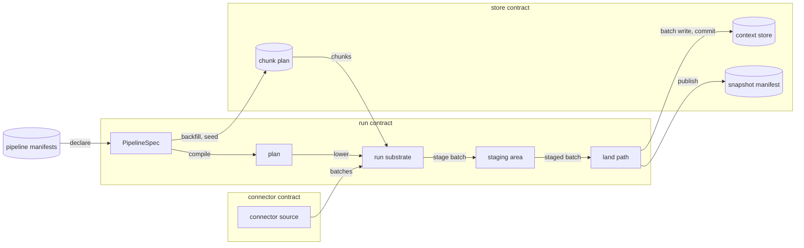
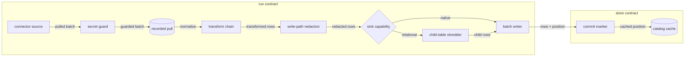
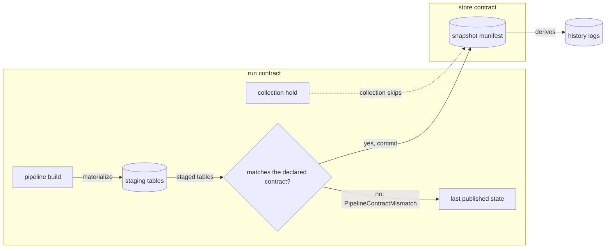

# Pipelines and the write path

A pipeline declares a source and the tables that receive its rows. The compiler produces a
plan, the runner lands source batches in the order `land` defines, and a build publishes
committed tables:



## declare

Pipeline declarations: fields, manifest loading, content hashes, table names and lifecycle commands.

- `pipeline-spec` — A pipeline specification takes {{type:contextful_core::pipeline::declare::PipelineSpec}}, its `source` and `destination` each {{type:contextful_core::pipeline::declare::SourceBlock}}, and each `tables` entry a bare name or a table block, the two forms mixing in one array.
- `serialization` — TOML and JSON deserialize into one `PipelineSpec`; the JSON Schema derived from it is the contract, and `contextful schema export` writes it to `.contextful/schema/pipeline.json`.
- `manifest-file` — Startup reads project config and inline `[[pipeline]]` blocks from `contextful.toml`, then reads `pipelines/*.toml` and `pipelines/*.json`. Startup collects specifications by `id`.
- `manifest-missing` — `pipeline validate` reading no manifest file raises `PipelineManifestMissing`, naming the declaration path.
  *because a validation over a mistyped path otherwise checks nothing and exits zero*
- `duplicate-id` — One `id` declared twice raises `PipelineDuplicateId`, naming each file and the line its declaration starts on.
  *because a silent pick between two declarations hides which one runs*
- `spec-invalid` — A manifest file the canonical type cannot deserialize raises `PipelineSpecInvalid`, naming the file, the key path and the value found.
  *because a partly read manifest runs a pipeline its author did not write*
- `content-hash` — `content_hash` is the sha256 of the specification's RFC 8785 canonical JSON with every optional field at its default elided, so an explicit default hashes as its absence.
  *because a replay pin that moves on a no-op edit strands pending work*
- `table-name` — The engine names destination tables `<pipeline id>_<table name>`, replacing each non-alphanumeric character with `_` and lowercasing each ASCII uppercase letter.
- `table-name-collision` — Two tables whose destination names fold to one spelling, or one whose name is another's `<name>_dead_letter`, within one pipeline or across pipelines, raise `PipelineTableNameCollision` at validation, naming both declarations.
  *because two tables folding to one name land in one store table and interleave their rows*
- `unbound-table-name` — A job target or model reference naming a destination table in a spelling the fold does not produce raises `PipelineUnboundTableName`, printing the expected spelling.
  *P1*
- `order-by-default` — `order_by` defaults to the injected ingest stamp and is inert on a keyless table; key semantics are {{store.declare.unkeyed-union}}.
- `write-mode` — `write_mode` is `append`, the default, or `replace`. Under `append` a run adds rows and no key retires; under `replace` the landing run is the table's whole current state.
- `replace-unsupported` — `replace` beside a `monotonic` or `opaque-token` cursor, a backfill chunk plan or a seed ceiling raises `PipelineReplaceUnsupported`, naming the table.
  *P1*
- `config-key` — A source config key outside the set that source enumerates raises `PipelineUnknownConfigKey` before any I/O, naming the key and the accepted keys; request headers and the forwarded guest table are exempt.
  *P1*
- `lifecycle-verbs` — `plan` compares desired state with the store without side effects; `--json` emits a structured diff. `apply` reconciles one or all pipelines. `run` fires one pipeline once. `serve` reconciles continuously.
- `plan-externals` — `plan` reports added, removed, changed and unchanged external steps against the applied snapshot in text and under `externals` in `--json`, with the same change fields as other declaration kinds.
  *because external-only edits affect the applied snapshot and need a visible diff*
- `apply-fires-nothing` — Applying a manifest triggers no run by itself. Repeating `apply` over unchanged sources performs no work except for elapsed schedules.
- `table-error` — `on_table_error = abort`, the default, halts the fire at the first failing table. Under `continue` every other table lands, `run` exits non-zero naming the failed runs, and a scheduled fire appends its failure count to its log line.
- `chunked-load` — `on_table_error` governs the single-pass live pull alone; a seed or backfill chunk plan halts the fire on failure under either setting.
- `incremental-field` — `incremental = "<field>"` names the stream clock, an RFC 6901 pointer into each fetched row when it opens with `/`; with it the source reports a `monotonic` cursor committing {{run.advance.watermark-shape}}, and without it the source refetches in full.

unsettled: What retires a key a source stops serving under `append`: a run declaring itself complete state, or a per-connector delete signal? owner: pipeline affects: run.declare

unsettled: Does `on_table_error` take a per-table override, and a cap on failed tables before a fire halts anyway? owner: pipeline affects: run.declare

## compile

The compiler converts a pipeline specification into a versioned plan with a shared schema.

- `authoring-surface` — Authoring code runs only at build time and emits a content-hashed plan. No authoring code executes in the serving environment. No build profile embeds a scripting runtime.
  *A-run#plan-compiled-content*
- `plan-node` — A plan is a flat node list with predecessor edges, each node a {{type:contextful_core::run::nodes::NodeKind}}.
- `plan-version` — A plan's version is the leading 16 chars of the sha256 over the RFC 8785 canonical JSON of its `{id, nodes}`.
- `plan-schema` — One schema library defines the plan type. Every language binds to its JSON Schema. The execution engine deserializes plan JSON against that schema.
- `inline-step-body` — A `step` body other than a connector reference raises `PipelineInlineStepBody`.
  *A-run#plan-compiled-content*
- `control-flow` — A data-dependent conditional or loop in a workflow body raises `PipelineUndeclaredControlFlow`; branching travels as `branch` and fan-out as `parallel`.
  *A-run#plan-compiled-content*
- `node-id-collision` — A node id repeated in one plan raises `PipelineNodeIdCollision`, naming the id and both positions.
  *A-run#plan-compiled-content*
- `lowering` — A plan lowers node by node onto {{run.journal.substrate-port}}.
- `unjoined-parallel` — A `parallel` node no `join` node names, or a node other than its join reading it or one of its bodies, raises `PipelineParallelUnjoined` at compile.
  *because an output read around its join reaches a partial result no run record marks as partial*
- `branch-arm` — A `branch` node records its predicate node's output once, trimming surrounding whitespace to produce the arm label. Every replay selects that recorded arm and skips the other arms' nodes.
- `branch-scope` — Each body of a `parallel` node runs under step labels prefixed by the parallel node's id, and its outcome reaches only the join, as {{run.journal.fan-out-join}} states.

## transform

The engine applies declared transforms in order to rewrite a batch in place.

- `chain` — The chain is an ordered list of {{type:contextful_core::pipeline::transform::TransformOp}}, declared once per pipeline and bound to the root table; a `filter` takes exactly one column.
- `arity` — A chain operation emitting more rows than it consumed raises `PipelineTransformArity`.
  *A-run#plan-compiled-content*
- `filter` — A filter dropping a root row drops that row's nested children with it.
  *because a child landing under a parent id no surviving row carries is a dangling reference*
- `column-missing` — A value filter or cast naming a column the batch does not carry raises `PipelineTransformColumnMissing`, printing the column and the table.
  *because a cast over an absent column otherwise lands the batch untransformed*
- `typed-cast` — A cast rewrites one column's type and keeps its name and position; a cast to `binary`, `binary(n)`, `float32[n]` or `float16[n]` keeps a value that type's JSON form reads and nulls any other.
- `type-carry` — A `rename` carries a pulled column type to the new name, a `select` drops it with its column, and a cast to a scalar type drops it.
- `extract` — `extract` copies the value at an RFC 6901 pointer into a named column, null where the pointer names nothing, keeps the source column, and lands the new column with no pulled type.
- `presence-filter` — A `filter` naming `absent` keeps the rows whose column is missing or null, and one naming `present` keeps the rest; neither requires the batch to carry the column.

unsettled: Does the chain grow past these five operations, or does richer work stay post-landing SQL? owner: pipeline affects: run.transform

## normalize

The engine normalizes nested data, assigns identity columns and converts nesting to relational tables where the sink requires it.

- `host-stage` — Type inference over deferred-typing JSON, struct flattening, list-to-child extraction and id assignment run in engine code; no connector reimplements them and no dataframe library participates.
- `normalized-form` — The canonical form uses nested Arrow structs and lists. The sink projects this form into relational tables late, so a source landing in two sinks normalizes once.
- `mode` — `native` keeps nesting the sink supports and expands unsupported nesting with {{run.record.schema-diff-home}}. `relational` flattens structs into parent-child column names and converts lists into child tables joined by a foreign key.
- `mode-resolution` — Mode resolves per stream per sink: explicit declaration, then sink capability, then `native`.
- `mode-unknown` — A mode outside the two raises `PipelineNormalizeModeUnknown`, printing both spellings.
  *A-run#nested-arrow-canonical*
- `identity-columns` — Normalize injects a content-hash row id, byte-identical across re-runs of one input, on every table; a load id on the root; a parent id and list index on each child; and a root id below the first child level.
- `field-collision` — A relational source field flattening onto an occupied column takes the first free `source_`-prefixed name, preserving injected identity columns and the source value.
- `list-index-missing` — A relational child table emitted without the list index that makes its projection reversible raises `PipelineListIndexMissing`, naming the parent and the list.
  *A-run#nested-arrow-canonical*
- `native-store` — On the store sink, `native` lands each undeclared column of objects and arrays as a struct or list column inferred over the batch; a column mixing kinds, or one `schema.json` holds as a scalar, lands as `Json`.
  *A-store#struct-list-map*
- `nesting-depth` — Recursion stops at the declared `depth`, default 5 levels, landing a deeper subtree as one `Json` value.

#### Scenarios

- `run.normalize.mode`: WHEN a relational stream holds a struct and a two-item list, THEN the store holds flattened parent columns and two indexed child rows joined to that parent.

## guard-secrets

The secret guard masks credential-shaped text in pulled batches, dead letters and registered body results before storage.

- `placement` — The secret guard runs at the one pull path streaming and backfill share, ahead of the recorded pull and the land path, so a replay reintroduces no credential.
- `matchers` — Matchers are linear-time, regex-free forward scans, each anchored on a literal prefix; the credential catalogue lives in code under a precision and recall fixture test.
  *A-run#secret-guard-has*
- `llm-candidate` — An LLM candidate starts with `sk-` at input start or after a byte outside ASCII alphanumerics, `-` and `_`; its tail spans that alphabet. Admission masks the whole candidate.
  *A-run#secret-guard-has*
- `llm-admission` — An LLM candidate needs 32 B of tail: a `proj-`, `svcacct-`, `service-`, `admin-` or `ant-` prefix permits the whole tail; otherwise its first 32 bytes are ASCII alphanumerics.
  *A-run#secret-guard-has*
- `assignment-key` — An assignment key qualifies when it is a keyword or ends in one after `_`, `-` or `.`, reading `-` as `_`, so `client_secret`, `x-api-key` and `db.password` qualify and `clientsecret` does not.
- `mask-replacement` — The replacement is the fixed `[REDACTED:secret]` marker, never a shape-preserving transform, over only the matched byte ranges widened to character boundaries; overlapping spans merge under the higher-priority pattern, and an assignment keeps its `key=` prefix.
- `mask-only` — The guard is on by default and blocks no run; each pull logs the count of masked cells per column.
  *A-run#secret-guard-has*
- `coverage` — The guard reads pre-normalize string cells for plaintext shapes; encoded material and a credential split across two cells pass through.
- `dead-letter-reason` — Every field of a {{type:contextful_core::run::ports::DeadLetter}} passes the guard as a pulled row's cells do, so a reason quoting a credential lands masked.
- `recorded-body` — Registered body results pass through the same guard before shaping and canonical preparation; the engine reports per-column counts once per fresh paid preparation, excluding counts from the recorded wire and replay.
  *A-authority#body-projection*

#### Scenarios

- `run.guard-secrets.assignment-key`: WHEN a cell holds `token_type=abcdefgh12`, THEN it lands unchanged.

## land

The engine processes batches from pull to commit, records ingest counts and isolates decoder failures.

- `stage-order` — A batch passes pull, the secret guard, the recorded pull, normalize, the transform chain, write-path redaction, shredding and batch write; the run then commits rows and position together through {{run.advance.commit-with-rows}}.
- `unknown-destination` — The local context store is the only destination, and synthesized artifacts write back through it; any other `destination` raises `PipelineUnknownDestination` at assembly, before any row moves.
  *A-topology#one-egress*
- `no-host-arm` — The destination world declares no host arm, so a guest supplies no destination.
  *A-topology#one-egress*
- `batch-write` — The store creates a landing table on first schema observation, {{store.reconcile.first-sight}}. The store writes each batch durably in a separate call. A batch may carry its ordinal for joining the run's request ledger.
- `typed-pull` — A pull's `types` object maps a column to a type spelled as {{store.reconcile.typed-landing}} reads it, and the run commit lands that column in it; an unreadable spelling fails the pull as {{store.reconcile.incompatible}}.
  *A-run#observed-batch-fixes*
- `late-type` — A pull declaring a type for a column an earlier staged batch of its run carried undeclared raises `PipelineTypeDeclaredLate`, deterministic, naming the column; the run commits nothing and retires its owner.
  *because that batch's part already holds the column in its inferred type, and a staged part is immutable*
- `irreconcilable-schema` — An arriving schema the store cannot reconcile fails the batch as {{store.reconcile.incompatible}}.
  *A-run#observed-batch-fixes*
- `commit-visibility` — A commit makes a run's rows visible for one table in one step; a crash before it leaves a recoverable partial run.
- `ingest-tally` — A fire reports, in total and per table, its runs' `fetched`, `kept` and `skipped` from {{type:contextful_core::run::record::RunRow}}, `dropped_low_quality` as `fetched` less `kept`, and `failed` tables; a non-zero `failed` exits non-zero.
  *because a fire pulls one declared source through its tables, and a `filter` is the one stage that drops a fetched row*
- `object-arrival-wake` — An object-arrival key only wakes its prefix read, which lists from its held position as a scheduled fire does; a duplicate or reordered key lands nothing twice, and the source's cadence still fires to catch a missed one.
  *because a notification is a hint a provider may repeat, reorder or drop, and the held position already decides what lands*

### sessions

A landing session commits each micro-batch read from stdin under one held table declaration.

- `session` — A landing session holds one store, node and table declaration across runs and commits each micro-batch as its own run; a later run rewrites no earlier run's parts or manifest.
  *because a writer flushing every second otherwise pays a process start, a store open and a node resolution per batch*
- `session-input` — `contextful context land --session` reads one {{type:contextful_cli::context::SessionBatch}} per stdin line, lands each as its own run through one landing session, and prints that run's outcome before reading the next line.
  *because a host running no serving process still needs one session across its batches*
- `session-schema` — A landing session parses `schema.json` again only when its version — length, modification instant, file identity — moves; a land adding no column or type replaces no `schema.json` and takes no schema lock.
  *because a land per second otherwise rereads and rewrites the schema under the lock every writer of the table waits on*

### receive

A delivered `receive` batch enters the pull stage under a batch key and lands through a bounded queue and group.

- `receive-entry` — A delivered batch enters at the pull position of {{run.land.stage-order}}: each declared table it touches lands as one run whose single pull yields that table's rows.
  *because a pushed row needs the guard, the recorded pull and redaction a pulled row passes*
- `receive-applied` — A served delivery loads its source from one immutable applied version, falling back to declarations only when no version exists; its source outcome follows {{surface.open-console.source-run-evidence}}.
- `receive-version-group` — An applied receive group admits spooled members only from its loaded configuration digest and version; declaration fallback occupies a separate namespace, while queue capacity and the land lock remain shared.
- `receive-ack` — `contextful pipeline receive <id> --key <key>` reads one batch on stdin and answers after every touched table commits, in declaration order, naming the batch id and each table's run id; a failed table answers retryable only under {{run.retry.retryable-classes}}.
  *because no commit spans two tables, so a sender learns success only once the last table commits*
- `receive-batch-key` — A batch key fixes each touched table's run id stem `receive-<digest>.<table>` and owner scope, a later attempt taking `.2`, `.3`; a table whose run under the key, or under the group its scope names, committed replays it and lands nothing.
  *A-run#batch-key-answers*
- `receive-resume` — A table under a batch key whose run did not commit resumes the key's pending owner, recorded pull included, and no other key's.
  *because a sender retrying after a lost answer must not lose uncommitted tables*
- `receive-batch-too-large` — A body exceeding the source's `max_batch_bytes` raises non-retryable `ReceiveBatchTooLarge`. The reader stops one byte past the bound. No table lands.
  *because an unbounded body is an unbounded allocation the sender controls*
- `receive-queue` — Up to `max_queue_depth` batches per pipeline hold queue slots while waiting or landing. Each batch holds its slot before body reading until the answer. One group lands at a time.
  *because concurrent senders share each table's single-writer cursor lease*
- `receive-spool` — A batch decodes and validates alone, so a malformed body answers alone, then spools, synced, to its pipeline's queue before waiting for the land lock; a leader lands every spooled batch, a dead receiver's included.
  *A-run#received-batches-spooled*
- `receive-group` — The land lock's holder lands the batches spooled under its credential, up to `max_queue_depth` members and 64 MiB, as one run per touched table, keyed by the group or a lone member, then pushes once and answers each.
  *A-run#received-batches-spooled*
- `receive-adopt` — A leader first lands the batches a dead leader claimed as that leader's group, resuming or replaying its run, before any new group forms, so each member key lands once.
  *because each member's scope names the dead group, so a new group leaves that group's owner pending and its members' scopes renamed*
- `receive-torn` — An attempt of a batch key, of the group its scope names, or of a new group's key, whose commit the store holds while its run row never closed, closes committed with its stored rows, retires its owner and replays.
  *because a leader dying between its commit and its run's close otherwise lands the committed rows again*
- `receive-group-isolation` — A group run failing with a class outside {{run.retry.retryable-classes}} lands each member's rows alone under its own key, so a batch the land path refuses answers alone and the group's other members commit.
  *because one malformed body must fail no other batch, and a sender honoring a non-retryable answer drops its rows*
- `receive-wait` — A spooled batch that neither holds the land lock nor joins a group within the wait of {{store.reserve.commit-wait}} withdraws its spool and answers as {{run.land.receive-backpressure}}.
  *because a batch no group takes must free its queue slot and tell its sender to resend*
- `receive-backpressure` — If batches hold every pipeline queue slot, the receiver raises retryable `ReceiveBackpressure` before reading the arriving batch's body.
  *because a sender told to wait sheds load the receiver cannot absorb*
- `receive-retry-after` — A {{run.land.receive-backpressure}} answer carries a retry interval of 1 s.
- `receive-push-wait` — A delivered batch's `pull_before_run` and `push_after_run` wait at most 30 s for {{store.push.in-flight}}'s push guard, then answer retryable; a resend under the key pushes its committed tables.
  *because a sender's request outlives no 300 s wait, and a freed queue slot serves the next batch sooner*
- `receive-write-not-granted` — If a credential lacks `write` over any declared table of a `receive` pipeline, the receiver raises `ReceiveWriteNotGranted` before reading the body. No table lands.
  *because a sender whose grant falls short learns it before spending the transfer*
- `receive-key-expired` — A batch key replays or resumes only within the source's `key_retention_secs` of its first attempt. After that window, the receiver raises non-retryable `ReceiveBatchKeyExpired` before reading the body. No table lands.
  *A-run#batch-key-answers*
- `receive-endpoint` — `POST /receive/:pipeline` on the served face takes the batch key in the `Contextful-Batch-Key` header, admits the credential before reading the body, and answers `200` with the {{run.land.receive-ack}} answer.
  *because a sender refused for its credential or grant must not have spent the transfer*
- `receive-key-missing` — If a delivery names no batch key, the receiver raises non-retryable `ReceiveBatchKeyMissing` before reading the body. No table lands.
  *because a batch without a key can neither replay nor resume under {{run.land.receive-batch-key}}*
- `receive-pipeline-unknown` — If a delivery names an undeclared pipeline or a pipeline whose source is not `receive`, the receiver raises `ReceivePipelineUnknown` before reading the body. No table lands.
  *because a sender's misaddressed batch must not land in another pipeline's tables*
- `receive-endpoint-status` — The receive route answers `400` for {{run.land.receive-key-missing}}, `404` for {{run.land.receive-pipeline-unknown}}, `403` for {{run.land.receive-write-not-granted}}, `413` for {{run.land.receive-batch-too-large}}, `410` for {{run.land.receive-key-expired}}, `503` with `Retry-After` for {{run.land.receive-backpressure}}, {{run.land.receive-push-wait}} or a retryable failed table, and `422` otherwise.

### queued receive

A queued delivery answers `202` at once, and a consumer lands it later under the same batch key.

- `receive-queued` — Under {{topology.compose.queue-extension}}, a request asking for a queued answer receives `202` with its batch key after admission and queuing. `202` acknowledges queue custody, without claiming {{run.land.receive-ack}}'s success.
  *because a sender must not read a queued batch as committed when a later landing can still refuse it*
- `receive-queued-admission` — A queued delivery passes every check {{run.land.receive-endpoint}} runs before reading a body, and a refused delivery queues nothing.
  *because a revoked or under-granted sender must learn its refusal before handing over custody*
- `receive-queued-outcome` — `GET /receive/:pipeline/:key` answers a queued batch's outcome: `pending`, each table's committed run, or the typed refusal its landing raised.
  *because a sender holding only a queued receipt reads success or refusal from one place*
- `receive-queued-window` — A queued batch's key window opens when it queues; a consumer reaching it past {{run.land.receive-key-expired}}'s window records that refusal as its outcome and lands nothing.
  *because a batch delayed in the queue must end typed rather than land after its replay guarantee lapsed*
- `receive-queued-spill` — If a body exceeds the queue's message cap, the receiver writes the body to the bucket under its batch key before queuing. The body is deleted after its outcome records.
  *because a queue message carries a reference when a body under `max_batch_bytes` still exceeds the provider's cap*
- `receive-queued-ask` — A served delivery carrying `Prefer: respond-async` asks for {{run.land.receive-queued}}'s answer; a delivery without that preference answers as {{run.land.receive-endpoint}}.
  *because a sender reading the committed answer keeps it, and the preference is HTTP's standard asynchronous request*
- `receive-queued-credential` — A queued message carries the credential its route admitted; the consumer admits it again against the pinned keys, expiry and revocation, with possession and audience settled at the route, and records a refusal as the batch's outcome.
  *because a credential revoked or expired while its batch waits must land no row under it*
- `receive-queued-consume` — A consumer receives up to the queue's batch size, lands each pipeline's queued batches per credential as {{run.land.receive-group}}, pushes, then acknowledges each message whose outcome recorded; a retryable failure leaves its message queued.
  *because a message acknowledged before its push loses the batch when the engine dies between commit and push*
- `receive-queued-redelivery` — A redelivered message lands through its batch key under {{run.land.receive-batch-key}}, so a message delivered twice lands its rows once.
  *because a managed queue delivers at least once*
- `receive-queued-outcome-grant` — The outcome route answers a credential holding `write` over every table of the pipeline and refuses any other as {{run.land.receive-write-not-granted}}.
  *because the outcome names the runs a sender's rows landed in, which only a sender of those tables reads*

### unreadable input

Input a decoder cannot read fails alone, lands as a dead letter, and decodes in a bounded child process.

- `unreadable-input` — Input a parser cannot read raises `PipelineUnreadableInput`, naming the path and the position inside it, permanent against the retry schedule and failing one table's pull unless its source dead-letters it.
  *A-connector#untrusted-input-decodes*
- `input-fault` — A failure over one input carries its fault: `input` when the input's own bytes defeat the decoder, `configuration` when the declaration or the build does. A source dead-letters an `input` fault alone, never by message.
  *because a message names an error for people, and branching on its text dead-letters any refusal that repeats the name*
- `dead-letter` — A pull's dead letters land in the table `<table>_dead_letter`, one {{type:contextful_core::run::ports::DeadLetter}} row per input, committed in the same run as the table's rows.
  *A-connector#untrusted-input-decodes*
- `dead-letter-replace` — A replacing table whose read dead-letters any input fails the pull under {{run.land.unreadable-input}}, naming each input, and commits neither its rows nor its dead letters.
  *because dead letters committing alone record a success while the table stays stale, and repeat each dead letter every fire*
- `dead-letter-occupied` — Dead letters whose `<table>_dead_letter` already holds a relational child table, or a store table lacking a {{type:contextful_core::run::ports::DeadLetter}} column, refuse the pull under {{run.declare.table-name-collision}} and land nothing.
  *because two shapes committing into one table mix their schemas*
- `partial-parse` — A reader stopping partway through a multi-part input raises `PipelinePartialParse` over the whole input and lands none of its parts.
  *A-connector#untrusted-input-decodes*
- `parse-boundary` — Each input whose decoder is subject to process failure decodes alone in a child process outside the serving process, which bounds the child's wall clock and memory and can terminate it.
  *A-connector#untrusted-input-decodes*
- `parse-deadline` — A decode runs for at most 60 s from child spawn; expiry kills its process group and raises {{run.land.parse-crashed}}.
  *A-run#decoder-child-owns*
- `parse-memory` — A decoder child receives at most 512 MiB of memory; exceeding the bound fails that input under {{run.land.parse-crashed}}.
  *A-run#decoder-child-owns*
- `parse-crashed` — A non-zero exit or fatal signal from the decode process raises `PipelineParseCrashed` naming the input; no input ends the serving process.
  *A-connector#untrusted-input-decodes*
- `table-failed` — A table whose pull fails raises `PipelineTableFailed` carrying the table, the error kind and the run id; the fire then follows `on_table_error`.
  *because a failure is answerable by name only when it carries its table and run*



#### Scenarios

- `run.land.session-input`: WHEN stdin carries `run-1`, `run-2` and `run-1` again, THEN the session prints two commits and one replay, one line each.
- `run.land.receive-group`: WHEN 16 one-row batches spool behind a held land lock that then releases, THEN one run commits all 16 rows, one push follows, and every batch answers committed.
- `run.land.receive-group-isolation`: WHEN a well-formed batch and one whose row sets a reserved column spool into one group, THEN the well-formed batch commits and only the other answers non-retryable.
- `run.land.receive-spool`: WHEN a receiver dies after spooling its batch, THEN the next leader lands that batch in its group and a resend under its key replays.
- `run.land.receive-adopt`: WHEN a group's leader dies after opening its run, after staging its parts, or after its commit, THEN a later batch lands apart and each member's resend replays the group's run, every row landed once.
- `run.land.receive-torn`: WHEN a group of two commits and its run row stays open, THEN one member resent beside a new batch and the other resent alone both replay the group's run, and every row lands once.
- `run.land.receive-wait`: WHEN a spooled batch waits 30 s behind a held land lock, THEN it leaves the spool and answers `ReceiveBackpressure`, retryable.
- `run.land.receive-resume`: WHEN the receiver dies after recording a delivered batch and the batch is resent under its key, THEN every landed cell but the run id is identical to the uninterrupted run's.
- `run.land.receive-queued-window`: WHEN a consumer reaches a batch queued 3601 s earlier under `key_retention_secs = 3600`, THEN its outcome reads `ReceiveBatchKeyExpired` and no table lands.
- `run.land.receive-endpoint`: WHEN a request carries no credential and a body past `max_batch_bytes`, THEN the route answers `401` without reading the body.

unsettled: Does a dead group's first attempt that never committed close, once a later attempt lands its members, rather than staying `running`? owner: pipeline affects: run.land

## export

An export reads committed table rows and delivers them to an operator-declared target with at-least-once delivery.

- `export-block` — An OTLP `[[export]]` block takes {{type:contextful_core::export::Block}} with one landed `table` and `signal = "logs"`; `contextful export run <name>` delivers every row its cursor has not passed.
  *A-topology#queue-ingress*
- `signal-unknown` — If `signal` is not `logs`, the exporter raises `ExportSignalUnknown` before reading any row.
  *because the one built-in arm maps a row onto a log record, and a span or metric needs a column mapping no block declares*
- `post-commit-read` — Export reads committed runs only, through the read face under the admitted credential, so its grants, row policy and masks hold; no landing waits on an export.
  *A-topology#export-committed*
- `commit-order` — Export reads rows past its cursor ordered by `_commit_seq`, then `_row_seq`. Export does not order by `_ingested_at`; {{store.reserve.commit-seq}} keeps late-committing runs eligible.
  *A-topology#queue-ingress*
- `commit-seq-missing` — A table holding rows whose `_commit_seq` is null, from parts landed without the column, raises `ExportCommitSeqMissing` naming the export and the row count, before any batch leaves.
  *because a null never passes a cursor, and a row an export skips in silence is a row its mirror loses*
- `batch-rows` — One delivery batch holds at most 500 rows.
  *because a batch that size sits below the face row ceiling and the request limits common collectors apply*
- `log-record` — Each row becomes one OTLP log record: `timeUnixNano` from `_ingested_at`, each non-null column outside the `_` namespace an attribute, beside `contextful.{table,run_id,commit_seq,row_seq}`.
  *because the attributes a target deduplicates on travel with the record, and the engine's own columns stay its own*
- `delivery` — The exporter sends each batch as one OTLP/HTTP JSON `POST` through the mediated client. The allowlist contains only the endpoint host. Each header follows {{connector.resolve.hydration-is-just-in-time}}.
  *A-topology#queue-ingress*
- `secret-preflight` — If no adapter resolves a header reference, the exporter refuses at preflight as {{connector.resolve.unresolved-name}} before reading any row.
  *because a target the export cannot authenticate to is known before a batch is built*
- `cursor-after-ack` — The cursor, the last delivered `_commit_seq` and `_row_seq`, commits only after the target answers 2xx for the batch.
  *because an unacknowledged batch remains eligible for delivery after a restart*
- `queue-wake` — A post-commit queue message only wakes an exporter, which reads through {{run.export.commit-order}} and advances under {{run.export.cursor-after-ack}}; a lost message delays delivery to the next wake and skips no row.
  *because a message lost between commit and enqueue must not lose the rows it announced*
- `local-state` — The local storage profile keeps log cursors in `.contextful/exports/<project>/<name>.json`, outside corpus sync, and typed delivery state in `machine.sqlite`.
- `remote-state` — Under {{run.journal.container-profile}}, PostgreSQL holds typed outboxes, acknowledged keyed state and log checkpoints in the execution database; a replacement reoffers identical pending event ids before advancing its acknowledged frontier.
  *A-run#disposable-execution-state*
- `d1-state` — Under {{run.journal.d1-profile}}, D1 commits export outboxes, acknowledged keyed state and log checkpoints; a sink commit without its D1 acknowledgement reoffers the same delivery identity.
  *A-run#d1-execution-state*
- `writer-fenced` — A PostgreSQL exporter whose durable writer lease has transferred raises `ExecutionWriterFenced` before dispatch or state publication; its lease row stays locked throughout an admitted outbound call, and takeover waits for that call.
  *A-run#disposable-execution-state*
- `at-least-once` — A run ending between a target's acknowledgement and the cursor commit resends that batch on the next run; a target deduplicates on `contextful.commit_seq` and `contextful.row_seq`.
  *A-topology#queue-ingress*
- `delivery-refused` — A target answering other than 2xx, or unreachable, raises `ExportDeliveryRefused` naming the export and the answer, and the cursor stays where it stood.
  *because an unacknowledged batch is resent from the cursor, never skipped*

### typed changes

A typed export publishes keyed `changes-v1` events from a staged outbox and acknowledges them in sequence.

- `typed-block` — A typed {{type:contextful_core::export::Block}} declares `format = "changes-v1"`, nonempty `key` columns and a `schedule`.
  *because a consumer needs stable row identity and a delivery cadence*
- `typed-state` — A typed export compares the latest stable committed table read through {{run.export.post-commit-read}} with its last acknowledged state; commits between reads coalesce into one publication.
  *because a scheduled state export promises the observed frontier rather than every intermediate write*
- `typed-view-recheck` — A typed export re-reads its admitted table even without a source commit frontier change, and stages a publication when its key, schema, policy or visible state changes; the publication identifier covers the source frontier, read identity and visible keyed state.
  *because a commit hash alone cannot identify the view delivered to a consumer, and a receiver must not mistake a changed view for a retry*
- `typed-events` — Each changed key yields a versioned upsert with its visible row or a deletion with its key; unchanged keys yield no event.
  *because a generic consumer applies the same keyed operations regardless of table shape*
- `typed-order` — Typed events order by encoded key and carry consecutive sequences and stable ids; a repeat delivery carries the same bytes and ids.
  *because acknowledgement can fail after the target applies a batch*
- `typed-complete` — A publication-complete event follows every change, including an empty set, and states that publication's change count.
  *because a consumer needs a boundary after which its keyed state represents one observed frontier*
- `typed-outbox` — Events and their next keyed state stage together in the configured execution store; a pending publication blocks staging a later frontier.
  *because a failed send must retain its exact payload and order across restarts*
- `typed-identity-changed` — Pending events under a changed read identity, or an export redirected to another target under the same name, raise `ExportIdentityChanged` without delivery; watch exits.
  *because an old outbox cannot prove authorization under a changed view or establish a new target's baseline*
- `typed-ack` — A typed export advances its durable acknowledgement sequence only after HTTP 2xx; acknowledging the completion event promotes its staged state in the same transaction.
  *because a receiver acknowledgement and local state promotion have one durable order*
- `typed-watch` — `contextful export watch <name>` fires the typed export on its schedule and retries a refused send with capped exponential delay from the pending outbox.
  *because delivery resumes without another operator invocation*
- `typed-byte-limit` — One typed JSON request holds at most 65536 B.
  *because a row-count bound alone admits an unbounded request body*
- `typed-event-too-large` — If a typed event exceeds one request's capacity, the exporter raises `ExportEventTooLarge`. Watch stops without retrying that event.
  *because an unchanged oversized event cannot make progress on retry*

### coordinated publications

A coordinated `[[publication]]` delivers every member of one producer completion and activates the members together.

- `group-block` — A local `[[publication]]` takes {{type:contextful_core::export::publication::PublicationDeclaration}}; its typed export `members` cover every producer output exactly once and share one destination and header binding.
  *A-run#coordinated-exports-activate*
- `group-source` — A successful store-driven job or materialized model build records one immutable completion binding its run identifier, pinned input frontier and all output table frontiers, including empty outputs.
  *A-run#coordinated-exports-activate*
- `group-source-latest` — The sqlite and D1 publication ledgers keep 1 completion per publication, the latest: the latest run recorded again with different bytes refuses, and a completion naming another run replaces it.
  *because a run is re-recorded only by its own retry, and history kept past it grows with every build*
- `group-delivery` — `contextful export group <name>` reads every completed producer member through {{run.export.post-commit-read}}, rechecks every frontier, and stages one ordered outbox with explicit member-complete events followed by one group-complete event.
  *A-run#coordinated-exports-activate*
- `group-identity` — A group's identity binds its store incarnation, destination, namespace, read identity, predecessor, publication order, input frontier, membership, delivered base and next state; each event identifier binds that group and its sequence.
  *A-run#coordinated-exports-activate*
- `group-activation` — A receiver stages member events transactionally and activates every member together only after validating the complete group; interrupted delivery preserves the active group, and acknowledged retries preserve its bytes and visibility.
  *A-run#coordinated-exports-activate*
- `group-checkpoint` — `contextful export checkpoint` saves delivery state; `contextful export restore` replays compatible immutable events while the receiver retains its accepted groups and active frontier, so an older checkpoint reverses no deletion or later publication.
  *A-run#coordinated-exports-activate*
- `group-rebuild` — `contextful export rebuild <name> --namespace <epoch>` exports the completed producer's full admitted state into a fresh namespace without executing its effects; the receiver keeps its active namespace until the replacement group completes.
  *A-run#coordinated-exports-activate*
- `group-input-digest` — A group plan's `input` carries the lowercase hex SHA-256 of its producer completion's JSON rather than the completion, so every request repeats a header of bounded size whatever the producer's input frontier holds.
  *because a producer's input frontier is caller-shaped JSON of any size, and each request repeats the group header*
- `group-request-bound` — Staging refuses a group whose header beside its smallest event exceeds {{run.export.typed-byte-limit}} with `PublicationHeaderTooLarge`, and one holding an event unable to fit beside its header with {{run.export.typed-event-too-large}}; the outbox stays unchanged.
  *because a staged group blocks every later frontier until acknowledged, so an unsendable one strands its outbox*
- `group-stranded` — Staging replaces a pending group unable to form its first request, which therefore no receiver holds, with the current frontier's group; a group with an acknowledged prefix stays immutable.
  *because a group never offered carries no delivery obligation, while a receiver may already stage an acknowledged prefix*
- `group-quiesce` — `contextful export group <name>` first takes the publication's dispatch intent, so serve starts no unit over its inputs, then holds those inputs exclusively through its pull, read, staging and delivery.
  *because a commit during the export moves the producer frontier the export rechecks*
- `group-quiesce-wait` — An export still waiting for the publication's intent and inputs 300 s after it began waiting for either raises `PublicationInputsBusy` before its pull, read or staging; the outbox stays unchanged.
  *because a running producer ends on its own schedule, and the next attempt exports its completed frontier*
- `group-incompatible` — Membership drift, incarnation mismatch, a changed pending read identity, an incompatible checkpoint, an incomplete producer frontier, or a predecessor/order mismatch raises `PublicationIncompatible` before delivery or activation.
  *A-run#coordinated-exports-activate*
- `group-storage` — A coordinated publication under `postgres` raises `PublicationStorageUnsupported` naming the coordinated-group-outbox capability before execution, staging or delivery; a `cloudflare-d1` sender state over 8 MiB raises it before staging.
  *A-run#d1-coordinated-groups*
- `group-d1-state` — Under {{run.journal.d1-profile}}, D1 holds each group's producer frontier, sender outbox and active namespace; one D1 batch commits a completing acknowledgement with its promoted state and active namespace.
  *A-run#d1-coordinated-groups*
- `group-d1-lease` — A `cloudflare-d1` group writer holds one durable D1 lease per publication, and every sender write predicates on that lease and the row's prior version.
  *A-run#d1-coordinated-groups*
- `group-d1-spill` — A `cloudflare-d1` sender row over 64 KiB holds the SHA-256 of an R2 object written before the row commits; the blob sweep keeps every object a publication row references.
  *because a D1 write crosses the binding once and never resends, an R2 put resends, and an object reached only through a committed row is never half visible*
- `group-d1-acknowledge` — A `cloudflare-d1` acknowledgement short of group completion advances the sender row's version and records the group and acknowledged sequence in a row of its own, leaving the outbox body unwritten.
  *because the outbox holds the group's delivered base and next state, so rewriting it per batch scales every acknowledgement with the published tables*
- `group-d1-resume` — Reading a `cloudflare-d1` outbox resumes after the event carrying its recorded acknowledged sequence, whatever batch boundaries the reading binary cuts; a sequence naming no unacknowledged event of the pending group fails every read.
  *because batch boundaries follow the reading binary's request ceiling, row cap and event encoding, which a replacement binary may change*
- `group-d1-takeover` — `contextful export group <name> --take-over` under `cloudflare-d1` takes the publication lease whatever its holder or expiry and advances its fence, so the prior holder's next write, a producer completion included, matches no lease and refuses.
  *because a delivery killed at its caller's time bound holds the lease until expiry, and a fenced producer's build retry records its completion again*
- `group-d1-recovery` — After an empty-disk replacement, `contextful export group` resumes a staged or partially acknowledged `cloudflare-d1` group from D1, reoffering identical group and event identifiers before staging a later frontier.
  *A-run#d1-coordinated-groups*

#### Scenarios

- `run.export.group-stranded`: WHEN an earlier sender staged a group whose header alone exceeds the request ceiling, THEN the next `contextful export group` replaces it with a digest-headed group and delivers it.
- `run.export.group-quiesce`: WHEN serve's cycle finds the producer due while an export of its publication awaits the receiver, THEN the cycle reports the producer pending and the export acknowledges its group.
- `run.export.group-d1-recovery`: WHEN the container stops after D1 commits a staged group and before any delivery, THEN its replacement delivers that group's exact bytes and the receiver activates every member together.
- `run.export.group-d1-state`: WHEN a replacement loses the acknowledgement of the group-complete batch, THEN it reoffers that batch, and the receiver's accepted group absorbs the retry without a second activation.
- `run.export.group-d1-acknowledge`: WHEN a receiver completes a group of 880 deletes whose final acknowledgement the sender lost, THEN the replacement reoffers from the last recorded sequence, the receiver absorbs the retry, and the sender promotes the group.
- `run.export.group-d1-takeover`: WHEN a delivery is killed before its acknowledgement while its lease runs, THEN a retry with `--take-over` delivers at once and the killed writer's next write refuses as fenced.

unsettled: Does the arm map a table onto the OTLP span or metric signal, and through which column declaration? owner: pipeline affects: run.export

unsettled: Does a local-profile sender whose disk a replacement emptied continue its receiver's group sequence, or refuse until `contextful export rebuild` opens a fresh namespace? owner: pipeline affects: run.export

## export-iceberg

An Iceberg export publishes one audience's admitted rows of one landed table as an Apache Iceberg table in a REST catalog, which a query engine reads without reaching the store.

- `block` — An Iceberg {{type:contextful_core::export::Block}} declares `format = "iceberg"`, one landed `table`, the admitted `credential` it reads as, a REST `catalog` URI, a `storage` endpoint, a `warehouse`, a `namespace`, a `table_name`, a `format_version` of 2 or 3, and a token reference.
  *A-topology#catalog-read-add-on*
- `read` — An Iceberg export reads through {{run.export.post-commit-read}} every column outside the `_` namespace and writes fresh Parquet whose every column carries its field id from the table's current schema; it references and copies no store file.
  *P5*
- `token-preflight` — If no adapter resolves the token reference, the exporter refuses at preflight as {{connector.resolve.unresolved-name}} before reading any row.
  *because a catalog the export cannot authenticate to is known before a file is written*
- `egress` — Every catalog and object-store request passes through the mediated client, whose allowlist holds the declared catalog and storage hosts; a table configuration naming another storage host raises `ExportStorageUndeclared` before any file is written.
  *A-topology#one-egress*
- `cast` — Each column takes the Iceberg type holding every value its stored type does: `int`, `long`, `double`, `boolean`, `string` for text and JSON, `binary`, `fixed[n]`, and nested `struct`, `list` and `map`; a variant exports as its tagged struct.
  *because a reader of the copy sees every source value unchanged, and the read face answers each cell in its stored type*
- `masked` — A column the credential's mask rewrites exports at the type {{authority.mask.projected-type}} reads it as, so a masked cell publishes as the read face answers it.
  *because a digest published under its column's stored type decodes as bytes it never held*
- `fixed-list` — A `FixedSizeList<T, n>` column exports as `list<T>`, the exporter reattaching the element's field id and recording `n` in the table property `contextful.fixed-size-list.<column>`.
  *because Iceberg has no fixed-size list in any format version, and the width is the one fact the cast drops*
- `timestamp-ns` — Under `format_version = 3`, a nanosecond timestamp column exports as `timestamp_ns` or `timestamptz_ns`, keeping every digit.
  *because a microsecond cast loses the digit a key or an ordering may depend on*
- `type-refused` — A nanosecond timestamp column, top-level or nested, under `format_version = 2` raises `ExportTypeUnsupported` naming the column at preflight, before any row is read.
  *P1*
- `file-size` — The exporter writes data files of at most 128 MiB, opening a new file before the next rows carry the current one past that size; one row larger than that fills a file alone.
  *A-topology#catalog-read-add-on*
- `create` — An export finding no table creates it at the declared format version and commits its files as one `append` snapshot, requiring that `main` does not exist.
  *A-run#iceberg-overwrite-commit*
- `overwrite` — Each later export commits one `overwrite` snapshot that adds its new data files and marks every live file of the parent snapshot deleted, requiring the table uuid and `main` at the parent snapshot id.
  *A-run#iceberg-overwrite-commit*
- `commit-retry` — A conflicting commit reloads the table and, while the parent's schema and partition spec ids are unchanged, retries with the written files, at most 3 attempts; a changed id or the last conflict raises `ExportCommitConflict`.
  *A-run#iceberg-overwrite-commit*
- `orphans` — After {{run.export-iceberg.commit-retry}} refuses, the exporter deletes every data and manifest file that export wrote; a retry deletes only the manifests it supersedes, keeping the data files it reuses.
  *because catalog maintenance removes only files some snapshot referenced, so an uncommitted file stays until its writer removes it*
- `commit-unknown` — A commit whose outcome is unknown deletes no file; the next run reloads the table and records the commit as taken when `main` names its snapshot id.
  *because a commit the catalog applied before the connection dropped references every file it added*
- `retention` — The exporter expires no snapshot and deletes no committed file; the catalog's snapshot expiration owns retention.
  *because a reader may still plan a query against the previous snapshot while the next export commits*
- `frontier` — The export records its committed snapshot id, source frontier, read identity and declared target, and commits nothing when all four equal the table's current snapshot id and the export's present values.
  *because each retained snapshot holds a full copy, and an unchanged export buys a reader nothing*
- `schema-changed` — A source whose columns or types no longer match the Iceberg table's current schema raises `ExportSchemaChanged` before any file is written; the export evolves no schema.
  *because a reader's queries name the columns they were written against, and an evolution the exporter chooses changes them unannounced*
- `audience` — Each Iceberg export publishes for exactly one admitted credential, which maps to exactly one namespace; the route derives the namespace from the caller's credential, and the caller never names one.
  *A-run#iceberg-audience*
- `namespace-shared` — Two Iceberg exports naming one namespace under different credentials, one credential under two namespaces, or one table raise `ExportNamespaceShared` at preflight, naming both exports.
  *A-run#iceberg-audience*
- `caller-sql` — Caller-written SQL reaches the catalog's query engine only when the warehouse holds one audience; otherwise the route runs fixed query templates against the mapped namespace.
  *A-run#iceberg-audience*
- `route` — Where a deployment adds a catalog query engine, the routing Worker sends a caller whose credential maps to a namespace to that engine, and every other caller to the Container query face.
  *A-topology#catalog-read-add-on*

#### Scenarios

- `run.export-iceberg.commit-retry`: WHEN catalog compaction commits between the export's table load and its commit, THEN the export reloads, marks the compacted files deleted and commits on its second attempt.
- `run.export-iceberg.type-refused`: WHEN a table holding a nanosecond timestamp column exports under `format_version = 2`, THEN preflight refuses naming the column and no Parquet file is written.
- `run.export-iceberg.frontier`: WHEN an export runs twice with no commit and no grant change between, THEN the second run commits no snapshot.

## backfill

The scheduler loads history through chunk plans with fenced leases and supports rewinding a declared range.

- `phase` — A run row records the {{type:contextful_core::run::backfill::PipelinePhase}} it ran under by its snake-case name, and a row without a phase carries no field.
- `chunk-plan` — Plan shape follows {{type:contextful_core::run::advance::CursorKind}}: `monotonic` plans independent time-window or id-range chunks, `opaque-token` one sequential chunk walked in order, `snapshot-id` version ranges sequential per stream and parallel across streams.
- `chunk` — A chunk row is {{type:contextful_core::run::backfill::ChunkRow}}; an interrupted plan resumes at the first chunk not done.
- `chunk-lease` — A worker leases a chunk row, recording node id and attempt, for a 300 s time-to-live renewed every 60 s, and writes under a path segmented by run, node, chunk and attempt.
  *because an unquantified lease cannot be tested against a paused worker*
- `fenced-commit` — A chunk commits in one catalog update conditioned on `attempt = :mine AND status != 'done'`; an update matching no row leaves that worker's files uncommitted.
  *because an expired holder otherwise commits over its successor*
- `commit-signal` — The catalog row signals commit; directory presence does not. Retention collects files under paths without a done row according to a retention window.
- `attempt-isolation` — An expired lease lets a second worker claim the chunk, increment the attempt and write under its own path.
- `block` — `[pipeline.backfill]` takes {{type:contextful_core::run::backfill::BackfillBlock}}; `start_from` defaults to zero.
- `rewind` — A rewind returns every chunk overlapping the half-open range to pending.
- `rewind-invalid` — An inverted, empty or scale-incomparable rewind window raises `PipelineRewindWindowInvalid`; a window overlapping no chunk is a no-op.
  *P4*
- `available-instant` — A backfill lands each row's availability column as {{store.available-time.declaration}} resolves it from the source, while `_ingested_at` stays the commit instant {{run.own.stage-instant}} writes.
  *because a 2026 backfill of 2014 history stamped with its commit instant answers no availability bound before 2026*

unsettled: How long does the retention window keep files under a path with no done row? owner: pipeline affects: run.backfill

## seed

A seed source bulk-loads history below a declared ordering ceiling before live ingestion.

- `block` — `[pipeline.seed]` attaches a bulk-load source with a ceiling `below` expressed on the seeded table's `order_by` scale.
- `one-land-path` — Seeded rows travel {{run.land.stage-order}} unchanged, landing availability and `_ingested_at` as {{run.backfill.available-instant}} does; attribution survives only in the load id and a run recorded under the `seeding` phase.
- `declaration-missing` — A seeded table without `primary_key`, or with `order_by` left at the ingest stamp, raises `PipelineSeedDeclarationMissing` at plan and validate.
  *A-run#incremental-position-bound*
- `ceiling-breached` — A seeded row whose ordering stamp reaches `below` raises `PipelineSeedCeilingBreached` naming the value; its chunk lands nothing, and the stamp is neither clamped nor dropped.
  *A-run#incremental-position-bound*
- `ceiling-point` — The engine evaluates the ceiling on the root batch after normalization and the transform chain, before writing.
- `ceiling-unevaluable` — A batch missing the ordering column, or a stamp unorderable against the ceiling, raises `PipelineSeedCeilingUnevaluable`; a text stamp orders only when `Z`-suffixed at the ceiling's fractional width.
  *A-run#incremental-position-bound*
- `scope` — Seed chunk and cursor state live under a `<table>#seed` scope apart from the live pipeline's.
- `connector-pin` — A seeding run is exempt from {{run.own.pinned-plan-changed}} and records its connector identity as provenance.
- `ceiling-binding` — On seed commit, an unset `monotonic` live position takes the ceiling when `below` parses as an integer; under the other cursor kinds the live position stays unset and starts from the source's beginning.
- `fingerprint` — Each run probes the seed source for a cheap fingerprint, a stat or a HEAD and never a download, and compares it with the one stamped at commit.
- `source-changed` — A differing fingerprint raises `PipelineSeedSourceChanged` naming both values; an equal one skips the load, and an unavailable one skips with a warning.
  *A-run#incremental-position-bound*
- `commands` — `seed status` prints each seeded table's ceiling, commit state and fingerprint match; `seed reset <pipeline> [--table T]` clears the seed's chunk plan and commit stamp, so the next run loads it again.
- `compaction-cadence` — A seeded table that no job meeting {{store.declare.fold-job}} covers raises `PipelineSeedCompactionMissing` at validate and before a fire, naming the table.
  *A-store#keyed-table-covered*

## model

The engine builds model tables from SQL over store tables, validates contracts and tests, and records freshness and holds.

- `model-block` — A `[[model]]` block takes {{type:contextful_core::pipeline::model::ModelSpec}}, with {{run.model.statement-source}}, {{disclosure.release.model-policy}} and {{disclosure.set-mode.opt-out-record}}; an unknown key refuses as {{run.declare.spec-invalid}}.
  *A-run#model-declared-sql*
- `statement-source` — A model declares exactly one of inline `sql` and `sql_file`; the latter reads UTF-8 text relative to the manifest containing the model.
  *because a manifest-relative statement file keeps a model portable across project roots*
- `top-level-block` — A manifest's top-level key outside the set the engine enumerates raises `PipelineUnknownBlock`, naming the key, the file and the accepted set.
  *because a misspelled block parses as nothing, and its declaration silently never runs*
- `model-id` — A model's `id` names the store table it builds; an id declared twice, equal to a pipeline destination table, or naming a table a landing wrote refuses as {{run.declare.table-name-collision}}.
- `sql` — A model statement is one read-only `SELECT` over store tables. The engine admits the statement under {{read.guard.whole-tree-walk}} before reading any row. A model reads another model's last published table.
- `validate-statements` — `pipeline validate` admits each model's `sql` and every test's statement as a build does, counting every relation but the model's own id in `sql` as registered, holds each declared input to {{run.model.restricted-input}}, and raises the error the build raises.
- `validate-undeclared` — `pipeline validate` names on stderr each relation a model's `sql` or test reads that no manifest table, pipeline destination or model declares, and still validates the model; `build` resolves that relation against the store.
  *because a table landed without a manifest declaration is a legal input, while a misspelled name otherwise surfaces only at `build`*
- `restricted-input` — A build reading a table whose {{type:contextful_core::store::declare::TableDecl}} declares `class`, `policy` or `visibility` raises `ModelInputRestricted`, naming the table and the declared keys.
  *because a build reads its inputs unmasked, so the model's table serves their withheld cells to every reader*
- `materialized` — `materialized` is `table`, the default: each build replaces the model's rows whole.
- `unique-key` — `unique_key` defines the model's row identity. A build with duplicate key values or a null in a key column refuses as {{run.publish.contract-mismatch}}.

### contracts

A published model declares a versioned column contract, and a contract change publishes only under its version bump.

- `contract-block` — `[model.contract]` declares `version`, a `<major>.<minor>.<patch>` string, and `columns`, each a {{type:contextful_core::pipeline::model::ContractColumn}} with `type` spelled as {{store.reconcile.typed-landing}} reads it and `nullable` defaulting to true.
- `contract-required` — A model whose `publish` is true, the default, and which declares no `[model.contract]` raises `ModelContractUndeclared` at validation.
  *because a published table without a declared contract has no identity a reader can pin against*
- `unpublished` — A model declaring `publish = false` commits its rows with no manifest section, so no build entry, hold or contract history names it.
- `contract-major` — Under the published build's major, a contract that drops or retypes a published column, makes a non-null one nullable, adds a non-null column or changes the grain refuses as {{run.publish.contract-mismatch}}, naming the column and the major to bump.
  *A-run#minor-contract-bump*
- `contract-minor` — Under the published build's major, a contract that only adds nullable columns or makes nullable ones non-null publishes once its minor exceeds the published one, else refuses as {{run.publish.contract-mismatch}}, naming the added or tightened column and the bumped minor.
  *A-run#minor-contract-bump*
- `injected-columns` — A build lands `_ingested_at` as its start instant, `_run_id` as its build id, `_row_seq` as the row's position, `_commit_seq` as its commit's value and `_site_id`, replacing any injected column the SQL selects; `semantics_version` is 2.

### builds

A build stages the model, checks its contract and tests, and records a watermark over its inputs.

- `freshness-block` — `[model.freshness]` declares `max_lag` as an integer followed by `s`, `m`, `h` or `d`; a model declaring none publishes a null `max_lag` and never computes stale.
- `test-block` — A `[[model.test]]` carries a `name` and one `SELECT` over the staged rows, registered under the model's id, and the store's tables; a test returning any row fails.
  *because a test must inspect the candidate build before its rows become visible to readers*
- `test-failed` — A failing test raises `ModelTestFailed`, naming the test and its row count; the build publishes nothing.
  *because a test exists to stop a build before readers trust it*
- `build-verb` — `contextful build <model>` materializes the model into staging, checks its contract, runs its tests, then commits; `--json` prints the build id, row count and watermark.
- `build-boundary` — A guarded model build admits its caller's execution boundary after staging and before changing the persistent schema or published pointer; a refusal discards staging and preserves prior schema, membership and watermark.
  *because a stopped execution must not publish its staged model*
- `unknown-model` — `build` naming no declared model raises `ModelUndeclared`, naming the declared models.
  *because a build of a misspelled id otherwise reports nothing to do*
- `build-frontier` — `build` reads each input at its committed frontier and fires no pipeline; a build ordered after a landing is a `build` job naming that pipeline in `after`, under {{surface.fire.build-dependency}}.
  *because `after` already orders builds behind pipelines, and a verb firing sources needs their credentials and quota, and repeats paid calls on every retry*
- `model-cycle` — If a model's `sql` reaches its own id through one or more other models, `pipeline validate`, import, apply and `build` raise `ModelCycle`. The engine names every model on the cycle and reads no store.
  *because no member of a cycle has a first build, and once one exists each build folds in the other's previous output*
- `build-id` — A build's id is the snapshot id it publishes.
  *A-run#model-declared-sql*
- `watermark` — A build's watermark is `{at, inputs}`: per input table the snapshot id, `through`, the greatest `commit_seq` read, and `omitted`, the count and digest of runs read outside the snapshot chain; `at` is the newest commit instant.
  *because a list of omitted runs grows by one key per run on an input no fold covers*
- `watermark-digest` — `omitted.digest` is the lowercase hex SHA-256 over the sorted keys `<run-id>/<node-id>` of the omitted runs, each followed by a newline.
- `watermark-listed-runs` — A watermark input carrying a `runs` list and no `omitted` reads with those runs included under {{run.publish.staleness}}; no build writes `runs`, and every echo of that watermark keeps the list.
  *because a manifest committed with listed runs stays readable*
- `build-horizon` — `contextful build <model> --available-as-of <t>` reads every input at `available_as_of` equal to `t` and records `t` as the watermark's `horizon`; a build without the flag records a null horizon.
  *because a build is reused across horizons only when its own bound is recorded beside it*

### holds and status

A hold keeps one build from collection, and status reads the last attempt beside the published build.

- `hold-verb` — `build hold --for <n>[smhd] <model> <build>` commits a hold until now plus the duration and prints `Held`, or `Renewed` over an unexpired hold; `--json` prints the receipt as an object.
- `status-verb` — `build status <model>` reports the last attempt separately from the published build; `--json` carries their ids, status, freshness and staleness computed at the requested instant.
- `hold-unknown-build` — A hold naming a build no committed manifest of the model records raises `ModelBuildUnknown`.
  *because a hold on a build that does not exist protects nothing and reads as protection*

unsettled: Does a model materialize incrementally, merging each build into its prior one on `unique_key`? owner: pipeline affects: run.model

unsettled: Does a model over a restricted table declare its own policy, or inherit the strictest policy among its inputs? owner: pipeline affects: run.model

#### Scenarios

- `run.model.build-frontier`: WHEN a `build` job naming `orders` in `after` fires in the cycle that lands `orders` run `r`, THEN the published build's watermark `through` under `orders_items` reaches the `commit_seq` of `r`.

## publish

Published tables: contract identity, snapshot publication, build history, freshness and collection holds.

- `manifest-commit` — The snapshot manifest commit publishes a table's data, contract identity, freshness and current build together. No separate file is authoritative for these values.
  *because separately written artifacts make a torn publication representable*
- `contract-identity` — A published table's identity is `contract_version` beside `schema_fingerprint`, taken over the declared columns, their types and the grain.
- `contract-mismatch` — A materialization whose columns, types or grain miss the declared contract raises `PipelineContractMismatch`, naming the column and the expectation.
  *P4*
- `staging` — A build materializes into staging and publishes through {{run.publish.manifest-commit}}; a refused build leaves the last published state serving.
  *P4*
- `history-logs` — `contract-history.jsonl`, `builds.jsonl` and `holds.jsonl` in the model's table directory hold append-only history derived from committed manifests and build-attempt records; each build and hold regenerates them, replacing an entry a source record disagrees with and keeping collected builds' entries.
- `build-entry` — A `builds.jsonl` entry is a {{type:contextful_core::pipeline::model::BuildEntry}}, its status published, refused, partial or failed.
- `failed-attempt` — A published model records an attempt before materialization; a dead attempt without a committed manifest reports `failed`, keeps the prior published build serving, and contributes a failed build entry.
  *because a process killed before publication cannot write its own failure, while its attempt record and released lock survive*
- `staleness` — A published model is stale at `t` when an input holds a committed run outside its watermark snapshot chain, its `commit_seq` above `through`, committed before `t` minus `max_lag`; `build status --json` names each such input under `stale_inputs`.
  *A-run#build-stale-landings*
- `staleness-omitted-check` — An input whose runs outside the watermark snapshot chain, at or below `through`, differ in count or digest from `omitted` holds a waiting run counted as committed before `t` minus `max_lag`.
  *A-run#build-stale-landings*
- `staleness-unsequenced` — A run carrying no `commit_seq` counts as at or below `through` when committed at or before the watermark's `at`.
  *because a run manifest may carry no sequence, and {{run.publish.staleness-omitted-check}} catches one the build never read*
- `staleness-collected-covered` — A run whose manifest retention collected counts as at or below `through` when the current snapshot folding it records a `commit_seq` at or below `through`.
  *because a snapshot's `commit_seq` bounds every run it folds*
- `staleness-model-input` — An input that is a model also waits on each of its published builds newer than the watermark snapshot, aged by that build's `created_at`.
  *A-run#build-stale-landings*
- `staleness-collected-run` — A waiting run whose manifest retention collected counts as committed before `t` minus `max_lag`.
  *A-run#build-stale-landings*
- `hold` — A hold is a {{type:contextful_core::pipeline::model::HoldRecord}} committed as `holds/<build id>.json` in the model's table directory, replacing any earlier hold on that build; collection skips a held build, and a hold confers no other authority.
  *A-run#model-declared-sql*
- `manifest-section` — The manifest section is the newest publishing build's {{type:contextful_core::pipeline::model::PublishSection}}, its `watermark` as {{run.model.watermark}}; freshness reads off it, and staleness follows {{run.publish.staleness}}, never stored.
- `semantics-version` — `semantics_version` advances when the engine adds an injected column, and `fingerprint_recipe` names the fingerprint's inputs, that column included.
- `disclosure-digest` — A build records a digest over its table's {{type:contextful_core::store::declare::TableDecl}} `class`, `policy` and `visibility`, sorting set-valued fields; the manifest and build log carry it, and any declaration sets `withheld_cells`.



#### Scenarios

- `run.publish.staleness`: WHEN no input lands after a build and `max_lag` is `1h`, THEN `build status` at 100 days later reports `stale` false.
- `run.publish.staleness`: WHEN `events` lands a run 1 second past the build and `max_lag` is `1h`, THEN status reports fresh at 1 hour after the landing and stale, `stale_inputs` `["events"]`, 1 second later.
- `run.publish.staleness`: WHEN a fold folds the runs a build read into a new snapshot, THEN status still reports the build fresh.
- `run.publish.staleness-omitted-check`: WHEN a run merged from another node carries a `commit_seq` below `through` and the build never read it, THEN status reports the input stale at once.
- `run.publish.staleness-omitted-check`: WHEN a relational run's group marker lands after a build read a plain run committed above it, THEN status reports the input stale at once.
- `run.publish.staleness-model-input`: WHEN `daily` rebuilds after `weekly` read it and `max_lag` is `1d`, THEN `weekly` reports stale, `stale_inputs` `["daily"]`, 1 day after the rebuild.

unsettled: Is a build with a non-null horizon stale by landings committed after its horizon? owner: pipeline affects: run.publish

## Shapes

A pipeline declaration:

```toml
[[pipeline]]
id = "record-sync"
incremental = "updated_time"
on_table_error = "abort"

[pipeline.source]
name = "http"
config = { endpoint = "https://api.example.test/v1/records", format = "json" }

[[pipeline.tables]]
name = "records"
primary_key = ["record_id", "observed_at"]
order_by = "observed_at"
write_mode = "append"

[[pipeline.transforms]]
op = "cast"
column = "value"
to = "float64"

[pipeline.backfill]
max_chunks = 512
chunk_size = "7d"

[pipeline.seed]
below = "2025-06-01T00:00:00Z"
source = { name = "file", config = { root = "exports/record-sync", format = "jsonl" } }

[[job]]
name = "nightly-fold"
schedule = "0 3 * * *"
kind = "fold"
target = "record_sync_records"
```

A model over a landed table, and the verbs that build and hold it:

```toml
[[model]]
id = "daily_records"
sql = "SELECT CAST(date_trunc('day', updated_time) AS VARCHAR) AS day, count(*) AS n FROM record_sync_records GROUP BY 1"
unique_key = ["day"]

[model.contract]
version = "1.0.0"
columns = [
  { name = "day", type = "utf8", nullable = false },
  { name = "n", type = "int64", nullable = false },
]

[model.freshness]
max_lag = "1d"

[[model.test]]
name = "counts-positive"
sql = "SELECT * FROM daily_records WHERE n <= 0"
```

```sh
contextful build daily_records --json
contextful build hold --for 7d daily_records <build id> --json
```
