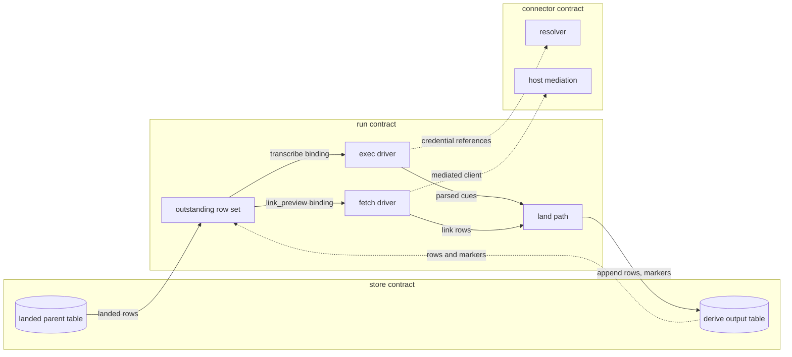
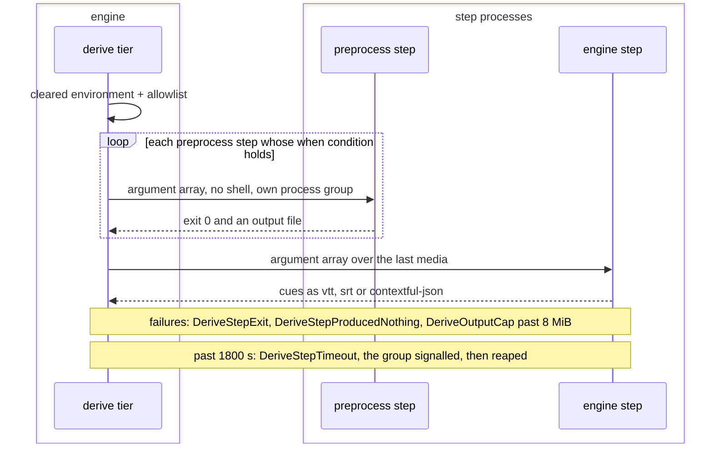
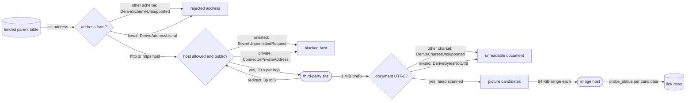
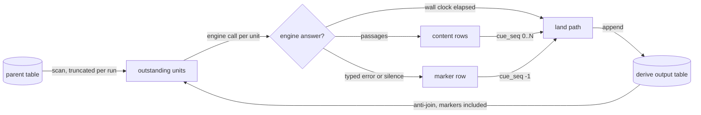

# The derive tier

Derive tasks process committed rows and append results through the ordinary write path.
Implementers use this contract for task selection, engine bindings and output rows. Media
tasks produce citable passages; link tasks extract document head fields and advertised images.

Derive tasks read parent rows, invoke an engine and write output rows:



## select

The derive source selects eligible parent rows each tick and limits each run's work.

- `required-key` — Missing or blank `source_table` or `parent_id_column` raises `DeriveConfigKeyMissing`, naming the key and pipeline. For built-in tasks, missing or blank `engine` or `media_column` raises the same error.
  *A-run*
- `no-store-root` — A source built without a store root or without its pipeline id raises `DeriveNoStoreRoot`, naming which is absent.
  *A-run*
- `foreign-output-table` — The anti-join's pipeline id comes from the build alone; a config key naming another pipeline's output raises `DeriveForeignOutputTable`.
  *A-run*
- `rows-per-run` — `max_rows_per_run` truncates the outstanding list after the anti-join, at 25 rows by default; zero or below resolves to that default.
- `attempts-per-unit` — `max_attempts` defaults to 3 attempts per unit. A non-positive value selects that default.
- `seconds-per-run` — `max_seconds_per_run` bounds the serial unit loop at 300 s by default for `link_preview` and carries no default for `transcribe`.
- `incomplete-unit` — If a parent row's key or media column is null, empty or whitespace, the derive source raises `DeriveUnitIncomplete`. The derive source skips the row and counts the row on the run record.
  *P4*
- `journaled-pull` — A derive pipeline configured to journal its pulls raises `DeriveJournaledPull`.
  *A-authority#prepared-record*
- `unmetered-grant` — A derive pipeline declaring a shared-quota grant for any task other than `link_preview` raises `DeriveUnmeteredGrant`.
  *A-connector*
- `metered-client` — A `link_preview` pipeline opening a socket outside the mediated client raises `DeriveMeteredClient`; every request it makes enters the run's request ledger.
  *A-connector*
- `anti-join` — Each tick recomputes the outstanding set: every parent row holding neither a passage nor a settled marker under its current {{run.emit.derivation-key}} in the pipeline's own output table, or, for a host task, its marker table.
  *A-run*
- `unit-parents` — A host task reads each joined table once after selection and before processing its first unit. Each unit carries every row whose join-column value equals that unit's key. Rows landed after that read are absent.
  *A-run*
- `join-keyed` — A task reads joined tables declaring `primary_key` through {{store.declare.dedup-view}}. Each unit joins one surviving row per key, excluding superseded versions.
  *because a raw file read hands a re-landed row in both versions, and the admitted read hands one*
- `join-absent` — A joined table the store holds no schema for fails the tick with a `Config` failure, settling no unit, so the next tick selects every unit again.
  *because an absent table read as empty settles each unit `ok` on a partial join that the anti-join never revisits*
- `latest-marker` — A unit's state under a key comes from its latest marker ordered by `_ingested_at`, `_run_id` and `_row_seq`. The highest attempt count does not determine that state.
  *because an `empty` marker records 1 attempt, so ranking by count lets an older retry revive a settled unit*
- `key-change` — Rows under the current key landed before the unit's latest `ok` or `empty` landing under another key count for nothing, so a key changed and changed back derives the unit again.
  *A-run*
- `derive-order` — A derive pipeline reading another derive pipeline's output table runs after that parent on the parent's tick, regardless of declaration order or its own schedule.
  *A-run*
- `derive-failed-parent` — A child derive pipeline runs after its parent fails and reads only the parent's committed rows.
  *A-run*
- `parent-outcome` — A derived child starts only after its parent produces a completed run outcome; a local launch, wait or signal failure, or a worker dispatch error, stops the unit before that child starts.
  *A-run*
- `derive-cycle` — A build whose derive source-table dependencies return to a pipeline raises `DeriveCycle`, names every pipeline on the cycle and arms none.
  *A-run*
- `derive-after-conflict` — A derive child whose `after` names a pipeline other than its source-table parent raises `DeriveAfterConflict` and arms none.
  *A-run*
- `parent-scan` — The derive source scans parent tables of at most 1000000 rows in memory. For larger tables, the source streams through the read engine in batches, holding one batch in memory.
  *A-run*
- `dry-run` — `pipeline run --dry-run` on a derive pipeline prints its eligible, already-derived and outstanding unit counts from one selection, calling no engine and landing no row.
  *A-run*
- `available-select` — A derive run carrying `available_as_of` selects only parent rows {{store.available-time.available-as-of}} admits at that bound, and each derived row lands its parent row's availability instant.
  *because content derived from a later source record otherwise answers an earlier horizon*

unsettled: Does a joined row's content enter the unit's {{run.emit.derivation-key}}, so a joined row landing after its unit settles derives it again (issue 95)? owner: derive affects: run.select
unsettled: Does a host task joining another derive pipeline's output table run after that pipeline, as {{run.select.derive-order}} orders a driving table's reader (issue 95)? owner: derive affects: run.select


#### Scenarios

- `run.select.derive-order`: WHEN configuration declares a scheduled child before its parent and the child reads the parent's output, THEN the parent's tick lands its new row before the child reads it.
- `run.select.derive-cycle`: WHEN two derive pipelines read each other's output tables, THEN the build raises `DeriveCycle` naming both; a self-reference names itself.
- `run.select.derive-failed-parent`: WHEN a parent fails after earlier rows committed, THEN its child reads those committed rows in the same tick.
- `run.select.parent-outcome`: WHEN the parent process fails to start, THEN its derived child does not start in that unit.
- `run.select.derive-after-conflict`: WHEN a derive child names another pipeline in `after`, THEN the build raises `DeriveAfterConflict` naming the child and both parents.

## bind

Engine bindings select registered tasks, configure engine interfaces and constrain media access and returned values.

- `unbound-engine` — An engine with no `[derive.<name>]` block raises `DeriveEngineUnbound`, naming the pipeline, the engine, the file to edit and every bound engine.
  *A-run*
- `command-in-manifest` — `command`, `preprocess`, `env` or `allow_hosts` inside `[pipeline.source.config]` raises `DeriveCommandInManifest`.
  *A-run*
- `unknown-task` — `task` names `transcribe`, the default, `link_preview`, or a task the embedding binary registered; any other value raises `DeriveUnknownTask`, listing the built-in and registered names.
  *A-run*
- `host-task` — An embedding binary registers each compiled derive task by name before build. Configuration selects that registered name without supplying a command. A duplicate built-in or registered task name raises `DeriveTaskNameTaken`.
  *A-run*
- `join-repeated` — A host task whose joins name one table twice raises `DeriveJoinRepeated` at registration.
  *because a unit holds one joined list per table, so the second join's rows replace the first's*
- `driver-mismatch` — `driver` is `exec` or `"none"` behind `transcribe` and `fetch` behind `link_preview`, and a host task names no `engine`; any other pairing raises `DeriveDriverMismatch`.
  *A-run*
- `endpoint-host-bare` — An `endpoint_host` carrying a path, query, port or scheme raises `DeriveEndpointHostNotBare`.
  *A-run*
- `remote-url-unsupported` — An `http` or `https` media value for an engine declining remote addresses raises `DeriveRemoteUrlUnsupported`, naming the `when = "media_is_url"` preprocess step.
  *A-run*
- `media-unreadable` — A media value that is neither an address nor a readable local file raises `DeriveMediaUnreadable`, failing that unit alone.
  *A-run*
- `media-root` — The engine canonicalizes local media paths under the binding's `media_root` ({{store.init.declaration-base}}), defaulting to that declaration base. A path outside the root raises `DeriveMediaOutsideRoot` and fails only that unit.
  *because a parent row is third-party data, and an unconfined path reads any file the machine's user can*
- `confidence-range` — A `confidence` outside `0.0..=1.0` after adapter normalization raises `DeriveConfidenceOutOfRange` and lands null.
  *A-run*
- `upstream-excerpt` — An `Upstream` excerpt holds at most 4 KiB and no request body.
- `engine-unavailable` — If a transcriber returns `EngineUnavailable`, the run ends. If a `LinkReader` returns `EngineUnavailable`, the derive source raises `DeriveLinkEngineUnavailable` and fails only that unit.
  *P6*
- `advisory-zone` — A row zone taken from the binding's advisory `zone` key raises `DeriveAdvisoryZone`.
  *A-run*
- `locality-wider` — An engine whose declared locality is wider than the zones its source table admits raises `DeriveLocalityWider` at build, naming the engine, its locality and the table.
  *because a derived passage carries its parent's content, and an engine outside the parent's zones moves that content where the parent cannot go*

unsettled: Does a host task declaring no model reach refuse a socket it opens, as {{run.select.metered-client}} refuses one for `link_preview` (issue 95)? owner: derive affects: run.bind

## exec

The executor runs operator-declared argument arrays as local processes with pinned binaries, restricted environments and bounded runtime and output.

- `shell-command` — The executor runs `command` as an argument array without a shell. A string-valued `command` raises `DeriveShellCommand`.
  *A-run*
- `env-name` — An allowlist name that is not ASCII alphanumeric or underscore, or that leads with a digit, raises `DeriveEnvNameInvalid`.
  *A-run*
- `chain-deadline` — `timeout_secs` bounds one unit's whole chain at 1800 s by default.
- `captured-output` — `max_output_bytes` bounds each step's captured standard output and error at 8 MiB by default.
- `audit-entries` — A chain contributes at most 64 entries of captured output to the run record.
- `step-error-excerpt` — A failing step's error text carries at most 4 KiB of its standard error.
- `non-zero-exit` — A step exiting non-zero raises `DeriveStepExit` carrying its bounded error text into the run audit.
  *A-run*
- `deadline-elapsed` — If a chain exceeds its deadline, the executor raises `DeriveStepTimeout`, naming the running step.
  *A-run*
- `output-cap` — The executor counts and discards output past the bound without buffering. Crossing the bound kills the step and raises `DeriveOutputCap` with the byte count. The executor continues draining so the child does not block.
  *A-run*
- `silent-step` — A preprocess step exiting zero without writing its output file raises `DeriveStepProducedNothing`.
  *A-run*
- `missing-binary` — A `command[0]` that is not an executable file on this machine raises `DeriveBinaryMissing`, naming the binary and the step.
  *A-connector*
- `unpinned-path` — A path-form `command[0]` without `sha256` raises `DeriveUnpinnedPath`, quoting the computed digest. A bare search-path name carries no digest.
  *A-connector*
- `digest-mismatch` — A pinned file whose bytes differ from its recorded digest raises `DeriveDigestMismatch`.
  *A-connector*
- `no-shell` — A step runs as its argument array with no shell, in a process group of its own, under a cleared environment holding only the binding's `env` table.
  *A-run*
- `step-condition` — A preprocess step runs only while its `when` holds: `media_is_url` for an `http` or `https` input, `engine_requires_pcm16_wav` for an input other than 16-bit PCM WAV; another name raises `DeriveStepConditionUnknown`.
  *because a misspelled condition otherwise skips or runs its step silently*
- `verified-spawn` — Before each spawn, the executor re-reads the step's binary and compares its bytes with the digest resolved at run start. A mismatch follows {{run.exec.digest-mismatch}}; matching bytes permit execution.
- `engine-id` — An `exec` engine id reads `exec:<name>@<prefix>`, the prefix being 12 chars of lowercase hex over every step's binary digest and arguments.
- `vendor-deadline` — A vendor engine, a binding naming an `endpoint_host`, holds `request_timeout_secs` as its engine step's deadline, clipped to the time {{run.exec.chain-deadline}} leaves, so a stalled vendor fails its unit before the chain elapses.
  *because a chain deadline alone lets one stalled vendor call spend the unit's whole budget with no step to name*



## fetch

The fetch driver follows third-party links with host and address checks, bounded redirects, document head scanning and image probes.

- `scheme` — An address whose scheme is neither `http` nor `https` raises `DeriveSchemeUnsupported` before any socket opens.
  *A-connector*
- `address-literal` — A host written as an address literal raises `DeriveAddressLiteral`.
  *A-connector*
- `redirect-chain` — A redirect chain runs to at most 5 hops.
- `binding-key` — `env`, `preprocess`, `engine` or `max_output_bytes` on a fetch binding raises `DeriveFetchBindingKey`, naming the key.
  *because a silently ignored key leaves an operator believing a fetch carries a credential or runs a process*
- `document-prefix` — `max_document_bytes` bounds the scanned document prefix at 1 MiB by default, dropping the remainder.
- `probe-prefix` — `max_probe_bytes` bounds one picture range request at 64 KiB by default.
- `hop-timeout` — `request_timeout_secs` bounds one hop at 20 s by default.
- `retry-after-default` — A `429` without a usable `Retry-After` maps to `RateLimited` carrying 60 s.
- `charset` — A declared character set other than UTF-8 raises `DeriveCharsetUnsupported`, naming the value.
  *A-connector*
- `not-utf8` — If a document declares no character set and fails UTF-8 validation, the fetch driver raises `DeriveBytesNotUtf8`. The validator tolerates a character split at the byte bound.
  *A-connector*
- `head-rows` — A link preview lands one passage for non-empty head title or description and one passage per distinct advertised head image, each carrying the scrubbed page URL and each image its probe status.
  *because the head and its image claims remain separately citable, including an image whose probe fails*

#### Scenarios

- `run.fetch.head-rows`: WHEN a page head declares a title, description and one image, THEN the output holds one text passage and one image passage with its probe status.



## emit

Derive tasks emit content rows and completion markers with status, attempt counts, citation keys and provenance.

- `failure-off-table` — Per-unit failure state recorded outside the output table raises `DeriveFailureOffTable`.
  *A-run*
- `unit-status` — `unit_status` is `ok`, `empty` where the engine established nothing to derive, `unavailable` where it returned nothing and stated no reason, or `failed` on a typed error; any other value raises `DeriveUnitStatusUnknown`.
  *A-run*
- `reserved-discriminator` — A derive table declaring a column named `kind` raises `DeriveReservedDiscriminator`.
  *A-run*
- `settled-revived` — A unit that settles under its current key while a tick derives it raises `DeriveSettledUnitRevived`, and that tick lands none of its rows; a changed key revives nothing.
  *A-run*
- `attempts` — `attempts` is the prior count under the row's key plus one; `unavailable` and `failed` stop at {{run.select.attempts-per-unit}}, and `empty` receives 1 attempts in total.
- `unredacted-error` — A non-null `last_error` write that has not passed address redaction raises `DeriveUnredactedError`.
  *A-authority#redaction-no-copy*
- `primary-key` — A derive output table or host marker table without `primary_key` `["unit_ref", "derivation_key", "cue_seq"]`, or a host content table whose key does not open with `unit_ref` and `derivation_key`, raises `DerivePrimaryKeyMissing`.
  *because a re-derived unit otherwise lands its new passages over the originals, or beside them with no key telling them apart*
- `derivation-key` — Every passage and marker row carries `derivation_key`: lowercase hex SHA-256 over the engine id, the binding less its bounds and `zone`, the output table's declared columns, and the parent row's id, media value and `derivation_key`.
  *A-run*
- `stale-supersedes` — A unit's latest `ok` or `empty` landing supersedes rows landed earlier under another key. Those rows answer until that landing. The next fold drops the superseded rows and rebuilds the table's sidecars without them.
  *A-run*
- `task-version` — A host task's `derivation_key` hashes its registered name, its `task_version` and the parent row's id, declared columns and `derivation_key`, so raising the version re-selects every settled unit.
  *A-run*
- `host-rows` — A host task's content row carries its unit's `unit_ref`, `derivation_key` and `task_version`, `kind` `passage` and `unit_status` `ok`; every unit lands one marker, `ok` over content rows, `empty` over none.
  *A-run*
- `content-empty` — A host unit landing no row in a content table lands one `kind` `marker`, `unit_status` `empty` row there under its key, so {{run.emit.stale-supersedes}} holds in every content table.
  *because a read and a fold supersede from one table's rows alone, so a content table never seeing the unit's newest key keeps its stale rows answering*
- `content-marker-retention-clock` — A generated host marker copies a custom {{store.declare.retain-rows}} timestamp from the parent row when the parent carries a same-named column.
  *because a generated empty marker must carry the declared clock before the content table accepts its landing*
- `output-tables` — A host-task pipeline declares exactly its task's marker and content tables, and a unit returns rows for its content tables alone; either breach raises `DeriveOutputTablesMismatch`, the second failing that unit alone.
  *A-run*
- `marker-last` — A host-task run commits each content table under its own commit, then the marker table, and a content table failing stops the fire before its marker lands, so the unit re-runs and its rows collapse by key.
  *A-run*
- `version-retained` — On an output table declaring `retain_versions`, {{run.emit.stale-supersedes}} holds per unit and `task_version`, so rows under an earlier task version stay current under that version beside the newer version's rows.
  *A-run*
- `marker-row` — A unit yielding no passage lands one marker row, `cue_seq` -1 and `kind` `marker`, carrying its status, attempts, last error and whether it retries.
  *A-run*
- `empty-document` — Only a WebVTT document whose blocks are its header, notes and styles establishes nothing to derive; empty output, or blocks none of which parse, lands `unavailable`.
- `canceled-unit` — A unit whose chain a run stop interrupts lands no row and charges no attempt; the pull ends `Canceled` once {{run.cancel.child-reaped}}.
- `output-modality` — A text passage extracted from a video parent carries `_modality` `text`, and an advertised image passage carries `image`, each under {{store.reserve.modality}}.
  *A-run*
- `local-content-key` — A local media unit's {{run.emit.derivation-key}} includes a SHA-256 digest of canonical file bytes, so changed bytes under an unchanged path reselect the unit.
  *A-run*
- `derived-id` — Every passage and marker row keyed as {{run.emit.primary-key}} carries `derived_id`, lowercase hex SHA-256 over its `unit_ref`, `derivation_key` and `cue_seq`, and a sidecar over such a table defaults its `id_column` to `derived_id`.
  *because a sidecar re-joins on one column, and a producer column outside the reserved underscore namespace needs no store change*

#### Scenarios

- `run.emit.output-modality`: WHEN a video parent yields a transcript passage and an advertised picture, THEN their output modalities are `text` and `image`.
- `run.emit.local-content-key`: WHEN a local file changes bytes under the same path, THEN the next tick selects its unit under another key.

## parse-cues

The caption parser reads SubRip and WebVTT through one grammar and groups cues into bounded passages.

- `backward-cue` — If a block starts before the last accepted block, the caption parser raises `DeriveCueOutOfOrder` and drops the block.
  *P4*
- `passage-chars` — A passage stays open while it holds fewer than 600 chars.
- `passage-span` — A passage stays open while it spans less than 60 s.
- `passage-bytes` — One passage's text holds at most 8 KiB.
- `passages-per-document` — One document yields at most 2000 rows of passages.
- `grammar` — SubRip and WebVTT read through one grammar: a block's timing line, then its text lines joined by a space.

## test-engine

The test-engine command builds one derive engine outside a pipeline and runs that engine against one file.

- `unsupported-driver` — A `fetch` engine named to the verb raises `DeriveTestEngineUnsupported`.
  *because the verb drives a transcriber over media, and a link engine takes no media*

## Shapes

Two engine bindings at the top level of `contextful.toml`:

```toml
[derive.local-asr]
driver           = "exec"
timeout_secs     = 1800
max_output_bytes = 8388608
zone             = "local:device"          # advisory; the adapter writes the row value

[[derive.local-asr.preprocess]]
when        = "engine_requires_pcm16_wav"
command     = ["ffmpeg", "-i", "{input}", "-ar", "16000", "-ac", "1", "{output}"]
output_path = "{output_stem}.wav"

[derive.local-asr.engine]
command       = ["speech-cli", "--model", "base", "--srt", "{input}"]
output_format = "srt"
output_path   = "{output_stem}.srt"

[derive.local-asr.env]
SPEECH_API_KEY = "${secret://speech-vendor}"

[derive.card-reader]
driver               = "fetch"
allow_hosts          = ["example.com", "*.example.com"]
allow_image_hosts    = ["*.cdn.example.net"]
request_timeout_secs = 20
```

One tick:


