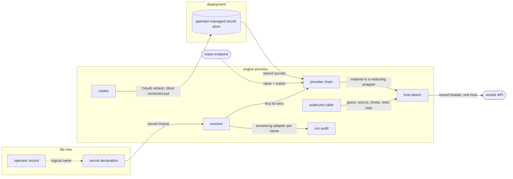
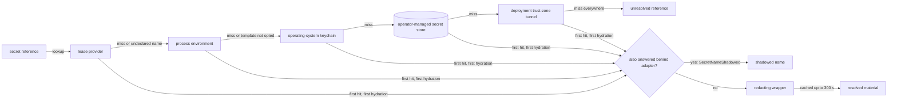
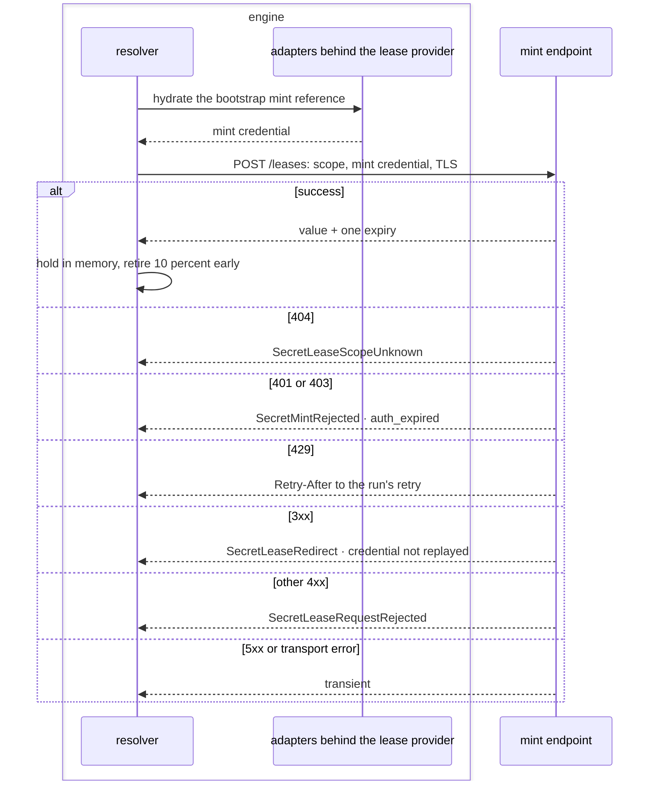

# Outbound credentials

An outbound credential authenticates a pull, derive step or metered call to a vendor API.
Connector implementers use this contract to declare, resolve, lease, attach, rotate and record credentials.

A credential from its reference to the vendor, keyed throughout by its logical name:



## reference

Outbound credential references, the `secret://` scheme and value templates.

- `credential-plane` — Outbound credentials authenticate vendor requests separately from credentials admitting callers into a store. A key retains its inbound or outbound purpose regardless of storage location.
  *A-connector*
- `declaration-binds-a-reference` — A declaration's capability block lists required credential names. Each name binds to a `secret://<name>` reference that the resolver hydrates at run time.
  *A-connector*
- `reference-scheme` — `secret://<name>` carries a logical name matching `[a-z0-9-]+` of at most 128 chars. A reference names no storage path, file name or key identifier.
- `backend-independence` — The adapter maps a logical name to a storage location. Changing credential stores changes the backend mapping without editing declarations.
- `value-template` — A value embedding a credential is a template of literal text with `${secret://<name>}` placeholders, such as `Bearer ${secret://vendor-token}`.
- `foreign-placeholder` — `${env://NAME}` or a bare `${NAME}` inside a template raises `SecretForeignPlaceholder` at parse, naming the value and the span.
  *A-connector*
- `malformed-placeholder` — When reading a declaration, the parser raises `SecretMalformedTemplate` for an unclosed, empty or nested placeholder, before any text leaves the process.
  *P1*
- `environment-is-a-miss` — Template hydration skips the process-environment adapter and continues through the chain. If no adapter answers, the resolver applies {{connector.resolve.unresolved-name}}.
  *A-connector*
- `environment-opt-in` — `CONTEXTFUL_SECRETS_ALLOW_ENV_TEMPLATES=1` enables the environment adapter for template hydration. The resolver logs one warning per process naming the variable.
- `whole-value-binding` — `env://NAME` binds a whole credential outside the template grammar.
- `whole-value-reference` — A whole-value `secret://<name>` reference outside templates, such as a `[sync]` credential key, resolves through the assembled adapter chain, including process environment, under {{connector.resolve.first-hit-wins}} and {{connector.resolve.shadowed-name}}.
  *because a whole-value key sits in the node's own configuration, where `env://NAME` already reads the environment directly*
- `material-in-a-declaration` — A credential-shaped literal standing where a reference belongs raises `SecretMaterialInDeclaration` at validation, naming the key.
  *A-connector*
- `lease-has-no-scheme` — A leased credential binds as `secret://<name>`. No lease spelling exists in the manifest grammar.
  *A-connector*
- `name-is-the-join` — Declarations, provider entries, cache keys, records and run provider attribution identify the same credential by its logical name.

## resolve

The provider interface, adapter order, request-time resolution, credential buffers and deployment security configurations.

- `provider-port` — One provider interface resolves a reference to credential material. Each backend implements this interface as an adapter. `CONTEXTFUL_SECRETS_BACKEND` selects the adapters in the chain.
- `provider-chain` — The chain runs: lease provider, process environment, operating-system keychain, operator-managed secret store, then a tunnel into the deployment trust zone.
  *A-connector*
- `first-hit-wins` — Hydration uses the first adapter answering the name. The resolver consults no later adapter for that reference during the run.
- `shadowed-name` — At first hydration, a name answered by the serving adapter and by any adapter behind it raises `SecretNameShadowed`, naming the logical name and both adapters.
  *because a stray environment variable otherwise shadows the manager unnoticed*
- `hydration-is-just-in-time` — When building each request, the host asks the resolver for credentials. Cached material follows {{connector.resolve.cache-ttl}}. Declarations, journal entries, audit records, run records and log lines contain no hydrated values.
  *A-connector*
- `redacting-wrapper` — Every hydrated value, including a pure-literal template, uses a wrapper whose debug and display forms print a fixed sentinel. The host reveals bytes only when writing the request.
- `wiped-on-drop` — A hydrated wrapper has no `Clone`. Shared owners reference one buffer that zeroes when its last owner drops, including an expired cache entry. The wrapper excludes request and transport copies.
  *because a freed credential otherwise stays readable until the allocator reuses its memory*
- `resolver-per-source` — Each source has one resolver and its own cache. The resolver combines concurrent first hydrations of one name into one lookup.
- `cache-ttl` — A cache entry lives at most 300 s.
- `unresolved-name` — If no assembled adapter answers a reference, the resolver raises `SecretUnresolvedReference`, naming the reference. The error occurs at preflight for static bindings and at the call otherwise.
  *P2*
- `posture` — Four credential configurations order by distance from the engine: inline environment values, request-time reference resolution, external manager using workload identity, and secretless broker sidecar. The workload-identity manager is the default.
  *A-connector*
- `inline-outside-development` — A profile other than development binding plaintext material at a call site raises `SecretInlineCredential` naming the binding.
  *A-connector*
- `forwarding-sidecar` — A sidecar that reads and forwards a stored long-lived credential raises `SecretForwardingBroker`. A sidecar minting a short-lived scoped credential is a lease provider.
  *A-connector*
- `adapter-is-optional` — Each managed backend is one adapter holding opaque versioned ciphertext; a deployment links only the adapters it uses.
- `know-how-in-an-adapter` — An adapter exposing a provider-specific exchange, refresh or lifetime entry point raises `SecretProviderKnowHowInBackend` at load.
  *A-connector*



## lease

The first credential adapter: lease declarations, mint requests, expiry, failures and the mint credential.

- `scope-declaration` — `CONTEXTFUL_LEASE_SCOPES` lists the logical names hydrating as run-time leases, each optionally as `name=scope`.
- `head-of-chain` — For a declared name, the resolver uses the lease provider without falling back to later adapters. A shadowing adapter raises under {{connector.resolve.shadowed-name}}.
  *A-connector*
- `undeclared-name-defers` — An undeclared name sends the lease provider no request and leaves precedence among the other adapters untouched.
- `empty-scope-set` — Selecting the lease backend with no scope declared raises `SecretLeaseScopesEmpty` at startup.
  *P3*
- `lease` — The resolver holds a leased credential and its expiry together in memory for the run. The resolver evicts both at expiry. Neither enters a file, journal entry or audit record.
  *A-connector*
- `malformed-lease` — A lease carrying no expiry, or one already past on arrival, raises `SecretMalformedLease` as a transient failure.
  *P6*
- `cache-window` — A leased name's cache entry expires at the earlier of {{connector.resolve.cache-ttl}} and the lease's own expiry.
- `retirement-margin` — An entry retires 10 percent of its window ahead of expiry, the margin capped at 30 s.
  *because a request sent near the boundary still lands inside the grant*
- `endpoint` — The provider answers `POST <provider-url>/leases` carrying a bearer mint credential and body `{ "scope": "<lease scope>" }`.
  *because a batched answer ties one scope's refusal to every name in it and mints material no request has asked for*
- `response` — A success carries `value` plus one expiry — `expires_in` seconds, `expires_at` epoch seconds, or an RFC 3339 instant — at the top level or under `lease`.
- `unknown-scope` — A `404` raises `SecretLeaseScopeUnknown` as a configuration fault. The resolver does not fall back to a stored credential for a declared name.
  *A-connector*
- `mint-rejected` — A `401` or `403` raises `SecretMintRejected`, classed `auth_expired`.
  *P6*
- `rate-limited` — A `429` passes its `Retry-After` to the run's retry, classed `rate_limited`.
  *P6*
- `request-rejected` — Any other `4xx` raises `SecretLeaseRequestRejected` as a permanent configuration fault.
  *P6*
- `transient-class` — A `5xx` and a transport error are transient. The mint client retries nothing itself; the run's retry schedule is the one retry layer.
  *P6*
- `vendor-requests-on-failure` — A run holding an expired lease whose provider is unreachable issues 0 requests to the vendor.
  *P6*
- `calls-per-resolver` — A resolver issues at most 1 calls to the mint endpoint per declared name per lease window.
- `bootstrap-credential` — The engine authenticates to the mint endpoint with one standing `secret://` credential scoped only to minting. Revoking this credential cuts off each leased source at its next expiry.
  *A-connector*
- `bootstrap-non-recursion` — The lease provider holds the chain as assembled before it joined, so the mint reference hydrates only through adapters behind it.
- `bootstrap-unserved` — A bootstrap name no adapter behind the lease provider answers raises `SecretBootstrapUnresolved`, naming the reference.
  *A-connector*
- `bootstrap-declared-leased` — Listing the bootstrap name among the leased scopes raises `SecretBootstrapLeased` at startup.
  *A-connector*
- `bootstrap-backend` — `CONTEXTFUL_LEASE_BOOTSTRAP_BACKEND` composes an operator-managed secret store behind the lease provider to hold the mint reference.
- `mint-transport` — The mint client reaches its endpoint over TLS or loopback and ignores system proxy configuration.
  *A-connector*
- `redirect` — A `3xx` from the mint endpoint raises `SecretLeaseRedirect`; the mint credential is not replayed at the target.
  *A-connector*



## attach

Host handling of outbound requests: network transport, permitted hosts and addresses, credential headers, redirects and URL scrubbing.

- `host-mediation` — The host implements outbound HTTP. Before socket I/O, the host checks each request against the declaration, assigns a request id and writes the bound credential onto a permitted request.
  *A-connector*
- `no-material-to-a-guest` — No host import hands credential bytes to guest code; a guest names a request and receives a response.
  *A-connector*
- `unpermitted-request` — A request whose host the declaration does not cover raises `SecretUnpermittedRequest` and fails the guest call even where guest code discards the error.
  *A-connector*
- `transport-port` — The mediated client reaches the network only through a transport interface. The send method connects to a vetted address, follows no redirect, and applies the client's proxy choice, timeout and body ceiling.
  *A-connector*
- `resolve-half` — After {{connector.meter.pre-send-hook}} admits the hop, the transport interface resolves the name. The client checks each returned address under {{connector.attach.private-address}}.
  *A-connector*
- `resolve-once` — The host resolves a permitted host name once per request and connects to the address it vetted, with no second lookup between check and connect.
  *A-connector*
- `private-address` — A host name resolving to a private, link-local, unique-local, loopback or cloud-metadata address raises `ConnectorPrivateAddress`, unless the configured host is itself a loopback name or literal.
  *because an allowlisted name pointed at an internal range is SSRF*
- `bound-host` — A credential-bound source declares one non-wildcard host, checked at validation and session open. A wildcard entry or table-bound endpoint host beside a bound credential raises `SecretWildcardHost`.
  *A-connector*
- `default-attachment` — Without an attachment declaration, the host writes `Authorization: Bearer <value>` from the single bound credential.
- `attach-block` — An `[attach]` block maps a header name to a value template. The host hydrates it onto the permitted request, overriding the guest's header of that name.
- `per-request-hydration` — A guest session stores hydration handles and plain static headers. The host calls each handle for every permitted request and releases the hydrated header when the request completes.
  *because session-held credential material outlives the request and delays rotation*
- `literal-attach-value` — An attach value embedding no reference raises `SecretLiteralAttachValue`.
  *because a constant header belongs in the guest's request construction*
- `redirect-pinning` — With or without credentials, a source follows a hop only with the configured host and port on the same or stronger transport. Sources follow cleartext-to-TLS hops at that host and port.
  *A-connector*
- `weakened-hop` — A redirect or vendor-supplied next link moving from TLS to cleartext, or to another host or port, raises `SecretRedirectOffOrigin`, and the read fails.
  *A-connector*
- `landed-origin` — The source stores response bodies only from the configured host and port.
  *A-connector*
- `referer-off` — `Referer` is off on every outbound client.
- `header-selects-client` — A source declaring any header, literal or hydrated, uses the hardened client and bypasses the system proxy. A source declaring no header keeps the proxy.
- `cleartext-endpoint` — The host marks a reference-hydrated header sensitive. Sending the header to a cleartext endpoint raises `SecretCleartextEndpoint`, except on IPv4 or IPv6 loopback.
  *A-connector*
- `sensitive-header-record` — A run records which header names carried a credential, by name only.
- `url-scrubbing` — Before a URL enters an error message, log line or stored column, the host removes query, fragment and userinfo. Scheme, host, port and path remain.
  *A-authority*
- `typed-url-edit` — Metered vendor traffic and control-plane traffic each use one client that clears URLs through typed error mapping. The host scrubs other URLs as text.
- `credential-in-a-url` — A configured endpoint carrying userinfo raises `SecretCredentialInUrl` at validation, naming the source.
  *A-authority*
- `mediation-covers-every-egress` — A built-in source, a guest connector, a model call and a limiter call each attach through the one mediated client; {{connector.attach.exec-environment}} names the one attachment outside it.
  *A-connector*
- `exec-environment` — At spawn, an exec step hydrates its env template through the source resolver into the environment cleared by {{run.exec.no-shell}}. This attachment bypasses host mediation and enters {{connector.record.provider-attribution}}.
  *because the derive driver hands a vendor child its own credential, and a loopback attaching proxy remains an open design*

unsettled: Does an exec step's vendor traffic pass a host-run loopback proxy that attaches its credential, so no child holds material? owner: connector affects: connector.attach

## rotate

Credential rotation responsibilities and mechanisms.

- `division-of-labor` — A credential store contributes versioned storage and a trigger. The host drives the OAuth loop from the connector's auth policy and writes the token back as a blind versioned put.
  *A-connector*
- `expiry-hint` — The host may store an opaque `expires_at` hint beside the ciphertext for cache invalidation.
- `static-key` — A static key in an operator-managed secret store turns over with no engine step: a run hydrates the current version at its next cache miss.
  *because the 300 s cache bound already caps staleness, and a per-manager change feed adds a listener and failure domain to every adapter*
- `oauth-credential` — The host refreshes an OAuth credential at {{connector.lease.retirement-margin}} from its declared expiry. The host puts the refreshed version to the answering adapter, conditioned on the hydrated version, then clears the name's cache entry.
  *A-connector*
- `operator-entered` — An operator re-enters a development or keychain secret by updating the reference.
- `leased-credential` — The resolver re-mints a leased credential before its window ends without writing it back. If minting fails, the source uses no credential, including an older value.
  *P4*
- `write-back-denied` — A refused put or answering adapter without a write method raises `SecretRotationWriteDenied`. The host discards the refreshed token without serving it, and the run fails closed.
  *A-connector*
- `conditional-put` — If another writer stores a version first, the losing put rehydrates that version without raising an error.
  *A-connector*
- `connector-owns-meaning` — The connector's `[auth]`, `[rate_limit]` and `[retry]` blocks define token lifetime, exchange rules, refresh endpoint and scopes, expired-token codes and rate-limit headers. Connector id and version pin these blocks.
  *A-connector*
- `no-master-key` — The engine holds references, and no single encryption key exists whose theft with a database copy yields every credential.
  *A-connector*
- `turnover-preserves-the-name` — Every rotation mechanism keeps the logical name, touching no declaration and no pinned connector artifact.

#### Scenarios

- `connector.rotate.write-back-denied`: WHEN the answering adapter refuses the put of a refreshed token, THEN the run fails and no request carries the refreshed token.
- `connector.rotate.conditional-put`: WHEN another writer stored a newer version first, THEN the next hydration returns that version and the rotation raises nothing.

## record

Optional operator metadata, provider observations, the inventory of configured bindings, and the provider attribution a run emits.

- `operator-record` — An optional operator record describes one logical name's intended grants, account or tenancy, consuming surfaces and rotation location; supplied creation and expiry assertions remain operator metadata.
  *A-connector*
- `metadata-storage` — A committed operator record contains descriptive metadata only. Recording a binding requires neither a credential value nor a decryption key.
  *A-connector*
- `provider-custody` — The selected provider owns credential values, versions and rotation state; an external-manager binding requires no ciphertext copy in the repository.
  *A-connector*
- `surface-of-consumption` — An operator record identifies each documented consuming surface and its credential binding name.
- `optional-record` — A binding without an operator record remains resolvable and appears in inventory with unknown descriptive fields.
- `unverified-scope-is-marked` — An operator record marks grants as unknown when the operator has not established them.
- `rotation-record` — A rotation follows {{connector.rotate.turnover-preserves-the-name}} without requiring a repository commit; operator metadata changes only when its assertions change.
  *A-connector*
- `inventory` — `contextful secrets list` displays configured logical bindings with their configured adapters, operator metadata and available provider observations. The command reads no credential values and claims no complete provider inventory.
- `observation-provenance` — Each provider-observed field names its adapter and observation time; operator assertions remain separately labelled, including when they disagree with provider observations.
- `observation-unavailable` — Inventory reports unsupported, denied or failed metadata reads as unavailable with a reason. Inventory neither substitutes operator assertions for provider observations nor hydrates values to obtain metadata.
- `expiry-unknown` — Inventory reports an absent expiry as unknown. `no expiry` requires an explicit assertion or observation. Inventory computes days remaining only for a dated expiry and retains its provenance.
- `expiry-warning` — The inventory marks each dated expiry falling within 30 d and each elapsed expiry, retaining the expiry's provenance.
- `configured-is-not-observed` — A configured adapter identifies a binding's configuration; only {{connector.record.provider-attribution}} identifies the adapter that answered a run's reference.
- `provider-attribution` — A run's commit-phase and failure rows carry `credential_providers`. The field maps each hydrated logical name to the answering adapter, using names only.
- `record-table` — An operator record is a `[secret.<name>]` table in the discovered `contextful.toml`, keyed `description`, `account`, `grants`, `surfaces`, `rotate`, `created` and `expires`, each optional; `expires = "never"` is the one explicit no-expiry assertion.
  *A-connector*
- `record-rejected` — A `[secret.<name>]` table outside discovered `contextful.toml`, without a manifest-bound `secret://` name, or containing an unknown key, mistyped value or credential-shaped string raises `SecretRecordRejected` during declaration read. The error names file, name and key path, excluding values.
  *because a misspelled name otherwise describes nothing while the real binding reads undescribed, and an echoed value carries a pasted token into CI logs*
- `record-is-inert` — Resolution, attachment, rotation and pipeline content hashing read no operator record. Editing a record changes no plan, run or hydrated value.
- `observe-port` — An adapter's observation interface returns presence, version, creation and expiry for a name, or unavailable with a reason. The interface holds no hydrated value. Inventory holds only observation interfaces.
  *A-connector*
- `inventory-output` — `secrets list` exits 0 whatever its marks; `--json` prints one object per binding per line: name, configured adapters, latest answered adapter with run id and instant, operator fields, and observations with adapter and time.

#### Scenarios

- `connector.record.provider-custody`: WHEN a binding selects an external manager with no encrypted repository entry, THEN the manager remains the sole owner of its value and versions.
- `connector.record.optional-record`: WHEN a configured binding has no operator record, THEN inventory includes the binding with unknown descriptive fields.
- `connector.record.rotation-record`: WHEN a manager rotates a credential, THEN the repository needs no commit.
- `connector.record.observation-provenance`: WHEN an operator expiry differs from an observed expiry, THEN inventory shows both with their distinct provenance.
- `connector.record.observation-unavailable`: WHEN a provider denies metadata access, THEN inventory reports the reason without reading a credential value.
- `connector.record.expiry-unknown`: WHEN neither operator nor provider supplies an expiry, THEN inventory reports unknown expiry and no days remaining.
- `connector.record.configured-is-not-observed`: WHEN a binding configures multiple adapters and has no run attribution, THEN inventory reports configuration without asserting an answering adapter.
- `connector.record.record-rejected`: WHEN `contextful.toml` holds `[secret.vendor-tokne]` beside a binding named `vendor-token`, THEN the declaration read refuses and the message carries no record value.
- `connector.record.observe-port`: WHEN inventory lists a lease-served binding, THEN its lease observation reads unsupported and the mint endpoint receives 0 requests.
- `connector.record.record-is-inert`: WHEN an operator record's description changes, THEN the pipeline retains its content hash.

## principal-secrets

Per-principal credential names and the adapter that serves their material.

- `name-binding` — A connection binds one opaque secret name to its admitted tenant and principal; a run hydrates only the name bound to its connection.
- `adapter-port` — A principal secret adapter resolves a name to credential material and a version. The adapter's write method conditionally stores a replacement version under the same name.
- `write-serialization` — Concurrent refreshes of one name serialize across resolvers through the adapter's conditional version; the losing refresh rehydrates the winner under {{connector.rotate.conditional-put}}.
  *A-connector*
- `lease-custody` — A lease endpoint holding refresh tokens answers the connection's name under {{connector.lease.lease}}; Contextful retains neither the refresh token nor its replacement.
- `disconnect` — Deleting a connection revokes its principal secret name before another run hydrates it. If revocation fails, the connection stays paused.
  *because a deleted connection must not regain vendor access from a cached lease*

#### Scenarios

- `connector.principal-secrets.name-binding`: WHEN two principals connect one OAuth client, THEN each run resolves only its own refresh-token name.
- `connector.principal-secrets.write-serialization`: WHEN two refreshes race on one name, THEN one version wins and the other resolver rehydrates it.

## Shapes

A declaration binding one credential through a template:

```toml
[pipeline.source]
name = "http"

[pipeline.source.config]
endpoint = "https://api.vendor.example/v1/records"   # one exact host: a credential attaches here
format   = "json"

[pipeline.source.config.headers]
Authorization = "Bearer ${secret://vendor-token}"
```

An operator record in `contextful.toml`, holding no value and no ciphertext:

```toml
[secret.vendor-token]
description = "Vendor API key"
account     = "acct-4471 (records namespace)"
grants      = ["records.read", "records.export"]
surfaces    = [{ surface = "records pipeline", binding = "Authorization header" }]
rotate      = "console.vendor.example/settings/api-keys"
expires     = "never"
```
