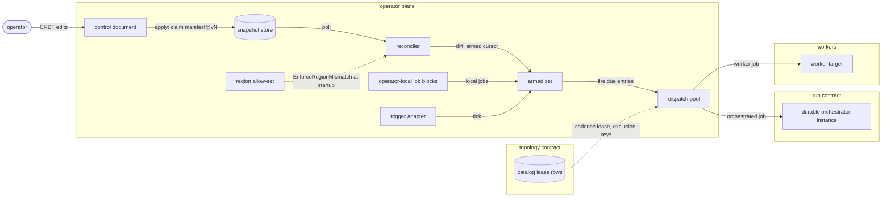
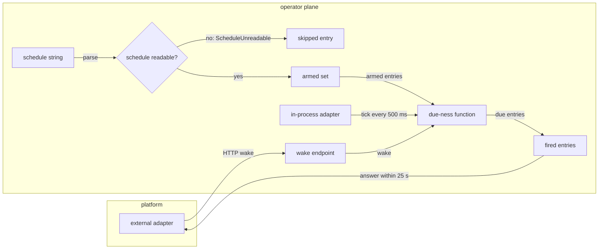
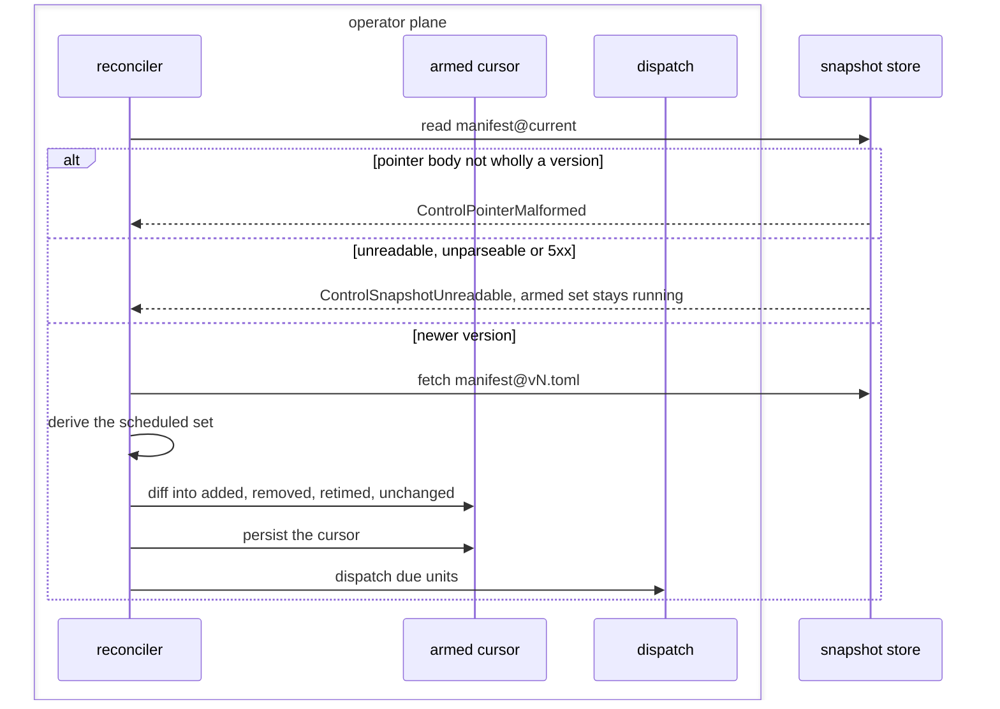
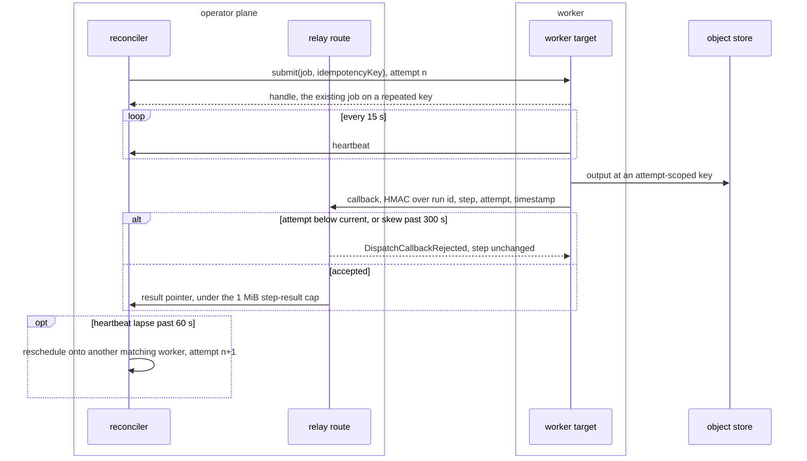
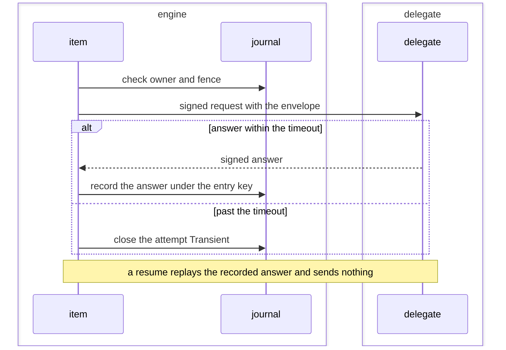
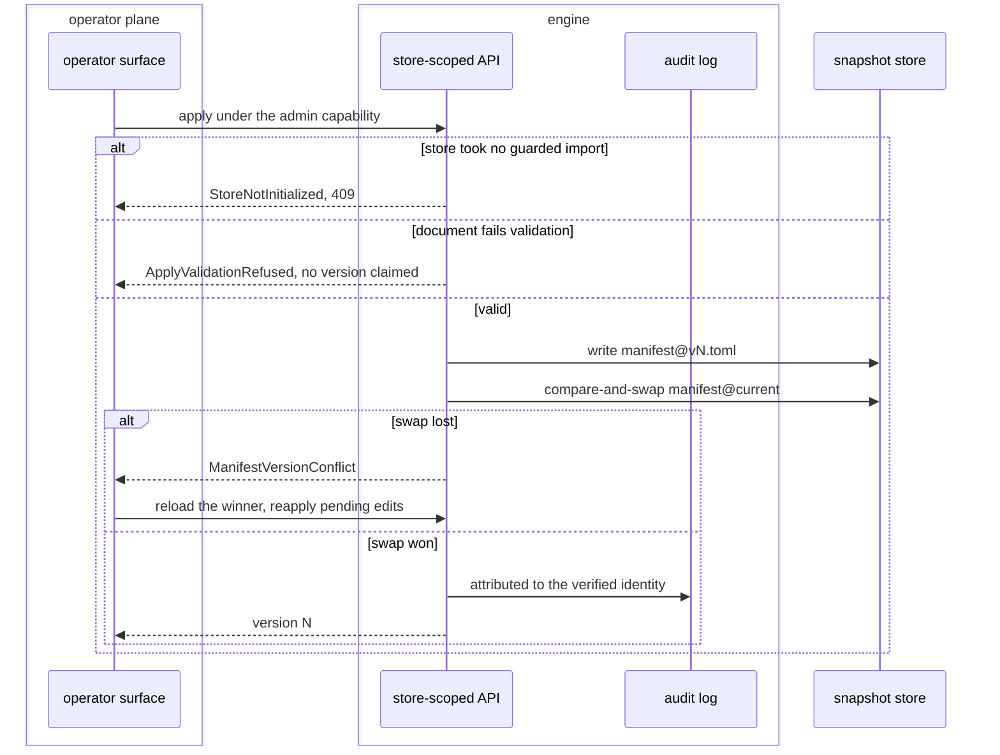

# Cadence, dispatch and the operator plane

The control plane decides when work runs and where. It holds the schedule grammar and its
trigger, the reconciler that turns an applied snapshot into an armed set, the fire stage,
the bounded dispatch pool and its worker adapter, the operator's edit and apply path over
the control document, and the region a data plane resides in. The published hostname and
the read path's two hops belong to the topology contract.

The path from an operator's edit to a dispatched unit, and where it meets topology and the run path:



## arm

The schedule grammar and cron dialect, the trigger adapter and its durability, the wake route, and how an entry computes its next fire.

- `unreadable-schedule` — A schedule string the grammar cannot read, including `L`, `W`, `?`, `#` and `@` macros, raises `ScheduleUnreadable` for that entry alone, naming the diagnostic; every other entry of the document arms.
  *A-surface*
- `unknown-trigger` — An unrecognized trigger value raises `TriggerAdapterUnknown` at startup and downgrades onto no adapter.
  *P3*
- `trigger-face-missing` — `external` selected on a deployment serving no HTTP face raises `TriggerFaceMissing` at startup.
  *P3*
- `wake-answer` — A wake answers within 25 s with what fired, what failed, what stays armed and the next due instant, naming each fire still in flight as pending.
  *because a platform request timeout otherwise ends the call before the caller learns anything*
- `wake-pending-steps` — A wake or cycle answer naming a unit pending also names each of its landing steps and dependent jobs pending, so a job due behind a pipeline that landed during the wake reads pending until its unit ends.
  *because a caller checking one job before reading its output otherwise finds it in neither `fired` nor `pending`*
- `tick-interval` — The in-process adapter evaluates the armed set every 500 ms.
- `trigger-select` — `[control] trigger` selects `in-process`, the default, or `external`, under which `pipeline serve --http <address>` answers `POST /wake` and runs no tick of its own.
- `grammar` — A schedule is `every <n><unit>` with unit `s`, `m`, `h` or `d`, or a UTC cron expression of five fields, minute, hour, day of month, month and day of week, each `*`, a value, range, list or `/` step.
- `next-fire-from-history` — An armed entry's next fire is the first instant its schedule admits after the later of its last journaled run start and its last dispatch, which the catalog records before start; an entry with neither is due when armed.
  *because a restarted daemon then keeps the cadence its run history shows instead of restarting every interval from boot*
- `catch-up` — A daemon arming an entry whose next fire has passed fires it once, whatever count of intervals elapsed, and arms the following fire from that run.
  *because replaying each missed interval against an incremental source pulls the same delta once per interval*
- `pulled-history` — A pipeline's last journaled run start is the latest start across this node's catalog and every run state {{store.push.run-state}} carries that records the pipeline.
  *because a cold node's empty catalog otherwise finds every scheduled entry due at once*
- `pulled-future` — A pulled run start later than the scheduler's current instant counts as no start for {{surface.arm.pulled-history}}.
  *because one node's fast clock or one bucket writer otherwise defers every replica's cadence until that instant*
- `unarmed-named` — An applied pipeline declaring no schedule, or held back by {{surface.arm.unreadable-schedule}}, arms no entry; serve names each such pipeline with its reason once per applied version, and `--cycle` lists them under `unarmed`.
  *because a pipeline silently left out of the armed set reads as armed until its data goes stale*

Both trigger adapters reach one due-ness function:



## reconcile

The control source, snapshot pointer, signed pulled-head validation against local declarations, schedule diff, and what a failed poll leaves running.

- `poll-cadence` — `poll` takes a schedule string, and a `[control]` block declaring none polls every 30 s.
- `pointer-malformed` — A pointer body that is not wholly a version raises `ControlPointerMalformed`.
  *because an integer read out of leading bytes arms a version nobody applied*
- `fail-static` — An unreadable pointer, an unparseable snapshot or a control plane answering `5xx` raises `ControlSnapshotUnreadable`, logs a diagnostic, and leaves the armed set in place running.
  *A-surface*
- `loopback-only` — A control URL whose host is not a loopback address raises `ControlSourceNotLoopback` and arms nothing; a poll follows no redirect and routes through no proxy.
  *A-surface*
- `pulled-control` — A reconciler adopts the project-scoped head {{store.pull.control-head}} carries, descending from its local head, only after verifying the receipt under a locally pinned issuer key and validating the snapshot against this node's declarations.
  *A-surface*
- `issuer-pin` — A reconciler reads pulled-control issuer pins through {{authority.verify.pin-source}} and refuses a receipt whose signer is absent from those pins.
  *because a bucket writer can sign its own unauthorized snapshot*
- `pulled-control-untrusted` — A pulled control head with an invalid signature, project, digest, predecessor chain or local validation raises `ControlSnapshotUntrusted`, names the reason and arms none of that version.
  *A-surface*
- `url-layout` — A control URL serves `manifest@current` and each `manifest@v<N>.toml` directly beneath its path; a pointer answered `404` reads as no applied version, and any other status besides `200` is unreadable.
  *because one layout serves a snapshot directory unchanged over loopback HTTP*
- `learns-by-reading` — A daemon learns of a new snapshot only by reading its control source, on each poll and on each wake; nothing pushes a snapshot to it.
  *A-surface*

One reconciler beat, polled every 30 s by default:



#### Scenarios

- `surface.reconcile.pulled-control`: WHEN a cold node holds a signed bucket head whose snapshot validates against its declarations, THEN it installs that head and arms its schedules.
- `surface.reconcile.pulled-control`: WHEN a signed bucket head contains one of two locally declared pipelines, THEN the reconciler adopts that partial apply and leaves the other pipeline unarmed.
- `surface.reconcile.pulled-control-untrusted`: WHEN a bucket writer replaces the snapshot bytes without a matching signature, THEN the node names the failed verification and arms none of that version.

## fire

Job declaration, the closed kind union, same-tick order, the fire watermark, and one-shot evaluation.

- `job-kind-unknown` — A block naming a kind outside the union, an argument vector or a host command raises `JobKindUnknown` at validation.
  *A-surface*
- `target-unbound` — A `fold` target naming no produced table, or a `build` target naming no declared `[[model]]`, raises `JobTargetUnbound` at validation.
  *P1*
- `cycle-control-source` — A configured control source that does not resolve under `cycle` raises `CycleControlSourceUnresolved`.
  *P3*
- `store-driven-concurrency` — A `store-driven` block declaring no positive integer `max_in_flight` raises `JobConcurrencyUnset` at validation; no default applies.
  *A-surface*
- `store-driven-body` — A `store-driven` block whose `body` names no body the embedding binary registers and no delegate under {{surface.delegate.binding}} raises `JobBodyUnregistered` at validation.
  *A-surface*
- `scheduled-body` — A scheduled `store-driven` job runs through the cadence lease and dispatch pool under `job:<name>`, using the embedding executable's registered body or its bound delegate, and the applied snapshot's job declaration.
  *A-surface*
- `scheduled-history` — A scheduled `store-driven` job computes its next fire from its host execution's recorded start, including failed attempts; a restarted daemon resumes pending execution through {{run.journal.input-pin}}.
  *A-surface*
- `job-snapshot` — Import and full apply retain validated job declarations in the immutable snapshot; a pipeline-only apply preserves the snapshot's jobs, and a pipeline-only editor refuses to discard them under {{surface.apply.validation}}.
  *A-surface*
- `model-snapshot` — Import and full apply retain validated model declarations with file SQL resolved inline; pipeline-only apply preserves applied models, and applied build dispatch reads that version's model, contract and tests without consulting draft definitions.
  *A-surface*
- `standalone-snapshot` — Import and full apply retain standalone table contracts in immutable snapshot metadata; pipeline-only apply preserves that metadata, including absent metadata.
  *A-surface*
- `applied-data-contract` — Applied store-driven and build jobs resolve standalone and pipeline table declarations and models from their snapshot; unapplied edits to them change neither input selection nor output landing contracts.
  *A-surface*
- `applied-current-authority` — Before opening an applied job execution, differing current table authority or model disclosure refuses under {{surface.apply.validation}}; current writer admission remains authoritative.
  *because a pinned read structure must not preserve authority the live declaration has changed*
- `applied-contract-missing` — Applied jobs lacking standalone contract metadata refuse under {{surface.apply.validation}} until full apply captures those contracts; no live declaration substitutes for missing snapshot metadata.
  *A-surface*
- `executable-pin` — Store-driven and build executions pin table declarations, model definitions, output membership, and memory shapes and relations; changed structure meets {{run.own.pinned-plan-changed}} before replay or publication.
  *A-surface*
- `scheduled-build` — A scheduled `build` job dispatches the native model publisher through the cadence lease and pool under `job:<name>`; its execution records starts and outcomes for restart cadence, including failed attempts.
  *A-surface*
- `build-dependency` — A build job's `after` names a pipeline and inherits its dependent-run head schedule; builds follow all pipeline steps and run only after a successful unit. Jobs without `after` read already committed inputs.
  *A-surface*
- `build-dependency-invalid` — Import and apply refuse a job dependency naming no pipeline, combining `after` with `schedule`, or naming a kind other than `build`, under {{surface.apply.validation}}.
  *because a dependency has one native cadence and never dispatches an unsupported job graph*
- `job-identity` — A pipeline sharing a job's `job:<name>` dispatch identity fails {{surface.apply.validation}} before a version is claimed.
  *because one exclusion key cannot dispatch two distinct operations*
- `plan-job` — A `plan` block names a compiled plan file beside its manifest; `job fire` lowers that plan onto one execution under host scope `job:<name>`, pinned to the plan's version.
  *A-surface*
- `cycle` — `serve --cycle` arms the applied snapshot, evaluates due-ness once, waits for every unit it dispatched, and prints what fired, what failed, what stays pending, the armed count and the next due instant.
- `cycle-exit` — `serve --cycle` exits non-zero when any unit it dispatched failed, after printing its answer; a cycle with no failed unit, or one finding the cadence lease held, exits zero.
  *because a scheduler running the cycle reads the exit status, and a zero over a failed fire reports success*
- `cycle-drain` — After its dispatched units end and before it releases the cadence lease, `serve --cycle` drains the queue's object-arrival keys and queued batches once, leaving post-commit wake-ups for `contextful queue drain`, and its answer counts what that drain settled.
  *because an object-arrival key or a queued batch must reach its read between cadence fires, and the cadence lease keeps one drainer*
- `cycle-drain-exit` — A cycle whose drain fails exits non-zero as {{surface.fire.cycle-exit}} does, its deliveries left queued for the next cycle.
  *because a drain failure leaves work queued, and a scheduler reading a zero retries none of it*
- `daemon-drain` — While it holds the cadence lease, `pipeline serve` under the in-process trigger drains the queue as {{surface.fire.cycle-drain}} does, beside its ticks, starting each drain 5 s after the previous one ends.
  *because a daemon running no cycle still owes each object-arrival key and queued batch its read, and the cadence lease keeps one drainer*
- `daemon-drain-retry` — A failed daemon drain logs its error and leaves its deliveries queued; the daemon keeps serving and drains again on its next pass.
  *because one unreachable source must not stop every schedule the daemon arms*

## dispatch

The bounded fire pool and its exclusion keys, the reconciler's hold on the cadence lease, step results, and the worker adapter with its attempt-fenced callback.

- `not-a-head` — A `[[pipeline]]` block naming `after = "<id>"` is a landing step of that entry's dependent run; the run is the unit and cadence rides its head entry. A due id that is a step raises `DispatchUnitNotAHead` and starts nothing.
  *A-surface*
- `step-result` — A completion callback carries a pointer, an object-store key or a catalog row id, or the failed step's last error line, as JSON of at most 1 MiB; any other callback body raises `StepResultRefused` and records nothing.
  *because a step result rides one journal row, and bulk output belongs in the object store it points into*
- `in-band-tool-error` — A step driving the engine over the tool protocol judges the tool result, not transport status: a `200` carrying a protocol error or a result flagged `isError` raises `StepToolError`.
  *P2*
- `callback-skew` — The relay accepts a callback timestamp within 300 s of its own clock.
- `callback-rejected` — A heartbeat or callback whose signature fails, whose attempt is not the step's current attempt, whose timestamp falls outside {{surface.dispatch.callback-skew}}, or whose step has closed, raises `DispatchCallbackRejected` and changes no step.
  *because a partitioned worker's late result otherwise overwrites its successor's, and a captured callback replays indefinitely*
- `heartbeat-beat` — A worker heartbeats every 15 s with a signed `GET` on its step's awakeable route, and posts its outcome to that route with a signed `POST`.
  *A-surface*
- `worker-target` — `[control] workers` lists worker URLs and `[control] relay` the URL whose `/awake/:token` route `serve` binds; with workers listed, each landing step posts to a worker's `POST /submit`, keyed by run, step and attempt.
  *A-surface*
- `worker-key` — Heartbeats and callbacks sign under the key `CONTEXTFUL_WORKER_KEY` holds; `serve` listing workers without a relay or without that key refuses at startup and binds nothing.
- `submit-signed` — A worker admits a `POST /submit` only when it carries an HMAC under the worker key over its timestamp and body, within {{surface.dispatch.callback-skew}}, naming a callback under its own `[control] relay`; any other submission raises `DispatchSubmitRejected` and starts nothing.
  *because an unsigned submission lets any caller start a step and have the worker sign heartbeats and callbacks for a route of its choosing*
- `submit-exhausted` — A step every listed worker refuses in turn at `POST /submit` fails its unit naming the last refusal, each worker tried once.
  *because a step bouncing between refusing workers holds its pool slot and exclusion key while never running*
- `heartbeat-lapse` — A heartbeat lapse past 60 s reschedules that worker's in-flight work onto another matching worker under the next attempt number.
- `pool-bound` — A deployment's fire pool runs at most 4 units at once, `[control] pool` replacing the bound; a due unit past the bound stays armed and reports pending.
  *because one bound per deployment caps the process's concurrent pulls, where a bound per exclusion key caps nothing as pipelines are added*
- `admission-order` — Due units start by earliest next fire, then highest `[[pipeline]]` `priority`, an integer defaulting to 0, then the least recent of each unit's last run start and last dispatch, a unit with neither first, then id.
  *A-surface*
- `refill` — A wake whose fire ends before its answer admits each unit its evaluation left pending into the freed slot, through the cadence lease; a unit falling due after the evaluation waits for the next wake.
  *A-surface*
- `exclusion-key` — A unit's exclusion key is its pipeline id: a unit due while another under its key is in flight starts no second instance, and its next fire recomputes once the first ends.
  *because two fires of one pipeline race for one cursor*
- `export-quiesced` — A due unit whose head or a landing step writes a member of a publication, or a relation its producer reads, starts nothing while `contextful export group` holds that publication, and stays due, reporting pending.
  *because a producer commit between an export's frontier reads raises {{run.export.group-incompatible}}, and a deferred unit costs one beat where stopping serve costs every dispatch*
- `export-deferred-slot` — A deferred unit takes no pool slot and writes no dispatch record: its slot passes to the next unit in admission order, and it waits for the next beat or a wake's refill.
  *because a deferred unit holding its slot stops unrelated units for the whole export, and a recorded dispatch moves its fire past the instant it never ran*
- `export-claim` — A started unit writing a publication's inputs holds them shared from its start until it ends, so an export of that publication waits for it.
  *because serve admits a unit before its child commits, so a check at admission alone misses a unit already running*
- `export-claim-unread` — A unit whose publication inputs serve cannot compute claims every declared publication; a unit whose claim serve cannot take starts nothing and stays due, logging the error.
  *because an unclaimed unit starting during an export commits between the frontier reads {{run.export.group-incompatible}} rechecks*
- `lease-gated` — A serve process dispatches only while it holds its deployment's cadence lease; a process finding the lease held arms nothing and, under `--cycle`, exits naming the holder.
  *because two daemons reading one snapshot otherwise fire every due unit twice*
- `children-reaped` — A serve process starts each child run in its own process group; on `SIGTERM`, `SIGINT`, a `--cycle` exit or an unwind it signals each live group `SIGTERM`, `SIGKILL`s the remainder after 10 s, and exits once every child has.
  *because a child outliving its serve also outlives the cadence lease, and a second scheduler then fires the same pipeline concurrently*
- `fire-credential` — Under `--issuer-key`, serve mints each store-driven or synthesize child fire one credential for `svc://job/<name>` in the project's default zone, granting {{surface.dispatch.fire-reach}}, in that child's `CONTEXTFUL_TOKEN`; the seed reaches no child argument or variable.
  *because a serve outlives any credential the ceiling admits, and a credential minted per fire narrows each child to its own job's tables*
- `fire-reach` — A store-driven fire reaches `read` on its statement's relations and `write` on its `tables`; a synthesize fire reaches `read` on its source, its target and the declared entities table, and `write` on its target.
  *because a synthesize pass consolidates against live claims and resolves mentions against entities, and writes no table but its claims and their dead letters*
- `fire-credential-lifetime` — A fire credential lives 600 s, or {{authority.issue.ceiling}} when lower; the child admits it once at start.
  *because a fire admits its credential before its first read, and a short lifetime bounds a leaked fire credential's exposure*
- `fire-credential-pins` — Each child holding a minted fire credential also receives `CONTEXTFUL_ISSUER_PUBKEY`, the seed's public key, and `CONTEXTFUL_AUDIENCE`, the issuance policy's default audience the credential carries, replacing values serve inherited.
  *because the child admits its credential from inherited variables, and a pin or audience other than the minting one refuses every fire*
- `fire-credential-inherited` — A serve holding no `--issuer-key` passes its own `CONTEXTFUL_TOKEN` to each child it starts.
- `fire-credential-missing` — A serve dispatching to child processes, whose applied snapshot schedules a store-driven or synthesize job, holding neither `--issuer-key` nor `CONTEXTFUL_TOKEN`, raises `FireCredentialMissing` at start and fires nothing.
  *because a missing credential otherwise fails every fire while the serve reports healthy*
- `fire-credential-zone` — A serve under `--issuer-key`, whose applied snapshot schedules a store-driven or synthesize job, under a root whose `[project.zone]` declares no `default`, raises `FireCredentialZoneUnset` at start and fires nothing.
  *because a credential signing no zone asserts an undeclared zone, which {{authority.place.undeclared}} admits nowhere but `*`, so every fire reads no row*

One step on a worker target, from submit to an accepted or rejected callback:



unsettled: Does an export on one node quiesce a serve on another, given the publication's intent and inputs locks are files on the exporting node's disk? owner: pipeline affects: surface.dispatch

## delegate

A delegate is deploy-bound code outside the binary that runs a store-driven item's body over one signed HTTP request, in a synchronous `call` mode or the asynchronous `submit` mode, and answers with a closed outcome vocabulary.

- `binding` — `[control.delegates.<name>]` binds a delegate by `url`, a `mode` of `call` or `submit`, and under `call` a `timeout`; a `store-driven` `body = { delegate = "<name>" }` naming no bound delegate raises `JobDelegateUnbound` at arm or fire.
  *A-surface*
- `host` — A delegate `url` is `http` to a loopback host or the `contextful.delegate` virtual host, carrying no credential; any other spelling raises `DelegateHostRefused` at startup and arms nothing.
  *because the stock container reaches a delegate only through a loopback relay or the deploy's outbound interception, and a public URL turns daemon configuration into egress*
- `envelope` — A delegate request carries `job`, `execution_id`, `step`, `input_hash`, `idempotency_key` under {{run.journal.idempotency-key}}, `attempt`, `entity` with namespace, key and fence, `as_of`, `version` when fired from an applied snapshot, `pins`, `tables`, the input `row` and `deadline`.
  *because a delegate holds no state of its own, and a request naming its version and fence lets it refuse before a paid call*
- `signed` — A request is signed under the worker key over `call`, its timestamp and body, and an answer over `answer`, the request's `idempotency_key`, its timestamp and body, each as {{surface.dispatch.submit-signed}} signs a submission.
  *because an answer bound to its request cannot be replayed onto another item's call*
- `rejected` — An answer unsigned or skewed past {{surface.dispatch.callback-skew}} raises `DelegateAnswerRejected` and closes the attempt `Transient`; one outside {{surface.delegate.outcome}} or over {{surface.dispatch.step-result}} raises it and closes the attempt `Permanent`.
  *because an unsigned answer lets any process on the loopback land rows, and a malformed one cannot change on retry*
- `call-mode` — Under `call`, one request per attempt holds its connection open and the response body is the attempt's answer; a response arriving after the delegate's `timeout` closes the attempt `Transient`, and its late body records nothing.
  *A-surface*
- `status` — A `call` response with a status other than `200` closes the attempt `Transient`, whatever its body; a terminal receipt follows a signed `permanent` answer, a `Permanent` rejection or an exhausted budget under {{run.items.retry-budget}}.
  *because a refusal before work is deployment drift an operator fixes, and a terminal receipt outlives the fix*
- `call-timeout` — A `call` delegate's `timeout` defaults to 300 s.
- `call-timeout-ceiling` — A `call` `timeout` above 3600 s raises `DelegateTimeoutRefused` at validation.
  *because an item holding a `max_in_flight` slot for over an hour is a stalled delegate, not a slow one*
- `submit-mode` — Under `submit`, the request is a {{surface.dispatch.worker-target}} submission answered at once; the delegate heartbeats under {{surface.dispatch.heartbeat-beat}}, posts its answer to the callback, and a lapse follows {{surface.dispatch.heartbeat-lapse}}.
  *A-surface*
- `outcome` — An answer is `ok` with rows per declared output table, `defer` with a `retry_at` instant, `transient`, or `permanent` with a reason; `ok` lands as {{run.items.completion}}, `defer` parks, and `transient` and `permanent` follow {{run.items.retry-budget}}.
  *A-surface*
- `defer-parks` — A `defer` parks the item until its `retry_at` under {{run.items.retry-budget}}; the first fire after that instant re-admits it under {{run.items.replay}}, no run sleeps on it, and a row of a job without `isolated_items` closes `Transient` instead.
  *because a provider budget clears on the provider's clock, and a slot held through the wait starves every other entity*
- `currency` — The fence in {{surface.delegate.envelope}} is checked immediately before the request under {{run.items.fence}}; under `submit`, the heartbeat `GET` answers the current attempt and fence, so a delegate learns before a paid call whether it is superseded.
  *because a delegate that pays after its owner was replaced spends a call whose answer nothing records*
- `version` — A binding's optional `version` joins the item's owner pins as a body dependency, so a changed version opens a fresh execution identity and a pending item under the old one refuses as {{run.own.pinned-plan-changed}}.
  *because a prompt or model change inside a delegate otherwise resumes recorded work under new semantics*
- `clocks` — Signature timestamps on a request and an answer ride each side's system clock; the `deadline` and a `defer` wait ride the engine's instant.
  *because the engine's instant is injectable while a delegate shares only wall time, and a wait measured on two clocks never fires*
- `submit-relay` — A `submit` binding on a daemon declaring no `[control] relay` or holding no worker key refuses at startup, as {{surface.dispatch.worker-key}} refuses a worker list.
  *because a submit delegate posts its answer to the awakeable route the relay binds*

One item on a `call` delegate, from the fence check to the recorded answer:



#### Scenarios

- `surface.delegate.call-mode`: WHEN a delegate answers `ok` with rows for one item and the daemon restarts before that item's landing commits, THEN the resumed item lands the recorded rows and the delegate receives no second request.
- `surface.delegate.host`: WHEN a delegate `url` names a host that is neither loopback nor the virtual host, THEN startup refuses and arms nothing.
- `surface.delegate.defer-parks`: WHEN a delegate answers `defer` with a `retry_at` ten minutes ahead, THEN the item's failed-attempt count is unchanged and the first fire after that instant sends the request again.

## edit

The configuration document, the records it presents read-only, the structured schedule specification, and connector configuration.

- `secret-in-document` — A credential value typed into a configuration field raises `SecretMaterialInDocument`; the document holds references and the backend holds material.
  *because a value in the document reaches every daemon and replica that reads a snapshot*
- `connector-upload` — An artifact uploaded through the operator surface raises `ConnectorUploadRefused`; the surface references registered connectors by id and version.
  *because publishing into the registry runs a separate signed path*
- `store-draft` — An Admin edit validates a complete control document and saves one store-scoped draft bound to its applied version, verified operator and random nonce, leaving the applied pointer unchanged.
  *A-surface*

## apply

Validation, the immutable version claim, the pointer advance, the owner's storage, and the authority an apply carries.

- `version-race` — An apply whose compare-and-swap loses raises `ManifestVersionConflict`, reloads the winning version and reapplies its pending edits onto it, overwriting no applied version.
  *A-surface*
- `validation` — A document failing engine validation raises `ApplyValidationRefused` and claims no version.
  *because a snapshot store holding a version daemons refuse to arm stalls every daemon reading it*
- `owner-unconfigured` — An owner with no storage configured or no credential raises `ConfigOwnerUnconfigured`, answered `503`; no local writer substitutes for the store-scoped API.
  *P3*
- `weak-conditional-backend` — A configuration owner or catalog backend whose conditional replacement is not linearizable raises `ConditionalWriteUnsupported` at startup or open.
  *A-surface*
- `uninitialized-store` — An edit or apply against a store that has taken no explicit guarded import, an empty store included, raises `StoreNotInitialized`, answered `409`.
  *P3*
- `local-claim` — A local control plane validates and claims `manifest@v<N>.toml` in its snapshot directory, `.contextful/control/<project>/` unless `[control] snapshot_dir` names one, on its own; `contextful pipeline apply` is that apply, and no hosted plane sits on its path.
  *because {{topology.coordinate.air-gap}} holds a single-node deployment to reach no process outside itself*
- `synced-attestation` — In a project with `[sync]`, import and apply admit an admin capability, then sign a receipt over the project, version, predecessor receipt digest and snapshot digest through {{authority.issue.signing-port}}.
  *A-surface*
- `receipt-message` — A JSON control receipt carries `format: 1`, signer public key and signature over UTF-8 `contextful-control-v1\n<project>\n<version>\n<parent-or-minus>\n<snapshot-sha256>\n<signer>\n`; its parent is `-` only for the first version.
  *A-surface*
- `receipt-digest` — A predecessor and the bucket head name the lowercase SHA-256 hex digest of a receipt's RFC 8785 canonical JSON bytes.
  *A-surface*
- `receipt-file` — A synced claim writes immutable `receipt@v<N>.json` beside its snapshot before advancing the applied pointer.
  *A-surface*
- `attestation-unavailable` — A synced import or apply lacking an admitted admin capability or issuer signing port raises `ControlAttestationUnavailable` and claims no version.
  *A-surface*
- `guarded-import` — `contextful pipeline import` claims v1 from the declared pipelines while the snapshot directory holds no version; an import over a directory holding a version claims nothing, names that version and exits zero.
  *because a restart on a warm disk runs import before apply, and a refusal there stops the restart*
- `adopt-before-claim` — Import or apply over a snapshot directory holding no version first adopts a pulled head verified under {{surface.reconcile.issuer-pin}} against the verb's `--public-key` and meeting {{surface.apply.self-valid}}, though the declarations drop its pipelines or jobs; an import that adopts claims nothing.
  *because a replacement host claiming a fresh v1 diverges from the bucket's signed head, and the claim that follows removes what a release dropped*
- `external-snapshot` — Import and full apply retain validated `[[external]]` declarations in the snapshot; a pipeline-only apply preserves them, and a pipeline-only editor refuses to discard them under {{surface.apply.validation}}.
  *because Admin reads external steps from the applied version, beside the jobs {{surface.fire.job-snapshot}} retains*
- `self-valid` — Import, apply and adoption validate a snapshot's document, build plans and each job's `after` against that snapshot's own pipelines, so apply signs no head its adoption refuses.
  *because a signed head failing its own adoption refuses every cold start until a reset*
- `draft-claim` — An Admin apply rechecks the configured store owner, validates its saved draft again, and claims that draft through the owner's version compare-and-swap.
  *A-surface*
- `operator-attestation` — An Admin mutation lacking a fresh console signature over its verified operator, route and body, or reusing a nonce held in store control state across restarts, raises `ControlOperatorAttestationInvalid` before changing the document.
  *because a shared store capability cannot identify the person who used the console*
- `draft-table-contracts` — Pipeline editing preserves standalone table metadata from the draft's expected immutable version; apply regenerates that metadata and refuses an altered saved draft under {{surface.apply.validation}} before advancing the pointer.
  *A-surface*
- `draft-absent` — An Admin apply finding no validated store draft raises `ControlDraftAbsent` and changes no applied version.
  *because an absent draft supplies no document for the version claim*
- `served-admin-grant` — A served `/control/*` request whose admitted credential holds no Admin grant over `*` without a tenant scope raises `ControlAdminGrantMissing`, answered `403`, before its handler runs.
  *because the control document arms work over every table and tenant of the store*
- `served-malformed` — A served Admin edit or apply whose body is not a JSON object holding exactly its route's fields raises `ControlRequestMalformed`, answered `400`, and changes nothing.
  *because an absent or extra field leaves the operator's intended version or draft ambiguous*
- `served-unavailable` — A served control request failing with no authority or surface refusal raises `ControlUnavailable`, answered `503`, and returns no internal error text.
  *because a storage or owner fault message can disclose paths and endpoints to the console*

One apply through the engine's store-scoped API:



#### Scenarios

- `surface.apply.attestation-unavailable`: WHEN a synced apply presents no admin capability, THEN no version or receipt is claimed.
- `surface.apply.receipt-message`: WHEN a receipt's parent or snapshot digest changes after signing, THEN its signature does not verify.
- `surface.apply.receipt-file`: WHEN signing fails during a synced import, THEN neither the snapshot nor the pointer names the version.
- `surface.apply.guarded-import`: WHEN a warm synced node restarts through pull, import, apply and push, THEN import claims nothing, apply reports the version unchanged, and the restart succeeds.
- `surface.apply.adopt-before-claim`: WHEN a cold node pulls a signed bucket head and runs import, THEN import claims nothing, and apply of one added pipeline claims the head's successor and pushes.
- `surface.apply.adopt-before-claim`: WHEN a release changes only the schedules of pipelines a build job runs `after`, THEN a cold node adopts the old head and apply claims its successor.
- `surface.apply.adopt-before-claim`: WHEN a release removes a pipeline with the build job whose `after` names it, THEN a cold node adopts the old head, apply claims its successor, and the next cold node adopts that.

## reside

Where the data plane runs, the region allow-set gating placement, and operation with no external reach.

- `region-entries` — A residency allow-set holds at most 16 entries.
- `region-mismatch` — A configured resource resolving to a region the policy omits raises `EnforceRegionMismatch` at startup, and the runtime serves nothing.
  *P3*
- `site-regions` — A push records the pushing site's residency allow-set in the bucket manifest; a push finding a differing set another site recorded, an absent one included, raises `ResidencySitesDiverge` and commits nothing.
  *A-surface*

## connection

Runtime lifecycle of one tenant's external source connection and its scheduled pipeline.

- `routes` — `POST /connections` creates, `POST /connections/{id}/pause` pauses, and `DELETE /connections/{id}` deletes a connection outside the operator-only `/control/*` routes.
- `create` — A served connection create binds an admitted tenant, principal, source selection, secret name and pipeline id in one versioned control claim under {{surface.apply.version-race}}.
  *A-surface*
- `authority` — A connection mutation requires an admitted write credential for its tenant and principal, checked on the request before reading and on the standing record before changing it; a mismatch raises `ConnectionScopeDenied`.
  *because a caller-controlled tenant or principal could otherwise point a pipeline at another user's credential*
- `idempotent-create` — Repeating create with the same connection id and declaration returns the standing version; a differing declaration raises `ConnectionIdConflict` without replacing it.
  *because a retried consent callback must not produce a second scheduled pipeline*
- `answer` — Create answers `201` with the claimed connection, version and state; a repeat, pause or delete answers `200`; each claim advances the version by one, deleting an active connection claims twice, and a repeat claims nothing.
- `malformed` — A create body outside `id`, `tenant`, `principal`, `file_ids`, `refresh_secret` and `schedule`, an unreadable schedule, or a pause or delete body other than `{}` raises `ConnectionRequestMalformed` and claims nothing.
  *because a connection record binds exactly the declared selection, so an unrecognised field cannot ride along into the pipeline*
- `unknown` — A pause or delete naming no standing connection raises `ConnectionUnknown`; a deleted id stays bound to its retired record, and create refuses its reuse as {{surface.connection.idempotent-create}}.
  *because a retired id reused by a new declaration restarts a pipeline whose credential is revoked*
- `pause` — Pause disarms the connection's schedule and prevents new fires; an in-flight fire reaches its run cancellation boundary under {{run.cancel.two-grains}}.
- `delete` — Delete first pauses the connection, revokes its credential under {{connector.principal-secrets.disconnect}}, then retires its pipeline and schedule through a versioned claim.
- `schedule-scale` — Connection schedules share {{surface.dispatch.pool-bound}} and {{surface.arm.next-fire-from-history}}; each connection holds one armed entry rather than one timer or thread.
  *A-surface*
- `consent-boundary` — The calling application owns Google authorization, callback and code exchange; connection create receives only a secret name, never an OAuth code or token.

unsettled: Which manifest block supplies a connection pipeline's OAuth client references and Drive origin? owner: surface affects: surface.connection

#### Scenarios

- `surface.connection.authority`: WHEN a caller names another tenant's connection, THEN `ConnectionScopeDenied` changes no control version.
- `surface.connection.idempotent-create`: WHEN a consent callback retries the same declaration, THEN one pipeline and schedule remain.
- `surface.connection.malformed`: WHEN a create body carries an OAuth `code` beside its secret name, THEN `ConnectionRequestMalformed` claims no version.
- `surface.connection.unknown`: WHEN a deleted connection is paused, THEN `ConnectionUnknown` changes no version.
- `surface.connection.pause`: WHEN a connection is paused before its due instant, THEN no new Drive fire starts.

## Shapes

A daemon's own configuration, the control wiring and its operator-local jobs:

```toml
[control]
snapshot_dir = "./.contextful/control/research"   # or url = "http://127.0.0.1:8787/control"
poll         = "every 30s"
pool         = 4
trigger      = "in-process"                         # or "external", with `pipeline serve --http`

[control.delegates.stages]
url     = "http://127.0.0.1:9005/stage/screen"     # loopback, or http://contextful.delegate/stages
mode    = "call"                                   # or "submit", the worker protocol
timeout = "300s"
version = "stage-prompts-v3"                       # rotated when the delegate's semantics change

[residency]
regions = ["eu-west-1", "eu-central-1"]

[[job]]
name     = "nightly-fold"
schedule = "0 3 * * *"
kind     = "fold"
target   = "meta_ads_insights"

[[job]]
name     = "hourly-push"
schedule = "every 1h"
kind     = "sync-push"

[[job]]
name          = "score-documents"
schedule      = "every 1m"
kind          = "store-driven"
body          = "score"               # compiled code the embedding binary registers
statement     = "SELECT doc_id, body FROM documents ORDER BY doc_id"
as_of         = "2030-01-01T00:00:00Z" # absent, the instant the execution opens
max_in_flight = 4
tables        = ["scores"]

[[job]]
name           = "stage-screen"
schedule       = "every 15m"
kind           = "store-driven"
body           = { delegate = "stages" }   # deploy-bound code outside the binary
statement      = "SELECT entity_id, pass_id FROM due_items"
max_in_flight  = 5
tables         = ["screen_result"]
isolated_items = { logical_key = "pass_id", entity_key = "entity_id", entity_namespace = "entity", max_attempts = 3 }
```

The envelope one `call` request carries, signed over `call`, its timestamp and this body:

```json
{"job": "stage-screen", "execution_id": "x-7f3a", "step": "row/p-7/delegate/1", "input_hash": "c1d9…",
 "idempotency_key": "9e2b…", "attempt": 1, "entity": {"namespace": "entity", "key": "e-1", "fence": 4},
 "as_of": "2030-01-01T00:00:10Z", "version": 3, "pins": {"input": "ab12…", "body_dependency_delegate": "stages"},
 "tables": ["screen_result"], "row": {"entity_id": "e-1", "pass_id": "p-7"}, "deadline": "2030-01-01T00:05:10Z"}
```

A delegate's answers, one per line, each signed over `answer`, the request's idempotency key, a timestamp and the body:

```json
{"outcome": "ok", "rows": {"screen_result": [{"entity_id": "e-1", "pass_id": "p-7", "proceed": true}]}}
{"outcome": "defer", "retry_at": "2030-01-01T00:10:00Z"}
{"outcome": "permanent", "reason": "subject withdrawn"}
```

The wake route's answer:

```json
{
  "fired": ["field-notes", "nightly-fold"],
  "failed": [],
  "pending": ["hourly-push"],
  "armed": 14,
  "next_due": "<instant, RFC 3339 UTC>"
}
```
