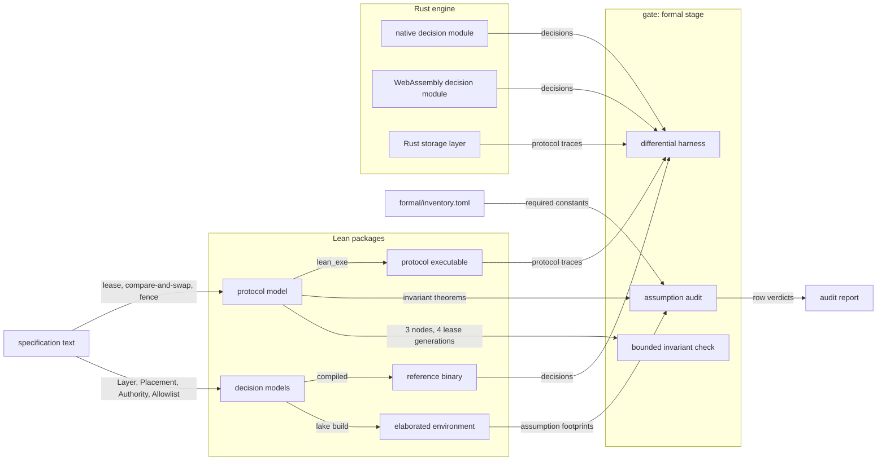

# The formal model

Two Lean 4 packages stand beside the engine: one specifying the policy core, and one holding
an executable state machine of the store's lease, compare-and-swap and fence protocol, its
invariants stated as theorems. The nightly formal stage checks both, and one differential
harness ties each model to the code it describes: the policy model to both builds of the
decision module, the protocol model to the store's two lease paths.

The two models, the checks over them, and where each meets the engine:



## model

The Lean policy package and the Lean protocol state machine, their pins, and the definitions theorems and checks range over.

- `package` — The policy model is a Lean package rooted at `formal/`: `lakefile.toml` declares one `lean_lib` target and no `require` stanza, and `lean-toolchain` names one exact release string.
  *A-assurance#store-protocol-modelled*
- `declared-dependency` — A `require` stanza in the policy package's `lakefile.toml` reaching any external library raises `FormalPackageDependency`, naming the library.
  *A-assurance#model-specifies-profile*
- `toolchain-drift` — A build whose resolved toolchain string differs from the pinned one raises `ProofToolchainDrift`, printing both strings.
  *A-assurance#store-protocol-modelled*
- `build-cost` — A cold elaboration of the package completes within 60 s and writes at most 2048 KiB of artifacts.
  *because the nightly formal stage elaborates it cold on every run*
- `build-command` — `lake build` at the package root elaborates every declaration and writes the environment the audit reads.
- `module-layout` — Five modules carry the package — the layer algebra, placement with the floor, the authority mapping, connector host containment and statement execution — and the library root re-exports all five.
- `layer` — A layer is a total function from a row identifier to `Bool`; `composed` folds a list of layers by conjunction, admitting a row when every member admits it.
- `floor` — An allow-set is a decidable predicate over a placement value; `floor` intersects a list of allow-sets pointwise, and `floor []` admits every caller as the unit of that fold.
- `placement-inductive` — The declared placement is an inductive type carrying its identifier inside the constructor, with one case per category the manifest admits and one case for an absent declaration.
- `unmodelled-constructor` — A category the manifest admits with no case in the placement inductive raises `UnmodelledConstructor` at elaboration, naming the category.
  *A-assurance#model-specifies-profile*
- `total-definitions` — Every definition is total and computable: none is marked `partial`, `noncomputable` or `opaque`, and decidable equality on each finite enumeration is derived.
- `from-the-spec` — Each definition is written from the specification text and derived from no engine source.
  *because a definition copied from code makes every theorem restate the code instead of checking the specification*
- `out-of-model` — The policy package defines no credential bytes, signature verification, SQL semantics, journal write, process state or attacker observation, and no theorem reaches one.
- `protocol-package` — The protocol model is a second Lean 4 package rooted at `formal/protocol/`, beside the policy package, pinned to the same `lean-toolchain` string, with one `lean_lib` target, one `lean_exe` target and no `require` stanza.
  *A-assurance#store-protocol-modelled*
- `protocol-model` — The protocol model is a total, computable step function over two lease paths, the compaction lease guarding a table pointer and the run lease guarding a commit log: grant, raise, renewal, expiry, release, fenced commit, pause, message delay and crash.
  *A-assurance#store-protocol-modelled*
- `protocol-safety` — Five invariants are Lean theorems over every reachable state of both paths: one lease holder per fence, fences only increase, no commit after a successor's acquisition, no lost update, and release keeps the lease object and its fence.
  *A-assurance#store-protocol-modelled*
- `protocol-theorems` — Each protocol invariant theorem is a required constant in the protocol package's inventory, audited by {{assurance.audit-assumptions.check-command}} against the same allowlist.
- `protocol-check` — The gate evaluates every invariant on each state reached by every step sequence over three nodes and four lease generations; a breaking state raises `ProtocolInvariantViolated`, printing the shortest sequence reaching it.
  *P7*
- `protocol-pins` — {{store.lease.stale-fence}} and {{store.lease.pointer-fence}} pin to the protocol model's invariant theorem `no_commit_after_successor_acquire`.
  *because the model's guarded objects are the table pointer and the commit log; the catalog cursor row and a snapshot's sidecars lie outside it*
- `journal-model` — The journal model is a total, computable step function over three callers and two keys; each journal-store and blob-store port call, effect, lapse, crash, sweep and retirement is one step.
  *A-assurance#protocol-package-holds*
- `journal-safety` — Seven journal properties are Lean theorems over every reachable state: recorded values stay, journaled resolutions agree, one record per key, effects under a claim or lapsed lease, takeover from a lapsed holder, no dangling blob, no {{run.journal.missing-blob}}.
- `journal-grace` — `no_dangling_blob` assumes an aged sweep spares a blob between its put and its record; `protocol journal check --no-grace` prints the shortest sequence reaching {{run.journal.missing-blob}}.
- `journal-check` — `protocol journal check` evaluates every journal property on each state three callers reach on one key; a breaking state raises `JournalInvariantViolated`, printing the shortest sequence reaching it.
  *P7*
- `merge-model` — The merge model decides each key from its local entry, remote entry, remote tombstone, held flag and verification flag; one differing commit-log copy refuses the whole merge.
  *A-assurance#protocol-package-holds*
- `merge-theorems` — Six merge properties are Lean theorems over every input: the scoped union, a foreign or unverified tombstone keeping its entry, only live tombstones listed, the commit-log refusal, and one writer's convergence at a fixed `now`.
- `fold-model` — The fold model is a total, computable step function over two passes staging, committing and dying, lease acquisition, collection and two readers; a pass commits only while its fence is the highest granted.
  *A-assurance#protocol-package-holds*
- `fold-theorems` — Six fold properties are Lean theorems: commits conditioned on the version read, lost commits publishing nothing, collection sparing reachable and in-flight directories, supersession without deletion, readers' snapshots present, and lease-ordered fences.

## prove

The theorem inventory: layer composition, placement, the evidence floor, the proof targets over the authority mapping, and the mediation relation over statement execution.

- `composition-sound` — `composed_sound`: a row the fold over a list admits is admitted by every member of that list.
- `narrowing` — `composed_narrows`: a row admitted by `l :: ls` is admitted by `ls`.
  *because appending a layer then removes rows and adds none*
- `order-is-specified` — The composition theorem ranges over the single order {{authority.compose.relation-order}} fixes, and filtering then masking is a different relation from masking then filtering.
- `commutation-claim` — A claim that the enforcement stages commute raises `CommutationClaimed`.
  *A-assurance#assurance-claims-carry*
- `placement-is-a-layer` — `zone_layer_sound`: with the placement check as one more list member, a row the whole list admits was admitted by that check, with no bridging hypothesis.
- `floor-no-downgrade` — `floor_no_downgrade`: a floor admitting a caller forces every member of its evidence list to admit that caller.
- `fail-closed` — An evidence list holding one fail-closed member yields a floor admitting no public-cloud caller, and the fail-closed allow-set rejects both cloud categories.
- `evidence-nonempty` — `floor_no_downgrade`'s negative space names a non-empty evidence list, which {{authority.place.empty-evidence}} holds at the engine.
- `symbolic-inclusion` — Zone inclusion is decided by subsumption over patterns, quantified over every constructor and every identifier, the named provider and the undeclared case included.
- `subsumption-exact` — Per-entry subsumption decides zone inclusion exactly, a bare category subsuming every identifier under it, so no normal form on allow-sets precedes the decision.
- `sampled-inclusion` — Inclusion decided by evaluating a fixed set of example values raises `ZoneInclusionSampled`.
  *A-assurance#assurance-claims-carry*
- `effective-policy` — An effective policy computed from two allow-sets is included in both.
- `proof-targets` — The authority mapping of {{authority.profile.delegation-profile}} carries four proof targets: inclusion; narrowing, where an attenuated child's permission implies its parent's; profile meaning, where permission holds exactly when the audience matches and every block admits; and {{assurance.prove.restriction-preservation}}.
  *because all four are pure decision functions over a verified credential; the mediation relation covers read-path releases, and the rest of scoped-session execution stays unproved*
- `restriction-preservation` — `attenuateAll_permits_every_parent_block`: every block of a credential admits each request that any chain of attenuations of that credential permits, under one trusted environment.
  *A-assurance#mediation-ranges-over*
- `mediation-relation` — `statement_reach_released_rows_pass_session_layers`: the mediation induction ranges over the read path's statement execution, and every row a reachable state has released passed every layer of the session.
  *A-assurance#mediation-ranges-over*
- `target-binding` — A proof target is bound to one authenticated query path, recorded beside it as a module path and a test, before the claim names it.
- `unbound-target` — A target the claim names with no binding raises `ProofTargetUnbound`, naming the target.
  *A-assurance#assurance-claims-carry*
- `negative-space` — Beside each theorem, its negative space states what it leaves open: that the required members were in the list, that a member removes rather than tests, and that execution reaches the fold before an effect.
- `no-negative-space` — A theorem published without its negative space raises `TheoremWithoutNegativeSpace`, naming the constant.
  *A-assurance#assurance-claims-carry*
- `mediation-from-composition` — A filter-composition theorem offered as a mediation theorem raises `MediationClaimedFromComposition`.
  *because mediation quantifies over the reachable states of an execution; composition quantifies over a list*
- `names-carry-reach` — A constant's name states the object it ranges over, not the property a reader hopes for.

## audit-assumptions

The assumption allowlist, the transitive footprint audit over the elaborated environment, the inventory and the report.

- `assumption` — An assumption is a declaration the Lean kernel accepts without proof: the set `#print axioms` reports for a constant, which the audit reads through `collectAxioms`.
- `allowlist` — The assumption allowlist holds 2 entries, `propext` and `Quot.sound`, and every theorem's footprint is a subset of it.
  *because no required constant draws on `Classical.choice`*
- `transitive-audit` — Each required constant's assumption footprint is read transitively off the elaborated environment, naming every assumption reached.
- `verdict-input` — A verdict is a function of the elaborated environment and the inventory alone; source text, declaration counts and the build's exit status decide nothing.
  *because elaboration reports a hole as a warning and exits zero, and a character pattern misses a hole spelled in parentheses*
- `assumption-outside-allowlist` — An assumption in a footprint and absent from the allowlist raises `AssumptionOutsideAllowlist`, printing the constant and the assumption.
  *A-assurance#assurance-claims-carry*
- `hole-assumption` — A footprint containing the hole assumption raises `ProofHoleAssumption`, naming the declaration, whatever its syntax spells.
  *A-assurance#assurance-claims-carry*
- `native-evaluation-assumption` — A footprint containing a per-declaration native-evaluation assumption raises `NativeEvaluationAssumption`, naming the declaration that minted it.
  *A-assurance#assurance-claims-carry*
- `inventory` — `formal/inventory.toml` holds one row per required constant — name, module, expected statement text, admitted assumptions, binding, negative space — edited apart from the declarations satisfying it.
- `missing-constant` — A required constant absent from the elaborated environment raises `TheoremConstantMissing`.
  *A-assurance#assurance-claims-carry*
- `statement-drift` — A required constant whose elaborated statement differs from its expected text raises `TheoremStatementDrift`, printing both.
  *A-assurance#assurance-claims-carry*
- `inventory-change` — A change to a required statement lands in the commit carrying the proof it admits.
- `allowlist-admission` — An assumption joins the allowlist through an `A-assurance` section naming it, and each inventory row admitting it cites that section in a `record` field.
  *A-assurance#assurance-claims-carry*
- `report` — The report names the commit, the resolved toolchain, the allowlist and inventory revision applied, and for each required constant its statement match and the assumptions it reaches.
- `check-command` — `contextful formal check` elaborates the package, matches every inventory row, audits every footprint, writes the report, and exits non-zero naming the first failing constant.

## recheck

Rebuilding and re-auditing from pinned source in a credential-free environment.

- `two-phase` — A recheck rebuilds the package from the commit's own source and pinned toolchain into an empty artifact directory, fetching nothing, and re-runs the audit against the rebuilt environment.
- `credential-free` — A recheck environment exposing a token, a signing key or a registry login raises `RecheckEnvironmentCredentialed`, naming the variable or file carrying it.
  *A-assurance#assurance-claims-carry*
- `report-mismatch` — A recheck whose per-constant statement text or assumption set differs from the first phase's raises `RecheckReportMismatch`, naming the constant.
  *because `.olean` output is not byte-reproducible across hosts and paths, while the per-constant report is the fact under check*
- `wall-time` — A recheck completes within 600 s.

## scope-claim

The sentence the assurance claim is allowed to be: named decisions, named specifications and trusted dependencies.

- `claim-sentence` — The assurance claim reads: these named decisions satisfy these named Lean specifications under these stated runtime assumptions; each list resolves to code paths, constants and components in the tree.
- `beyond-named-decisions` — A claim that the enforcement engine, or any object wider than the named decisions, is verified raises `ClaimBeyondNamedDecisions`.
  *A-assurance#assurance-claims-carry*
- `trusted-dependencies` — The claim names the delegation library, its cryptography and its parser as trusted dependencies, and proves none of them.
- `unnamed-dependency` — A claim resting on a component absent from its trusted-dependency list raises `TrustedDependencyUnnamed`, naming the component.
  *A-assurance#assurance-claims-carry*

unsettled: Which translator, external models and refinement scope does a claim name once a theorem reaches the Rust decision functions through translated code? owner: build affects: assurance.scope-claim

## differential-test

The executable reference models, the case generators, the minimized counterexample corpus and the command running them.

- `reference-model` — The reference model is the policy package's proved decision definitions, compiled with JSON case decoding and decision rendering into a binary that reads one case on standard input and prints one decision.
  *A-assurance#executed-reference-proved*
- `reference-theorems` — Each theorem the reference package proves over a decision it executes is a required constant in its inventory, audited by {{assurance.audit-assumptions.check-command}} and bound to the differential test running that decision.
  *because a theorem pin performs only beside a differential that drives the code its clause names*
- `reference-vocabulary` — Before any case, the harness reads the reference binary's operation listing; an operation one of the reference and the harness lists and the other lacks raises `ReferenceVocabularyDrift`, printing both lists.
  *because the reference's case decoder and the harness spell the operations twice, and an operation one side lacks is never compared*
- `harness` — The harness drives the reference binary and the decision module's native and WebAssembly builds over each generated case and compares their decisions field by field.
  *A-assurance#decision-module-compiles*
- `builds` — The native build decides in process and the `wasm32-unknown-unknown` build under the decision-module host; absent `--wasm`, the command compiles the module from the working tree, and the report names the builds compared.
  *A-assurance#decision-module-compiles*
- `decision-cases` — A case names one decision: table-pattern coverage, grant narrowing, zone admission against an allow-set, session-zone resolution, or credential admission; a placement decision also carries the zone it resolved.
- `credential-cases` — A `verify` case admits one credential against pinned keys as a network checkpoint does; both builds decide it and are compared, the reference model decides none, and the report counts each credential verdict.
  *because the reference model carries no signature scheme, and a gateway admits the credential before it places the request*
- `case-classes` — Each run generates malformed inputs, boundary values and well-formed requests, and its report names the classes it drew from.
  *because a green run is evidence over the generated classes, not an equivalence proof*
- `malformed-bytes` — The malformed class draws case texts carrying invalid UTF-8 or an integer literal outside the unsigned 64-bit range, handed as bytes to every decider, and each decides such a text malformed.
  *because a 32-bit WebAssembly build and a 64-bit native build part ways first at byte decoding and integer width*
- `minimized` — A disagreement is shrunk until no single field removal, string shortening or byte removal keeps any two of the three decisions apart, and the minimized case is recorded.
- `corpus-replay` — Every counterexample-corpus case replays before any freshly generated case.
- `corpus-entries` — The counterexample corpus retains at most 256 entries, evicting the oldest case a fresh seed reproduces.
- `run-budget` — One invocation, corpus replay included, completes within 300 s.
- `disagreement` — A case on which any two of the three decisions differ raises `ReferenceModelDrift`, printing the minimized case and every decision.
  *A-assurance#decision-module-compiles*
- `discarded-counterexample` — A run reporting a disagreement and writing no corpus entry raises `CounterexampleDiscarded`.
  *A-assurance#differentially-tested-reference*
- `seed` — Each run records its generator seed, and re-running with that seed reproduces the same case sequence.
- `protocol-cases` — Protocol cases are operation sequences and node interleavings a `proptest-state-machine` generator draws over grant, raise, renew, expire, release, send, deliver, pause, resume and crash steps across three nodes, each replayed on both lease paths.
- `protocol-harness` — The harness drives the protocol executable and the store's own lease calls, `Syncer` over a scripted bucket and the local catalog with the commit log, through each case, comparing lease, fence, head, write count and node views after every step.
  *A-assurance#store-protocol-modelled*
- `protocol-drift` — A step after which the model's state and the store's projected state differ raises `ProtocolConformanceDrift`, printing the minimized operation sequence and both states.
  *A-assurance#store-protocol-modelled*
- `protocol-vocabulary` — Before any case, the harness reads the protocol executable's step listing; a step kind one of the model and the harness lists and the other lacks raises `ProtocolVocabularyDrift`, printing both lists.
  *because the step type and the harness enum spell the vocabulary twice, and a step one side lacks is never compared*
- `journal-harness` — The journal harness runs each caller's `Journal::step` on a thread over gated memory, file and SQLite adapters, one port call per step, comparing rows, blobs and caller phases with the model.
  *A-assurance#protocol-package-holds*
- `journal-drift` — A step after which the journal model and an adapter differ raises `JournalConformanceDrift`, printing the adapter, the minimized sequence and both states.
  *A-assurance#protocol-package-holds*
- `journal-command` — `contextful formal journal-differential` replays `formal/protocol/journal-regressions.jsonl` in each entry's grace mode, then generated cases; `--no-grace` replays and saves the model's sequence to {{run.journal.missing-blob}}.
- `merge-harness` — `contextful formal merge-differential` compares the merge model with `merge_verified` key by key on each generated case: entry, tombstone and refusal, or {{store.merge.cursor-recency}}.
- `merge-drift` — A case on which the merge model and `merge_verified` differ raises `MergeConformanceDrift`, printing the minimized case and both merges.
  *A-assurance#protocol-package-holds*
- `fold-harness` — The fold differential replays seeded step sequences through `prepare_under`, `commit` and `collect` over a file-backed store, comparing pointer, chain, directories and readers with `protocol fold run` after every step.
  *A-assurance#protocol-package-holds*
- `command` — `contextful formal differential --seed <n> --cases <n>` replays the corpus, then runs the generated cases, exiting non-zero on the first disagreement.

## Shapes

One inventory row:

```toml
[constant.composed_sound]
module    = "Contextful.Layer"
statement = "∀ {ls : List Layer} {r : RowId}, composed ls r = true → ∀ l ∈ ls, l r = true"
assumptions    = ["propext", "Quot.sound"]
binding   = "engine/policy/src/relation.rs::compose_layers"
negative  = """
Leaves open: that the required members were present in the list; that a member
performs removal rather than a test; that an execution reaches the fold ahead of
an effect.
"""
```
