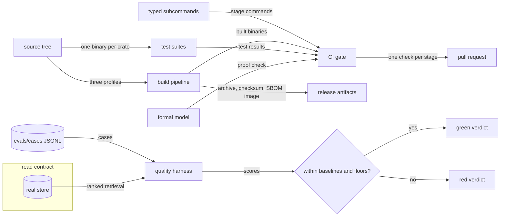
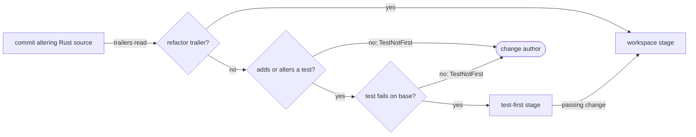
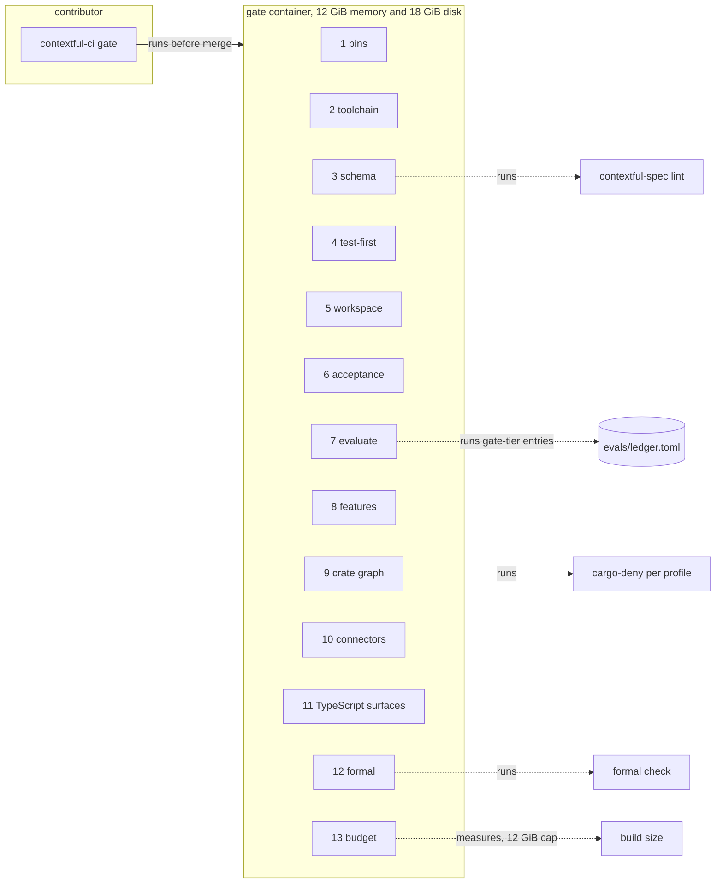
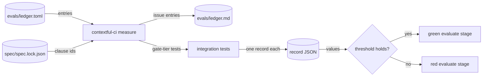

# Engineering gates and the quality harness

How the tree is written, built and checked: one home per capability, typed automation, test
placement, build targets and artifacts, the gate's stages and ceilings, and the harness that
turns read-path quality into a red or green verdict.

The tree, the checks over it, and the two verdicts they produce:



## structure-tree

One home per capability, the one enforcement decision module, adapters, mirror annotations and derived-artifact checks.

- `one-home` — Enforcement, control-plane state, credential resolution, statement guarding and visibility each resolve to one implementation in the engine; a surface reaches one through the engine route or the registered view compiling it in.
  *P5*
- `duplicated-capability` — A surface or crate carrying a second implementation of an engine capability, in any language, or a hand-written copy of an engine constant, raises `CapabilityDuplicated`, naming both sites.
  *P5*
- `capability-registry` — `spec/capabilities.toml` names each capability of {{assurance.structure-tree.one-home}} with one home path and one or more defining symbols; an absent registry, a missing or doubled capability, an absent home or an undefined symbol raises `CapabilityHomeUnresolved`.
  *A-assurance*
- `cross-language` — The crate-graph stage matches Rust, TypeScript, JavaScript and Python functions, types and constants outside a home by name folded to lowercase without separators, against its symbols and its literal constants' names and values.
  *A-assurance*
- `decision-module` — One module owns the enforcement decision; a gateway and the engine reaching the same verdict execute it, compiled native and to WebAssembly from one pinned source.
  *P5, A-assurance*
- `adapter` — A surface with no engine process on its request path implements an adapter against the engine's ports.
  *P5*
- `derivation-check` — A generated artifact declares the check that fails once its source moves, and the gate's schema stage runs that check.
  *P5, A-assurance*
- `mirror-exemption` — A review-time restatement of a build-time rule is admitted where its site carries a `mirrors: <clause id>` comment naming the clause it restates; an unannotated restatement stays {{assurance.structure-tree.duplicated-capability}}.
  *because a reviewer-facing check sometimes restates a rule, and the annotation keeps the engine its one home and the copy traceable to it*
- `mirror-unresolved` — A `mirrors:` comment in a tracked file under `crates/`, `tools/` or `apps/` naming no clause of `spec/spec.lock.json` raises `MirrorUnresolved` in the schema stage, naming the file and line.
  *because an annotation naming nothing exempts a copy while tying it to no rule it could drift from*

## automate

Typed subcommands over compiled binaries, and the boundary shell keeps.

- `typed-subcommand` — An automation step carrying a branch, a loop or a retry, or running past 5 lines, is a typed subcommand shelling out to compiled binaries.
  *P7*
- `subcommand-surface` — A subcommand exposes typed options, generated help and an entry point a test calls directly.
- `one-path` — The gate invokes the subcommand a contributor invokes.
  *because a local reproduction and a gate run then execute one code path*
- `unchecked-shell` — A shell file in the tree that `shellcheck` rejects raises `ShellCheckFailed` in the toolchain stage.
  *P7*
- `test-shellcheck` — A gate stage starting a test process over a tree tracking a shell file puts the `shellcheck` {{assurance.automate.unchecked-shell}} runs first on that process's `PATH`.
  *because a suite asserting a script passes `shellcheck` otherwise depends on whether the sandbox image ships the linter*
- `build-time-toolchain` — The automation toolchain links into no build profile and enters no release artifact.

## test

Assertion construction, guard validation, suite placement, test-first and acceptance tests, and the connector test kit.

- `presence-before-absence` — A test whose central claim is an absence first constructs the condition it names and verifies that condition obtains.
  *P7*
- `vacuous-exclusion` — An exclusion assertion — `all`, or a negated `any` — in a tracked test file under `crates/` or `tools/`, over a collection no earlier statement of its function shows non-empty, raises `VacuousAssertion` in the test-first stage.
  *P7*
- `guard-fires-both-ways` — A guard is validated against the fixture that motivated it and against the state it stands against, passing on the first and failing on the second.
- `one-integration-binary` — A crate's integration tests compile in one target, `tests/integration/main.rs`, which declares each suite as a module selected by path.
  *because each file directly under `tests/` links its own static binary, hundreds of MiB for an engine-linked crate*
- `feature-gated-suite` — A feature-gated suite carries a module-level `cfg` attribute at the head of its module file and compiles to nothing while its feature is off.
- `global-state-lock` — A suite contending process-global state acquires a named lock the integration binary's root module owns; every suite touching that state takes the same lock.
  *because a lock declared inside one suite leaves another suite free to race the same state*
- `own-process` — A test needing its own process sits in a top-level file stating why at its site; a thread-scoped log capture is such a test.
- `connector-kit` — The connector authoring toolkit ships a conformance suite — discovery returns valid schemas, an opened table yields a finite stream, a position round-trips — plus recorded-HTTP fixture replay and property tests over position monotonicity.
- `test-first` — A change altering Rust source under `crates/` or `tools/` adds or alters a test under a package's `tests/` that fails against the base commit's source; a change without one raises `TestNotFirst`.
  *A-assurance*
- `test-first-scope` — The test-first stage builds each changed test file's target against the base source with every feature enabled, then runs exactly the tests under that file's top-level module; a target failing to compile there counts as failing.
- `comparison-base` — Test-first resolves the supplied comparison revision to one commit and uses that commit for source selection, changed-test selection and base replay; each report records that commit and the tested head.
  *A-assurance*
- `merge-source` — Test-first includes source introduced by merge resolutions; refactor exemptions apply only to source attributable to exempt commits and preserve obligations from behavior changes elsewhere in the comparison.
  *A-assurance*
- `base-evidence` — Test-first reports assertion failures, compilation failures and bounded test executions separately; infrastructure faults follow {{assurance.test.base-unrunnable}} and supply no failing-test evidence.
  *A-assurance*
- `base-run-bound` — One test-first execution against the base, its build excluded, runs for at most 300 s; a run past the bound is killed with its process group and counts as failing.
- `base-unrunnable` — A base invocation whose output reports a full disk, an unloadable manifest or an unfetchable dependency raises `TestFirstBaseUnrunnable` instead of a verdict.
  *because such a fault fails at base whatever the tests assert, and reading it as red admits an untested change*
- `refactor-trailer` — A commit carrying the trailer `Test-First: refactor` exempts the source it alters from {{assurance.test.test-first}}; the rest of the range stays held, and the workspace stage alone holds that commit.
  *because a behavior-preserving change has no failing test to write, and the existing suite is its specification*
- `acceptance-surface` — An acceptance test drives a built binary through its command line, MCP or HTTP surface; a workspace package among the acceptance package's dependencies raises `AcceptanceLinksEngine`.
  *A-assurance*

#### Scenarios

- `assurance.test.comparison-base`: WHEN linear or divergent history supplies a comparison revision, THEN source selection, changed-test selection and replay use the same resolved commit.
- `assurance.test.merge-source`: WHEN a merge resolution introduces source behavior without a changed test, THEN the change fails {{assurance.test.test-first}}.
- `assurance.test.merge-source`: WHEN a comparison combines refactor and behavior commits, THEN the behavior changes retain their failing-test obligation.
- `assurance.test.base-evidence`: WHEN a base assertion fails, THEN its diagnostic identifies test failure independently of infrastructure output.
- `assurance.test.base-evidence`: WHEN base execution fails through infrastructure, THEN the failure supplies no failing-test evidence.

The test-first check over one commit in a change's range:



## build

Target directories, the engine-linked invocation, linked query functions, build targets, release artifacts and the dependency allowlist.

- `target-dir-per-stage` — Each cargo stage builds into a target directory of its own, reclaimed once the stage passes.
  *because stages under different feature unification share no artifacts, and peak disk is then one stage*
- `checkout-artifacts` — `.cargo/config.toml` names the checkout root, and every workspace package's build script folds its canonical path into the package fingerprint, so a shared target directory recompiles workspace packages per checkout while unchanged dependencies stay fresh.
  *A-assurance*
- `runtime-checkout` — Reusable test helpers resolve the workspace root and tested binary from explicit runtime inputs bound to the invocation; cached helpers carry no compile-time checkout path deciding which source or binary runs.
  *A-assurance*
- `one-engine-build` — The workspace stage builds every engine-linked package in one cargo invocation over the union of their features, and the store adapter's suites resolved without `read` link no SQL engine, so the features stage compiles one copy.
  *A-assurance*
- `staged-feature-runs` — A defect appearing under one feature combination alone is reached by a staged nightly run, one command per container.
- `linked-query-functions` — Columnar file reading and statement serialization link into every build linking the SQL engine, and the read path loads no extension while serving.
  *A-assurance*
- `runtime-extension-load` — A read path loading an extension into a binary that statically links the SQL engine raises `ExtensionAutoloadRefused`.
  *A-assurance*
- `debug-info` — Development and test profiles carry line-tables-only debug information for workspace code and none for dependencies.
  *because every engine-linked test binary embeds the bundled engine, and full debug information multiplies each past a sandbox's disk*
- `release-profile` — Release builds compile with thin link-time optimization, one codegen unit per crate and symbols stripped, and unwind on panic.
  *because the run keeper survives a panicking job only by unwinding to its guard*
- `profile-build` — The features stage tests each package under every feature set its manifest lists in `feature-runs`: each other package has its own nightly check; each binary feature run has separate nightly checks for differential tests and all remaining tests.
  *because one cold build of the binary under one feature set fills most of a stage's wall clock, and a listed set reaches what none and all miss*
- `container-image` — The repository's `Dockerfile` builds one profile, `contextful-full` by default, as a static binary for the `PLATFORM` and `RUST_TARGET` its arguments name, and ships it in a shell-free runtime image as a non-root user over a declared store volume.
- `release-image` — Each profile's release image is an OCI index of a `linux/amd64` and a `linux/arm64` manifest; `contextful-ci image` assembles each from the profile's `x86_64` or `aarch64` musl release binary, with the `Dockerfile`'s runtime user, volume and entrypoint.
  *because arm64 hosts pull the same tag natively, and each release cell already holds its target's binary, so no image compiles twice*
- `image-binary-mismatch` — A binary whose ELF machine differs from its target's, or whose program headers name a dynamic interpreter, raises `ImageBinaryMismatch`, naming the target.
  *because a mislabelled layer runs only under emulation, and a dynamic binary finds no C library in the static runtime*
- `targets` — All three profiles cross-compile to `x86_64-unknown-linux-musl` and `aarch64-unknown-linux-musl`; edge and full also build for `aarch64-apple-darwin` and `x86_64-apple-darwin`.
  *A-assurance*
- `windows-target` — Windows targets are excluded from the release matrix; no profile publishes Windows artifacts.
  *A-assurance*
- `wasi-probe` — No profile ships a `wasm32-wasip2` release; a scheduled-tier ledger entry builds the edge profile for it and holds the compressed artifact to {{assurance.gate.edge-budget}}.
  *A-assurance*
- `release-artifact` — Each profile ships a release archive with a SHA-256 checksum and an SBOM, a package-manager formula and an independently tagged container image; the bare formula name and the install script resolve to the full profile.
- `release-builder` — The release command uses `cargo build` by default and `cargo zigbuild` under `--builder zigbuild`, forwarding the selected target and profile features.
  *because Cloudflare Linux builds Darwin targets through Zig while the local release command keeps its native build path*
- `release-metadata` — Each release cell writes a JSON record naming its profile, target, archive, SHA-256 digest and SBOM.
  *because distributed release cells need a small authenticated input for formula generation*
- `formula-manifest` — The formula command accepts a manifest covering every release matrix cell once, with matching asset names and SHA-256 digests, and writes formulas and SHA256SUMS without local archives.
  *because one aggregation sandbox need not download every archive to produce formulas*
- `licence-field` — Every workspace package under `crates/` or `tools/` declares `license = "Apache-2.0"`, inherited from `[workspace.package]`; a package declaring another value or none raises `PackageLicenceMissing`, naming its manifest.
  *because cargo-deny, cargo-about and SBOM generators read the manifest field, not the `LICENSE` file, so an unlicensed package fails a consumer's licence check*
- `dependency-allowlist` — The connector authoring dependency allowlist carries `regex` and `serde_json` at its depth limit; a profile graph reaching `fancy-regex`, `pcre2`, `onig` or `serde_json`'s `unbounded_depth` feature raises `DependencyAllowlistViolation`, naming the profile and path.
  *because a backtracking matcher or a parser without a depth limit lets one hostile record pin a core or exhaust the stack*

#### Scenarios

- `assurance.build.release-builder`: WHEN a Darwin cell selects `--builder zigbuild`, THEN the release command invokes `cargo zigbuild` for that profile and target.
- `assurance.build.release-metadata`: WHEN a release cell packages an archive, THEN its JSON metadata names the archive, digest and SBOM.
- `assurance.build.formula-manifest`: WHEN every cell's metadata is present without local archives, THEN formula generation writes the profile formulae and SHA256SUMS.
- `assurance.build.checkout-artifacts`: WHEN checkout A and checkout B build different source into one target directory, THEN B's integration tests, doctests and binary execute B's behavior on cold and warm builds, and their shared dependency stays fresh.
- `assurance.build.runtime-checkout`: WHEN a helper cached from checkout A receives checkout B's runtime inputs, THEN its workspace operations and binary execution reach B alone.

## gate

Stage order, secrets of record, the crate-graph, row-token, egress and dependency rules, the formal stage, the container's ceilings, disk, footprint budgets and surface checks.

- `stage-sequence` — The gate runs its stages in order — pins, toolchain, schema, test-first, workspace, acceptance, evaluate, features, crate graph, connectors, TypeScript surfaces, formal, budget — all of both tiers when none is named, else the named subset, which `--plan` prints unrun.
- `nightly-tier` — `contextful-ci stages --parts --tier nightly` prints the features, formal and budget parts in run order; `stages --parts` prints the remaining parts, those a change runs before merge, and `gate --stage` runs a part of either tier.
  *A-assurance*
- `stage-subset` — A selected subset runs in the sequence's order; a stage reading an unselected predecessor's output, with that output absent, raises `StagePredecessorMissing`, naming both stages, before any stage runs.
  *A-assurance*
- `affected-parts` — `contextful-ci stages --parts --base <rev> --affected` lists, in run order, the parts of the selected tier the diff from the merge base of `<rev>` and HEAD reaches, the required tier always including `preflight`.
  *A-assurance*
- `affected-every` — A change to `Cargo.toml`, `Cargo.lock`, a toolchain file, anything under `crates/`, `tools/` or `.github/`, or any path no other affected clause maps reaches every part of either tier.
  *A-assurance*
- `affected-spec` — A change under `spec/` or `references/` reaches test-first validation, one under `spec/` the foundation workspace part, and each clause whose statement or `spec/pins.toml` entry changed the parts running its pinned test or theorem.
  *A-assurance*
- `affected-spec-inputs` — A change to `spec/01-topology.md` or `spec/capabilities.toml` reaches crate-graph, to `spec/adr/A-assurance.md` the formal stage, and to `spec/terms/assurance.toml` every budget part.
  *because those stages read the file directly, apart from any clause pin*
- `affected-removed` — A clause the merge base's lock holds and HEAD's lacks reaches the evaluate stage.
  *because the evaluate stage refuses a ledger entry naming a clause the lock lacks*
- `affected-unplaced` — An unreadable spec lock or pins file, or a changed clause pinned outside every workspace package, reaches every required part.
  *because a pin the listing cannot place runs on a part the listing cannot name*
- `affected-surfaces` — A change under `apps/` or `packages/` reaches the TypeScript surfaces, acceptance and crate-graph parts.
  *A-assurance*
- `affected-formal` — A change under `formal/` other than a `lean-toolchain` file reaches the formal and evaluate stages, the foundation, CLI and CLI differential workspace parts, and every feature part.
  *A-assurance*
- `windows-checks` — Windows native checks run only as optional diagnostics and contribute no required merge or release verdict.
  *A-assurance*
- `test-first-parts` — The test-first parts require a changed test in each changed source package under {{assurance.test.test-first}}; each changed source package's part checks only its own changed tests against the base.
  *because one base build per package fits the sandbox's wall clock more reliably*
- `workspace-parts` — The workspace parts compile the feature-unified workspace untested, run differential CLI tests apart and remaining CLI tests in eight shards under {{assurance.gate.cli-shard-map}}, and each other non-acceptance package suite in one of four groups.
  *A-assurance*
- `cli-shard-map` — `tools/ci/cli-shards.toml` assigns each remaining CLI test, a nested-build group whole, one shard by recorded duration within 9 min per shard; an unmapped test, reported as drift, joins its group or the least-loaded shard, which adds unit tests and doctests.
  *A-assurance*
- `folded-parts` — `stages --parts` folds pins, toolchain, schema and test-first validation into `preflight`; each package group's workspace and evaluate parts into `suite.<group>`, probes into `suite.ci`; crate graph, connectors and surfaces into `perimeter`; members stay runnable alone.
  *because every part pays its own sandbox setup and compile, and a fold pays it once for every member*
- `compile-only` — `gate --stage <part> --compile-only` runs each `cargo test` invocation the part runs, in its own target directory with `--no-run` and without its `--` arguments, and nothing else; a CLI shard compiles every shard's invocations.
  *because a compile cache serves a part only when the warming build's cargo arguments, environment and target directory match the part's*
- `compile-groups` — `stages --parts --compile-groups` lists, in run order, the first part of each distinct compile signature — its ordered `--compile-only` invocations and target directory — across both tiers unless `--tier` names one.
  *because the eight CLI shards share one signature, and warming each compiles it eight times*
- `fold-verdicts` — A fold runs each member after an earlier member fails, skips a member reading a failed member's output, and fails when any member fails.
  *because one fold check replaces a check per member, and one run reports every member's verdict*
- `stage-reports` — Each stage prints the environment it leaves and its memory limit, peak and event counts, and a failing stage prints its diagnostics before propagating its exit code.
  *because memory exhaustion is silent, and a kill then reads as a number in the log*
- `stage-timings` — Each part records queue, setup, compilation and test durations separately, alongside its commit, feature set, runner identity and cold or warm cache state.
  *A-assurance*
- `part-budget` — Every part completes within {{assurance.gate.container}} on cold and warm builds; oversized work splits into locally runnable parts retaining every required suite and predecessor obligation.
  *A-assurance*
- `build-admission` — The runner admits concurrent builds only within available build slots and {{assurance.gate.parallel-jobs}}; excess builds queue before setup and compilation.
  *A-assurance*
- `timeout-cleanup` — A timed-out part retains phase timings and stdout/stderr diagnostics, terminates its owned process tree, verifies descendant exit and reports a failed verdict before releasing its build slot.
  *A-assurance*
- `pins-stage` — The pins stage resolves every pinned artifact identity a run depends on before any compilation.
- `evaluate-stage` — The evaluate stage runs every gate-tier ledger entry and the native case set in the deterministic tier, one part per package group plus a probe part, each reporting the floor and baseline verdicts over its entries.
- `schema-stage` — The schema stage regenerates each derived artifact into a scratch location, compares it byte for byte against the committed copy, and runs `contextful-spec lint`.
- `secret-ciphertext` — In the schema stage, a key other than `DOTENV_PUBLIC_KEY*` in a git-tracked `.env*` file other than `.env.example` holding a value without the `encrypted:` prefix, or a tracked `.env.keys`, raises `SecretPlaintext`, naming file and key.
  *because a tracked file reaches every clone, and only dotenvx ciphertext is safe there while its private key stays untracked*
- `secret-scope` — In the schema stage, a key other than `DOTENV_PUBLIC_KEY*` in a git-tracked `.env*` file whose block — the assignments above it, up to the first blank line — opens with no comment carrying text raises `SecretScopeMissing`, naming file and key.
  *because a provider token cannot report its own grants, so the comment above it is the one record of what it reaches*
- `crate-graph` — The crate-graph stage holds run-path crates to reaching read-path crates through the three crossing crates alone; another edge raises `CrateGraphViolation`, naming both crates.
  *P5*
- `locked-resolve` — The crate-graph stage resolves every graph `--locked` against the committed `Cargo.lock`, so a lock behind its manifests, or one rewritten before the stage starts, fails the stage before any rule runs; the stage never rewrites it.
  *because a rule held over a graph the lock file does not record passes a build that resolves another*
- `row-token` — Every row-returning function of the store crate takes the enforcement token type, whose constructor is private to the enforcement module; a row path outside a registered relation raises `EnforceUnmediatedPath`, naming the function.
  *P5*
- `dependency-deny` — The crate-graph stage runs pinned cargo-deny `check bans` over each profile's resolved graph, denying every crate a profile-wide dependency refusal names; a hit raises that refusal's error, naming the profile and the path.
  *A-assurance*
- `deny-profile-graph` — A profile's graph is the binary resolved with default features off and the profile's feature on, across every target, excluding development dependencies; the stage prints each profile the binary declares no feature for.
  *A-assurance*
- `deny-list` — `deny.toml` holds one `[bans]` entry per crate or feature a profile-wide dependency refusal names, its reason that refusal's clause id; an entry missing or extra raises `DenyListDrift`, naming it.
  *because a refusal whose crate the list omits passes every profile graph linking it*
- `unconfigured-egress` — An outbound call reachable under the default configuration — usage ping, license check, update probe — raises `UnconfiguredEgress` in the crate-graph stage, naming the call site.
  *because some deployments run with no external reach, and a call nobody configured moves data outside every grant, zone and audit record*
- `interpolated-claim` — A source lint over the runtime crates finding a subject claim formatted into SQL text raises `EnforceInterpolatedSubjectClaim`, naming the file and line.
  *P1*
- `formal-stage` — The nightly formal stage runs {{assurance.audit-assumptions.check-command}}, {{assurance.differential-test.command}}, {{assurance.model.protocol-check}} and the protocol differential over 10000 generated cases on both lease paths; a non-zero exit from any reds the run.
  *P7*
- `container` — The gate container carries four ceilings — processor count, 12 GiB of memory, 18 GiB of usable disk, and a 45 min per-stage wall clock — and a run dies on any one.
  *A-assurance*
- `parallel-jobs` — Parallel build jobs number the memory ceiling divided by 3 GiB.
- `free-disk` — A stage starting with less than 2 GiB of free disk raises `BuildDiskPrecondition` and exits 28 before doing work.
  *P7*
- `build-size` — The nightly budget stage holds total build size to 12 GiB, printing that size, the free space and the largest artifacts; a larger build raises `BuildSizeCeilingExceeded`, naming the head of that list.
  *P7*
- `edge-budget` — The edge profile holds to 50 MiB compressed and 60 MiB idle resident set.
- `full-budget` — The full profile holds to 150 MiB compressed and 180 MiB idle resident set.
- `control-budget` — The control profile holds to 60 MiB compressed and 80 MiB idle resident set.
- `footprint` — Per nightly run and per profile, the footprint step builds the static-linked Linux target, compresses it, and holds its size to the profile's budget and its dynamic dependencies to the platform C library.
  *P7*
- `budget-stage` — The budget stage runs {{assurance.gate.footprint}} over every profile, in one nightly-tier part per profile, and the evaluate stage builds no profile.
  *because one link-time-optimized release build of the full profile fills most of one stage's wall clock*
- `footprint-exceeded` — An artifact over its profile's budget, or carrying a dynamic dependency beyond the platform C library, raises `FootprintBudgetExceeded`, naming the profile.
  *P7*
- `typescript-surfaces` — The TypeScript surfaces run each declared typecheck, test and build script in one stage; an absent script skips only that script.
- `native-test-files` — The surfaces stage runs every regular native `.test.ts` file under a direct TypeScript surface's `test/` or `tests/` tree through Node's TypeScript strip runner, and refuses absent passing tests or pinned names.
  *because a package script can omit a pinned test while reporting success*
- `surface-check-failed` — A surface whose typecheck, unit tests or framework build fails raises `SurfaceCheckFailed`, naming the surface and the script.
  *P7*

#### Scenarios

- `assurance.gate.stage-timings`: WHEN a part queues and then executes, THEN its report distinguishes queue, setup, compilation and test durations.
- `assurance.gate.part-budget`: WHEN every part runs with empty caches and then warm caches, THEN each completes within {{assurance.gate.container}} and the union preserves required coverage.
- `assurance.gate.build-admission`: WHEN occupied build slots reach the admission limit, THEN another build queues without starting setup or compilation.
- `assurance.gate.timeout-cleanup`: WHEN a forced hang leaves a descendant holding output pipes, THEN timeout diagnostics survive, the descendant exits and the part fails before its slot is released.

The stages, numbered in run order, under the container's ceilings:



unsettled: Which workload, cadence and drift bound does the idle-resident soak run under, given that a multi-day soak fits no per-change gate? owner: build affects: assurance.gate

unsettled: Which cache hit rate holds `test-first` and `workspace` under the per-stage wall clock once the `Cargo.lock`-keyed build cache serves the gate container (issue 31)? owner: build affects: assurance.gate

## evaluate

The read-path quality harness: case format, deterministic metrics and floors, judged dimensions, the reader and the judge.

- `real-read-path` — An evaluation run ingests, indexes, retrieves, reads, judges and scores through the surfaces a caller uses, and the harness adds no storage or runtime primitive.
- `through-the-store` — The corpus loads through the real store, and the retriever under test calls {{read.retrieve.ranked-call}} with the options a caller passes.
  *because an unordered full-scan retriever cannot go red when ranking breaks*
- `policy-labels` — An evaluation corpus carries zone and row-policy labels in its table declarations, and a run reads it through the access-control path under one admitted credential.
  *A-assurance*
- `unlabeled-corpus` — A run over a corpus whose tables declare no zone or row policy, with no `local:` zone passed as `--zone`, raises `EvalCorpusUnlabeled` before any row lands.
  *A-assurance*
- `case-format` — A case carries an id, a corpus path relative to its case file, a question, tags, and an expected block of answer, artifacts, edges, entities, must-cite, must-abstain, must-not-retrieve, time anchor and recency bound.
- `row-reference` — A case names a row as `<table>#<key>`, the key joining the row's declared primary-key values with commas, and the runner keys each returned row the same way.
- `regression-case` — A case tagged `regression` is a regression case, and its must-not-retrieve set scores {{assurance.evaluate.forbidden-row-rate}}.
- `corpus-layout` — A corpus is a directory holding `contextful.toml`, its table declarations and policy labels, and one `rows/<table>.jsonl` per table.
- `run-command` — `contextful eval run --goldens <file>` loads the case file, lands and folds each referenced corpus into a scratch store at `--landed-at`, the Unix epoch by default, reads every case, and writes the run report.
  *because an undated row landed at the epoch predates every question's window, so a replay scores alike on any day*
- `entity-command` — `contextful eval entity-evidence --manifest <file>` loads versioned synthetic or licensed adjudicated fixtures through {{assurance.evaluate.through-the-store}}, resolving mentions through knowledge cards, following requested predicates through keyed recall, and comparing ordinary ranked evidence retrieval.
- `entity-eligibility` — Both entity-evidence arms receive identical evidence admitted by keyed recall under the case anchor and one reader credential; fixed adjudicated tuples grant no answer credit to later, expired, superseded, inaccessible or unresolved evidence.
- `entity-metrics` — Entity-evidence reports canonical entity accuracy, eligible-claim recall, ordered relationship-path correctness, citation resolution and appropriate abstention independently under deterministic labels; model judgments occupy separate labels.
- `entity-baseline` — Entity-evidence baselines bind fixture version, manifest digest, corpus digest and run configuration, extending {{assurance.baseline.metric-path}} with `entity_evidence.<arm>.<metric>`; versioned ledger entries collect {{assurance.measure.record}} records.
- `legs` — Each case calls {{read.retrieve.ranked-call}} three times at limit k: the lexical leg with the question alone, the vector leg with an embedding and an empty query, the hybrid leg with both.
- `stub-embedder` — The deterministic tier embeds every row and question with a seeded feature-hashing stub embedder; a corpus row or a case carrying its own embedding keeps it.
- `semantic-cache` — `--semantic-manifest` hashes corpus, held-out labels, development queries, configuration, and the model's license, embedding configuration and artifacts at an immutable revision; a changed, unhashed or symbolically linked input or a second table raises `EvalSemanticCacheUnverified` before {{assurance.evaluate.through-the-store}}.
  *because model quality needs real vectors whose provenance and inputs survive offline replay*
- `semantic-inputs` — A missing, non-finite, zero-norm or mismatched vector, a relocated held-out file, an overlapping development query or a configuration difference raises `EvalSemanticInputRejected` before retrieval; every leg consumes the same verified cases and corpus.
  *because a cache fallback or corpus substitution changes the experiment while preserving its name*
- `semantic-report` — Semantic reports carry {{assurance.evaluate.deterministic-tier}} with sample counts and case-bootstrap uncertainty; a comparable baseline reports overall and per-slice regressions under the pinned tolerance.
- `semantic-separate` — Semantic quality reports use their own tier and input identity, exclude answer judging and deterministic mechanics verdicts, and compare baselines only for matching corpus, labels, model and configuration identities.
- `run-verdict` — A run holds its report to the floors and, given `--baseline`, to that file; either red verdict exits non-zero, and `--update-baseline` applies {{assurance.baseline.raise-only}} on green alone.
- `converter` — Each benchmark and application ground truth converts once into the case format through its own converter, and the runner reads nothing else.
- `deterministic-tier` — Recall@k, R-precision, hit-rate@k, reciprocal rank and nDCG@k run with no model call, reported per leg — lexical, vector, hybrid — and per slice.
- `distinct-top-k` — Membership in the top k is distinct, and a repeated id counts once.
- `absent-truth` — A ranked metric over a case with no relevant set is NaN and drops out of every aggregate; an empty ranking against a non-empty relevant set scores zero.
- `precision-floor` — Precision at rank min(k, R), R being the relevant-set size, holds at or above 60 percent.
  *because precision@k caps at R/k, below the floor whenever R is small*
- `forbidden-row-rate` — A row named in a must-not-retrieve set holds at 0 percent of a regression case's returned rows.
- `duplicate-row-rate` — A repeated table-and-row-key pair holds at 0 percent of the ranking.
- `in-window-rate` — A case declaring a recency bound holds its in-window rate at or above 95 percent.
- `abstention` — A must-abstain case returns zero rows.
- `truth-per-surface` — Expected artifacts score the artifact retriever and expected edges score the edge retriever, reported apart; edge truth with no edge surface configured counts in an unscored tally.
- `memory-legs` — Beside {{assurance.evaluate.legs}}, a run naming an admitted reranker adds a hybrid leg passing it as `rerank_with` under {{read.rank.rerank}}, and a memory case adds a keyed leg calling {{read.recall.keyed}} at its time anchor.
- `edge-surface` — The edge retriever of {{assurance.evaluate.truth-per-surface}} runs one {{read.traverse.call}} walk per expected entity, over every walkable declared relation at {{read.traverse.hop-bound}}; a case's expected edges score the union of returned edges.
- `memory-tags` — A memory case carries one or more tags of `knowledge-update`, `temporal-reasoning`, `abstention` and `selective-forgetting`; a temporal case anchors at `observed_at`, and a forgetting case erases its subject under {{disclosure.erase.privilege}} before reading.
- `supersession-correctness` — A run reports, per leg, the rate of memory cases serving a superseded claim at its successor's anchor.
- `supersession-floor` — The {{assurance.evaluate.supersession-correctness}} rate holds at 0 percent across native memory cases.
  *because a retired belief served beside its successor is the distractor memory exists to remove*
- `recall-under-suppression` — A memory case reports recall@k with the claims {{read.recall.suppression-count}} counts excluded from its judged relevant set.
- `evidence-cap-rate` — A memory case reports the share of its served claims whose `evidence_omitted` count under {{read.recall.evidence-references}} is above 0.
- `memory-converters` — Beside {{assurance.evaluate.converter}}, LongMemEval and MemoryAgentBench each convert into tagged memory cases, and their scores report beside the native set as {{assurance.baseline.native-gate}} holds.
- `filtered-recall` — Each run reports restricted recall@k against an exact scan at three restriction selectivities drawn from the zone and row-policy labels of {{assurance.evaluate.policy-labels}}.
  *because an approximate index loses recall as a filter narrows, and one unfiltered figure hides that loss*
- `judged-dimensions` — The reading stage adds four judged dimensions: answer accuracy; abstention, as correct-refusal and hallucination-on-unknown rates; citation faithfulness; and temporal correctness against the bitemporal columns.
- `grounded-reader` — The harness reader answers from retrieved rows alone, and the deterministic tier substitutes a stub reader.
- `model-endpoint` — The judge and the reader reach a model through {{connector.infer.model-endpoint}}, and the harness holds no credential.
- `judge` — The judge is one pinned open-weights instruct model, called once per judged item at temperature zero; a judge swap is a full re-baseline.
  *because a majority vote at temperature zero samples one mode and adds cost without reducing variance*
- `judged-run` — `contextful eval run --tier judged` reads and judges every case through the endpoint and model `--endpoint` and `--model` name, stamping that model in the run block; the deterministic tier judges with the stubs.
- `cutoff-flags` — `contextful eval run` takes `--snapshot`, `--pretrain-cutoff` and `--posttrain-cutoff` for the reader and `--judge-snapshot`, `--judge-pretrain-cutoff` and `--judge-posttrain-cutoff` for the judge, each cutoff value a month and its tag, as `2024-10:documented`.
- `judged-cutoffs` — A judged run block stamps the reader's and the judge's snapshot ids and their {{connector.infer.cutoffs}}.
  *because a score from a model trained past a case's resolution measures recall, not reading*
- `systems-metrics` — Tokens per query, latency and cost report beside the quality figures, bucketed by corpus size in tokens relative to the reader's context window.
- `checkpoint` — A run appends each case's result as JSONL, and a crash re-runs the in-flight case.
- `run-report` — A run report carries one field per gated metric, the sample count behind each mean, the run block, the per-slice breakdown, and the tally of cases sampled, dropped and unscored.

#### Scenarios

- `assurance.evaluate.unlabeled-corpus`: WHEN a corpus's tables declare no policy and the run passes no `--zone`, THEN the run raises `EvalCorpusUnlabeled` and lands no row.
- `assurance.evaluate.policy-labels`: WHEN a regression case names a row another agent owns under `owner = subject.agent`, THEN no leg returns it and the hybrid forbidden-row rate reads 0.
- `assurance.evaluate.cutoff-flags`: WHEN a run passes `--pretrain-cutoff 2024-10:documented` and no `--posttrain-cutoff`, THEN the reader's post-training cutoff compares as each call's own instant.
- `assurance.evaluate.judged-cutoffs`: WHEN a judged run passes `--judge-posttrain-cutoff 2025-03:estimated`, THEN the run block carries that cutoff tagged `estimated` beside the judge's snapshot id.

## baseline

Holding a run against committed baselines and absolute floors, intervals, golden custody and case generation.

- `file` — A baseline file carries a reserved run block `{k, tier, model, samples}` and one entry per gated metric: a bare number at the run's dead band, or an object overriding the band.
- `default-dead-band` — A rate-valued entry with no override gates at a 2 percent dead band.
- `rank-quality-dead-band` — The ranked-quality entry gates at a 3 percent dead band.
- `band-units` — A band carries its metric's own units, and a count entry is pinned at zero with no band.
- `metric-path` — An entry names a metric by the report's field path: `retrieval.<modality>.<metric>`, `edge_retrieval.<modality>.<metric>`, `judge.<dimension>`, `latency_ms`, `n_cases`, or `slices.<tag>.` before a bare `<metric>` or any of these but `latency_ms`.
- `sample-count` — Every mean-valued path takes a `.n` suffix naming its sample count.
  *because blanking one case's truth lifts a NaN-filtered mean without moving the case count*
- `unresolvable-path` — A path resolving to nothing, a mean over fewer than 30 cases, a malformed entry or a non-finite band raises `BaselinePathUnresolved` before the suite runs.
  *P7*
- `run-stamp-drift` — A run block differing from the run's own configuration raises `BaselineRunStampMismatch` before the suite runs.
  *P7*
- `cutoff-block` — A judged baseline's run block carries the reader's and the judge's snapshot ids and {{connector.infer.cutoffs}}, so {{assurance.baseline.run-stamp-drift}} refuses a run under a changed snapshot or cutoff.
  *because a score from a model trained later measures more recall, not better reading*
- `interval` — Each judged figure reports a 95 percent percentile-bootstrap interval over cases from 1000 resamples.
- `raise-only` — A baseline update runs after every gate and floor passes, moves each improved entry to its measured value, moves none in the worse direction, and adds no path.
- `floors-are-absolute` — An absolute floor gates independently of every committed value.
- `floor-coverage` — A report lacking a floor's figure on any leg of its `retrieval` surface breaches that floor; only a forbidden-row or in-window rate over no case holds.
- `offline` — The gate is a local command comparing the report against in-tree baselines and floors, reporting both verdicts, with or without a trace store reachable.
- `trace-store` — A trace store records run history and curation staging, and decides no verdict.
- `golden-custody` — Version-controlled JSONL under `evals/cases/` is the canonical golden set, one loader is its only ingestion door, and a reviewer's edit reaches the gate as a change to the tree.
  *A-assurance*
- `answer-key-in-the-store` — An artifact path normalizing under the evaluation directory, reached by a manifest lint or a connector, raises `GoldenSetIngested`.
  *A-assurance*
- `generated-redaction` — A golden mined from a live query or promoted from a labeled outcome passes {{authority.redact.write-time}} before commit; a case it cannot redact raises `GoldenRedactionFailed`.
  *A-assurance*
- `promotion-source` — Only an adjudicated outcome label promotes into a golden set; a self-rated row does not.
- `generators` — Three generators draft candidate cases from the deployment's store — entity-to-fact-to-edge walks, composed edge chains, and questions about absent entities — and a human approves each before commit.
- `draft-command` — `contextful eval draft` reads the declared entity, fact and edge tables through one admitted session, runs the three generators, and writes their candidates as case lines; it commits nothing.
- `commit-command` — `contextful eval commit` appends each draft an `--approve <id>=<reviewer>` names, redacted under the declaration's removal rules, to the named case file; an id the file already holds refuses the commit.
- `held-out` — Retrieval and synthesis are tuned on no gate input.
- `rotation` — The native set rotates on a cadence, a sample of its truth is reviewed on each rotation, and a comparison across generations resolves through the pinned run stamp.
- `native-gate` — A native benchmark generated from a real corpus is the red or green gate; public benchmark sets run beside it as held-out comparison and decide nothing.
- `public-corpora` — A public benchmark corpus enters through a fetch-manifest entry naming its URL, its dataset's terms and a SHA-256 digest, and is never committed; fetched bytes under another digest raise `PublicCorpusDigestMismatch`.
  *because a corpus whose bytes drift scores another benchmark under the same name*
- `trace-export` — A run touching a deployed store with a hosted trace endpoint configured raises `TraceExportOutOfPerimeter`; hosted collection serves runs over public or synthetic fixtures alone.
  *A-assurance*


## backtest

Historical evaluations, called backtests: bounded cases, model-knowledge controls, label intervals and splits, execution metadata, planted leaks and replayable trajectories. Financial return-series and execution profiles are consumer-selected applications of this flow ({{topology.bound-application.domain-neutral}}).

- `bounded-case` — A bounded case carries a horizon, an instant each of its reads passes as {{store.available-time.available-as-of}}; its trajectory is the ordered tool calls, queries and retrieved documents its run records.
- `checkpoint-route` — A reader, derive engine or embedder naming a checkpoint family resolves each bounded case to the newest family checkpoint whose post-training {{connector.infer.cutoffs}} precedes the case's horizon.
  *because date-bounded checkpoints remove memorized outcomes at the source*
- `cutoff-slice` — A backtest report places each case by its resolution instant minus the reader's post-training cutoff and states leakage against a declared reference, a cutoff discontinuity or a clean control model, never a bare pre/post gap.
  *A-assurance*
- `cutoff-sensitivity` — The report repeats {{assurance.backtest.cutoff-slice}} with each `estimated` cutoff moved across its declared uncertainty interval, and states the minimum detectable effect.
  *because finding no leakage bounds it and does not certify its absence*
- `latest-arm` — A case set run under a checkpoint family also runs the family's latest checkpoint as a paired arm, and the report states the latest-minus-routed difference.
  *because the latest-minus-dated gap isolates the leakage premium*
- `answer-key-only` — A judge scores a case resolved before the judge's post-training cutoff against the case's stored expected answer alone.
  *because a judge reasoning about an outcome may remember it*
- `run-stamp` — Beyond {{assurance.evaluate.judged-cutoffs}}, taken through {{assurance.evaluate.cutoff-flags}}, a backtest run block stamps the derive engine's and embedder's snapshot ids and cutoffs, the temperature, seed, prompt digest and tool-schema version.
  *because two runs differing in any of these are two trials, and a report cannot slice on a value it never recorded*
- `label-interval` — Every bounded case declares its label interval `[t0, t1]`, the span its outcome is observed over; a bounded case without one raises `EvalLabelIntervalMissing` before any of its reads.
  *because purge and embargo need each label's span, and a label observed past the horizon is the leak itself*
- `split` — A split purges each training case whose label interval overlaps a test case's, and embargoes each training case starting within a declared span after a test fold ends.
  *because serially correlated labels carry a test fold's outcome into adjacent training cases*
- `trial-ledger` — A financial return-series profile records each run against its case set as a trial row and computes the deflated Sharpe ratio from trial count, Sharpe variance, series length, skew and kurtosis.
  *because the deflated Sharpe needs every trial's Sharpe, not a reported count*
- `seed-repeats` — A configuration runs its declared repeat count; its repeats count as one trial, and the report shows their spread.
- `universe-table` — A case evaluating changing membership names a membership table declaring valid time and `available_time`; a case naming literal identifiers reports under a separate `fixed-universe` slice.
  *because a fixed identifier list names only the members known when the case was written*
- `fill-instant` — A financial execution profile fills each decision at the first price available strictly after the decision's recorded instant.
  *A-assurance*
- `execution-component` — A backtest report stamps its declared execution component's digest and parameters under {{topology.bound-application.domain-neutral}}; a report without one raises `EvalExecutionUndeclared`.
  *A-assurance*
- `planted-future` — Each bounded case plants a row available after its horizon in every table it reads; a planted row in the case's trajectory fails the case.
  *because a planted row proves the bound held on the path the case took, not only in its configuration*
- `planted-delisting` — A financial universe profile plants a member delisted inside its window; the case fails unless its trajectory holds that member's delisting return.
  *because survivorship shows as a missing delisting return, which no aggregate figure reveals*
- `leak-score` — The case's judge model scores each retrieved document 0 to 4 against a reference answer from rows available before the horizon, landing one row per document and case horizon; the report gives Brier per leak tier.
  *A-assurance*
- `trajectory-check` — A bounded case fails when a call in its trajectory lacks the {{disclosure.record.bound-entry}} attributes, or a retrieved document scores at or above the case's declared leak threshold.
  *because a bound proves the configuration, and leaked page content passes the bound*
- `query-finding` — A recorded query naming an entity first available after the case's horizon lands a finding naming the call.
  *because a model that remembers the outcome steers its queries toward it*
- `trajectory-replay` — `contextful eval replay <run>` re-serves each recorded response without reading the store and reproduces the run report's digest.
  *because a backtest a third party cannot re-score is a claim, not evidence*
- `replay-root` — A backtest run report carries the signed audit-chain root covering its run's {{disclosure.record.bound-entry}} entries.
  *because the root lets a verifier prove each replayed response is the one the run recorded*

#### Scenarios

- `assurance.backtest.label-interval`: WHEN a bounded case declares a horizon and no label interval, THEN the run raises `EvalLabelIntervalMissing` and reads nothing for that case.
- `assurance.backtest.planted-future`: WHEN a bounded case's trajectory returns the row planted one day after its horizon, THEN the case fails and the report names the call that returned it.

## forecast

Probability forecasts over consumer-declared outcomes: freeze instant, settlement, lead time, imputation, coverage, reference baselines and separate scoring tracks. Prediction-market baselines belong to an explicitly selected profile ({{topology.bound-application.domain-neutral}}).

- `forecast-case` — A forecast case carries a freeze instant, a resolution statement naming its vintage, a resolution instant and a probability answer; a backtest forecast case is a {{assurance.backtest.bounded-case}} whose horizon is its freeze instant.
- `resolved-before-freeze` — A backtest forecast case whose resolution instant precedes its freeze instant raises `EvalCaseResolvedBeforeFreeze`.
  *because a question picked after its answer is known leaks through its own existence*
- `settlement` — A forecast case settles through the label join within {{read.settle.grace-window}}, and its scores report as {{read.settle.calibration-report}} groups them.
  *because one settlement path keeps a forecast's Brier score comparable with an application's calibration*
- `lead-time` — An answer recorded less than the case's declared minimum lead before resolution scores on a separate track.
  *because an answer given near resolution reads the outcome rather than forecasting it*
- `market-context` — A prediction-market profile supplies freeze-instant probability prices as available rows, and the report shows each forecaster's score improvement over that baseline.
- `imputed` — A missing answer scores as probability 0.5 for a dataset case; a prediction-market profile instead uses its freeze-instant probability price.
  *because dropping a missing answer rewards abstaining on hard questions*
- `coverage-floor` — A forecaster answering below 95 percent of a round's cases is reported unranked.
  *because imputation alone still lets a forecaster pick its questions*
- `no-evidence-baseline` — Each round also scores a forecaster given the question text alone, and the report subtracts its Brier score from each forecaster's.
  *because which questions exist can reveal their answers without any retrieval*
- `tracks-separate` — Backtest, prospective, tool-free and tool-using scores never pool into one figure.
  *A-assurance*

#### Scenarios

- `assurance.forecast.resolved-before-freeze`: WHEN a backtest forecast case freezes on `2014-06-01` and resolved on `2014-05-20`, THEN the run raises `EvalCaseResolvedBeforeFreeze` before reading the case.

unsettled: Which consumer-selected reference anchors difficulty-adjusted probability scores across case sets? owner: eval affects: assurance.forecast

## measure

The target ledger: each tracked target, the clause it serves, how it is measured and its record per commit.

- `ledger` — `evals/ledger.toml` holds one entry per tracked target: an id, an owning clause id, a run-report metric path, a tier, a method naming one integration test, case set or probe, and a threshold.
- `unresolved-entry` — An entry whose owning clause, method or metric path resolves to nothing raises `MeasureEntryUnresolved` before any measure runs.
  *P7*
- `open-entry` — An entry naming an issue in place of a method reports open and gates nothing, and `evals/ledger.md` carries every entry's computed status.
- `tier` — A gate-tier entry decides the evaluate stage, a trend-tier entry decides nothing, and `contextful-ci measure` runs the gate tier alone unless `--tier` names `trend`, `scheduled` or `all`.
- `judged-tier` — An entry whose metric names a judged figure is scheduled-tier; on another tier it resolves to nothing under {{assurance.measure.unresolved-entry}}.
  *because a judged figure costs a model call per item and moves with the judge, not with the change*
- `count-first` — A gate-tier entry measures a count, a ratio within one run or a size under a locked resolve; a wall-clock or resident-memory figure is trend-tier.
  *because a shared container moves wall-clock figures past any band narrow enough to catch a regression*
- `record` — A measure writes one JSON record carrying its entry id, value, sample count, seed and run stamp; a gate-tier method finishing without one raises `MeasureRecordMissing`.
  *P7*
- `seeded` — Every generated fixture and randomized schedule derives from the record's seed, and replaying that seed reproduces a count-valued entry's value.
  *because a failure that cannot replay cannot be fixed*
- `seed-mismatch` — A gate or scheduled record whose seed differs from its entry's declared seed raises `MeasureSeedMismatch` and counts as red; a trend mismatch leaves no comparable record.
  *because a figure measured under another seed replays nothing the ledger names*
- `timing-iterations` — A timed batch reports p50 and p95 over 200 repeats of its operation, each after warm-up.
- `timing-batches` — A timed figure is the median of 5 repeats of its timed batch.
- `trend-direction` — Each trend-tier ledger entry declares `higher_is_better` or `lower_is_better` for its metric.
  *A-assurance*
- `trend-baseline` — A trend figure compares with the newest earlier successful default-branch report for the same entry and seed under {{assurance.measure.runner-stamp}}; absent matching history yields no annotation.
  *A-assurance*
- `trend-band` — A trend figure more than 25 percent worse than its baseline annotates the run report and fails no stage.
- `runner-stamp` — The run block carries the runner's processor model, processor count and memory limit, and a trend figure compares only against a baseline with the same stamp.
- `absolute-threshold` — A threshold is an absolute figure of this system's own measure, and it tightens only through {{assurance.baseline.raise-only}}.
- `threshold-cost` — A gate-tier target that rises under `<=`, falls under `>=` or moves under `==` carries a `# cost:` comment above its entry that its entry at `<rev>` lacks, or `contextful-ci measure --since <rev>` raises `MeasureThresholdLoosened`.
  *because a loosened gate otherwise reads as a changed number, and the cost it accepts goes unrecorded*
- `history` — A run on the default branch attaches its run report to the measured commit under `refs/notes/measures`, and no verdict reads a note.
  *A-assurance*
- `run-report` — `contextful-ci measure-report` writes the note line — commit, run id, attempt, exit code, records and trend annotations — with an integer run id, and reads back every earlier note whatever its run id's JSON type.
  *because earlier notes on `refs/notes/measures` carry text run ids, and an unreadable note hides every older baseline*
- `measured-basis` — A bound with a measured basis names a trend-tier or scheduled-tier ledger entry id as its benchmark.

A ledger entry's path from the tree to a verdict:



#### Scenarios

- `assurance.measure.unresolved-entry`: WHEN an entry names `run.journal.entry-keys`, THEN the run raises `MeasureEntryUnresolved` and no test runs.
- `assurance.measure.trend-band`: WHEN a trend p95 moves from 40 ms to 52 ms on a matching runner stamp, THEN the report carries a +30 percent annotation and the stage passes.
- `assurance.measure.trend-baseline`: WHEN a newer failed report follows two successful matches, THEN the trend compares with the newer successful match and the stage passes.
- `assurance.measure.run-report`: WHEN the baseline note's run id is the text `contextful-measures_2026-10-14` and the run's is `42`, THEN the report writes `42` and its annotation names that text run id as its baseline.
- `assurance.measure.open-entry`: WHEN an entry's method is `{ issue = 43 }`, THEN `evals/ledger.md` lists it open and the evaluate stage ignores it.

## release

The release tag's version, the refusals guarding it, the signed annotated tag `contextful-ci tag` creates, and the local packaging the operator runs from it.

- `version` — A release tag is `v0.<minor>.<patch>`: `<minor>` counts the milestones computing `closed` in the tagged commit's `spec/status.md` plus each store format major past `1`, and `<patch>` counts the existing tags `v0.<minor>.*`.
  *A-assurance*
- `store-format` — A commit's store format is the `FormatVersion::CURRENT` constant in its `crates/contextful-core/src/store/lay_out.rs`, and `1.0` where that constant is absent; a constant that does not parse raises `TagStoreFormatUnread`.
  *A-assurance*
- `annotated` — `contextful-ci tag` creates a signed annotated tag on `HEAD` naming the closed milestones once every refusal of this operation clears, and never moves or replaces an existing tag.
  *A-assurance*
- `dirty-tree` — A working tree or index differing from `HEAD` raises `TagTreeDirty`.
  *because the gate then judges files the tagged commit does not hold*
- `off-branch` — A `HEAD` unreachable from the default branch, `origin/HEAD` unless `--branch` names another, raises `TagOffDefaultBranch`.
  *A-assurance*
- `version-regressed` — A computed version below the highest existing `v<major>.<minor>.<patch>` tag raises `TagVersionRegressed`, naming both.
  *A-assurance*
- `format-break-patch` — A computed `<minor>` equal to the highest existing tag's, while `HEAD`'s store format major differs from that tag's, raises `TagFormatBreakPatch`, naming both formats.
  *A-assurance*
- `format-notes` — A tag whose store format major exceeds the highest existing tag's carries the message line `Store format <old> → <new>: upgrade every reader, then every writer together.`
  *because an older reader refuses a manifest of the newer major, and an older writer refuses the table once a newer writer commits*
- `workspace-version` — A `[workspace.package]` version in `HEAD`'s `Cargo.toml` that is absent or differs from the computed version raises `TagWorkspaceVersionMismatch`, naming both.
  *A-assurance*
- `gate-failed` — Once the other refusals clear, every gate stage runs against `HEAD` with `HEAD~1` as base; a failing stage raises `TagGateFailed`, naming the stage's refusal, and no tag is created.
  *A-assurance*
- `release-tag-version` — `contextful-ci release` over a `HEAD` carrying a `v*` tag, none of which equals `v` plus the `[workspace.package]` version, raises `ReleaseTagVersionMismatch`, naming both, before any build.
  *because a tag cut without `contextful-ci tag` otherwise ships binaries reporting another version*
- `release-run` — The operator pushes the tag, runs `contextful-ci release` per {{assurance.build.targets}} matrix cell, `contextful-ci formula` over their metadata and `contextful-ci image` per profile, then publishes the GitHub release from that tag.
  *because every packaging command then reads one tag identity, and each runs on the operator's machine*

#### Scenarios

- `assurance.release.version`: WHEN milestones 0 to 7 and 11 compute `closed` and `v0.9.0` exists, THEN the computed version is `v0.9.1`.
- `assurance.release.version-regressed`: WHEN milestone 11 reopens after `v0.9.0`, THEN the computed `v0.8.0` raises `TagVersionRegressed`.
- `assurance.release.store-format`: WHEN 16 milestones compute `closed`, `v0.16.1` declares store format `1.0` and `HEAD` declares `2.0`, THEN the computed version is `v0.17.0` and its message carries `Store format 1.0 → 2.0`.
- `assurance.release.format-break-patch`: WHEN milestone 11 reopens after `v0.9.0` while the store format moves from `1.0` to `2.0`, THEN the computed `v0.9.1` raises `TagFormatBreakPatch`.

## Shapes

Where the build-time material sits:

```
tools/
  ci/                     typed subcommands the gate invokes
  spec/                   the corpus checker
  eval/                   the quality harness's metrics, floors, baseline gate, ledger, records, trends,
                          run checkpoint, trace store, and one converter per external ground-truth source
crates/acceptance/
  tests/integration/mNN.rs  one milestone's acceptance test, driving a built binary
evals/
  cases/                  version-controlled JSONL, one case per line
  baselines/              one file per gated configuration
  ledger.toml             one entry per tracked target, keyed to its clause
  ledger.md               every entry's computed status, generated
  generators/             graph walk, edge chain, absent entity
crates/<name>/tests/
  integration/main.rs     the crate's one integration binary
  integration/<suite>.rs  a module, selected by path
  <isolated>.rs           its own process, with a comment saying why
```

A baseline file:

```json
{
  "_run": { "k": 10, "tier": "judged", "model": "pinned-open-weights", "samples": 1 },
  "retrieval.hybrid.recall_at_k": 0.71,
  "retrieval.hybrid.recall_at_k.n": 184,
  "retrieval.hybrid.ndcg_at_k": { "value": 0.63, "band": 0.03 },
  "retrieval.hybrid.ndcg_at_k.n": 184,
  "judge.citation_faithfulness": 0.82,
  "judge.citation_faithfulness.n": 184,
  "latency_ms": { "value": 480, "band": 60 },
  "n_cases": 184
}
```

A case:

```json
{
  "id": "edge-chain-0117",
  "corpus": "native/r3",
  "question": "Which supplier does the northern plant share with the coastal plant?",
  "expected": {
    "answer": "Meridian Castings",
    "artifacts": [["supplier_notes", "b7f1c2"], ["plant_registry", "0a44de"]],
    "edges": [["plant:north", "supplied_by", "supplier:meridian"]],
    "entities": ["supplier:meridian"],
    "must_cite": ["supplier_notes"],
    "must_abstain": false,
    "time_anchor": "<RFC 3339 instant>"
  },
  "tags": ["multi_hop", "entity_resolution"]
}
```
