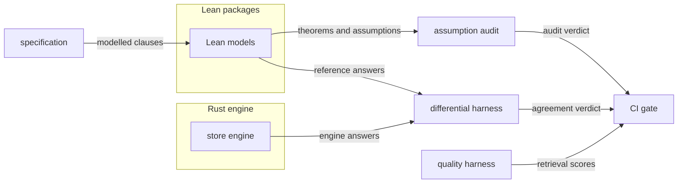
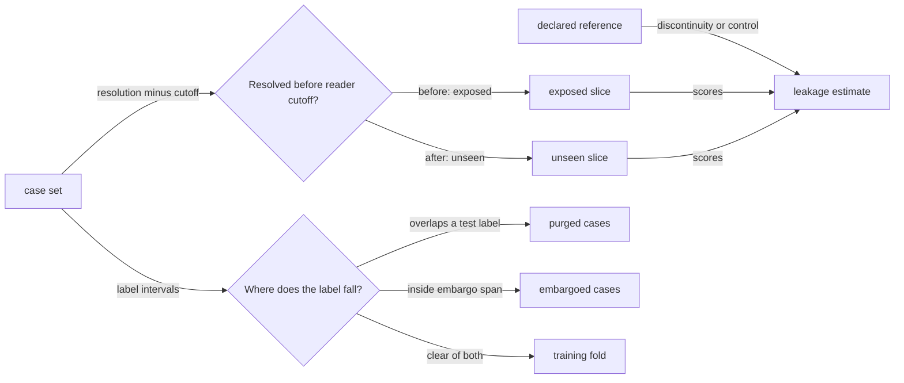

# Assurance

## The problem assurance solves

A specification is only useful if the engine follows it. Assurance gathers three kinds
of evidence, and each proves something different. Lean, a proof checker, proves
properties of a model. A differential test checks that the engine agrees with the model
on generated cases. Engineering checks test source changes and search quality. The
assurance claim names what it covers and which assumptions it trusts
({{assurance.scope-claim.claim-sentence}}).

## Models and proofs

Authors write each model definition from the specification text and from no engine source
({{assurance.model.from-the-spec}}). Every definition is total, so the model answers
every input ({{assurance.model.total-definitions}}).

The policy proofs cover combining enforcement layers. For example, every member layer
admits a row the composed filter admits ({{assurance.prove.composition-sound}}).
Each theorem states its negative space: what it leaves open, such as whether execution
reaches the filter at all ({{assurance.prove.negative-space}}).

The protocol model describes how leases, fenced commits, pauses and crashes change state
({{assurance.model.protocol-model}}). A bounded check evaluates every invariant over
every short step sequence and prints the shortest breaking one
({{assurance.model.protocol-check}}).

## Why a successful build proves too little

Lean compiles a proof that still contains an unfinished step. The assumption audit
therefore reads the compiled environment, not the build's exit status
({{assurance.audit-assumptions.verdict-input}}). A proof depending on the hole
assumption fails the audit ({{assurance.audit-assumptions.hole-assumption}}).

A theorem whose statement changed without its inventory entry fails too
({{assurance.audit-assumptions.statement-drift}}). A recheck rebuilds from pinned source
in an environment holding no credential ({{assurance.recheck.credential-free}}).

## Following one change

A contributor changes zone admission so the allow-set entry `on-prem:*` rejects
`on-prem:lab`, a zone the specification admits ({{authority.place.disjunctive}}).

Zone admission is one of the harness's decision cases
({{assurance.differential-test.decision-cases}}). The harness runs the reference binary,
built from the model's definitions, and the engine's decision module on each generated
case ({{assurance.differential-test.harness}}).

The reference admits and the engine rejects. The harness shrinks the case to a minimal
form and records it ({{assurance.differential-test.minimized}}). Every later run
replays that case before any fresh one ({{assurance.differential-test.corpus-replay}}).

The full formal stage runs nightly, not on every change ({{assurance.gate.formal-stage}}).
A change merged between two nightly runs therefore holds no formal result until the
next run.

The claim stays within its evidence. A composition proof offered as a mediation proof
fails, because composition says nothing about whether every read passes the filter
({{assurance.prove.mediation-from-composition}}).

## Engineering checks

Enforcement and credential resolution each resolve to one
implementation ({{assurance.structure-tree.one-home}}). Contributors and the gate run
the same typed subcommands ({{assurance.automate.one-path}}).

A change to Rust source adds a test that fails against the base commit
({{assurance.test.test-first}}). The gate runs its stages in a fixed order
({{assurance.gate.stage-sequence}}). A shared target directory recompiles workspace
packages per checkout ({{assurance.build.checkout-artifacts}}).

## Search quality

Evaluation loads its corpus through the real store and retriever
({{assurance.evaluate.through-the-store}}). A row a case forbids holds at zero percent of
returned rows ({{assurance.evaluate.forbidden-row-rate}}). A baseline update only moves
entries in the improving direction ({{assurance.baseline.raise-only}}).

A **backtest** replays historical cases. The report places each case by its resolution instant
relative to the reader model's training cutoff ({{assurance.backtest.cutoff-slice}}).

Forecast tracks keep separate scores and pool into no single figure
({{assurance.forecast.tracks-separate}}). The target ledger ties each measured target to
the specification rule it serves ({{assurance.measure.ledger}}).

## Releases and consumers

`contextful-ci tag` creates a signed tag only after every release check clears; a dirty
working tree fails first ({{assurance.release.dirty-tree}}). The conformance suite runs
the released artifact through its public surfaces, outside a source checkout
({{assurance.consumer.suite}}).
