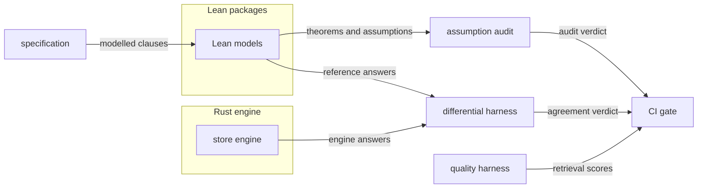
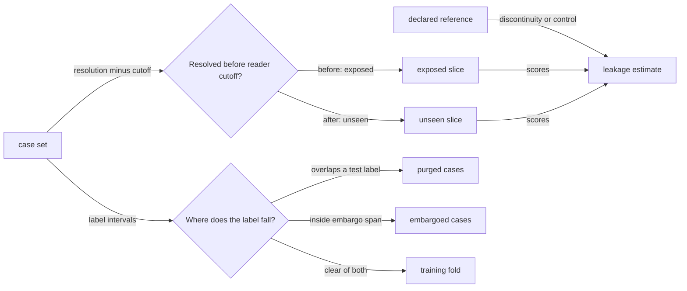

# Assurance

## What it is for

Assurance connects **Contextful**'s specified behavior to evidence: Lean proofs over
explicit models, differential tests comparing model and implementation decisions, and
engineering gates. Each claim names its scope and assumptions
({{assurance.scope-claim.claim-sentence}}).

## In plain words

- **Proofs.** Lean checks properties of the models. Each theorem names what it leaves
  open ({{assurance.prove.negative-space}}), and the assumption audit rejects proof
  holes ({{assurance.audit-assumptions.hole-assumption}}).
- **Comparisons.** An executable reference model and the implementation answer the same
  generated cases ({{assurance.differential-test.harness}}). Agreement covers those
  cases ({{assurance.differential-test.case-classes}}).
- **Engineering checks.** Rust source changes carry a test that fails against the base
  ({{assurance.test.test-first}}), with an explicit refactor exemption
  ({{assurance.test.refactor-trailer}}). The gate runs its stages in a fixed order
  ({{assurance.gate.stage-sequence}}), and search results are scored against rows that
  must never appear ({{assurance.evaluate.forbidden-row-rate}}).

## How it works

Models follow the specification text, not the engine source
({{assurance.model.from-the-spec}}). The policy package depends on no external library
({{assurance.model.declared-dependency}}), pins its toolchain
({{assurance.model.toolchain-drift}}), and keeps every definition total
({{assurance.model.total-definitions}}). The protocol package models lease, compare-and-swap
and fence as a step function ({{assurance.model.protocol-model}}) whose invariants are
theorems ({{assurance.model.protocol-safety}}) and a bounded check
({{assurance.model.protocol-check}}).

The theorems cover layer composition ({{assurance.prove.composition-sound}}), narrowing
({{assurance.prove.narrowing}}) and the evidence floor
({{assurance.prove.floor-no-downgrade}}), over the one order the engine applies
({{assurance.prove.order-is-specified}}). Each carries its negative space, the premises it
leaves open ({{assurance.prove.negative-space}}).

A proof counts only if the audit accepts it, reading the elaborated environment and the
inventory alone ({{assurance.audit-assumptions.verdict-input}}), because a build exits
zero over a hole. Each required constant's assumption footprint is read transitively
({{assurance.audit-assumptions.transitive-audit}}) against a fixed allowlist
({{assurance.audit-assumptions.allowlist}}), and its statement must match the inventory
({{assurance.audit-assumptions.statement-drift}}). A recheck repeats this from pinned source in
an environment holding no credential ({{assurance.recheck.credential-free}}).

The claim is one sentence ({{assurance.scope-claim.claim-sentence}}) naming decisions,
specifications and trusted dependencies ({{assurance.scope-claim.trusted-dependencies}}).
Refinement reaches pure decision functions only ({{assurance.scope-claim.refinement-scope}}).

Beneath the proofs sit the engineering rules: one implementation per capability
({{assurance.structure-tree.one-home}}), each home registered
({{assurance.structure-tree.capability-registry}}) and its copies matched across languages
({{assurance.structure-tree.cross-language}}), test-first with its refactor exemption
({{assurance.test.test-first}}, {{assurance.test.refactor-trailer}}), and ordered gate stages
({{assurance.gate.stage-sequence}}), each run locally before merge
({{assurance.automate.one-path}}). The quality harness
({{assurance.evaluate.run-command}}) loads its corpus through the real store
({{assurance.evaluate.through-the-store}}) under policy labels
({{assurance.evaluate.policy-labels}}), and baselines only ever rise
({{assurance.baseline.raise-only}}).

Windows ships no release ({{assurance.build.windows-target}},
{{assurance.gate.windows-checks}}). Builds bind to their checkout
({{assurance.build.checkout-artifacts}}, {{assurance.build.runtime-checkout}}),
test-first to one comparison ({{assurance.test.comparison-base}},
{{assurance.test.merge-source}}, {{assurance.test.base-evidence}}), parts to
timings, owned processes and tiers ({{assurance.gate.stage-timings}},
{{assurance.gate.part-budget}}, {{assurance.gate.build-admission}},
{{assurance.gate.timeout-cleanup}}, {{assurance.gate.nightly-tier}}), and folds
short parts into one check each ({{assurance.gate.folded-parts}}).

One ledger keys each tracked target to its clause ({{assurance.measure.ledger}}): a
gate-tier count reds the evaluate stage ({{assurance.measure.count-first}}), and timings
only annotate ({{assurance.measure.trend-band}}) against earlier matching reports
({{assurance.measure.trend-baseline}}) in their declared direction
({{assurance.measure.trend-direction}}).

A backtest places each case against the reader model's post-training cutoff ({{assurance.backtest.cutoff-slice}})
and purges overlapping labels ({{assurance.backtest.split}}); forecast tracks never pool
({{assurance.forecast.tracks-separate}}).

## Worked example

A contributor changes zone admission so an allow-set entry `on-prem:*` rejects
`on-prem:lab`, a zone it admits under {{authority.place.disjunctive}}.

Its test fails at base, or the test-first stage stops it; a nightly-tier
run reaches the formal stage
({{assurance.gate.formal-stage}}).

The model follows the specification independently of the engine
({{assurance.model.from-the-spec}}). A changed theorem statement with an unchanged inventory
fails the statement check ({{assurance.audit-assumptions.statement-drift}}). A proof
finished with a hole fails on its footprint
({{assurance.audit-assumptions.hole-assumption}}).

Zone admission is one of the harness's decision cases
({{assurance.differential-test.decision-cases}}). When a generated case exercises this
disagreement, the reference binary admits and the implementation rejects
({{assurance.differential-test.harness}}). The case shrinks to a minimal form
({{assurance.differential-test.minimized}}), enters the counterexample corpus
({{assurance.differential-test.discarded-counterexample}}), and replays before fresh cases
on later runs ({{assurance.differential-test.corpus-replay}}), reproducible from the
recorded seed ({{assurance.differential-test.seed}}).

The composition theorem is not a
mediation theorem ({{assurance.prove.mediation-from-composition}}), stages are not claimed
to commute ({{assurance.prove.commutation-claim}}), and a clause pins at most one theorem
beside one test ({{corpus.state.theorem-beside-test}}).

## Where to look

| Question | Operation |
| --- | --- |
| What does a theorem leave open? | `assurance.prove` |
| Why did the proof gate fail? | `assurance.audit-assumptions` |
| What may the claim say? | `assurance.scope-claim` |
| Which gate stage runs what? | `assurance.gate` |
| When does quality go red? | `assurance.evaluate`, `assurance.baseline` |
| Which targets are measured? | `assurance.measure` |
| What accompanies releases? | `assurance.release`, `assurance.consumer` |
