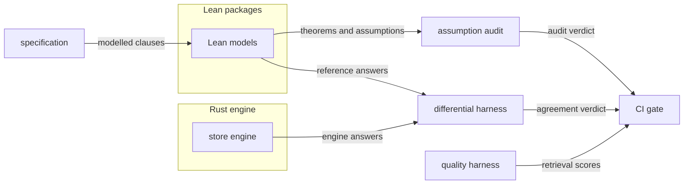
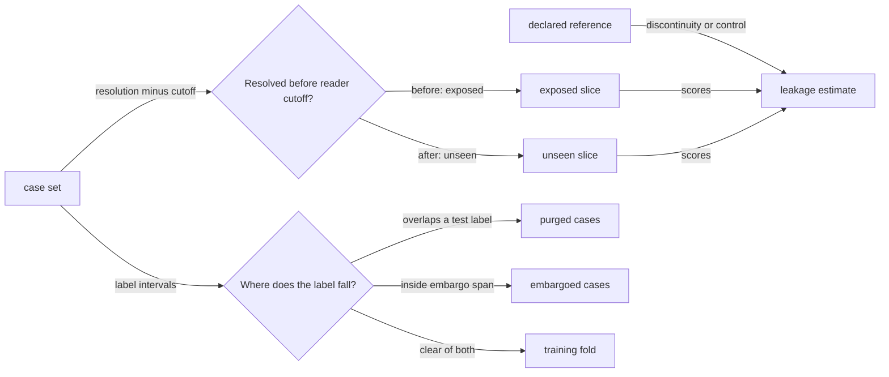

# Assurance

## What it is for

Assurance checks whether **Contextful** follows its specification. Lean, a proof
checker, verifies properties of models. Tests compare the models' answers with the
engine's answers. Engineering checks test source changes and search quality. Each
claim states what it covers and which assumptions it relies on
({{assurance.scope-claim.claim-sentence}}).

## How it works

Models describe the specification's decisions independently of the engine source
({{assurance.model.from-the-spec}}). The policy model uses no external library
({{assurance.model.declared-dependency}}), fixes its compiler version
({{assurance.model.toolchain-drift}}), and defines a result for every input
({{assurance.model.total-definitions}}). The protocol model describes how leases,
conditional writes and writer fences change state ({{assurance.model.protocol-model}}).
Proofs check its safety rules ({{assurance.model.protocol-safety}}); a separate check
explores sequences of steps up to a fixed length ({{assurance.model.protocol-check}}).

The proofs cover combining policy layers ({{assurance.prove.composition-sound}}),
restricting permissions ({{assurance.prove.narrowing}}) and preserving required evidence
({{assurance.prove.floor-no-downgrade}}) in the engine's specified order
({{assurance.prove.order-is-specified}}). Each proof lists what it leaves unproved,
called its negative space ({{assurance.prove.negative-space}}).

Lean accepts unfinished proofs during a build, so a successful build alone supplies
insufficient evidence. An assumption audit reads the compiled proofs and the declared
inventory ({{assurance.audit-assumptions.verdict-input}}), follows their dependencies
({{assurance.audit-assumptions.transitive-audit}}), and rejects proof holes
({{assurance.audit-assumptions.hole-assumption}}). It checks assumptions against an
allowlist ({{assurance.audit-assumptions.allowlist}}) and theorem statements against the
inventory ({{assurance.audit-assumptions.statement-drift}}). Rechecking uses pinned
source without credentials ({{assurance.recheck.credential-free}}).

Claims identify the decisions, specifications and dependencies they trust
({{assurance.scope-claim.trusted-dependencies}}).

## What the engineering checks cover

Each capability has one registered implementation
({{assurance.structure-tree.one-home}}, {{assurance.structure-tree.capability-registry}}).
Cross-language copies are checked for agreement ({{assurance.structure-tree.cross-language}}).
Rust source changes carry a test that fails against the base revision
({{assurance.test.test-first}}); behavior-preserving refactors declare their exemption
({{assurance.test.refactor-trailer}}). The gate runs checks in order
({{assurance.gate.stage-sequence}}), and each stage runs locally before merge
({{assurance.automate.one-path}}).

Search evaluation loads test data through the real store
({{assurance.evaluate.through-the-store}}) with access labels
({{assurance.evaluate.policy-labels}}), measures forbidden rows in results
({{assurance.evaluate.forbidden-row-rate}}), and preserves the required quality baseline
({{assurance.baseline.raise-only}}).

Build artifacts
belong to their checkout ({{assurance.build.checkout-artifacts}}). Each gate part has a
time budget ({{assurance.gate.part-budget}}); short parts share a check
({{assurance.gate.folded-parts}}), and nightly checks run separately
({{assurance.gate.nightly-tier}}).

The measurement ledger connects each target to a clause ({{assurance.measure.ledger}}).
Required counts determine whether evaluation passes ({{assurance.measure.count-first}}).
Timing comparisons describe trends ({{assurance.measure.trend-band}}) against comparable
reports ({{assurance.measure.trend-baseline}}).

Backtests separate cases by whether they resolved before the reader model's training
cutoff ({{assurance.backtest.cutoff-slice}}). Training cases with overlapping outcome
periods are excluded from a test split ({{assurance.backtest.split}}). Forecast tracks
keep separate scores ({{assurance.forecast.tracks-separate}}).

## Worked example

A contributor changes zone admission so an allow-set entry `on-prem:*` rejects
`on-prem:lab`, a zone it admits under {{authority.place.disjunctive}}.

The nightly run checks the proofs
({{assurance.gate.formal-stage}}).

The model follows the specification independently of the engine
({{assurance.model.from-the-spec}}). A changed theorem statement with an unchanged inventory
fails the statement check ({{assurance.audit-assumptions.statement-drift}}). A proof
finished with a hole fails on its footprint
({{assurance.audit-assumptions.hole-assumption}}).

Zone admission is one of the harness's decision cases
({{assurance.differential-test.decision-cases}}). When a generated case exercises this
disagreement, the reference program admits and the implementation rejects
({{assurance.differential-test.harness}}). The case shrinks to a minimal form
({{assurance.differential-test.minimized}}), enters the counterexample corpus
({{assurance.differential-test.discarded-counterexample}}), and replays before fresh cases
on later runs ({{assurance.differential-test.corpus-replay}}), reproducible from the
recorded seed ({{assurance.differential-test.seed}}).

The claim stays within what the evidence establishes: a composition proof leaves
complete enforcement open ({{assurance.prove.mediation-from-composition}}), and changing
stage order needs its own evidence ({{assurance.prove.commutation-claim}}). A clause
connects at most one theorem and one test ({{corpus.state.theorem-beside-test}}).

## Where to look

| Question | Operation |
| --- | --- |
| What does a theorem leave open? | `assurance.prove` |
| Why did the proof gate fail? | `assurance.audit-assumptions` |
| What may the claim say? | `assurance.scope-claim` |
| Which gate stage runs what? | `assurance.gate` |
| When does quality go red? | `assurance.evaluate`, `assurance.baseline` |
| Which targets are measured? | `assurance.measure` |
| What accompanies releases? | `assurance.release`, `assurance.consumer` |
