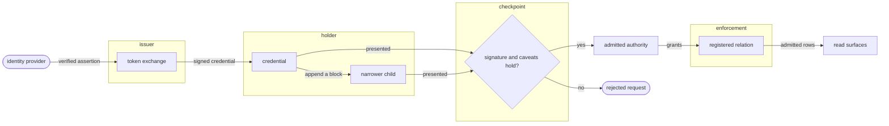
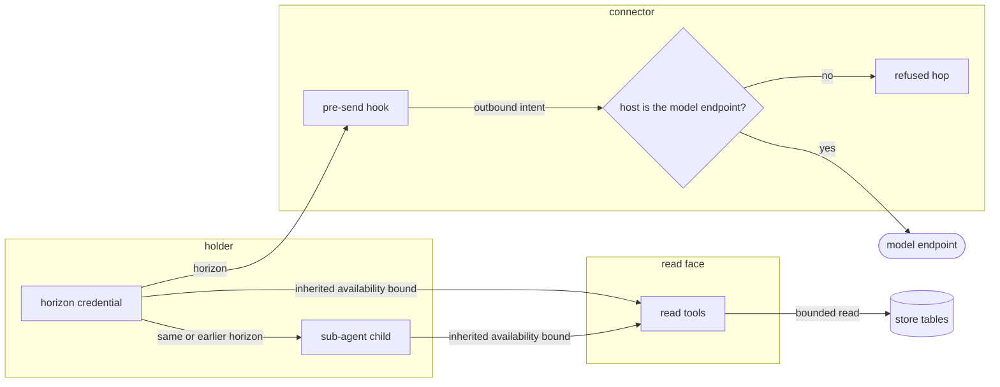

# Authority and enforcement

## The problem authority solves

A caller reads stored rows on behalf of a person, and the store holds rows that person
may not see. **Admission** verifies the caller's credential. A **checkpoint** is the
code in a command, server or gateway that performs admission and produces the verified
permissions every read and write takes ({{authority.verify.admitted-authority}}).
**Enforcement** applies those permissions to each read, deciding which rows and cells
the caller receives.

## What a credential says

A **subject** is a tuple of agent, host, principal, task, zone and incognito flag
({{authority.identify.subject-tuple}}). The mint verifies only the principal,
against the identity provider ({{authority.identify.on-behalf-of}}).

The credential is a chain-signed token under a versioned profile that names every fact
the engine admits ({{authority.profile.delegation-profile}}). Its grants name actions,
table patterns and optional tenant, template and aggregate bounds
({{authority.grant.fields}}).

## Getting a credential

The example reader signs into the console. The console holds no project-wide credential;
it exchanges the reader's identity assertion for that reader's short-lived credential
({{authority.exchange.per-reader}}). The policy maps the reader's role to `read` on
`workspace/*`, and the assertion's tenant claim becomes the tenant scope `acme-eu` on
every grant ({{authority.exchange.tenant}}).

A direct mint, outside the exchange, needs a credential whose grant carries `admin`
({{authority.issue.unauthorized-mint}}).

## Narrowing for a sub-agent

The reader's agent spawns a sub-agent. A holder derives a narrower child offline by
appending a signed block, with no issuer round trip ({{authority.attenuate.offline}}).
The agent derives one child per sub-agent, bound to that sub-agent's own key pair
({{authority.attenuate.per-sub-agent}}). A derivation that adds `write` fails, naming
the widened dimension ({{authority.attenuate.widens}}).

A horizon on a grant bounds the availability time of every read its holder makes
({{authority.grant.horizon}}).

## Admission

A checkpoint holds public keys only, so admitting a request calls no outside service
({{authority.verify.public-key-only}}). Each request under a key-bound credential
carries a proof signed by the matching private key ({{authority.verify.possession-binding}}).

Each statement start and each commit re-reads expiry, revocation and policy version
({{authority.verify.effect-boundary}}). Short lifetimes are the primary withdrawal
({{authority.revoke.short-lifetime}}).

An operator adds the sub-agent's derivation to the denylist every checkpoint reads
({{authority.revoke.denylist}}). At its next effect boundary the sub-agent's credential
fails ({{authority.revoke.revoked}}). The parent credential carries its own revocation
identifier and keeps working ({{authority.revoke.revocation-id}}).

## Enforcement in three layers

Enforcement is three layers: removal at write time, a redistribution bound at push, and
row and column restriction at query time ({{authority.compose}}).

Write-time redaction drops or transforms a value before columnar bytes exist
({{authority.redact.write-time}}). It is the only layer protecting data at rest; a
column protected at query time alone is cleartext in storage.
A cleared redistribution flag withholds the whole table from the bucket at push
({{authority.bound-redistribution.withhold}}).

The sub-agent queries `workspace/documents` with no tenant filter. The engine conjoins a
byte-exact tenant equality the query text omits ({{authority.filter-rows.tenant-equality}}).
A statement naming `acme-us` fails, naming both scopes ({{authority.refuse.scope-denied}}).
A refusal returns a typed error, not an empty result ({{authority.refuse.not-empty}}).

A `contact_email` column masked by policy arrives masked where it stands
({{authority.mask.in-place}}). The table declares no zone policy, so it resolves to a
fail-closed pair of zones ({{authority.place.fail-closed}}). The response envelope
reports the zone's removals and carries no removed value ({{authority.place.envelope}}).

Every step completes before the engine cuts a ranked result to size, so visible positions carry no
trace of a withheld row ({{authority.compose.before-the-cut}}).

## Injected instructions

Text read from a source sometimes holds instructions aimed at the model. An
organization-wide face serves only the read tools, and the server authors every
conversational write ({{authority.resist.read-only-face}}). A claim write holding a
credential-shaped value fails before storage ({{authority.resist.credential-shaped-value}}).
