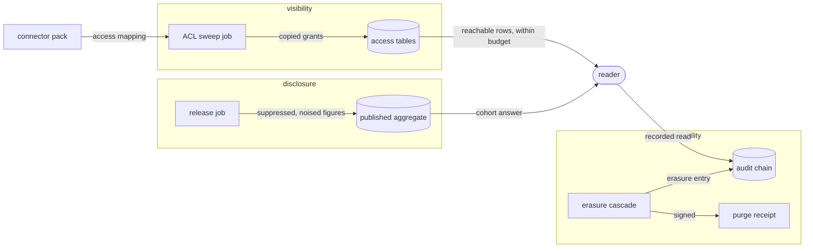

# Visibility, disclosure and accountability

## The problems this contract solves

A **Contextful** workspace indexes an organization's wiki, drive and chat. Three
problems follow. A reader sees only what the source lets that reader see
(**visibility**). A figure computed from other people's rows reaches one asker without
exposing any contributor (**disclosure**). Every read leaves a verifiable trace, and a
person or a tenant is removable on demand (**accountability**).

## Visibility: mirroring source permissions

The example is a wiki page shared with the group `planning`, which contains `eng-leads`,
which contains one reader.

A **pack** is the reviewed unit that loads one source with its access mapping; a table
with no mapping fails at diagnosis ({{disclosure.pack.mapping-absent}}). A **sweep**
reads the source's permission state and commits it as one run
({{disclosure.sweep.sweep-verb}}). Grants arrive as ordinary rows of reserved
`_visibility` tables ({{disclosure.mirror.grants-table}}).

For the wiki, the sweep writes one resource row, one grant to `planning` and two
membership rows. A grant naming no resource fails at commit
({{disclosure.sweep.orphan-grant}}). A Drive sweep follows every permission page of each
file before its grants replace earlier ones ({{disclosure.drive-sweep.permission-pages}}).

At read time, a bounded group closure walks `planning`, then `eng-leads`, then the
reader ({{disclosure.reach.closure-walk}}). The registered view admits a row only when
its resource holds a grant in that reachable set ({{disclosure.reach.semi-join}}). The
reachable set holds every principal the subject reaches through identity links and
groups ({{disclosure.reach.subject-principals}}).

**Fidelity** states how closely a table follows its source, and the source family caps
the claim ({{disclosure.declare-fidelity.family-bound}}).

## When permission state goes stale

An editor removes `planning` from the page. The table's staleness budget, a declared
duration ({{disclosure.bound-staleness.budget-grammar}}), bounds how long the old grant
keeps answering. If the sweep stalls past the budget, the reader's next
read fails instead of serving a revoked grant ({{disclosure.bound-staleness.access-stale}}).

A table declared `public_only` instead narrows to public rows past its budget
({{disclosure.bound-staleness.public-only}}). The engine retains no reachable set computed in
either state ({{disclosure.reach.degraded-uncached}}).

## Explaining a decision

Asked why a colleague lacks access to the page, `audit explain` decides from current grants
({{disclosure.explain.decision}}). The explanation names groups on the path and omits
their members ({{disclosure.explain.groups-not-members}}).

## Disclosure: releasing a figure

A release computes statistics over contributors' rows. Before computing, it reserves
each contributor's spend against a lifetime budget, and a failed reservation publishes
nothing ({{disclosure.release.budget-reservation}}). A group key outside the permitted
columns fails ({{disclosure.release.group-key}}). A model declaring a disclosure policy
publishes only through a release: a plain build of it, or a build job naming it, fails
before staging any row ({{disclosure.release.governed-build}}).

The release suppresses a group whose distinct contributors fall under the declared
minimum ({{disclosure.suppress.min-group-size}}). Every suppressed group together leaves one
sentinel row with no key or figure ({{disclosure.suppress.sentinel-row}}).

A model declares whether its figures describe one person or a cohort, and a model
declaring neither is per-person ({{disclosure.bound-cohort.governance-declaration}}). A
cohort key resolving to one person fails at declaration
({{disclosure.bound-cohort.singleton-cohort}}).

The tables a cohort model's statement reads hold one row per contributor, so a read of
one fails unless the credential grants `read-individual` over it
({{disclosure.bound-cohort.per-individual-row}}). A statement grouping the published
cohort table by fewer than all its group-key columns fails: the coarser groups sum
figures no release noised ({{disclosure.bound-cohort.cohort-widening}}).

A named query template holds exactly one statement
({{disclosure.template.single-statement}}). The offline diagnostic checks every
published model's policy from local files ({{disclosure.set-mode.check-verb}}).

## Accountability: the audit chain

Each read appends one audit entry, and rows leave only after that entry syncs
({{disclosure.record.read-entry}}). Entries hash-link into segments, each closed by a
signed root ({{disclosure.record.segment}}).

A proof for one entry verifies offline under the signer's public key alone
({{disclosure.attest.inclusion-proof}}). Verification of a damaged chain fails at the
earliest broken index ({{disclosure.attest.broken-chain}}).

## Erasure

The reader leaves the organization, and an operator erases the reader's rows. Erasure needs the forget grant
({{disclosure.erase.privilege}}). The cascade invalidates every fact derived from the
erased rows in the same operation ({{disclosure.erase.cascade}}), and the files holding
them are rewritten or collected ({{disclosure.erase.physical-removal}}).

A dead letter
repeats the content of the rows its failed batch carried, so each letter citing an erased
row leaves with it ({{disclosure.erase.dead-letters}}). A letter written without
`evidence`, such as a pipeline's record of an unreadable input, cites no row, so no
subject reaches it; `context erase --dead-letters-without-evidence` clears those letters
from each requested table through the same signed publication
({{disclosure.erase.dead-letters-without-evidence}}).

A tenant purge returns a signed receipt naming a salted pseudonym, not the tenant
identifier ({{disclosure.receipt.pseudonym}}).
