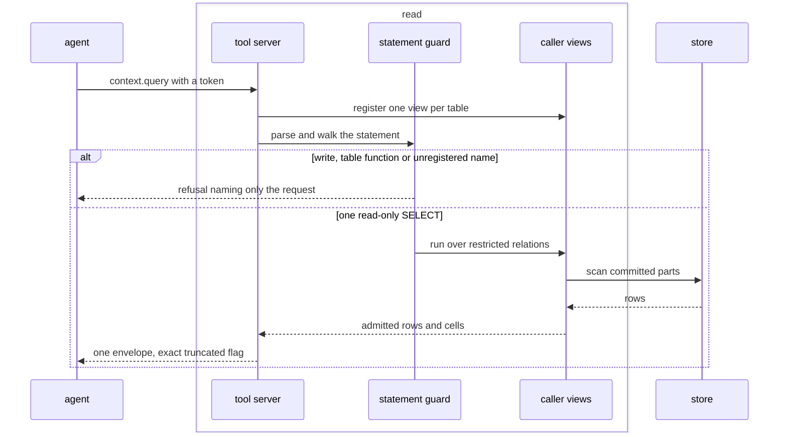
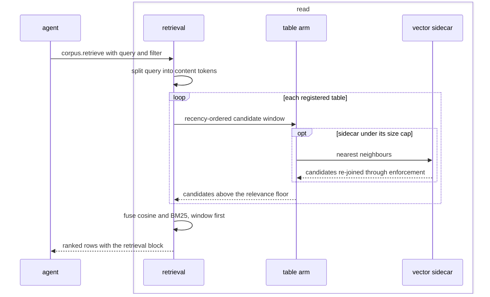
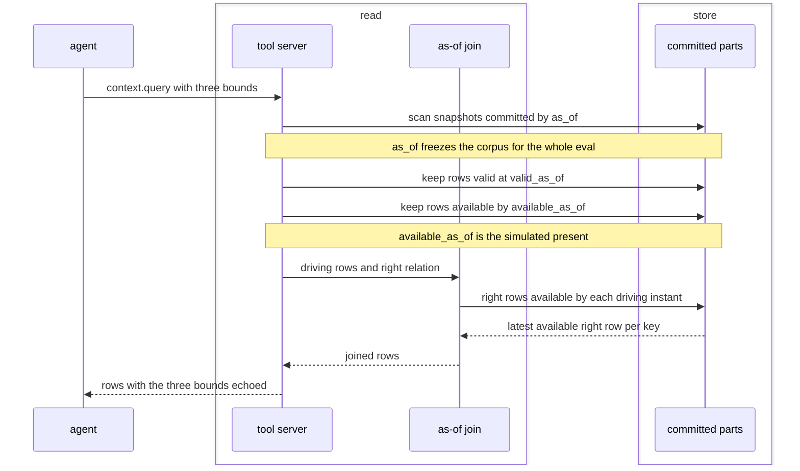
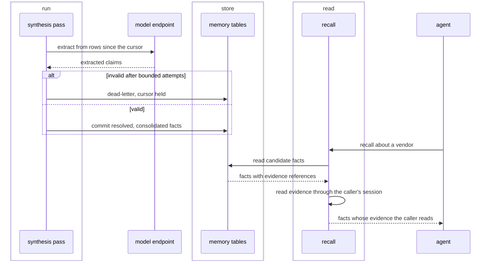

# Reading and memory

## What it is for

SQL, templates, ranked retrieval and memory share relations, admission, ranking and the envelope. Reads write no rows. Memory uses the run path and table enforcement.

## How it works

Each connection starts by registering one view per table the manifests name ({{read.register.connection-views}}). Each view carries the caller's restriction, so a bare table name anywhere means the caller's restricted relation ({{read.register.bare-name}}). The tool set is closed ({{read.register.tool-set}}). Reads under one key share a pooled connection ({{read.cache.session-pool}}).

The guard reads the engine's parse tree ({{read.guard.engine-own-parse}}), admits exactly one read-only SELECT ({{read.guard.single-read-only-statement}}), and walks the whole tree ({{read.guard.whole-tree-walk}}), checking every base relation against the registered set ({{read.guard.relation-allowlist}}). Authorship decides whether the guard runs: operator text runs raw, token-holder text is gated ({{read.guard.statement-provenance}}); the command line carries the operator verb ({{read.query.operator-verb}}). Caller parameters bind by name or contiguous number ({{read.guard.query-binding}}). Templates are checked once at startup ({{read.guard.startup-time-check}}) and bind arguments with no coercion ({{read.guard.template-binding}}).

Ranked reads use `corpus.retrieve` ({{read.retrieve.ranked-call}}) over a prefix and table list ({{read.retrieve.table-list}}): content tokens ({{read.retrieve.content-tokens}}), a per-table recency window ({{read.retrieve.candidate-window}}) that sidecars widen ({{read.retrieve.sidecar-generates-candidates}}), a full-text probe ({{read.retrieve.fulltext-probe}}) and a relevance floor ({{read.retrieve.relevance-floor}}). Ranking fuses cosine with BM25 ({{read.rank.fusion}}); a question's timeframe is a tier, not a filter ({{read.rank.question-window-is-a-tier}}). A missing lexical backend changes the order, never the answer ({{read.rank.degradation-not-error}}).

Time travel takes three bounds on every read tool ({{read.register.bound-arguments}}, {{read.register.available-bound-argument}}): `as_of` freezes the corpus, `valid_as_of` picks what was true, and `available_as_of` is the simulated present ({{store.available-time.available-as-of}}). An `ASOF JOIN` matches on availability ({{read.as-of-join.per-row-bound}}).

Every transport serializes one projection ({{read.respond.one-projection}}). Internals carries bindings ({{read.respond.query-internals-parameters}}). Tools without SQL have no deadline ({{read.register.duration-no-statement}}). Deadlines and byte bounds follow {{read.respond.duration-ceiling}} and {{read.respond.byte-ceiling}}. A row ceiling sets `truncated` through an over-fetched probe row ({{read.respond.truncation-is-exact}}); a byte cut also sets it, and each cut names its cause ({{read.respond.truncation-cause}}). Zero rows is a success ({{read.respond.zero-rows-is-success}}). A pinned build never silently widens to the latest state ({{read.resolve-pin.unknown-build}}).

Memory uses ordinary store tables ({{topology.compose.memory-substrate}}). Synthesis retries invalid extraction ({{read.synthesize.extract-attempts}}), then dead-letters with its cursor held ({{read.synthesize.dead-letter}}). Ambiguous mentions dead-letter ({{read.resolve-entity.ambiguous-mention}}). Recall gates evidence through the caller's session ({{read.recall.evidence-unresolved}}). The CLI shares keyed recall ({{read.recall.cli-verb}}). Predictions settle through {{read.settle.predict-verb}}, {{read.settle.observe-verb}}, {{read.settle.label-join}} and {{read.settle.calibration-verb}}. An alias explains to one card ({{read.resolve-entity.knowledge-card}}), claims needing their own grant ({{read.resolve-entity.card-authorization}}).

Relations, cadence, confidence and usage follow {{read.declare.reserved-relations}}, {{read.synthesize.cadence}}, {{read.synthesize.confidence-calibration}} and {{read.recall.usage-ledger}}.

An edge walk ({{read.traverse.call}}) crosses readable, cited edges ({{read.traverse.enforced-edges}}) within bounds ({{read.traverse.frontier-cap}}).

Operator claims land through {{read.revise.served-write}} under credential-bound scope ({{read.revise.served-scope}}); browser requests refuse ({{read.revise.browser-request}}).

## Worked example

An agent with a capability token wants one vendor's current renewal terms.

- It calls `context.describe` and learns row counts, declared indexes and the published row ceiling ({{read.register.describe-payload}}), which the engine applies exactly as published ({{read.register.advertised-is-enforced}}).
- It sends SQL that joins `contracts` to a `read_parquet` call, and the guard refuses the table function ({{read.guard.table-function}}). It retries with a join to `payroll`, which it holds no grant on; the refusal echoes only what it asked for ({{read.guard.unregistered-relation}}).
- It switches to `corpus.retrieve` with the query "vendor renewal terms" and a filter on `vendor_id`. A table lacking `vendor_id` drops its arm instead of running unfiltered ({{read.retrieve.unsatisfiable-arm-drops}}). The `contracts` vector sidecar sits under its size cap ({{read.retrieve.sidecar-size-cap}}), so the probe adds candidates, each re-joined through enforcement ({{authority.compose.vector-arm}}).
- Rows keep one copy per table and row key ({{read.retrieve.row-key-dedup}}), sort in-window first, and return with the `contextful.retrieval` block ({{read.rank.retrieval-block}}). Counts reflect delivered rows ({{read.rank.delivered-counts}}). Rows carry integer scores; the lexical engine's float score stays inside ({{read.rank.internal-score-stays-internal}}).
- To report that no contract mentions a penalty clause, the agent counts rows, never trusting a low top score ({{read.respond.coverage-is-a-count}}).
- It asks memory what the workspace concluded about the vendor. One fact cites a row in a table masked for this caller, so recall suppresses that fact and still answers with the rest ({{read.recall.evidence-unresolved}}).

## Where to look

Stored citations share {{read.reference.call}}; {{read.reference.erased-verdict}} distinguishes absence, {{read.reference.index-visibility}} controls metadata, and {{read.reference.frontier}} binds publication.

- What a connection can name: `read.register`.
- Which statements run: `read.guard`.
- The envelope and its encodings: `read.respond`.
- Candidates and order: `read.retrieve`, `read.rank`.
- Build pins and time bounds: `read.resolve-pin`.
- Memory writes and reads: `read.synthesize`, `read.revise`, `read.recall`, `read.resolve-entity`, `read.traverse`.
- Predictions and outcomes: `read.settle`.
