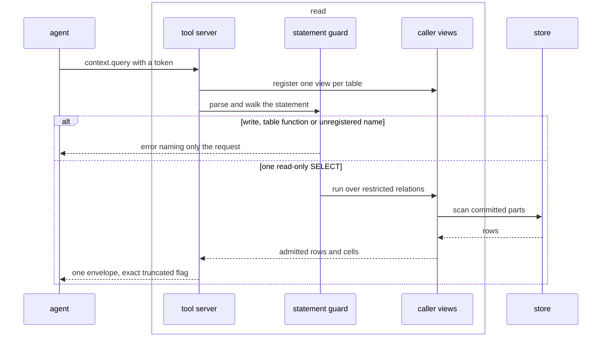
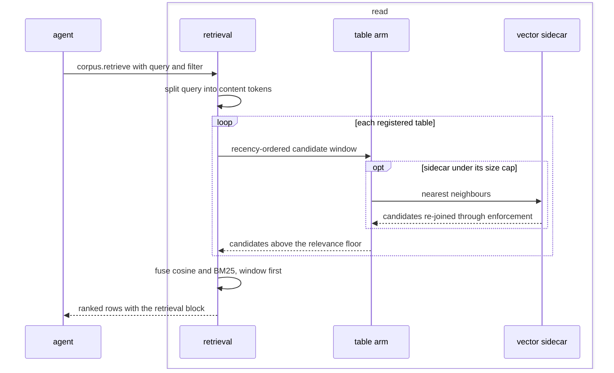
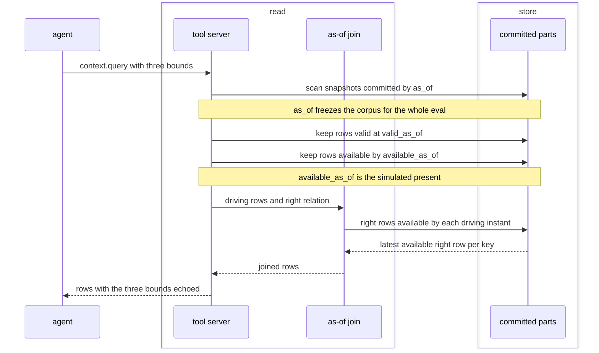
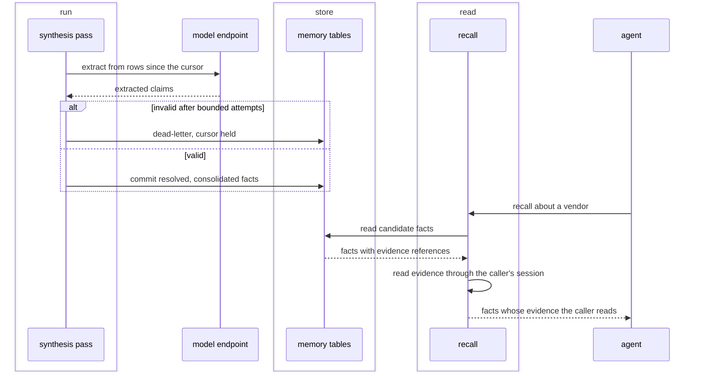

# Reading and memory

## The problem the read face solves

A caller, such as an agent holding a capability token, asks questions of stored tables.
The caller sees only rows its grant admits, and no read writes a row. SQL queries,
ranked retrieval and memory recall all pass through the same registered relations and
return the same response shape.

The example agent wants the current status of one resource.

## Naming what a caller reads

Each session connection registers one view per manifest table
({{read.register.connection-views}}). A bare table name in the caller's SQL resolves
to that caller's restricted view ({{read.register.bare-name}}). The tool set is closed,
so a caller reaches nothing outside it ({{read.register.tool-set}}).

The agent first calls `context.describe` and learns row counts, declared indexes and
the published row ceiling ({{read.register.describe-payload}}).

## Which statements run

The guard reads the SQL engine's own parse tree, so no keyword list decides admission
({{read.guard.engine-own-parse}}). The text has to parse to exactly one read-only
SELECT ({{read.guard.single-read-only-statement}}).

The agent joins `documents` to a `read_parquet` call, and the guard refuses the table
function ({{read.guard.table-function}}). It retries with a join to a table it holds
no grant on; the error echoes only the requested name ({{read.guard.unregistered-relation}}).

Operator statements run without that guard, and no network interface exposes them
({{read.guard.statement-provenance}}). The operator runs a raw statement with `contextful query` ({{read.query.operator-verb}}).

## The response

Every transport serializes one projection: columns, rows, `truncated` and optional
blocks ({{read.respond.one-projection}}). `truncated` is set from an over-fetched probe
row, never from comparing counts ({{read.respond.truncation-is-exact}}). Zero rows is a
success, not an error ({{read.respond.zero-rows-is-success}}).

## Ranked retrieval

The agent switches to `corpus.retrieve` with the query "resource status" and a filter on
`resource_id` ({{read.retrieve.ranked-call}}). A table lacking `resource_id`
contributes no rows instead of running unfiltered ({{read.retrieve.unsatisfiable-arm-drops}}).

Ranking fuses vector cosine with lexical BM25 scores ({{read.rank.fusion}}). A
question's timeframe orders rows but drops none ({{read.rank.question-window-is-a-tier}}).
Each stored vector sits beside an `embedding_model` column naming the model that
produced it ({{read.embed.model-identifier}}).

To report that no document mentions a status change, the agent counts rows. A low top
score proves no absence ({{read.respond.coverage-is-a-count}}).

Reads under one key reuse a pooled session and its connections
({{read.cache.session-pool}}).

## Reading at an earlier time

Every read tool takes three bounds: `as_of` freezes the corpus, `valid_as_of` picks what
was true, and `available_as_of` sets a simulated present. An `ASOF JOIN` matches each
row on availability ({{read.as-of-join.per-row-bound}}).

A read naming a published model build resolves that build, and an unknown build fails
instead of widening to the latest state ({{read.resolve-pin.unknown-build}}).

A credential carrying a horizon caps the simulated present. A call asking for a later
`available_as_of` fails, naming the argument ({{read.horizon.exceeds-horizon}}).

`context.reference` resolves one stored citation, and an erased source answers
`erased`, distinct from `missing` ({{read.reference.erased-verdict}}).

## Notifications

A subscription notifies each committed run once, in commit order, with no row content
({{read.subscribe.commit-order}}). A resume position naming no committed run fails
and names the oldest one available ({{read.subscribe.position-unavailable}}).

## Memory

Memory is claims about entities, kept in ordinary store tables with reserved relation
types ({{read.declare.reserved-relations}}). A synthesis pass extracts claims from
source rows and retries an invalid response a bounded number of times
({{read.synthesize.extract-attempts}}). An exhausted batch goes to a dead-letter
table, and the cursor holds ({{read.synthesize.dead-letter}}).

A mention matching two identities dead-letters its claim instead of guessing
({{read.resolve-entity.ambiguous-mention}}). A writable server accepts operator claims
through one direct-write route ({{read.revise.served-write}}).

The agent asks memory what the workspace concluded about the resource. One fact cites a
row masked for this caller, so recall suppresses that fact and answers with the rest
({{read.recall.evidence-unresolved}}).

An edge walk follows only edges the caller reads, with citations that resolve
({{read.traverse.enforced-edges}}). A prediction registers through
`contextful memory predict` and settles against later observations
({{read.settle.predict-verb}}).
