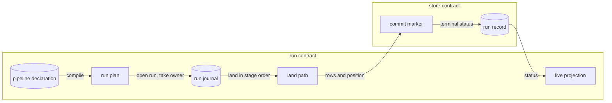
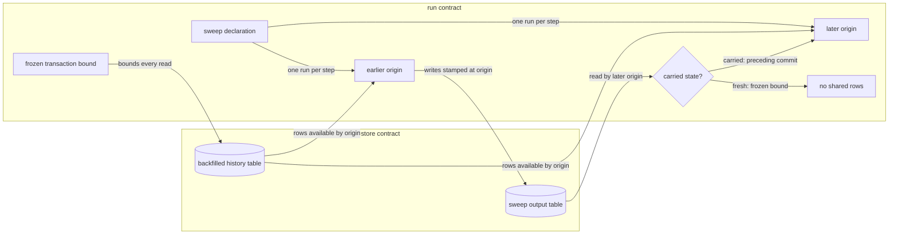

# Runs, pipelines and derive

## What it is for

A pipeline declares a source and tables. A run pins its plan, records effects for replay,
and commits rows with their position ({{run.advance.commit-with-rows}}).

## How it works



A pipeline specification ({{run.declare.pipeline-spec}}) is identified by a content hash
that ignores no-op edits ({{run.declare.content-hash}}). It compiles into a flat node list ({{run.compile.plan-node}})
carrying no script: branching is declared, never computed from data
({{run.compile.control-flow}}), and the plan lowers onto one substrate interface
({{run.journal.substrate-port}}).

The record opens before the first pull ({{run.record.row-at-open}}). An execution owner
pins the connector and plan ({{run.own.pinned-plan-changed}}); host jobs use their own
scope ({{run.own.host-scope}}).

Bodies: {{run.own.body-implementation}}, {{run.own.body-dependencies}}, {{run.own.body-compatibility}}.
Items follow {{run.items.opt-in}} and {{run.items.identity}}.
Outcomes follow {{run.items.completion}} and {{run.items.outcomes}};
admission follows {{run.items.entity-admission}}, {{run.items.overlap}} and {{run.items.fence}}.
Retries follow {{run.items.retry-budget}} and {{run.items.replay}}.

Each pull records its value once ({{run.journal.step-output}}); outbound requests carry
idempotency keys ({{run.journal.idempotency-key}}). Journal state persists through store
ports with file and SQLite adapters ({{run.journal.storage-ports}},
{{run.journal.sqlite-stores}}). A batch follows {{run.land.stage-order}}.
Initialize {{run.journal.execution-recovery}} under {{run.journal.container-profile}}:

```sh
export CONTEXTFUL_STORAGE_PROFILE=postgres
export CONTEXTFUL_CATALOG_URL='host=database.example user=contextful dbname=execution sslmode=require'
export CONTEXTFUL_RECOVERY_ID=deployment-recovery-identity
contextful storage initialize --project research
contextful storage check --project research
```

```toml
[sync]
endpoint = "r2://ACCOUNT_ID"
bucket = "CORPUS_BUCKET"
pull_before_run = true
push_after_run = true
access_key_id = "env://CORPUS_ACCESS_KEY_ID"
secret_access_key = "env://CORPUS_SECRET_ACCESS_KEY"
```

Stop writers, capture {{run.journal.execution-backup}}, restore
{{run.journal.execution-recovery}}, and restart. Replacement uses
{{run.journal.postgres-stores}}; exports follow {{run.export.remote-state}} and
{{run.export.writer-fenced}}.
Cloudflare recovery follows {{run.journal.d1-profile}}, {{run.journal.d1-guard}},
{{run.journal.d1-backup}} and {{run.export.d1-state}}.
The stage types its observed batch ({{run.land.observed-schema}}) and preserves nested
columns or projects them into parent and child rows ({{run.normalize.mode}}). A downgrade
travels with its table's commit ({{run.record.schema-diff-home}}). The secret guard's
catalogue and mask-only posture are fixed by {{run.guard-secrets.matchers}} and
{{run.guard-secrets.mask-only}}. A decode that can die runs in a bounded child
({{run.land.parse-child}}, {{run.land.parse-deadline}}, {{run.land.parse-memory}}).

Failures cross every port as one tagged type ({{run.retry.failure-taxonomy}}). Only the
transient and rate-limited tags retry ({{run.retry.retryable-classes}}), under the step's
schedule, the only retry layer ({{run.retry.one-layer}}). A stop is a mark on the
run row that every await observes through one token ({{run.cancel.one-token}}), and landing
is never cut mid-write ({{run.cancel.land-path-uncut}}). A run waiting on an outside party
suspends durably until its single-use token is posted back ({{run.suspend.awakeable}}).

A deployment declares its writing site ({{run.record.writing-site}}) once in `contextful.toml`,
as `site_id` or `site_id_env`; `--site-id` replaces it for one run
({{run.record.site-id-unresolved}}).

Every run closes on a shared status ({{run.record.status-set}}); live progress is
a best-effort projection the runner never reads back ({{run.project.best-effort}}).

A backfill splits history into leased chunks whose commits are fenced against a stale holder ({{run.backfill.fenced-commit}}); a seed bulk-loads
consumer-held history below a ceiling through the same land path ({{run.seed.one-land-path}}).
A model ({{run.model.statement-source}}) builds in staging ({{run.publish.staging}}).
Derive anti-joins output ({{run.select.rows-per-run}}), runs a machine-bound engine
({{run.bind.command-in-manifest}}), records unit fate and key
({{run.emit.unit-status}}, {{run.emit.derivation-key}}), and keeps rows until replacement
({{run.emit.stale-supersedes}}). Passage modality names output ({{run.emit.output-modality}});
bytes refresh units ({{run.emit.local-content-key}}); folds remove orphaned output
({{run.emit.parent-tombstone}}).
Chained derives follow
{{run.select.derive-order}}, {{run.select.derive-failed-parent}} and {{run.select.parent-outcome}}; {{run.select.derive-cycle}}
prevents circular chains. A conflicting `after` refuses under {{run.select.derive-after-conflict}}.

A sweep follows {{run.sweep.origins}}, {{run.sweep.frozen-as-of}} and {{run.sweep.simulated-write}}:



## Worked example

The `meta-ads` pipeline pulls ad insights incrementally. Its declaration names `updated_time`
as the stream clock ({{run.declare.incremental-field}}), so the source reports a monotonic
cursor that stores the field name beside the value ({{run.advance.watermark-shape}}).

With no pending owner, a fire receives a fresh execution id ({{run.own.retirement}}). The pull admits rows at or after the stored position, re-landing
the boundary instant ({{run.advance.inclusive-boundary}}); `insights` declares a
`primary_key`, so those repeats are idempotent ({{run.advance.declared-key-required}}).

The process dies after its first page.

On restart, startup marks the row `partial_failure`, its owner lease expired
({{run.record.orphan-reap}}). The next fire finds no commit marker newer than the cached
position ({{run.own.marker-reconciles}}), sees the same plan hash, and replays. The
journal hit hands the recorded page to the land path byte for byte
({{run.journal.replay-lands}}), and replay spends no vendor request
({{connector.meter.replay-reservation}}). The remaining pages pull live and commit with the
position, and `success` releases the owner ({{run.own.pin-release}}).

A rename of `updated_time` between fires refuses the open ({{run.advance.field-rename}});
restarting is explicit ({{run.advance.turning-incremental-on}}).

## Where to look

For downstream projections, follow {{run.export.group-block}} to the producer completion
({{run.export.group-source}}), delivery barrier ({{run.export.group-delivery}}) and
receiver activation ({{run.export.group-activation}}). Recovery follows
{{run.export.group-checkpoint}} or {{run.export.group-rebuild}}; profile admission
follows {{run.export.group-storage}}.

| Question | Operation |
| --- | --- |
| Why did a replay skip the vendor? | `run.journal` |
| When does the cursor move? | `run.advance` |
| Why did a step stop retrying? | `run.retry` |
| What does a stop leave behind? | `run.cancel` |
| How does a batch reach the store? | `run.land` |
| How does history load? | `run.backfill`, `run.seed` |
| How does derive pick and settle units? | `run.select`, `run.emit` |
