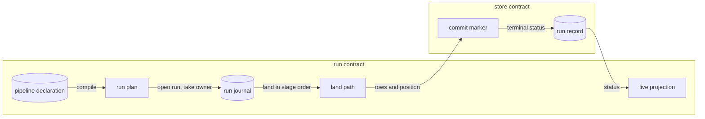
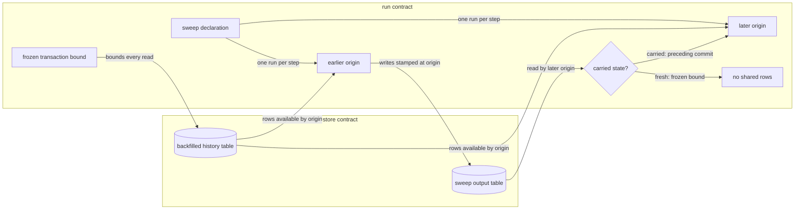

# Runs, pipelines and derive

## The problem a run solves

A pipeline copies records from a source, such as a vendor API, into store tables. When
a process dies halfway through a pull, the restart has to write each row once, keep the
source position in step with those rows, and send no second paid request. A **run** is
one execution of a pipeline over one scope.

## Declaring and compiling a pipeline

The example pipeline, `record-sync`, declares a source, one table named `records` and
`incremental = "updated_time"` ({{run.declare.pipeline-spec}}). That field is the
stream clock: the source reports a cursor that stores the field name beside its value
({{run.declare.incremental-field}}). An edit that restates a default leaves the
content hash unchanged ({{run.declare.content-hash}}).

The compiler turns the declaration into a plan, a flat node list holding no script
({{run.compile.plan-node}}). Branches and fan-out come from declared nodes, not
from data, so a replay walks the same graph ({{run.compile.control-flow}}).

Each deployment supplies a durable orchestrator implementing one execution interface
({{run.orchestrate.role}}).

## A run that dies and resumes

The engine writes the run row before the first pull, so a reader tells a zero-row
success from no run ({{run.record.row-at-open}}). An **execution
owner** binds the pending work to its scope, connector build and plan hash
({{run.own.execution-owner}}), and the owner renews a lease while it runs
({{run.record.owner-lease}}).

The pull admits rows at or after the stored position, so each poll re-reads the boundary
instant ({{run.advance.inclusive-boundary}}). `records` declares a key, which makes those
repeats idempotent; a keyless table accumulates them ({{run.advance.declared-key-required}}).

The **journal** records each pulled page exactly once, although the request behind it
runs at least once ({{run.journal.step-output}}). Each outbound request carries an
idempotency key derived from the journal entry, so a repeated request names itself
({{run.journal.idempotency-key}}). A value over 1 MiB moves to a content-addressed blob
({{run.journal.inline-cutoff}}).

Now the process dies after its first page. Startup marks the row `partial_failure`
because its owner lease has expired ({{run.record.orphan-reap}}). The next fire finds no
commit marker newer than the cached position, so the pending owner stays
({{run.own.marker-reconciles}}).

The plan hash matches, so the run replays. The journal hands the recorded page to the
land path byte for byte ({{run.journal.replay-lands}}), and the replay sends no request
to the vendor ({{run.retry.no-double-spend}}).

The remaining pages pull live. The commit publishes the rows and the new position
together ({{run.advance.commit-with-rows}}), and `success` releases the owner
({{run.own.pin-release}}).

Two changes stop the replay instead. A declaration whose hash changed while the owner
was pending fails the open, naming both identity sets ({{run.own.pinned-plan-changed}}). A
renamed `updated_time` fails the open before any request leaves the host
({{run.advance.field-rename}}).

## Inside one batch

A batch passes a fixed stage order from pull to commit ({{run.land.stage-order}}). The
secret guard runs before the recorded pull, so a replay reintroduces no credential
({{run.guard-secrets.placement}}). The guard masks credential-shaped text and logs a
count per column; it blocks no run ({{run.guard-secrets.mask-only}}).

Normalize keeps the nesting a sink supports, or flattens it into child tables joined by
a foreign key ({{run.normalize.mode}}). The declared transform chain then selects,
renames, casts, extracts and filters columns of the root table ({{run.transform.chain}}).
A commit makes one table's rows visible in one step, and a crash before it leaves a
recoverable partial run ({{run.land.commit-visibility}}).

## Failures, stops and waits

One tagged failure type crosses every port, and a caller branches on the tag, not on a
message ({{run.retry.failure-taxonomy}}). Only `Transient` and `RateLimited` retry, under
the step's schedule ({{run.retry.retryable-classes}}). In the example, a vendor rate limit retries the page,
and an expired credential ends the step.

A stop marks the run, and every await observes it through one cancellation token
({{run.cancel.one-token}}). A stop leaves landing uncut: received bytes finish landing first ({{run.cancel.land-path-uncut}}).

A run waiting on an outside party suspends on an awakeable, a single-use token the party
posts back ({{run.suspend.awakeable}}). The caller supplies the deadline, and the
core reads no wall clock ({{run.suspend.deadline}}).

A store-driven job that declares isolated items gives each item a completion receipt,
so a later fire skips finished items ({{run.items.completion}}).

## Loading history

A backfill splits history into chunks that workers lease. The
chunk commits only while that worker's attempt holds the row, so a stale worker's
files stay uncommitted ({{run.backfill.fenced-commit}}).

A seed bulk-loads consumer-held history through the same stage order as live pulls
({{run.seed.one-land-path}}). A seeded row at or past the declared ceiling fails its
chunk, which writes nothing ({{run.seed.ceiling-breached}}).

A sweep runs one job per origin across a span, every origin under one frozen
transaction-time bound ({{run.sweep.frozen-as-of}}). Under carried state, each
origin also reads the output the preceding origin committed ({{run.sweep.carried-state}}).

## Models

A model builds a table from SQL over store tables ({{run.model.statement-source}}).
`build` reads each input at its committed frontier and fires no pipeline
({{run.model.build-frontier}}). A model whose SQL reaches its own id fails validation
before any read ({{run.model.model-cycle}}).

A build materializes into staging, so a refused build leaves the last published state
serving readers ({{run.publish.staging}}).

## Derive

Derive runs a task, such as passage extraction, over parent rows.
Each tick selects the parent rows that hold no settled output under the current
derivation key ({{run.select.anti-join}}). A binding names a registered engine, and a
command written into the manifest fails ({{run.bind.command-in-manifest}}).

An exec engine runs a pinned binary as an argument array, with no shell and a cleared
environment ({{run.exec.no-shell}}). A fetch engine follows third-party links, and a host
written as an address literal fails ({{run.fetch.address-literal}}).

The caption parser reads SubRip and WebVTT
through one grammar ({{run.parse-cues.grammar}}). Each unit records one status: `ok`, `empty`,
`unavailable` or `failed` ({{run.emit.unit-status}}). The command in {{run.test-engine}}
runs one engine against one file, outside any pipeline.

## Delivering and watching

An export delivers committed rows to a declared target. Its cursor commits after the
target acknowledges a batch, so a run ending between the two resends that batch
({{run.export.at-least-once}}).

A live progress view projects runner events, and no execution step reads that view
({{run.project.best-effort}}).
