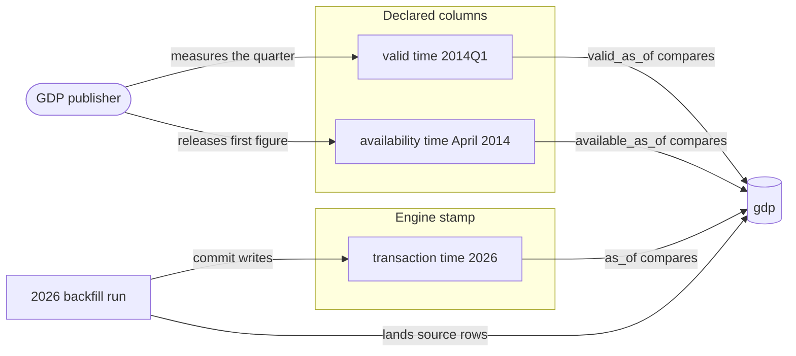
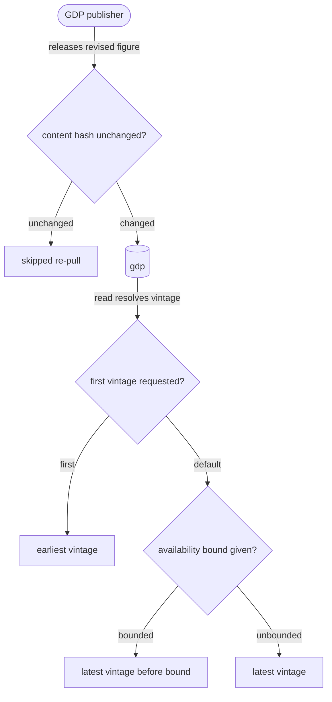

# The store and its sync

## What it is for

The store holds Parquet, manifests and one pointer per table ({{store.lay-out.components}}). A conditional write keeps every committed batch whole.

## How it works

`contextful init` names the project ({{store.init.declaration-file}}), gives its store a synced identity ({{store.init.store-identity}}), and declares its authoring posture ({{store.init.posture}}); commands below it find it ({{store.init.discovery}}).

Files never change once written ({{store.lay-out.immutable-files}}). A write adds a run directory and commits by conditionally creating that run's manifest ({{store.lay-out.run-manifest}}); until the manifest exists, the run's parts join no read ({{store.lay-out.uncommitted-run}}). The pipeline's cursor rides inside the same commit, so rows and position land together ({{store.lay-out.cursor-in-commit}}).

A read resolves an explicit sorted file list from the pointer and the manifests, never a glob ({{store.reconcile.explicit-file-list}}). An unkeyed table reads as the union of its committed runs ({{store.declare.unkeyed-union}}); a keyed table reads through a view that keeps one survivor per key ({{store.declare.dedup-view}}), picked by `order_by` ({{store.declare.order-by-default}}). Schemas grow additively: a new column joins and older files read it as null ({{store.reconcile.additive}}). The type lattice admits one promotion ({{store.reconcile.lattice}}), and any other clash refuses at the write ({{store.reconcile.incompatible}}). A source with mixed scalar kinds uses {{store.reconcile.variant}}.

An empty replacement marks a fileless frontier ({{store.declare.empty-replacement}}).

Runs accumulate until a fold compacts them. A pass writes Parquet and every sidecar into staging ({{store.fold.pass}}), carrying untouched parts by reference ({{store.fold.carry-by-reference}}), then replaces `_pointer.json` conditioned on its starting ETag ({{store.fold.pointer-commit}}). Readers see a snapshot and its sidecars together or neither ({{store.fold.partial-snapshot}}), and a statement in flight keeps the snapshot it started on ({{store.fold.non-blocking}}).

A table's {{store.declare.retain-rows}} declaration gives rows an age limit. Reads enforce the cutoff at the statement ({{store.bound-time.row-age-cutoff}}), and a fold omits expired rows from the next snapshot ({{store.fold.row-retention}}). The pass reports its cutoff, expired rows, dropped partitions and collected directories ({{store.fold.row-retention-report}}).

Catalog lifetimes differ: `derived.sqlite` rebuilds from the tree ({{store.lay-out.derived-catalog}}); `machine.sqlite` keeps machine-local journal, cursors and leases ({{store.lay-out.machine-catalog}}). Both use ports ({{store.lay-out.catalog-ports}}).

A bucket mirrors the tree. A push uploads changed files, commits the bucket manifest by compare-and-set, and re-merges a lost race within a bound ({{store.merge.retries}}). A pull checks every digest ({{store.pull.digest-mismatch}}), refuses a different store identity ({{store.pull.identity-conflict}}), and writes no pointer unless it converges ({{store.pull.unconverged}}). Leases keep writers apart, with a fence storage checks on commit ({{store.lease.stale-fence}}). A replica is read-only ({{store.replicate.write-refused}}) and holds a snapshot whole or not at all ({{store.replicate.partial-parquet}}) ({{store.replicate.descriptor}}). Deletions are signed ({{store.merge.tombstone-signed}}).

A pull carries the signed control head ({{store.pull.control-head}}) without changing the applied pointer.

## Worked example

Take the keyed table `filings`, with `primary_key = ["document_id", "page"]` and `order_by = "revised_at"`.

- Node `ingest-a` resolves its node id once at start ({{store.lay-out.node-id-order}}), takes the pipeline's lease, and renews it ({{store.lease.renewal}}).
- A run lands parts under `data/runs/<run-id>/ingest-a/`, and the engine injects `_ingested_at` and `_run_id` ({{store.reserve.injected}}). One batch sends `page` as a float; it refuses before any Parquet, because a key never widens ({{store.reconcile.key-widening}}).
- The run commits under the lease fence. A paused machine that lost its lease then commits; the higher fence beats it, and its run stays unreadable ({{store.lease.stale-fence}}).
- A query now gets the current snapshot plus the committed runs it omits, deduped per key ({{store.bound-time.unbounded-latest}}).
- A fold trigger fires ({{store.fold.triggers}}). The pass holds the compaction lease and stamps its fence into the manifest and the pointer ({{store.fold.compaction-lease}}); the new snapshot's `includes_runs` names the folded runs ({{store.fold.includes-runs}}). The previous snapshot stays reachable to bounded reads ({{store.fold.supersedes}}) until retention collects it ({{store.fold.retention}}).
- An auditor's read of `filings` as of last week resolves the snapshot then current ({{store.bound-time.as-of}}), so the fold changes no answer. An instant older than retained history refuses and names the oldest answerable instant ({{store.bound-time.as-of-unretained}}).
- The node pushes, and a laptop replica refreshes. A query needing a sidecar the replica lacks refuses and names the refresh that supplies it ({{store.replicate.missing-index}}).

## Clocks

A backfill keeps the source's availability instant ({{run.backfill.available-instant}}); a revision lands as a vintage ({{store.available-time.vintage-rows}}).

## Where to look

- File layout and visibility: `store.lay-out`.
- How keys, ordering and write modes shape a read: `store.declare`.
- How schemas merge: `store.reconcile`.
- When a snapshot publishes: `store.fold`.
- Time-bounded reads and vintages: `store.bound-time`, `store.available-time`.
- Bucket sync and single-writer exclusion: `store.endpoint`, `store.push`, `store.pull`, `store.merge`, `store.lease`.
