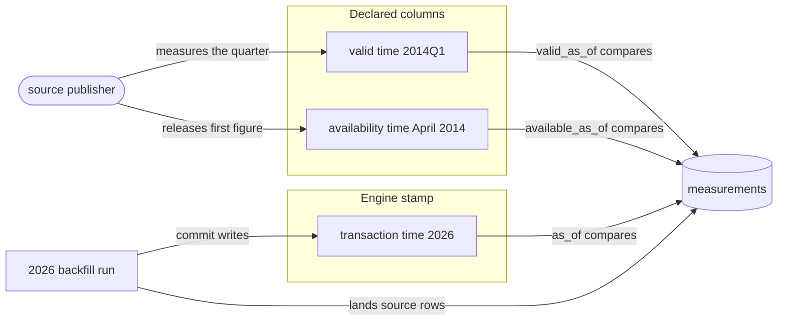
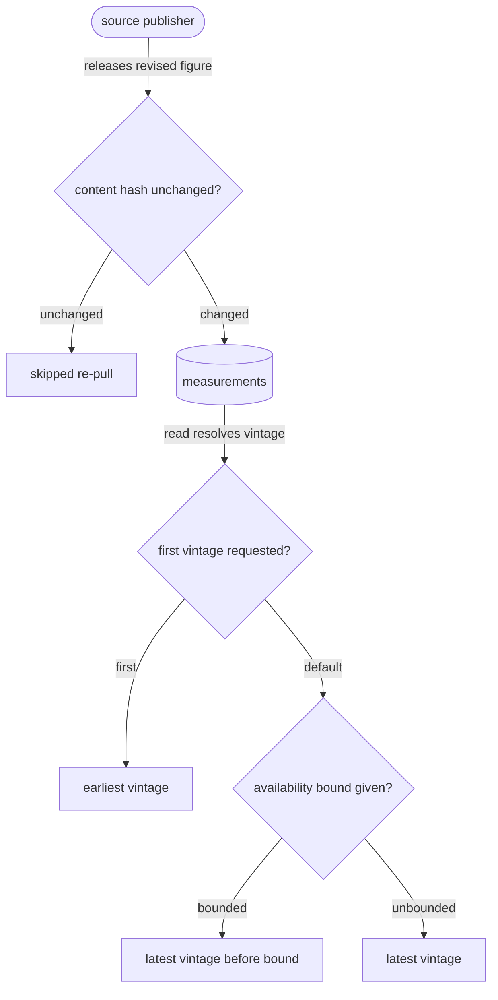

# The store and its sync

## The problem the store solves

Writers append rows while readers query and a background pass compacts. A reader
needs a consistent answer, and a crashed writer must leave nothing half visible. The
store holds Parquet files, JSON manifests and one pointer object per table
({{store.lay-out.components}}). Every commit is a conditional write, so a batch is
either whole or absent ({{topology.coordinate.primitive}}).

## Setting up a project

`contextful init` writes `contextful.toml` and creates the store root beside it
({{store.init.declaration-file}}). The store receives an identity that clones keep,
so two different stores do not merge by accident ({{store.init.store-identity}}).

## One table, from write to read

The example table `documents` declares `primary_key = ["document_id", "page"]` and
`order_by = "revised_at"`. A keyed table reads through a view that keeps one survivor
per key ({{store.declare.dedup-view}}); an unkeyed table reads as the union of its
runs ({{store.declare.unkeyed-union}}).

A run writes parts into its own directory and commits by creating that run's manifest
conditionally ({{store.lay-out.run-manifest}}). Until the manifest exists, no read
lists the run's parts ({{store.lay-out.uncommitted-run}}).

The engine injects provenance columns such as `_ingested_at` and `_run_id`, replacing
any value the producer sent ({{store.reserve.injected}}). It also assigns
`_commit_seq` above every value the table holds, so later commits sort later
({{store.reserve.commit-seq}}).

Schemas grow additively: an unseen column joins, and older files read it as null
({{store.reconcile.additive}}). One batch sends `page` as a float. That batch fails
before any Parquet, because a key column takes no float promotion ({{store.reconcile.key-widening}}).

A **snapshot** is a compacted, immutable set of a table's parts, named by a sortable id
({{store.lay-out.snapshot-id}}). A query with no time bound reads the current snapshot
plus the committed runs it omits
({{store.bound-time.unbounded-latest}}). Every read passes an explicit sorted file
list, not a glob ({{store.reconcile.explicit-file-list}}).

## Leases and a paused writer

A **lease** gives one node exclusive ownership of a pipeline or of compaction, and a
**fence** is the number that rises with each new holder. A paused machine that lost
its lease later tries to commit. The higher fence wins the condition, and the stale
run stays unreadable ({{store.lease.stale-fence}}).

## Compaction

Runs accumulate until a fold compacts them. A pass stages Parquet and every declared
**sidecar**, an index file beside the snapshot, then commits ({{store.fold.pass}}). Each
table declares its sidecars under `indexes` ({{store.index.declaration}}).

The commit replaces the table pointer, which names the current snapshot, on the ETag the
pass read ({{store.lay-out.table-pointer}}). A reader sees a snapshot and its sidecars
together or neither ({{store.fold.partial-snapshot}}).

A statement already running keeps the snapshot it started on, so a fold blocks no
reader ({{store.fold.non-blocking}}).

A sidecar is a vector graph, a full-text index or a key lookup
({{store.index.kinds}}). A sidecar returns candidate ids only, and
retrieval joins them through the access-controlled relation
({{store.index.candidate-ids}}).

## Three clocks

Transaction time records when a commit happened, valid time when a fact held, and
availability time when the source released it. The diagrams follow one quarterly
measurement through all three.

An auditor reads `documents` as of last week and gets the snapshot current then, so a
later fold changes no answer ({{store.bound-time.as-of}}). An instant older than
retained history fails and names the oldest answerable instant
({{store.bound-time.as-of-unretained}}).

A table declaring `available_time` keeps every revision as a vintage beside the earlier
value ({{store.available-time.vintage-rows}}).

A document capture commits as one store snapshot that an evaluation case names by id
({{store.snapshot.capture}}).

When a project binds an encryption key, Parquet files use modular encryption and
sidecars use authenticated per-file keys ({{store.encrypt.cipher}}).

## Sync to a bucket

A bucket mirrors the store tree. The `[sync] endpoint` scheme selects a filesystem, S3
or R2 bucket ({{store.endpoint.schemes}}). Before trusting conditional writes, a probe
writes a sentinel object and tests its conditions ({{store.probe.sentinel}}).

`contextful sync manifest --emit` prints the plan a push commits, without touching the
bucket ({{store.emit.plan}}). A push uploads files the bucket lacks and commits the
bucket manifest under `If-Match` ({{store.push.manifest-commit}}).

When two writers race, the push merges manifests and retries within a bound
({{store.merge.retries}}). Deletions travel as signed tombstones
({{store.merge.tombstone-signed}}).

A pull checks each downloaded object against its manifest digest
({{store.pull.digest-mismatch}}). Before downloading anything, a pull refuses a store
holding a different identity ({{store.pull.identity-conflict}}).

A laptop replica is a read-only copy that records each snapshot it holds
({{store.replicate.descriptor}}). It refreshes from the bucket and refuses writes
({{store.replicate.write-refused}}). A query needing a sidecar the replica lacks fails
and names the refresh that supplies it ({{store.replicate.missing-index}}).

Under a database profile, each run carries an unpushed mark until a push clears it
({{store.drain.mark}}). If the push at shutdown fails, the marks stay and name the runs
still unpushed ({{store.drain.unfinished}}).
