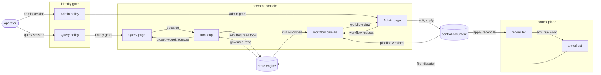

# Operator surfaces

## The problem the surfaces solve

An **operator** configures what runs and asks questions of the results. Two failures
matter most. A configuration edit can race another operator's edit or arm a broken
schedule. A question answered by a model can drift from the stored rows. The control
plane makes edits versioned and validated, and the console makes every answer rest on
rows read under the operator's own credential.

The hosted console has two pages, Admin for configuration and Query for questions.
Each page and its API routes check a verified identity assertion and that page's grant
({{surface.open-console.wrong-page}}).

## From document to running job

The operator edits one configuration document. A credential value typed into a field
fails, because the document holds references and the backend holds material
({{surface.edit.secret-in-document}}).

The example adds a nightly `fold` job for the table `record_sync_records`. Validation
checks that the target names a produced table ({{surface.fire.target-unbound}}), and a
document failing validation claims no version ({{surface.apply.validation}}).

A second operator applied a minute earlier, so this apply's compare-and-swap loses. The
surface reloads the winning version and reapplies the pending edit onto it
({{surface.apply.version-race}}). Admin edits and applies also need the server's admin
capability ({{surface.open-console.admin-grant}}).

The reconciler polls the snapshot pointer and diffs the schedule set
({{surface.reconcile.poll-cadence}}). If a poll fails, the armed set keeps running
unchanged ({{surface.reconcile.fail-static}}).

An unreadable schedule string holds back its own entry alone, and every other entry arms
({{surface.arm.unreadable-schedule}}). A job kind outside the closed union fails
validation ({{surface.fire.job-kind-unknown}}).

At the job's instant, dispatch starts one instance in a bounded pool. A worker running
the fold goes silent, and its work moves to another worker under the next attempt
number ({{surface.dispatch.heartbeat-lapse}}). The silent worker's late callback carries
the old attempt and changes nothing ({{surface.dispatch.callback-rejected}}).

A store-driven item can run on a **delegate**, code deployed outside the binary and
reached over one signed HTTP request ({{surface.delegate.binding}}). Its answer is a
closed outcome: rows, a deferral, or a transient or permanent failure
({{surface.delegate.outcome}}).

A data plane serving from a region its policy omits refuses to start
({{surface.reside.region-mismatch}}). A tenant's source connection is created, paused
and deleted through versioned claims ({{surface.connection.create}}).

Admin projects pipelines, jobs and models as one node and edge graph, with each latest
run outcome ({{surface.visualize.workflow-canvas}}).

## One question in Query

The operator opens Query on the `field-notes` store. Its registry entry carries no
credential name of its own ({{surface.register-store.authored-name}}). The server mints
a per-reader credential; a refused mint falls back to a shared credential or surfaces
the refusal ({{surface.ground.mint-refused}}).

Before any question, Query offers chips built from the tables the reader may describe
({{surface.browse.discovered-chips}}). The operator asks which records landed this
week. The vantage, the session's time basis, parses as a calendar day
({{surface.set-vantage.unparseable}}).

A turn plans over admitted read tools, replans once if the first round leaves the
question open, and synthesizes from the governed rows ({{surface.plan-turn.turn-flow}}).
The server chooses every tool, so a call naming an unadmitted tool dispatches nothing
({{surface.ground.unadmitted-tool}}).

Prose exists only over a tool result ({{surface.ground.ungrounded-answer}}). The
server redacts each streamed chunk before Query shows it ({{surface.speak.stream-redaction}}).

The rows carry a date column and a measure over distinct days, so component choice draws
a line chart ({{surface.render.component-choice}}). A view arriving from the client
fails, because the server builds every view ({{surface.render.client-authored-view}}).

After the answer, a second pass distils the exchange into learnings for later turns
({{surface.learn.distillation}}). A greeting card appears only when a new row matches
an earlier conclusion within budget ({{surface.brief.absence-is-earned}}).

Posting an answer to a team channel under a service identity, on a schedule, fails
({{surface.publish-answer.askerless-audience}}).

## The client library

The client library reaches the engine through four deployment shapes. Its process
transport needs a verified capability token before any protocol framing
({{surface.package.stdio-credential}}).
