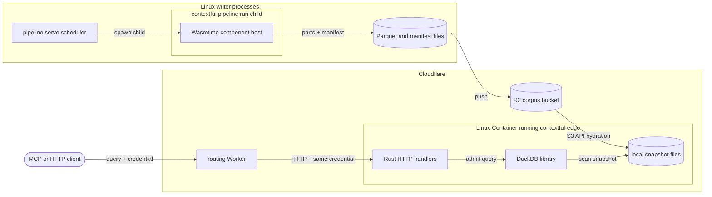

# System topology

## What it is for

Operators use this guide to choose a Contextful binary and deployment. Contextful runs connectors, stores their output as Parquet files and serves queries under access controls. Applications supply business rules and domain vocabulary ({{topology.bound-application.domain-neutral}}).

## How it works

One Cargo workspace builds execution, storage and query code ({{topology.compose.workspace}}). Execution manages connector steps, scheduling, journal entries and cursors ({{topology.compose.run-path}}). Storage and queries manage files, the catalog, retrieval and bucket sync ({{topology.compose.read-path}}).

These components share three contracts: the connector interface, the part-and-manifest layout and capability tokens ({{topology.compose.three-crossings}}). Versions and conformance tests keep these contracts compatible ({{topology.compose.crossing-version}}). Dependency checks enforce the allowed connections ({{topology.compose.undeclared-crossing}}). A query-only binary reads a full-profile writer's output ({{topology.compose.run-path-droppable}}).

The type system requires access-control checks before functions return stored rows ({{topology.compose.mediation}}). Model requests use one configured OpenAI-compatible endpoint ({{topology.compose.inference-egress}}). Network access follows the deployment's sources and optional bucket sync ({{topology.compose.local-first}}).

Choose a build profile for the process's job ({{topology.package.profile}}):

| Profile | Process responsibility |
| --- | --- |
| `contextful-full` | Run connectors, schedule work and serve queries ({{topology.package.full-profile}}). |
| `contextful-edge` | Sync stored files and serve read-only queries ({{topology.package.edge-profile}}). |
| `contextful-control` | Edit team configuration and apply canonical TOML ({{topology.package.control-profile}}). |

Profiles select capabilities at compilation ({{topology.package.fixed-at-build}}). An unavailable capability returns a named error ({{topology.package.capability-absent}}). `contextful --version` identifies the selected profile ({{topology.package.version-profile}}).

The [deployment maps](../targets.md) identify Linux processes, macOS native execution, Docker's Linux VM and provider services. Cloudflare uses a Linux Container, D1 execution metadata and R2 files ({{topology.coordinate.backends}}). Deployment checks compare output against the reference deployment ({{topology.deploy.parity}}) and probe each hostname's access policy ({{topology.publish-hostname.posture-mismatch}}).

Writers coordinate through conditional updates ({{topology.coordinate.primitive}}). The `Catalog` trait connects the engine to the deployment's database ({{topology.coordinate.catalog-port}}). Lease fences distinguish successive writers ({{topology.coordinate.fence-advances}}).

## Worked example

A Linux writer syncs corpus files to R2. A Cloudflare Linux Container reads a synchronized copy behind a routing Worker.

The writer's Wasmtime host produces files; the replica's DuckDB library reads their synchronized copy.

1. The scheduler acquires and renews the deployment's cadence lease ({{topology.coordinate.cadence-lease-renewal}}).
2. A run child invokes the connector through embedded Wasmtime ({{topology.package.component-host}}).
3. The writer stores parts and a manifest, then advances the cursor conditionally ({{topology.coordinate.cursor-cas}}).
4. Bucket sync copies the corpus to R2. The replica pulls the files and serves read-only SQL ({{topology.package.edge-profile}}).
5. The deployment probe checks anonymous access against the hostname's declared policy ({{topology.publish-hostname.posture-mismatch}}).
6. The routing Worker forwards a caller's request and credentials to the query container ({{topology.publish-hostname.container-readiness}}).

## Where to look

- Component responsibilities and shared contracts: `topology.compose`.
- What a binary links, and what it refuses: `topology.package`.
- Provider services and startup instructions: `topology.deploy`.
- What a hostname exposes: `topology.publish-hostname`.
- Who may write concurrently: `topology.coordinate`.
- Where the engine ends and an application begins: `topology.bound-application`.
