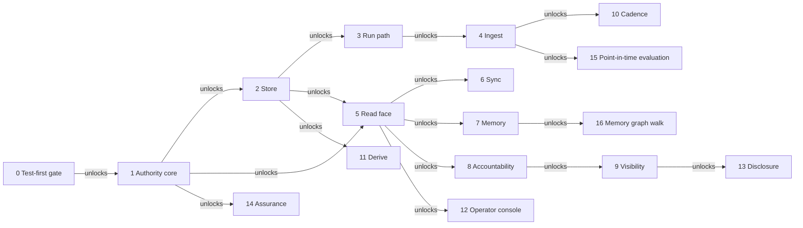

# Milestones

The order in which the corpus is built. A milestone names the operations it closes;
`contextful-spec state` expands each to its clause set and reports the reach in
[`status.md`](./status.md). An operation belongs to at most one milestone.

Each milestone's `Reach:` line is its acceptance criterion, and its `Acceptance:` line
names the test in `crates/acceptance/` that drives that reach through a built binary.
The acceptance test lands before the first clause of its milestone is pinned, ignored
while the milestone is open; the milestone closes when the ignore comes off, the
test passes, and every operation it names holds a performed clause.

A `Depth: operation` line specifies a milestone at operation level: its operations carry
refusal and limit clauses, unsettled lines and diagrams, and no behavior clause. Removing
the line when the milestone opens admits behavior clauses again.

## 0 — The test-first gate

| Operations | Intent |
| --- | --- |
| `assurance.automate`, `assurance.test` | Typed gate subcommands, the red-before-green check over every source change, and the acceptance package. |

Reach: A change altering source with no test failing against its base reds the gate before merge.

Acceptance: `contextful_acceptance::m00::m00_test_first_gate`

## 1 — The authority core

| Operations | Intent |
| --- | --- |
| `authority.identify`, `authority.profile`, `authority.grant`, `authority.attenuate`, `authority.issue`, `authority.verify`, `authority.revoke`, `authority.exchange` | The subject, delegation, admission, custody and revocation, with the proof package and differential harness beside them. |
| `assurance.model`, `assurance.prove`, `assurance.audit-assumptions`, `assurance.recheck`, `assurance.scope-claim`, `assurance.differential-test` | — |

Reach: An authority is admitted once, travels as a value, and is re-read at the effect about to act.

Acceptance: `contextful_acceptance::m01::m01_authority_core`

## 2 — The store

| Operations | Intent |
| --- | --- |
| `store.lay-out`, `store.init`, `store.declare`, `store.reserve`, `store.reconcile`, `store.fold`, `store.index`, `store.bound-time`, `store.encrypt` | Layout, declaration, reserved columns, reconciliation, commit and compaction, indexes, the two clocks, at-rest encryption. |

Reach: A table lands, a scan resolves its file list, and a reader opens the Parquet without the engine.

Acceptance: `contextful_acceptance::m02::m02_store`

## 3 — The run path

| Operations | Intent |
| --- | --- |
| `run.journal`, `run.items`, `run.advance`, `run.suspend`, `run.retry`, `run.own`, `run.cancel`, `run.record`, `run.project` | Journal, isolated items, cursor, suspension, retry, cancellation and the run record; shared contracts, packaging and coordination. |
| `topology.compose`, `topology.package`, `topology.coordinate` | — |

Reach: A run crashes mid-step and resumes from its journal without re-issuing a recorded effect.

Acceptance: `contextful_acceptance::m03::m03_run_path`

## 4 — Ingest

| Operations | Intent |
| --- | --- |
| `run.declare`, `run.compile`, `run.transform`, `run.normalize`, `run.guard-secrets`, `run.land`, `run.export`, `run.backfill`, `run.seed`, `run.model`, `run.publish` | The pipeline declaration and landing sequence, the connector world, and outbound credentials. |
| `connector.*` | — |

Reach: A declared pipeline pulls from a real source, lands rows under a cursor and never holds a credential in plaintext, and a model over those rows publishes a build a hold keeps.

Acceptance: `contextful_acceptance::m04::m04_ingest`

## 5 — The read face under enforcement

| Operations | Intent |
| --- | --- |
| `read.register`, `read.guard`, `read.respond`, `read.query`, `read.retrieve`, `read.rank`, `read.cache`, `read.resolve-pin`, `read.embed` | Registration, the statement guard, retrieval and ranking, the tool surface; the enforcement layers as one reference monitor. |
| `authority.redact`, `authority.compose`, `authority.filter-rows`, `authority.mask`, `authority.refuse`, `authority.bound-redistribution`, `authority.place`, `authority.resist` | — |

Reach: An agent asks over MCP and receives ranked rows the caller's authority admits.

Acceptance: `contextful_acceptance::m05::m05_read_face`

## 6 — Sync and replicas

| Operations | Intent |
| --- | --- |
| `store.endpoint`, `store.emit`, `store.push`, `store.pull`, `store.probe`, `store.merge`, `store.lease`, `store.replicate`, `store.drain` | Bucket endpoints and credentials, push planning, the wire format, push and pull, the conditional-write probe, merge, fenced leases, the replica and unpushed runs. |

Reach: Two nodes share one bucket and converge without a coordinator.

Acceptance: `contextful_acceptance::m06::m06_sync`

## 7 — Memory

| Operations | Intent |
| --- | --- |
| `read.declare`, `read.synthesize`, `read.revise`, `read.recall`, `read.resolve-entity`, `read.settle` | Memory tables, synthesis, revision on one valid-time line, recall, entity resolution and settled outcomes. |

Reach: A synthesized belief supersedes its predecessor on new evidence, and a reader sees which grant produced it.

Acceptance: `contextful_acceptance::m07::m07_memory`

## 8 — Accountability

| Operations | Intent |
| --- | --- |
| `disclosure.record`, `disclosure.explain`, `disclosure.attest`, `disclosure.erase`, `disclosure.receipt` | The audit chain, explanation, attestation, erasure and the receipt. |

Reach: An operator answers what a named person could have seen over a past window, from the store, in SQL.

Acceptance: `contextful_acceptance::m08::m08_accountability`

## 9 — Visibility

| Operations | Intent |
| --- | --- |
| `disclosure.mirror`, `disclosure.sweep`, `disclosure.reach`, `disclosure.bound-staleness`, `disclosure.declare-fidelity`, `disclosure.pack` | Source permissions mirrored as data, the sweep, reachability, the staleness budget and fidelity. |

Reach: A revoked grant at the source stops answering within a declared bound.

Acceptance: `contextful_acceptance::m09::m09_visibility`

## 10 — Cadence and the operator plane

| Operations | Intent |
| --- | --- |
| `surface.arm`, `surface.reconcile`, `surface.fire`, `surface.dispatch`, `surface.edit`, `surface.apply`, `surface.reside`, `surface.register-store` | Schedules, reconciliation, bounded dispatch, configuration apply, deploy targets and published hostnames. |
| `topology.deploy`, `topology.publish-hostname`, `topology.bound-application` | — |

Reach: Due work dispatches into a bounded pool, and a published hostname is probed for the posture it declares.

Acceptance: `contextful_acceptance::m10::m10_cadence`

## 11 — The derive tier

| Operations | Intent |
| --- | --- |
| `run.select`, `run.bind`, `run.exec`, `run.fetch`, `run.emit`, `run.parse-cues`, `run.test-engine` | Deferred per-row work over landed rows. |

Reach: A pipeline reads the words inside a landed document and fills them into the parent row.

Acceptance: `contextful_acceptance::m11::m11_derive`

## 12 — The operator console

| Operations | Intent |
| --- | --- |
| `surface.open-console`, `surface.visualize`, `surface.package`, `surface.speak`, `surface.ground`, `surface.plan-turn`, `surface.set-vantage`, `surface.browse`, `surface.learn`, `surface.render`, `surface.brief`, `surface.publish-answer` | Independently gated Query and Admin pages, governed answers, and visualized operator workflows. |

Reach: An operator asks on Query and receives a sourced answer; Admin visualizes the store's workflows and admits only operators with its page grant.

Acceptance: `contextful_acceptance::m12::m12_console`

## 13 — Disclosure

| Operations | Intent |
| --- | --- |
| `disclosure.set-mode`, `disclosure.release`, `disclosure.suppress`, `disclosure.template`, `disclosure.bound-cohort` | Aggregate release under a disclosure budget. |

Reach: Two parties compare against a benchmark neither can invert.

Acceptance: `contextful_acceptance::m13::m13_disclosure`

## 14 — Assurance

| Operations | Intent |
| --- | --- |
| `assurance.structure-tree`, `assurance.build`, `assurance.gate`, `assurance.evaluate`, `assurance.baseline`, `assurance.measure`, `assurance.release` | The build gate, the build targets, the retrieval-quality harness, the target ledger and release tags. |

Reach: The gate holds its resource budget, and the evaluation floors and every gate-tier target are measured on every change.

Acceptance: `contextful_acceptance::m14::m14_assurance`

## 15 — Point-in-time evaluation

| Operations | Intent |
| --- | --- |
| `store.available-time` | The declared availability instant, its resolution at landing, vintages, and the `available_as_of` bound. |
| `read.as-of-join` | The point-in-time join matching each driving row to the right row available at its instant. |
| `run.sweep` | Walk-forward origins under one frozen `as_of`, carried or fresh state, and writes stamped available at their origin. |
| `read.horizon` | The credential horizon every read inherits, the arguments it refuses, the stamps and statistics it withholds, and the builds and indexes it resolves. |
| `store.snapshot` | The captured document corpus a case pins, and the standing of a capture after the horizon. |
| `assurance.backtest` | Bounded cases routed to dated checkpoints, leakage stated against a reference, purged and embargoed splits, a trial ledger, planted leaks and a replayable trajectory. |
| `assurance.forecast` | Forecast cases frozen before resolution, settled through the label join, scored on tracks that never pool. |

Reach: A source observation landed with its valid instant and later publication instant answers no `available_as_of` read between the two, and answers one after publication.

Acceptance: `contextful_acceptance::m15::m15_point_in_time`

## 16 — Memory graph walk

| Operations | Intent |
| --- | --- |
| `read.traverse` | A bounded walk over admitted memory edges from a seed entity, under the caller's enforced session, the declared walkable relations and fixed hop, fan-out and frontier bounds. |

Reach: An agent walks admitted edges from an entity and sees only what its credential can read.

Acceptance: `contextful_acceptance::m16::m16_traverse`

## 17 — Delegated bodies

| Operations | Intent |
| --- | --- |
| `surface.delegate` | A store-driven item's body on deploy-bound code outside the binary: the binding, the envelope, signed answers, call and submit modes, and the outcome vocabulary. |

Reach: A store-driven item runs its paid call on a loopback delegate, its answer lands as the item's rows, and a resume after a restart sends no second request.

Acceptance: `contextful_acceptance::m17::m17_delegated`

## 18 — Provider orchestrators

| Operations | Intent |
| --- | --- |
| `run.orchestrate` | The orchestrator role as a port: a provider's workflow engine drives the engine one provider step per table pull or chunk, keeps every journal, retry, suspend and cancel clause inside the step, and runs no retry of its own. |

Reach: A backfill chunk's provider step crashed after half its pages resumes under an in-tree test filler and lands parts byte-identical to the engine runner's.

Acceptance: `contextful_acceptance::m18::m18_orchestrate`

## 19 — Drive connections

| Operations | Intent |
| --- | --- |
| `surface.connection`, `connector.drive-picks` | Tenant-bound connection creation, pause, deletion and shared scheduling over Picker-selected files. |

Reach: A Picker-selected file creates one tenant-bound Drive pipeline, lands scoped rows, pauses without another fire, and deletes with its credential revoked.

Acceptance: `contextful_acceptance::m19::m19_drive_connections`

## 20 — Drive permission custody

| Operations | Intent |
| --- | --- |
| `disclosure.drive-sweep`, `connector.principal-secrets` | Source permission reads, verified identity links and per-principal credential custody. |

Reach: A Drive permission withdrawal stops an enterprise reader within the declared visibility bound, while two connection refreshes resolve one versioned credential.

Acceptance: `contextful_acceptance::m20::m20_drive_permissions`

## 21 — Sheet rows

| Operations | Intent |
| --- | --- |
| `connector.drive-sheet` | Workbook export and keyed rows for each sheet. |

Reach: A selected workbook lands rows from two sheets with distinct keys, and removing a row lands its tombstone.

Acceptance: `contextful_acceptance::m21::m21_sheet_rows`

## 22 — Drive change cursor

| Operations | Intent |
| --- | --- |
| `connector.drive-changes` | Full-walk handoff, paged changes and safe cursor recovery. |

Reach: A change during the initial walk lands once through the change cursor, and an invalid cursor triggers a complete selected reconciliation.

Acceptance: `contextful_acceptance::m22::m22_drive_changes`

## 23 — Workspace delegation

| Operations | Intent |
| --- | --- |
| `connector.drive-domain-auth` | Domain approval, impersonated user scope and organization-export boundary. |

Reach: A delegated Workspace connection reads only as its admitted domain user and refuses a subject outside the approved domain before token minting.

Acceptance: `contextful_acceptance::m23::m23_workspace_delegation`
