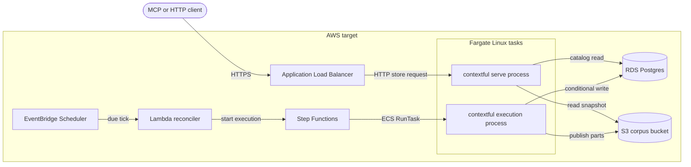
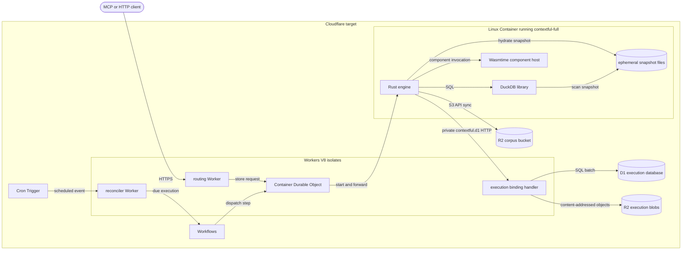
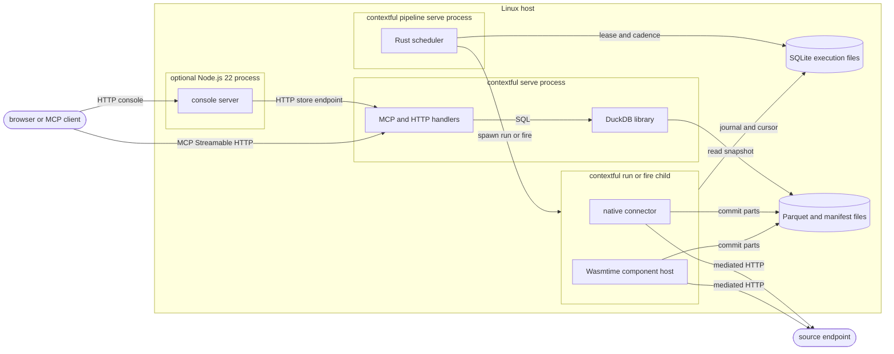

# Deployment targets

Generated by `contextful-spec state` from `spec/targets/*.toml`; not authored.
`corpus.targets` in [`00-corpus.md`](./00-corpus.md) states the rules every target file obeys; `topology.deploy` in [`01-topology.md`](./01-topology.md) the roles they fill.

## AWS

VPC-bound and regulated deployments, and teams already operating on AWS.

The `lambda-fargate` target runs reconciliation in Lambda, dispatches ECS tasks through Step Functions, and hosts the native Linux `contextful-full` executable in Fargate containers. The query process embeds DuckDB; component execution embeds Wasmtime. RDS Postgres supplies the shared catalog and S3 holds corpus objects. The `fargate-daemon` alternative keeps scheduling and reconciliation in the native daemon.

| Role | `lambda-fargate` (default) | `lambda-only` | `fargate-daemon` |
| --- | --- | --- | --- |
| cron tick | EventBridge Scheduler | EventBridge Scheduler | in-process scheduler |
| reconciler | Lambda | Lambda | in-process reconcile loop |
| durable orchestrator | Step Functions: Standard for backfills, Express for short high-frequency pipelines | Step Functions Express | engine journal in the catalog |
| single-writer catalog | RDS Postgres via pg-catalog | RDS Postgres via pg-catalog | RDS Postgres via pg-catalog |
| object store | S3 | S3 | S3 |
| hot-path query face | ALB → warm contextful-full on Fargate | Lambda function URL serving the read-only replica | ALB → contextful serve on Fargate |
| heavy compute | Fargate task started by Step Functions (ECS RunTask, .sync) | Lambda | in-process component host |
| secrets | Secrets Manager through the task role | Secrets Manager through the function role | Secrets Manager through the task role |
| realtime run projection | Fargate-hosted run projection | — | — |
| queue | SQS standard queue; S3 event notifications to SQS for object arrival | — | SQS standard queue; S3 event notifications to SQS for object arrival |
| kind · profiles | orchestrated · full | function · edge | daemon · full |
| wall-clock cap · excluded | none · nothing | 15 min · first-time-backfill, component-connector | none · nothing |

The `lambda-fargate` runtime and process boundaries:

## Cloudflare

Edge-first deployments on native object storage with near-zero idle cost.

The default `worker-container-d1` target places TypeScript routing and reconciliation in Workers' V8 isolates, with Cron Triggers and Workflows as the scheduling and orchestration services. A Durable Object controls a Linux Container's lifecycle. Inside that Container, the native `contextful-full` executable runs the Rust engine, embedded DuckDB and embedded Wasmtime; Workers and Workflows reach it across a request boundary.

The Rust processes use `CONTEXTFUL_STORAGE_PROFILE=cloudflare-d1`. Requests to the private `contextful.d1` outbound host reach a Worker binding handler, which accesses D1 for execution metadata and an R2 bucket for execution blobs. Corpus parts and manifests occupy a separate R2 bucket through its S3-compatible API; Container files form a replaceable local working copy. The `worker-container` alternative assigns the catalog role to Durable Object SQLite instead of D1.

Cloudflare Queues carries receive batches and object-arrival notifications; the Rust engine remains the store writer. A separate Durable Object owns the hibernating WebSocket projection. Workers Secrets supply credentials to the configured bindings. The optional Node.js console server requires its own Node-capable host; its React assets alone form a static browser preview.

The execution binding example under `apps/cloudflare-execution/` exposes authenticated `POST /conformance`: its Container runs `contextful-conformance`, which drives the packaged Linux `contextful` binary. That example's endpoint is a conformance harness, distinct from the target's query and orchestration routes. Clause implementation evidence lives in `status.md`.

| Role | `worker-container` | `worker-container-d1` (default) |
| --- | --- | --- |
| cron tick | Cron Trigger | Cron Trigger |
| reconciler | Worker | Worker |
| durable orchestrator | Workflows | Workflows |
| single-writer catalog | Durable Object SQLite, one object per store | D1 through a private Worker outbound binding |
| object store | R2 | R2 |
| hot-path query face | Worker router → warm contextful-full Container | Worker router → warm contextful-full Container |
| heavy compute | Container | Container with cloudflare-d1 storage profile |
| secrets | Workers Secrets | Workers Secrets |
| realtime run projection | Durable Object with a hibernating WebSocket | Durable Object with a hibernating WebSocket |
| queue | Cloudflare Queues with a pull consumer; R2 event notifications for object arrival | Cloudflare Queues with a pull consumer; R2 event notifications for object arrival |
| kind · profiles | orchestrated · full | orchestrated · full |
| wall-clock cap · excluded | none · nothing | none · nothing |

The `worker-container-d1` runtime and process boundaries:

## Linux (reference)

Self-hosted Linux servers, development, and air-gapped single-node deployments.

The `contextful-full` Linux executable runs natively on x86-64 or ARM64, using the corresponding `x86_64-unknown-linux-musl` or `aarch64-unknown-linux-musl` release artifact. A long-lived `contextful pipeline serve` process owns the scheduler and launches the same executable as `contextful pipeline run` or `contextful job fire` children. A separate `contextful serve` process answers MCP and HTTP requests. A service manager such as systemd supervises these processes with the same project working directory and configured environment.

Wasmtime executes WebAssembly component connectors inside a run child; its Tokio runtime is embedded there. DuckDB executes SQL inside the process serving reads. SQLite is an embedded library for execution state, with files such as `machine.sqlite`; Parquet parts, manifests and control snapshots live under the project's configured filesystem root. These libraries have no separate service process.

The optional operator console is a separate Node.js 22 process, `node apps/console/dist/server.js --http <host:port>`, and reaches the Rust HTTP server through its configured store endpoint. The browser executes the React client. The local target uses the filesystem receive spool; bucket sync adds an explicitly configured S3-compatible endpoint.

The repository's Dockerfile packages the Linux executable in a shell-free, non-root image with `/data` as its project volume. Separate scheduler and HTTP containers share that persistent volume. On macOS, a Darwin executable runs the same process layout directly; Docker runs the Linux image inside a Linux VM. The topology's macOS sections give both execution paths.

| Role | `process` (default) |
| --- | --- |
| cron tick | in-process scheduler |
| reconciler | in-process reconcile loop |
| durable orchestrator | engine journal in the catalog |
| single-writer catalog | local catalog file with embedded SQLite execution stores |
| object store | local filesystem under ./.contextful/, optional S3-compatible sync |
| hot-path query face | native contextful serve process with embedded DuckDB |
| heavy compute | native contextful pipeline run or job fire child; embedded Wasmtime for components |
| secrets | environment and configured secret providers |
| realtime run projection | in-process WebSocket |
| queue | — |
| kind · profiles | daemon · full |
| wall-clock cap · excluded | none · nothing |

The `process` runtime and process boundaries:

