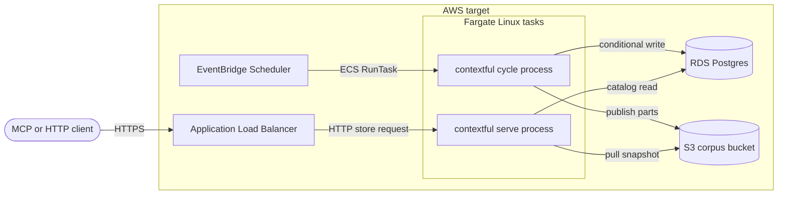

# Deployment targets

Generated by `contextful-spec state` from `spec/targets/*.toml`; not authored.
`corpus.targets` in [`00-corpus.md`](./00-corpus.md) states the rules every target file obeys; `topology.deploy` in [`01-topology.md`](./01-topology.md) the roles they fill.

## AWS

VPC-bound and regulated deployments, and teams already operating on AWS.

The `scheduled-fargate` target runs every process as the native Linux `contextful-full` executable in Fargate containers. EventBridge Scheduler starts `contextful pipeline serve --cycle` as an ECS task on a fixed rate; the cycle takes the cadence lease, runs every due unit and exits. A long-running `contextful serve` behind an Application Load Balancer answers queries and pulls the bucket every 30 s. The query process embeds DuckDB; component execution embeds Wasmtime. RDS Postgres supplies the shared catalog, the engine journal in it makes every run durable and resumable, and S3 holds corpus objects. The `fargate-daemon` alternative keeps scheduling in one always-on task for sub-minute cadences.

The OpenTofu configuration under `apps/aws-fargate/` provisions either shape: a private VPC with its service endpoints, RDS Postgres, the S3 corpus bucket, the SQS queue with its dead-letter queue and object-arrival notification, the ECS cluster, the cycle task or daemon service, and the `serve` service behind the load balancer.

| Role | `scheduled-fargate` (default) | `fargate-daemon` |
| --- | --- | --- |
| cron tick | EventBridge Scheduler | in-process scheduler |
| reconciler | `pipeline serve --cycle` in the scheduled Fargate task | in-process reconcile loop |
| durable orchestrator | engine journal in the catalog | engine journal in the catalog |
| single-writer catalog | RDS Postgres via pg-catalog | RDS Postgres via pg-catalog |
| object store | S3 | S3 |
| hot-path query face | ALB → contextful serve on Fargate | ALB → contextful serve on Fargate |
| heavy compute | in-process component host of the scheduled task | in-process component host |
| secrets | Secrets Manager adapter through the task role | Secrets Manager adapter through the task role |
| realtime run projection | Fargate-hosted run projection | — |
| queue | SQS standard queue; S3 event notifications to SQS for object arrival | SQS standard queue; S3 event notifications to SQS for object arrival |
| kind · profiles | orchestrated · full | daemon · full |
| wall-clock cap · excluded | none · nothing | none · nothing |

The `scheduled-fargate` runtime and process boundaries:

## Cloudflare

Cloudflare deployments with a Linux Container, D1 execution metadata and R2 objects.

Cloudflare's default deployment configuration is `worker-container-d1`. TypeScript routing and reconciliation run in Workers' V8 isolates. Cron Triggers schedule work; Workflows coordinates execution. A Durable Object controls the Linux Container's lifecycle. The Container runs the native `contextful-full` executable with embedded DuckDB and Wasmtime. Workers and Workflows call the Container through requests.

The Rust processes use `CONTEXTFUL_STORAGE_PROFILE=cloudflare-d1`. Requests to the private `contextful.d1` host call a Worker binding handler. The handler reads and writes execution metadata in D1 and execution blobs in R2. A separate R2 bucket stores corpus parts and manifests through its S3-compatible API. Files inside the Container are a replaceable working copy.

Cloudflare Queues carries receive batches and object-arrival notifications. The Rust engine writes the store. A separate Durable Object manages hibernating WebSocket connections for run updates. Workers Secrets supplies credentials to configured bindings. The optional console server runs on a Node.js host. The React assets provide a static browser preview without that server.

The `worker-container-d1-basin` configuration adds an optional read face for exported audiences. The Container commits each audience's Iceberg export to Basin Catalog, the Iceberg REST catalog of an R2 bucket that holds that audience alone. The routing Worker sends a caller whose credential maps to an export namespace to Basin SQL over REST with that audience's read-only token, one Worker secret per audience bucket, and sends every other caller to the Container. Each export table runs with Basin compaction disabled; Basin snapshot expiration removes superseded exports.

The example under `apps/cloudflare-execution/` exposes authenticated `POST /conformance`. Its Container runs `contextful-conformance` against the packaged Linux `contextful` binary. This endpoint tests execution storage; it serves no query or orchestration routes. `status.md` records clause implementation evidence.

| Role | `worker-container-d1` (default) | `worker-container-d1-basin` |
| --- | --- | --- |
| cron tick | Cron Trigger | Cron Trigger |
| reconciler | Worker | Worker |
| durable orchestrator | Workflows | Workflows |
| single-writer catalog | D1 through a private Worker outbound binding | D1 through a private Worker outbound binding |
| object store | R2 | R2, with one Basin Catalog bucket per exported audience |
| hot-path query face | Worker router → warm contextful-full Container | Worker router → warm contextful-full Container, or Basin SQL for an exported audience |
| heavy compute | Container with cloudflare-d1 storage profile | Container with cloudflare-d1 storage profile, which also runs Iceberg exports |
| secrets | Workers Secrets | Workers Secrets |
| realtime run projection | Durable Object with a hibernating WebSocket | Durable Object with a hibernating WebSocket |
| queue | Cloudflare Queues with a pull consumer; R2 event notifications for object arrival | Cloudflare Queues with a pull consumer; R2 event notifications for object arrival |
| kind · profiles | orchestrated · full | orchestrated · full |
| wall-clock cap · excluded | none · nothing | none · nothing |

The `worker-container-d1` runtime and process boundaries:

## Linux (reference)

Self-hosted Linux servers, development, and air-gapped single-node deployments.

The `contextful-full` Linux executable runs natively on x86-64 or ARM64, using the corresponding `x86_64-unknown-linux-musl` or `aarch64-unknown-linux-musl` release artifact. A long-lived `contextful pipeline serve` process owns the scheduler and launches the same executable as `contextful pipeline run` or `contextful job fire` children. A separate `contextful serve` process answers MCP and HTTP requests. A service manager such as systemd supervises these processes with the same project working directory and configured environment.

Wasmtime executes WebAssembly component connectors inside a run child; its Tokio runtime is embedded there. DuckDB executes SQL inside the process serving reads. SQLite is an embedded library for execution state, with files such as `machine.sqlite`; Parquet parts, manifests and control snapshots live under the project's configured filesystem root. These libraries have no separate service process.

The optional operator console is a separate Node.js 22 process, `node apps/console/dist/server.js --http <host:port>`, and reaches the Rust HTTP server through its configured store endpoint. The browser executes the React client. The local target uses the filesystem receive spool; bucket sync adds an explicitly configured S3-compatible endpoint.

The repository's Dockerfile packages the Linux executable in a shell-free, non-root image with `/data` as its project volume. Separate scheduler and HTTP containers share that persistent volume. On macOS, a Darwin executable runs the same process layout directly; Docker runs the Linux image inside a Linux VM. The topology's macOS sections give both execution paths.

| Role | `process` (default) |
| --- | --- |
| cron tick | in-process scheduler |
| reconciler | in-process reconcile loop |
| durable orchestrator | engine journal in the catalog |
| single-writer catalog | local catalog file with embedded SQLite execution stores |
| object store | local filesystem under ./.contextful/, optional S3-compatible sync |
| hot-path query face | native contextful serve process with embedded DuckDB |
| heavy compute | native contextful pipeline run or job fire child; embedded Wasmtime for components |
| secrets | environment and configured secret providers |
| realtime run projection | in-process WebSocket |
| queue | — |
| kind · profiles | daemon · full |
| wall-clock cap · excluded | none · nothing |

The `process` runtime and process boundaries:

